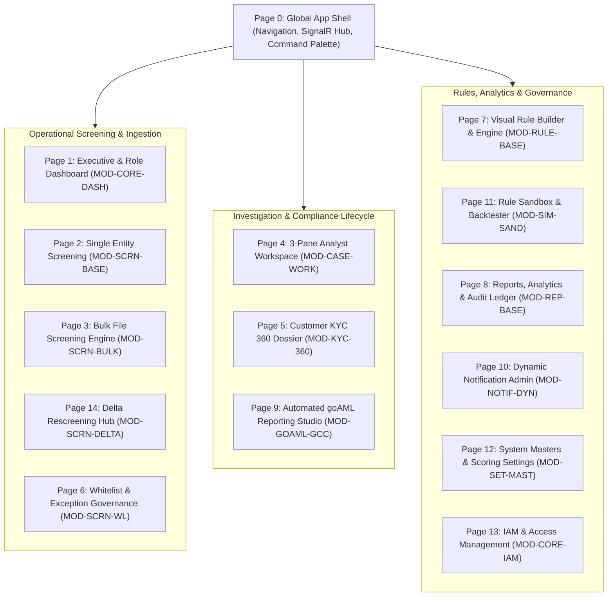
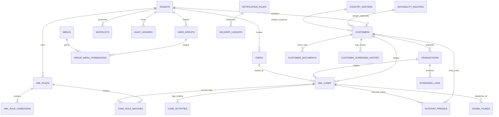

# EDITH AML Intelligence Platform: Comprehensive System Architecture Outline

**Document Reference:** EDITH_System_Architecture_Outline.md  
**Consolidation Source:** EDITH Master PRD (v3.0), Database Architecture (v1.0), Cloud Architecture (v1.0), and Google Stitch UI/UX Design System & Screen Specifications  
**Version:** 1.0  
**Target Environment:** Cloud-Native / Multi-AZ / GCC Banking Regulatory Compliant (CBUAE, SAMA, CBO)  
**Primary Stack:** .NET 10 LTS, React 19 Micro-Frontends, Apache Kafka, PostgreSQL 17, OpenSearch 2.x, Kubernetes, Istio  

---

## 1. Executive Summary & Strategic Scope

The **EDITH Next-Gen Anti-Money Laundering (AML) Intelligence Platform** represents a comprehensive architectural modernization of legacy monolithic compliance software into a cloud-native, event-driven, modular microservices platform. Engineered specifically to eliminate alert fatigue, accelerate compliance investigations, and automate regulatory reporting for financial institutions across the Gulf Cooperation Council (GCC) region, EDITH adheres strictly to Financial Action Task Force (FATF) standards and central bank mandates.

### 1.1 Core Business & Engineering Objectives
* **Sub-5-Second Screening Budget:** Deliver deterministic and fuzzy entity resolution over 15+ million sanctions and Politically Exposed Persons (PEP) records within an estimated target budget of **2 to 5-second end-to-end SLA** at 99.9% availability.
* **Dual-Database Footprint (Zero In-Memory Redis):** Eliminate in-memory Redis key-value dependencies. System-of-record integrity, state management, advisory locking, and transaction staging reside strictly within **PostgreSQL 17**, while fuzzy phonetic entity resolution executes in a dedicated, read-optimized **OpenSearch 2.x** cluster.
* **Dual-Mode Core Banking System (CBS) Integration:** Provide real-time synchronous pre-clearance APIs (`POST /api/v1/screen/transaction`) with `Idempotency-Key` headers, paired with cryptographically signed, asynchronous webhook callbacks (`POST /core/webhooks/aml-decision`) for post-investigation ledger actions.
* **Non-Blocking Asynchronous UX (The HTTP 202 Accepted Pattern):** Heavy background processes (bulk screening, historical delta re-screening, regulatory export generation) decouple immediately, returning `HTTP 202 Accepted` and streaming live progress to the user interface via WebSockets (SignalR).
* **"The Bloomberg Terminal of AML" UX Philosophy:** High information density, keyboard-first navigation, Object-Oriented UX (OOUX), progressive disclosure, and real-time concurrency collision prevention (1 person per case).

---

## 2. Complete UI/UX & Stitch Architecture Consolidation

### 2.1 Design System & Aesthetic Foundation (Google Stitch Blueprint)

The user interface adopts a **Semi-Flat / Modern Technical** aesthetic designed for extended analyst shifts across multi-monitor setups (1080p/1440p) using a dense 4px baseline rhythm.

```
+----------------------------------------------------------------------------------------------------+
|                                    EDITH DESIGN SYSTEM SPECIFICATION                               |
+----------------------+--------------------+--------------------------------------------------------+
| Design Token         | Hex / Value        | Functional Purpose & Application Scope                 |
+----------------------+--------------------+--------------------------------------------------------+
| Canvas Ground        | #020617 (Obsidian) | Ultra-dark base viewport, eliminating contrast fatigue |
| Surface Primary      | #0F172A (Slate)    | Cards, data panels, toolbars, modal containers         |
| Surface Elevated     | #1E293B (Elevated) | Contextual drawers, popovers, active selection states  |
| Surface Highlight    | #334155 (Slate Hi) | Hover states, table row highlights, focus boundaries   |
| Primary Institutional| #D4AF37 (Gold)     | Primary actions (Submit STR, Publish Rule, Brand mark) |
| Signal Critical      | #DC2626 (Crimson)  | Exact watchlist hits, OFAC matches, account freezes    |
| Signal Warning       | #D97706 (Amber)    | Fuzzy matches (70-89%), impending SLAs, validations   |
| Signal Success       | #059669 (Emerald)  | Cleared entities, false positive disposals, syncs      |
| Collision Lock Badge | #7C3AED (Violet)   | Real-time case session locking (1-person-per-case)     |
| Informational Signal | #2563EB (Sapphire) | Active filters, audit timestamps, documentation links  |
+----------------------+--------------------+--------------------------------------------------------+
| Typography: Body     | Inter (11px-16px)  | Structural layout, narrative investigative summaries   |
| Typography: Data     | JetBrains Mono     | Monospace tabular numerals, hashes, SWIFT, match scores|
+----------------------+--------------------+--------------------------------------------------------+
```

### 2.2 Core Interaction Design Patterns

1. **Object-Oriented UX (OOUX):** Core entities—**Customers**, **Transactions**, **Sanction Profiles**, and **Cases**—behave as primary first-class objects with standardized visual cards, metadata chips, and context menus throughout all 15 platform views.
2. **Progressive Disclosure:** Deep intelligence (such as AI risk radar spider charts, OCR bounding-box overlays, and Cytoscape.js network graphs) is encapsulated inside docked side-drawers and collapsible inspector panels to maintain immediate focus on critical triage streams.
3. **Zero Cumulative Layout Shift (CLS):** Standardized shimmer skeleton loaders cycle from `#1E293B` to `#334155` at fixed component dimensions, ensuring zero DOM jumping during OpenSearch query executions.

---

### 2.3 Master Stitch Page Catalog & Specification (15 Core Structures + Administration)

Consolidating the 25 screen structures catalogued in Stitch project `projects/1331502508734451524`.  
*(Operational Note: While interactive UI screens in Stitch are actively in development with placeholder labels, backend microservice architecture and functional API contracts proceed strictly based on the foundational `EDITH STITCH.md` blueprint and defined feature lists).*



#### Page-by-Page Technical Matrix

| Page ID & Stitch Screen | Module Code | Primary Layout Model | Key Functional Widgets & Controls | Primary Data Source |
| :--- | :--- | :--- | :--- | :--- |
| **Page 0: Global App Shell** | `MOD-CORE-SHELL` | Fixed top bar (52px), sticky batch banner (24px), collapsible rail | `[Logo] EDITH`, Global `Ctrl+K` palette, SignalR Active Jobs dropdown, Shift Status pill | WebSocket Hub, Session State |
| **Page 1: Executive Dashboard** | `MOD-CORE-DASH` | 12-column masonry grid | Alerts Generated, Active Freezes, Sanctions Origin Donut, Remittance Sankey, goAML backlog | `core.audit_ledgers`, `cases.aml_cases` |
| **Page 2: Single Entity Screening** | `MOD-SCRN-BASE` | Split form & results grid | Name/DOB/Nationality/ID input, Match Score %, OFAC/UN Source badges, `[Create Case]` action | OpenSearch 2.x, `screening.customers` |
| **Page 3: Bulk Screening Engine** | `MOD-SCRN-BULK` | Upload drag-and-drop + live streaming table | CSV/Excel chunked uploader, HTTP 202 status pill, Kafka throughput monitor, SignalR toast | `screening.bulk_screening_jobs`, S3 |
| **Page 4: 3-Pane Analyst Workspace** | `MOD-CASE-WORK` | Triple split-pane canvas with independent vertical scroll | **Left:** Triage queue with 🔒 Collision Locks; **Center:** Circuit Breaker visual, Red Diff Viewer, Cytoscape graph; **Right:** Spider radar, GenAI STR text | `cases.aml_cases`, `cases.case_activities`, PG Advisory Locks |
| **Page 5: Customer KYC 360** | `MOD-KYC-360` | Unified profile dossier view | 90-day transaction timeline, Document Vault with OCR overlays, Historical Alert Matrix | `screening.customers`, `screening.customer_documents` |
| **Page 6: Whitelist Governance** | `MOD-SCRN-WL` | Data grid + side drawer | Active entity bypasses, TTL time-decay sliders, WORM audit trail of approvers | `screening.whitelists`, `core.users` |
| **Page 7: Visual Rule Builder** | `MOD-RULE-BASE` | Node-based logical canvas | Drag-and-drop conditions (`IF Tx > $10k AND Corridor == High-Risk`), weightage assigners | `rules.aml_rules`, `rules.aml_rule_conditions` |
| **Page 8: Reports & Audit Ledger** | `MOD-REP-BASE` | Tabbed visualization center | Velocity Anomaly Bands, Jurisdiction Risk Heatmaps, Cryptographic PDF exporter | `core.audit_ledgers`, `screening.transactions` |
| **Page 9: goAML Reporting Studio** | `MOD-GOAML-GCC` | Side-by-side XML editor & validator | FIU XSD schema validator, inline error callouts, Cryptographically signed dispatch button | `cases.goaml_filings`, FIU Endpoints |
| **Page 10: Dynamic Notifications** | `MOD-NOTIF-DYN` | Split rules list & builder | Shift-aware routing toggles, MS Teams Adaptive Card preview, IT Delivery Bounce Ledger | `notifications.notification_rules`, `notifications.user_shifts` |
| **Page 11: Rule Sandbox & Backtester** | `MOD-SIM-SAND` | Split-pane slider workbench | Weightage sliders, Historical replay simulator, Projected False Positive histogram | `screening.transactions`, `rules.screening_score_configs` |
| **Page 12: System Masters Settings** | `MOD-SET-MAST` | Tabbed configuration grids | Country Risk Tiers, Nationality Masters, Composite Scoring Weightage matrix | `rules.country_masters`, `rules.nationality_masters` |
| **Page 13: IAM & Access Management** | `MOD-CORE-IAM` | Admin tabular grid & drawer | RBAC Groups, Menu Entitlements toggles, Shift Roster manager, Module license gates | `core.users`, `core.user_groups`, `core.menus` |
| **Page 14: Delta Rescreening Hub** | `MOD-SCRN-DELTA` | Queue grid + authorization bar | Nightly sync delta hits, Score diffs, Batch disposition tool, MLRO bulk sign-off | `screening.delta_sync_batches`, `screening.delta_authorizations` |
| **Auth & Security Screens** | `MOD-CORE-AUTH` | Technical terminal layout | Sign In, MFA Token input, Password & Credential Reset, Officer Profile Editor | OAuth2 / OIDC, Vault Tokens |

---

## 3. High-Level System Architecture & Flow Topology

```mermaid
flowchart TB
    subgraph ExternalConsumers["External Consumers & Core Banking Systems"]
        CBS["Core Banking System (CBS)<br/>(Finacle / T24 / FIS / BACS)"]
        AnalystClient["Analyst Workspace<br/>(React 19 Micro-Frontends)"]
        TeamsClient["Microsoft Teams / Mobile<br/>(Actionable Adaptive Cards)"]
    end

    subgraph PerimeterIngress["Edge & Ingress Security Layer"]
        WAF["Enterprise WAF / DDoS Shield<br/>(TLS 1.3, Geo-Fencing, Rate Limiting)"]
        EdgeLB["L4/L7 Ingress Load Balancer<br/>(AWS ALB / Azure AGW / F5 BIG-IP)"]
        IstioIngress["Istio Ingress Gateway<br/>(Envoy Proxy Edge Controller)"]
    end

    subgraph ServiceMeshCluster["Kubernetes Service Mesh (.NET 10 LTS Microservices with STRICT mTLS)"]
        subgraph GatewaysAndHubs["Ingress Gateways & Real-Time Hubs"]
            ApiGateway[".NET 10 API Gateway (YARP)<br/>(Idempotency, Auth Claims, Route Dispatch)"]
            SignalRHub[".NET 10 SignalR WebSocket Hub<br/>(202 Task Progress, Advisory Lock Broadcast)"]
        end

        subgraph CoreServices["Core Platform Microservices"]
            IamSvc["IAM & Entitlements Service<br/>(MOD-CORE-IAM)"]
            ScreeningSvc["Screening Engine Service<br/>(MOD-SCRN-BASE)"]
            BulkScreenSvc["Bulk & Delta Worker<br/>(MOD-SCRN-BULK / DELTA)"]
            RulesSvc["AML Rules Execution Service<br/>(MOD-RULE-PROC)"]
            CaseSvc["Case Management & EDD Service<br/>(MOD-CASE-WORK)"]
        end

        subgraph AddonServices["Opt-In Add-on Microservices"]
            NotifSvc["Dynamic Notification Engine<br/>(MOD-NOTIF-DYN)"]
            GoAmlSvc["goAML Regulatory Exporter<br/>(MOD-GOAML-GCC)"]
            AiCopilotSvc["GenAI STR Narrative Copilot<br/>(MOD-AI-NARR)"]
            GraphVisualSvc["Entity Graph Visualizer<br/>(MOD-AI-GRAPH)"]
        end
    end

    subgraph EventStreamingBus["Event Bus & Streaming Layer (Apache Kafka 3.9+ KRaft / Strimzi)"]
        direction LR
        K_TxHeld["edith.tx.held.v1"]
        K_TxCleared["edith.tx.cleared.v1"]
        K_BulkStream["edith.screening.bulk.v1"]
        K_CaseLifecycle["edith.case.events.v1"]
        K_AuditLog["edith.audit.events.v1"]
    end

    subgraph PersistenceLayer["Dual-Database Persistence Tier (Zero Redis Dependency)"]
        subgraph PostgresHA["PostgreSQL 17 HA Cluster (Patroni + PgBouncer)"]
            PG_Primary[("PostgreSQL 17 Primary<br/>(ACID Writes & Advisory Locks)")]
            PG_SyncStandby[("PostgreSQL 17 Sync Standby<br/>(Zero RPO Hot Standby)")]
            PG_AsyncReplica[("PostgreSQL 17 Read Replica<br/>(Read Queries & Analytical Dashboards)")]
        end

        subgraph OpenSearchCluster["OpenSearch 2.x Dedicated Screening Cluster"]
            OS_Coord["OpenSearch Coordinator Nodes<br/>(Query Parsing & Result Aggregations)"]
            OS_Data["OpenSearch Data Nodes (Hot Tier)<br/>(15M+ Entities: BMPM & Double Metaphone)"]
        end
    end

    %% Inbound Connections
    CBS -->|"Sync Pre-Clearance (POST /screen/tx)<br/>Idempotency-Key Header"| WAF
    AnalystClient -->|"HTTPS / WSS (SPA Traffic)"| WAF
    TeamsClient -->|"Actionable Webhook Callback"| WAF
    WAF --> EdgeLB --> IstioIngress
    IstioIngress --> ApiGateway
    IstioIngress --> SignalRHub

    %% Gateway to Internal Services
    ApiGateway -->|"gRPC / mTLS (2-5s SLA)"| ScreeningSvc
    ApiGateway -->|"HTTP 202 Accepted"| BulkScreenSvc
    ApiGateway -->|"REST / mTLS"| CaseSvc
    ApiGateway -->|"REST / mTLS"| RulesSvc
    ApiGateway -->|"REST / mTLS"| IamSvc

    %% Service to Database
    ScreeningSvc -->|"1. Candidate Retrieval"| OS_Coord --> OS_Data
    ScreeningSvc -->|"2. Whitelist Check & Tx Commit"| PG_Primary
    CaseSvc -->|"Advisory Locks & Case Transitions"| PG_Primary
    CaseSvc -->|"Triage Queue Reads"| PG_AsyncReplica
    BulkScreenSvc -->|"Batch Chunks Insert"| PG_Primary

    %% Event Bus Integration
    ScreeningSvc -.->|"Publish TxHeldEvent"| K_TxHeld
    ScreeningSvc -.->|"Publish TxClearedEvent"| K_TxCleared
    CaseSvc -.->|"Publish CaseDisposed / Frozen"| K_CaseLifecycle
    BulkScreenSvc -.->|"Stream Chunks"| K_BulkStream

    %% Consumers
    K_TxHeld --> NotifSvc
    K_CaseLifecycle --> NotifSvc
    K_CaseLifecycle --> GoAmlSvc
    K_CaseLifecycle --> AiCopilotSvc
    K_BulkStream --> BulkScreenSvc

    %% Outbound Actions
    NotifSvc -->|"Signed HMAC Webhook Callback<br/>POST /core/webhooks/aml-decision"| CBS
    NotifSvc -->|"Dispatch Adaptive Card"| TeamsClient
    BulkScreenSvc -.->|"Broadcast Progress"| SignalRHub
    SignalRHub -.->|"WebSocket Toast Notification"| AnalystClient
```



---

## 4. Multi-Pass Screening Engine Execution Architecture (2–5s SLA)

### 4.1 Detailed 5-Pass Pipeline Breakdown

To satisfy the regulatory performance SLA across 15+ million records, the screening engine employs a staged funnel that eliminates non-matching records with increasing precision and computational depth:

```
[Inbound Transaction from CBS]
  │
  ├── PASS 1: Normalization & Cleansing (Memory: 80–150 ms)
  │     ├── ASCII folding, lower-case mapping, unicode normalization
  │     ├── Strip financial noise words (LLC, LTD, FZE, CORP, BANK, TRADING)
  │     └── Allocation of non-heap C# ReadOnlySpan<char> memory buffers
  │
  ├── PASS 2: Broad Candidate Retrieval (OpenSearch: 250–400 ms)
  │     ├── Multi-match dismax query against 'edith_watchlist_v1' index
  │     ├── Edge n-gram prefix expansion and broad Soundex filtering
  │     └── Extracts bounded candidate pool (maximum 500 entity candidates)
  │
  ├── PASS 3: Vectorized Phonetic & Distance Scoring (.NET SIMD: 400–800 ms)
  │     ├── Double Metaphone & Beider-Morse Phonetic Matching (BMPM)
  │     ├── Jaro-Winkler string similarity & Damerau-Levenshtein distance
  │     └── Vectorized execution utilizing AVX-512 SIMD CPU instructions
  │
  ├── PASS 4: Multi-Entity Parallel Evaluation (Task.WhenAll: 500–850 ms)
  │     ├── Simultaneous concurrent screening across four transactional roles:
  │     │     [1] Sender / Remitter   [2] Beneficiary / Payee
  │     │     [3] Intermediary Bank   [4] Ultimate Beneficial Owners (UBOs)
  │     └── Cross-role correlation matrix computation
  │
  └── PASS 5: Deterministic Scoring & Whitelist Bypass (PostgreSQL: 120–250 ms)
        ├── Evaluation against 'rules.screening_score_configs'
        ├── In-memory hash check against active 'screening.whitelists'
        └── Final Decision:
              ├── If Score < Threshold  ──> CLEARED (HTTP 200 to CBS)
              └── If Score >= Threshold ──> HELD (P1 AML Case Created + Kafka Alert)
```

---

## 5. Technology Stack Blueprint

### 5.1 Architecture Stack Matrix

| Architecture Tier | Selected Enterprise Technology | Version | Purpose & Rationale |
| :--- | :--- | :--- | :--- |
| **Frontend UI Shell** | **React (TypeScript)** | 19.0 / 5.6 | Concurrent Mode and Server Components for zero-lag rendering of high-density financial tables. |
| **Micro-Frontends** | **Vite + Module Federation** | v2.0 | Dynamic runtime loading of independent modules (`screening`, `cases`, `rules`, `analytics`). |
| **UI Component Base** | **Tailwind CSS + Shadcn UI** | 3.4 / Latest | High-density semi-flat styling adhering strictly to the Google Stitch design system tokens. |
| **Graph Visualizer** | **Cytoscape.js** | 3.30+ | Interactive canvas rendering UBO shareholding networks, transaction loops, and smurfing rings. |
| **Real-Time Client** | **@microsoft/signalr** | 10.0+ | WebSocket telemetry for non-blocking 202 Accepted job status and real-time case lock sync. |
| **Backend Framework** | **.NET LTS (C# 13)** | 10.0 | High-performance enterprise runtime with zero-allocation memory spans and Native AOT capabilities. |
| **API Gateway** | **YARP (Yet Another Reverse Proxy)**| 2.2+ | Lightweight reverse proxy handling rate limiting, claims injection, and idempotency key filtering. |
| **Inter-Service RPC** | **gRPC (.NET 10) + Protobuf** | 2.66+ | Low-latency binary communication for synchronous screening sub-calls inside the service mesh. |
| **Dynamic Plugins** | **Collectible `AssemblyLoadContext`** | Native .NET | Zero-downtime hot swapping of tenant rules and add-ons without recycling container processes. |
| **Relational Database**| **PostgreSQL** | 17.0 | Master ACID system of record, declarative table partitioning, and native advisory locking. |
| **DB Connection Pool** | **PgBouncer** | 1.23+ | Transaction-mode connection multiplexing preventing PostgreSQL connection exhaustion. |
| **DB HA Controller** | **Patroni + etcd** | 4.0 / 3.5 | Automated raft-consensus leader election and zero-RPO synchronous failover. |
| **Search Engine** | **OpenSearch** | 2.17+ | Dedicated read-optimized cluster with Double Metaphone, BMPM, and edge n-gram analyzers. |
| **Event Streaming** | **Apache Kafka (KRaft Mode)** | 3.9+ | Distributed event streaming deployed via Strimzi Operator on Kubernetes; eliminates ZooKeeper. |
| **CDC & Outbox** | **Debezium + Kafka Connect** | 3.0+ | Transactional outbox pattern syncing mutations from PostgreSQL WAL to OpenSearch indices. |
| **Orchestration** | **Kubernetes** | 1.31+ | Multi-AZ container management, automated scheduling, self-healing, and rolling canary updates. |
| **Service Mesh** | **Istio** | 1.24+ | Zero-trust service mesh enforcing STRICT mutual TLS (mTLS) and fine-grained authorization. |
| **Secrets & KMS** | **HashiCorp Vault Enterprise** | 1.18+ | Ephemeral dynamic database credential provisioning (12h TTL) and envelope encryption for PII. |
| **Observability** | **OpenTelemetry SDK + Prometheus/Grafana**| Latest | End-to-end W3C distributed tracing, microsecond metrics, and financial SLA monitoring. |

---

## 6. Dual-Database Persistence Architecture (Zero Redis)

### 6.1 Schema Partitioning & Data Model Blueprint

In strict accordance with the PRD mandate, **Redis is excluded entirely**. Relational and search concerns are cleanly separated:



#### Key Relational Structures (PostgreSQL 17)
* **Relational Integrity & Partitioning Strategy:**
  - `screening.transactions` remains **unpartitioned** as a single authoritative table to preserve critical primary key (`id UUID PRIMARY KEY`), unique constraints (`transaction_ref_no`, `idempotency_key`), and referential integrity for foreign keys from `cases.aml_cases`, `cases.account_freezes`, and `screening.screening_logs`.
  - Partitioning is optionally reserved for high-volume append-only audit ledgers (`core.audit_ledgers` by `RANGE (created_at)`), where no incoming foreign keys or secondary unique constraints are required.
* **Tenant-Scoped Composite Uniqueness Constraints:**
  - Critical multi-tenant tables enforce uniqueness scoped to `tenant_id`: `core.users(tenant_id, username)`, `screening.customers(tenant_id, customer_code)`, `rules.aml_rules(tenant_id, rule_code)`, and `rules.setup_controls(tenant_id, control_code)`.
* **Native Advisory Locking (Real-Time Concurrency Control):**
  - Session-level 64-bit advisory locks via `pg_try_advisory_lock(hashtext('cases.aml_cases:' || :caseId))` guarantee that exactly **one analyst** can edit, dispose, or freeze a case at any given moment.
* **Row-Level Security (RLS) Tenant Isolation:**
  - Strict database kernel policy: `CREATE POLICY tenant_isolation ON screening.customers FOR ALL USING (tenant_id = current_setting('app.current_tenant_id')::uuid)`. Cross-tenant data leakage is physically impossible.

#### OpenSearch 2.x Indexing Blueprint
* **Index Name:** `edith_watchlist_v1`
* **Sharding:** 6 Primary Shards (aligned with 6 Hot Data Nodes) + 1 Replica Shard (Total 12 shards).
* **Analyzers:** Custom `edith_screening_analyzer` combining Double Metaphone, Beider-Morse Phonetic Matching (BMPM), and 3-to-10 character edge n-grams.
* **Durability:** Decoupled 30-second refresh intervals during batch imports, optimizing raw query throughput for synchronous traffic.

---

## 7. Scalability & High Availability Strategy

### 7.1 Zero-Downtime Hot-Swapping Strategy

```
+----------------------------------------------------------------------------------------------------+
|                                 DUAL-TIER ZERO-DOWNTIME ARCHITECTURE                                |
+----------------------------------------------------------------------------------------------------+
| TIER 1: INFRASTRUCTURE CANARY ROLLING UPDATES (KUBERNETES + ISTIO)                                 |
| - Traffic split incrementally: 5% -> 25% -> 100% via Istio VirtualServices.                        |
| - Kubernetes PodDisruptionBudgets (minAvailable: 75%) protect against node drain outages.          |
| - PreStop lifecycle hooks execute a 30-second graceful connection drain before SIGTERM.            |
+----------------------------------------------------------------------------------------------------+
| TIER 2: RUNTIME ASSEMBLY HOT-SWAPPING (.NET 10 COLLECTIBLE ASSEMBLYLOADCONTEXT)                    |
| - Tenant rule modules and scoring logic compile into isolated dynamic assemblies (.dll).          |
| - The engine instantiates rules inside a Collectible AssemblyLoadContext.                          |
| - Runtime pointer swapped atomically via Interlocked.Exchange(ref _evaluator, nextEvaluator).      |
| - Stale context unloaded (context.Unload()); GC reclaims metadata memory with ZERO pod downtime.  |
+----------------------------------------------------------------------------------------------------+
```

### 7.2 Autoscaling Architecture (HPA + KEDA)
* **Synchronous Workloads (`MOD-SCRN-BASE`):** Scaled via Kubernetes Horizontal Pod Autoscaler (HPA) using custom Prometheus metrics (CPU > 70% or p95 Latency > 2,500ms). Scaled from 6 to 48 pods within 15 seconds.
* **Asynchronous Workloads (`MOD-SCRN-BULK` / `MOD-NOTIF-DYN`):** Scaled via **KEDA** triggered by Apache Kafka consumer lag. If message lag on topic `edith.screening.bulk.v1` exceeds 200 records, KEDA scales worker pods from 2 to 32 instances immediately.

---

## 8. Enterprise Security, Governance & Regulatory Compliance

### 8.1 Zero-Trust & Service-to-Service Security
* **STRICT Mutual TLS (mTLS):** Enforced across every pod in the Kubernetes cluster using Istio PeerAuthentication.
* **SPIFFE/SPIRE Identity:** Every microservice instance receives a verified cryptographic identity:  
  `spiffe://edith.cluster.local/ns/edith-core/sa/screening-service-sa`.
* **Network Authorization:** Strict least-privilege `AuthorizationPolicy` definitions guarantee that only the API Gateway can call the Screening Engine's gRPC port.

### 8.2 Ephemeral Secrets & PII Data Protection
* **Dynamic Database Credentials:** HashiCorp Vault provisions temporary PostgreSQL credentials on a 12-hour lease directly to microservices via the Kubernetes External Secrets Operator (ESO). No static passwords exist in configurations.
* **Field-Level PII Encryption:** Sensitive attributes (national ID numbers, passports, bank account numbers) are encrypted at rest using the Vault Transit Secrets Engine (AES-256-GCM envelope encryption).
* **Automated goAML XML Generation:** Conforms strictly to UNODC and local GCC Financial Intelligence Unit (FIU) schemas, performing pre-flight XSD validation and cryptographic payload signing.

---

## 9. Observability, Distributed Tracing & SRE Framework

### 9.1 OpenTelemetry & W3C Trace Context Propagation
Every transaction is assigned a globally unique W3C `traceparent` at the API Gateway:
`00-4bf92f3577b34da6a3ce929d0e0e4736-00f067aa0ba902b7-01`
* **Trace Propagation:** Context flows across internal gRPC calls, Kafka record headers, database execution tags, and external webhook dispatches.
* **Trace Visualization:** Exported via the OpenTelemetry Collector to Grafana Tempo / Jaeger, allowing engineers to drill down into microsecond latency breakdowns per screening pass.

### 9.2 Golden Signals & Real-Time Financial SLA Dashboards
Prometheus scrapes operational metrics across four critical dimensions:
1. **Latency:** `edith_screening_duration_seconds{quantile="0.99"}` (Critical alert if > 4.5s for 3m).
2. **Traffic:** `http_requests_total{service="api-gateway"}` (Alert if sudden drop > 80%).
3. **Errors:** HTTP 5xx error percentage (Alert if > 0.1% over 1 minute).
4. **Saturation:** Container CPU / Memory and Kafka consumer group lag.

---

## 10. Master Architecture Proposed Specifications & Target Matrix

| Dimension | Architectural Mandate | Proposed Target Specification | Status |
| :--- | :--- | :--- | :--- |
| **Performance SLA** | 2 to 5-second end-to-end multi-pass screening budget | Estimated Target: 5-pass staged pipeline (OpenSearch + SIMD phonetics) resolving in ~2.1–3.8s at p99 | **PROPOSED TARGET** |
| **Data Persistence** | Dual-database footprint; zero in-memory Redis | PostgreSQL 17 (System of Record + Advisory Locks) + OpenSearch 2.x (Fuzzy/Phonetic) | **PROPOSED TARGET** |
| **Core Banking API** | Dual-mode: Sync pre-clearance + Async Webhooks | HTTP 200 with Idempotency-Key + signed HMAC-SHA256 post-investigation callbacks | **PROPOSED TARGET** |
| **UI/UX System** | Semi-Flat OOUX "Bloomberg Terminal of AML" | Google Stitch 15-page layout, Obsidian/Gold palette, 3-pane canvas, collision locking | **PROPOSED TARGET** |
| **Asynchronous UX**| Zero-blocking UI during heavy tasks | HTTP 202 Accepted pattern + Kafka worker streaming + SignalR WebSocket live toasts | **PROPOSED TARGET** |
| **Availability** | Zero-downtime hot-swapping under continuous load | Kubernetes Canary (Istio) + .NET 10 Collectible `AssemblyLoadContext` runtime swap | **PROPOSED TARGET** |
| **Security** | Zero-Trust & GCC banking compliance | STRICT mTLS (Istio), Vault ephemeral DB credentials, Row-Level Security, Hash-chained audit | **PROPOSED TARGET** |

---
*End of Master System Architecture Outline — EDITH AML Intelligence Platform (v1.0)*
