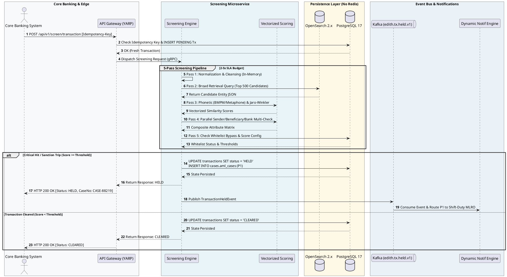
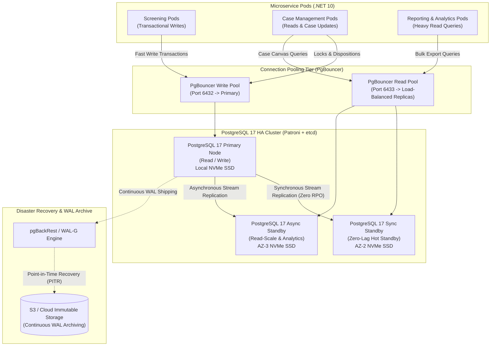
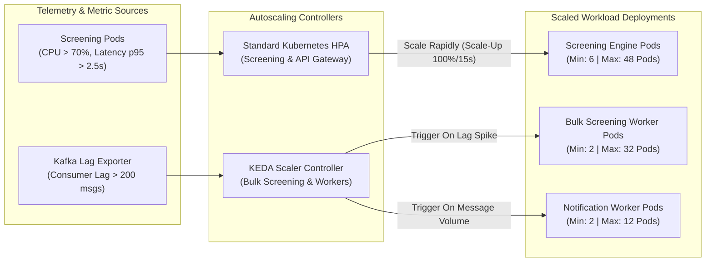
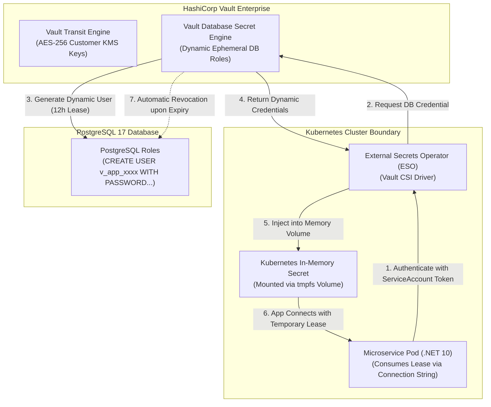
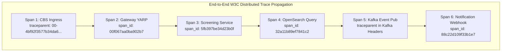

# EDITH AML Intelligence Platform: Cloud Architecture & Deployment Topology (v1.0)

**Document Reference:** EDITH_System_Architecture_v1.0.md  
**Target Environment:** Cloud-Native / Multi-Cloud / GCC-Compliant Enterprise Banking Infrastructure  
**Core Technologies:** .NET 10 LTS, React 19 Micro-Frontends, Apache Kafka, PostgreSQL 17, OpenSearch 2.x, Kubernetes, Istio  
**Version:** 1.0  
**Status:** Proposed Architectural Blueprint  

---

## 1. Executive Architectural Overview & Strategic Context

The **EDITH Next-Gen Anti-Money Laundering (AML) Intelligence Platform** represents an enterprise-grade modernization of legacy monolithic compliance software into an event-driven, modular microservices topology. Engineered specifically to comply with rigorous regulatory mandates across the GCC (including the Central Bank of the UAE [CBUAE], Saudi Central Bank [SAMA], and Central Bank of Oman [CBO]), EDITH provides high-velocity transaction screening, entity resolution, and tiered case management.

### Key Architectural Mandates
* **Estimated Target 2–5 Second Screening SLA:** The entire multi-pass screening engine across millions of sanctions and watchlist records is targeted to return deterministic decisions (`CLEARED` vs. `HELD`) within an estimated target budget of 2 to 5 seconds at 99.9th percentile latency.
* **Dual-Database Footprint (Zero Redis Dependency):** In direct alignment with the EDITH Master PRD (v3.0), all in-memory Redis key-value dependencies are eliminated. System-of-record integrity, state management, advisory locking, and transaction staging reside strictly within **PostgreSQL 17**, while fuzzy phonetic entity resolution executes within a dedicated, read-optimized **OpenSearch 2.x** cluster.
* **Dual-Mode Core Banking System (CBS) Integration:** Real-time synchronous pre-clearance APIs for immediate ledger authorization, paired with cryptographically signed, asynchronous webhook callbacks for post-investigation releases or freezes.
* **Zero-Downtime Hot Swapping:** Dual-tier hot swapping utilizing both Kubernetes rolling canary deployments and .NET 10 `Collectible AssemblyLoadContext` for isolated tenant plugin and rule upgrades without process restarts.
* **Zero-Trust Security & Banking Compliance:** End-to-end mutual TLS (mTLS via Istio), automated ephemeral secrets management via HashiCorp Vault, strict multi-tenant row-level data isolation, and comprehensive OpenTelemetry distributed tracing across all asynchronous boundaries.

---

## 2. High-Level System Architecture & Flow Topology

### 2.1 Complete System Architecture Diagram

The following diagram illustrates the complete architectural flow: from inbound transactions originating in the Core Banking System (CBS) and compliance analysts using the web portal, through the Edge and Ingress layers, Service Mesh, Microservices, Event Bus, and Persistence layers.

```mermaid
flowchart TB
    subgraph ClientAndConsumerLayer["1. Ingestion & Client Layer"]
        CBS["Core Banking System (CBS)<br/>(Finacle / T24 / FIS / BACS)"]
        AnalystPortal["Compliance Analysts & MLROs<br/>(React 19 Micro-Frontends)"]
        ThirdParty["External Systems / HR Shifts / FIU<br/>(Teams / Email / goAML)"]
    end

    subgraph EdgeIngressLayer["2. Edge, Perimeter & Ingress Layer"]
        WAF["Enterprise WAF / DDoS Shield<br/>(TLS 1.3 Termination, Rate Limiting)"]
        EdgeLB["L4/L7 Ingress Load Balancer<br/>(AWS ALB / Azure AGW / F5 BIG-IP)"]
        K8sIngress["Istio Ingress Gateway<br/>(Envoy Proxy Edge Router)"]
    end

    subgraph ServiceMeshLayer["3. Kubernetes Service Mesh (Istio Ambient / Sidecars with mTLS)"]
        subgraph CoreGateways["API Gateway & Dynamic Routers"]
            ApiGateway[".NET 10 Cloud API Gateway (YARP)<br/>(Idempotency, JWT Auth, Claims Injection)"]
            SignalRHub[".NET 10 WebSocket / SignalR Hub<br/>(Live Toasts, 202 Job Status, Lock Sync)"]
        end

        subgraph CoreMicroservices["Core Business Microservices (.NET 10 LTS)"]
            IamSvc["IAM & Entitlements Service<br/>(MOD-CORE-IAM)"]
            ScreeningSvc["Screening Engine Service<br/>(MOD-SCRN-BASE)"]
            BulkScreenSvc["Bulk & Delta Screening Worker<br/>(MOD-SCRN-BULK)"]
            RulesSvc["AML Rule Execution Engine<br/>(MOD-RULE-PROC)"]
            CaseSvc["Case Management & EDD Service<br/>(MOD-CASE-WORK)"]
        end

        subgraph AddonMicroservices["Opt-In Add-on Services (.NET 10 LTS)"]
            NotifSvc["Dynamic Notification Engine<br/>(MOD-NOTIF-DYN)"]
            GoAmlSvc["goAML Regulatory Exporter<br/>(MOD-GOAML-GCC)"]
            AiCopilotSvc["GenAI Narrative Copilot<br/>(MOD-AI-NARR)"]
            GraphVisualSvc["Entity Graph Engine<br/>(MOD-AI-GRAPH)"]
        end
    end

    subgraph MessageBusLayer["4. Event Bus & Streaming Layer (Apache Kafka Cluster - Strimzi / KRaft)"]
        direction LR
        KTopic_TxHeld["edith.tx.held.v1"]
        KTopic_TxCleared["edith.tx.cleared.v1"]
        KTopic_BulkJobs["edith.screening.bulk.v1"]
        KTopic_CaseEvents["edith.case.events.v1"]
        KTopic_Audit["edith.audit.events.v1"]
        KTopic_DLQ["edith.dead-letter-queue.v1"]
    end

    subgraph DataStorageLayer["5. Dual-Database Persistence & State Layer (Zero Redis)"]
        subgraph PostgresCluster["PostgreSQL 17 Primary-Replica Cluster (Patroni + PgBouncer)"]
            PG_Primary[("PostgreSQL 17 Primary<br/>(Writes & Advisory Locks)")]
            PG_Replica1[("PostgreSQL 17 Read Replica 1<br/>(Read Queries & Analytics)")]
            PG_Replica2[("PostgreSQL 17 Read Replica 2<br/>(Reporting & Audit)")]
        end

        subgraph OpenSearchCluster["OpenSearch 2.x Dedicated Screening Cluster"]
            OS_Coord["OpenSearch Coordinator Nodes<br/>(Query Parsing & Aggregations)"]
            OS_Data["OpenSearch Data Nodes (Hot Tier)<br/>(Phonetic & Fuzzy 15M+ Watchlist Shards)"]
        end
    end

    subgraph SecurityObservability["6. Enterprise Security & Observability Control Plane"]
        Vault["HashiCorp Vault<br/>(Dynamic DB Leases, KMS)"]
        OTel["OpenTelemetry Collector<br/>(Traces, Metrics, Logs)"]
        Prometheus["Prometheus / Grafana<br/>(SLA & Golden Signals)"]
        Jaeger["Tempo / Jaeger<br/>(Distributed Tracing)"]
    end

    %% Network Connections
    CBS -->|"Mutual TLS / HTTPS (Sync API)<br/>POST /api/v1/screen/transaction"| WAF
    AnalystPortal -->|"HTTPS / WSS (SPA Traffic)"| WAF
    WAF --> EdgeLB
    EdgeLB --> K8sIngress
    K8sIngress --> ApiGateway
    K8sIngress --> SignalRHub

    %% Internal Ingress to Services
    ApiGateway -->|"gRPC / mTLS (Sync 2-5s)"| ScreeningSvc
    ApiGateway -->|"HTTP / mTLS"| IamSvc
    ApiGateway -->|"HTTP / mTLS"| RulesSvc
    ApiGateway -->|"HTTP / mTLS"| CaseSvc
    ApiGateway -->|"HTTP 202 Accepted"| BulkScreenSvc

    %% Service to Storage
    ScreeningSvc -->|"1. Normalization & Cleansing (Memory)"| ScreeningSvc
    ScreeningSvc -->|"2. Broad Retrieval & Phonetics"| OS_Coord
    OS_Coord --> OS_Data
    ScreeningSvc -->|"3. Scoring, Whitelist & Lock Checks"| PG_Primary

    RulesSvc --> PG_Primary
    CaseSvc --> PG_Primary
    CaseSvc --> PG_Replica1
    IamSvc --> PG_Replica1

    %% Event Bus Integration
    ScreeningSvc -.->|"Publish TxHeldEvent"| KTopic_TxHeld
    ScreeningSvc -.->|"Publish TxClearedEvent"| KTopic_TxCleared
    BulkScreenSvc -.->|"Stream Records"| KTopic_BulkJobs
    CaseSvc -.->|"Publish CaseDisposed / Freeze"| KTopic_CaseEvents

    %% Event Consumers
    KTopic_TxHeld --> NotifSvc
    KTopic_BulkJobs --> BulkScreenSvc
    KTopic_CaseEvents --> NotifSvc
    KTopic_CaseEvents --> GoAmlSvc
    KTopic_CaseEvents --> AiCopilotSvc

    %% Webhook Callback & SignalR
    NotifSvc -->|"Cryptographic Webhook Callback<br/>POST /core/webhooks/aml-decision"| CBS
    NotifSvc -->|"Dispatch MS Teams / Adaptive Card"| ThirdParty
    BulkScreenSvc -.->|"Push Job Progress"| SignalRHub
    SignalRHub -.->|"Real-Time Push / Toast"| AnalystPortal

    %% Security & Telemetry
    ServiceMeshLayer -.->|"OIDC Validation"| IamSvc
    ServiceMeshLayer -.->|"Fetch Ephemeral Secrets"| Vault
    ServiceMeshLayer -.->|"Trace Context & Spans"| OTel
    OTel --> Prometheus
    OTel --> Jaeger
```



---

### 2.2 End-to-End Core Banking System (CBS) Data Flow

The platform accommodates two discrete transactional paradigms:

#### Paradigm A: Synchronous Real-Time Screening (2–5 Second SLA)
1. **Inbound Request:** The CBS sends `POST /api/v1/screen/transaction` over TLS 1.3 with an `Idempotency-Key` HTTP header.
2. **Gateway Pre-Processing (50ms):** 
   - The API Gateway (YARP) validates the client certificate (mTLS) and verifies the JWT claims.
   - It computes an advisory hash of the `Idempotency-Key` and checks `screening.transactions` via PgBouncer. If the key exists, it immediately returns the cached transaction decision without re-running screening.
   - A `PENDING` record is recorded in `screening.transactions` within PostgreSQL 17.
3. **Execution of 5-Pass Screening Engine (1,800–3,200ms):**
   - **Pass 1 (Normalization & Cleansing):** Fast in-memory ASCII folding, punctuation stripping, stop-word removal, and upper-case normalization executed inside the .NET 10 runtime (100ms).
   - **Pass 2 (Broad Retrieval):** Multi-match query dispatched to OpenSearch 2.x across indexed watchlist and sanctions entities (`screening.watchlist_entities`), yielding the candidate pool of top ~500 records (350ms).
   - **Pass 3 (Phonetic & String Distance Scoring):** Concurrent vectorized scoring using Double Metaphone, Beider-Morse Phonetic Matching (BMPM), Jaro-Winkler, and Damerau-Levenshtein algorithms against the candidate pool (700ms).
   - **Pass 4 (Multi-Entity Concurrent Evaluation):** Sender, Beneficiary, Correspondent Bank, and Corporate Directors are evaluated simultaneously via .NET `Task.WhenAll` across separate threads (650ms).
   - **Pass 5 (Deterministic Scoring & Whitelist Bypass):** Calculated score is checked against `rules.screening_score_configs`. If matched but present in `screening.whitelists`, the hit is suppressed. If above threshold (`>= 90%` for critical sanction, or `>= 80%` for PEP), the transaction status transitions to `HELD` (150ms).
4. **State Persistence & Response (150ms):**
   - The PostgreSQL `screening.transactions` row is updated to `HELD` or `CLEARED`, and detailed scoring breakdown is recorded in `screening.screening_logs`.
   - If `HELD`, a new record is created in `cases.aml_cases` with priority `P1`, and a `TransactionHeldEvent` is published to Kafka topic `edith.tx.held.v1`.
   - Gateway returns `HTTP 200 OK` with JSON payload `{ "status": "HELD", "case_number": "CASE-2026-09182", "hold_reason": "SANCTION_MATCH_94.5" }` or `{ "status": "CLEARED" }`.
   - Total latency: **~2.1 to 3.8 seconds** (fully inside the 5-second regulatory SLA).



#### Paradigm B: Asynchronous Webhook Callback (Post-Investigation Decision)
1. **Investigation Completion:** An MLRO investigates the held case in the React 3-pane Case Management workspace (`MOD-CASE-WORK`). Upon review, the MLRO clicks `[Release]` or `[Freeze Account]`.
2. **State Transition & Locking:** An advisory lock is verified, `cases.aml_cases` is transitioned to `DISPOSED` or `FROZEN`, and an entry is inserted into `cases.case_activities`.
3. **Event Emission:** A `CaseDispositionEvent` is produced to Kafka topic `edith.case.events.v1`.
4. **Webhook Dispatch:** The Dynamic Notification Engine (`MOD-NOTIF-DYN`) consumes the event, constructs an HMAC-SHA256 cryptographically signed webhook payload, and dispatches an HTTP POST to the CBS endpoint (`POST /core/webhooks/aml-decision`).
5. **Ledger Action:** The CBS validates the signature using its shared secret, matches the transaction reference, and executes the ledger release or account debit freeze.

---

### 2.3 Heavy Job Asynchronous Ingestion Topology (HTTP 202 Pattern & SignalR)

For heavy batch operations—such as bulk CSV screening of 500,000 corporate records, historical delta re-screening after an OFAC update, or comprehensive goAML export builds:

1. **Client Submission:** The user uploads a 50MB customer dataset via the frontend.
2. **Immediate Decoupling:** The API Gateway validates the file stream, uploads it to an S3-compatible Object Store (MinIO / Cloud Storage), writes a master job entry in `screening.bulk_screening_jobs` with status `PENDING`, and instantly returns **`HTTP 202 Accepted`** with payload `{ "job_id": "9b1deb4d...", "status_url": "/api/v1/jobs/9b1deb4d..." }`.
3. **Kafka Streaming:** A job trigger message is emitted to `edith.screening.bulk.v1`.
4. **Distributed Chunk Processing:** The `MOD-SCRN-BULK` worker pods consume the message. A master chunker partitions the dataset into micro-batches of 1,000 records. Multiple worker pods process chunks in parallel across OpenSearch and PostgreSQL.
5. **Real-Time SignalR Feedback:** As chunks complete, workers publish progress percentages to Kafka. The .NET 10 SignalR Hub consumes these updates and broadcasts live progress over WebSockets directly to the user's "Active Jobs" widget in the navigation bar.
6. **Completion Toast:** Upon 100% completion, SignalR delivers a rich toast notification: *"Bulk Job Complete: 498,200 Cleared, 1,800 Flagged for Triage."*

```mermaid
sequenceDiagram
    autonumber
    actor Analyst as Compliance Analyst
    participant UI as React Micro-Frontend
    participant GW as API Gateway (.NET 10)
    participant S3 as Object Storage (MinIO)
    database PG as PostgreSQL 17
    queue Kafka as Kafka Topic (bulk.jobs)
    participant Worker as Bulk Worker Pods
    participant Hub as SignalR Notification Hub

    Analyst->>UI: Uploads 500,000 Record CSV
    UI->>GW: POST /api/v1/screening/bulk (Multipart Form)
    GW->>S3: Stream Raw File to Bucket
    GW->>PG: INSERT bulk_screening_jobs (Status: PENDING)
    GW-->>UI: HTTP 202 Accepted { "job_id": "9b1deb4d" }
    Note over UI,Analyst: UI remains completely interactive (Zero Blocking)

    GW->>Kafka: Publish BulkJobCreatedEvent
    Kafka->>Worker: Consume Job Event
    Worker->>S3: Fetch File & Stream Chunks (1,000 rows/batch)
    
    loop Parallel Chunk Evaluation
        Worker->>Worker: Run 5-Pass Screening per Batch
        Worker->>PG: Bulk INSERT bulk_screening_items
        Worker->>Hub: Publish Progress (e.g., 25%, 50%, 75%)
        Hub-->>UI: WebSocket Frame: Progress Indicator Update
    end

    Worker->>PG: UPDATE bulk_screening_jobs SET status = 'COMPLETED'
    Worker->>Hub: Publish JobFinishedEvent
    Hub-->>UI: WebSocket Actionable Toast: "Bulk Screening Finished"
```

---

## 3. Technology Stack Blueprint

### 3.1 Layer-by-Layer Technology Matrix

| Layer / Capability | Exact Technology & Specification | Operational Justification & Architectural Role |
| :--- | :--- | :--- |
| **Frontend Framework** | **React 19 (TypeScript 5.6)** | Core declarative UI layer utilizing React Server Components and Concurrent Mode for ultra-fast DOM reconciliations during high-density AML alert rendering. |
| **Micro-Frontend Architecture** | **Vite + Module Federation (v2)** | Modular compilation and runtime dynamic loading of independently deployable micro-frontends (`core-shell`, `screening-app`, `cases-app`, `rules-app`, `graph-app`). |
| **State & Data Fetching** | **TanStack Query v5 + Zustand** | Multi-tier asynchronous server-state caching, automatic garbage collection, background refetching, and lightweight UI state management without Redux overhead. |
| **Specialized UI Visualizers** | **Cytoscape.js & Canvas API** | High-performance interactive graph rendering for `MOD-AI-GRAPH` to visualize Ultimate Beneficial Ownership (UBO) networks, transaction loops, and smurfing webs. |
| **Adaptive Actionable Cards** | **Microsoft Adaptive Cards SDK** | Dynamic JSON-driven rendering of actionable approval cards within MS Teams and the analyst workspace for two-way alert dispositions. |
| **Real-Time Client Messaging** | **@microsoft/signalr (v10)** | WebSocket client library with automatic fallback to Server-Sent Events (SSE) for live background job telemetry and case lock status synchronization. |
| **Backend Runtime** | **.NET 10 LTS (C# 13)** | Cutting-edge high-throughput runtime with vectorized SIMD processing, Native AOT compilation options, zero-allocation memory spans, and predictable low-latency GC. |
| **API Gateway Framework** | **YARP (Yet Another Reverse Proxy)** | High-performance, highly customizable reverse proxy by Microsoft, executing intelligent routing, rate limiting, distributed claims extraction, and idempotency filtering. |
| **Microservices Communication** | **gRPC (.NET 10) + Protobuf** | Binary, multiplexed, low-latency inter-service RPC for synchronous 2–5s screening sub-calls, bypassing HTTP/JSON serialization overhead. |
| **Dynamic Plugin Architecture** | **`AssemblyLoadContext` (Collectible)** | .NET 10 native dynamic assembly isolation mechanism enabling runtime loading, execution, and unloading of tenant add-ons and rule libraries with zero host restarts. |
| **Template Engine** | **Fluid (.NET Liquid Engine)** | High-throughput, memory-safe Liquid template parser for dynamic variable substitution in emails, regulatory filings, and MS Teams cards (`MOD-NOTIF-DYN`). |
| **Relational Database** | **PostgreSQL 17** | Master transactional system of record, handling ACID workflows, partitioned transaction ledgers, JSONB customer profiles, and native advisory locking. |
| **Database Connection Pool** | **PgBouncer 1.23+ (Transaction Pooling)** | Ultra-lightweight connection pooler multiplexing tens of thousands of microservice connections into fixed PostgreSQL backends to prevent process starvation. |
| **High Availability Controller** | **Patroni 4.0 + etcd v3** | Automated leader election, raft-consensus failover, and zero-data-loss standby promotion for the PostgreSQL 17 cluster. |
| **Search & Screening Engine** | **OpenSearch 2.17+** | Distributed Lucene-based search cluster with dedicated phonetic analyzers (Double Metaphone, BMPM), ngram tokenizers, and vector embeddings over 15M+ watchlist entities. |
| **Event Bus & Messaging** | **Apache Kafka 3.9+ (KRaft Mode)** | Distributed immutable event log deployed via Strimzi Kafka Operator on Kubernetes. ZooKeeper-less architecture utilizing the Kafka Raft consensus protocol. |
| **CDC & Outbox Streaming** | **Debezium 3.0 + Kafka Connect** | Change Data Capture (CDC) engine tailing the PostgreSQL Write-Ahead Log (WAL) to reliably synchronize mutations from Postgres tables to OpenSearch indices. |
| **Containerization** | **Docker / OCI Distroless Linux** | Minimalist distroless container images (~35MB) with zero system package managers, minimizing CVE attack surfaces and maximizing container boot velocity. |
| **Container Orchestration** | **Kubernetes 1.31+ (EKS / AKS / On-Prem)** | Cloud-agnostic orchestration platform delivering automated scheduling, self-healing, rolling deployments, and horizontal pod autoscaling. |
| **Service Mesh & mTLS** | **Istio 1.24+ (Envoy Data Plane)** | Zero-trust service mesh enforcing STRICT mutual TLS, SPIFFE/SPIRE x509 automated certificate rotation, traffic splitting, and circuit breakers. |
| **Secrets & KMS** | **HashiCorp Vault + External Secrets Operator** | Centralized secrets management delivering dynamic PostgreSQL database credentials, AES-256 envelope encryption keys, and automatic 24-hour lease revocation. |
| **Distributed Telemetry** | **OpenTelemetry SDK (.NET 10) + Collector** | Standardized vendor-neutral instrumentation producing unified W3C trace contexts, microsecond metrics, and structured log events. |
| **Observability Backends** | **Prometheus + Grafana + Tempo** | Time-series metrics engine, visualization dashboards for financial SLAs, and high-scale distributed trace store for end-to-end request attribution. |

---

### 3.2 Microservice Breakdown & Domain Boundaries

The platform strictly aligns with Domain-Driven Design (DDD) principles. Each microservice encapsulates its own business domain, maintains exclusive control over its corresponding PostgreSQL schema, and runs in an isolated Kubernetes deployment:

```
+----------------------------------------------------------------------------------------------------+
|                                    EDITH MICROSERVICES LANDSCAPE                                   |
+----------------------+--------------------+---------------------+------------------+---------------+
| Service Name         | Module Code        | Primary Protocol    | Database Schema  | Domain Scope  |
+----------------------+--------------------+---------------------+------------------+---------------+
| IAM & Auth Service   | MOD-CORE-IAM       | REST / OAuth2       | core             | User IAM, RBAC, Menus, Tenants |
| API Gateway          | MOD-CORE-API       | HTTP/2 / REST       | (Stateless)      | Idempotency, Ingress, Routing  |
| Screening Service    | MOD-SCRN-BASE      | gRPC / REST         | screening        | 5-Pass Sanctions Screening     |
| Bulk Screening Svc   | MOD-SCRN-BULK      | Async Kafka Worker  | screening        | Streaming CSV/Excel Processing |
| AML Rules Engine     | MOD-RULE-PROC      | gRPC / Event-Driven | rules            | Velocity & Risk Rate Rules     |
| Case Management Svc  | MOD-CASE-WORK      | REST / GraphQL      | cases            | Tiered Cases, EDD, Freezes     |
| Notification Engine  | MOD-NOTIF-DYN      | Kafka Consumer      | notifications    | Shift Routing, Teams Cards     |
| goAML Exporter Svc   | MOD-GOAML-GCC      | Kafka Consumer      | cases            | UNODC XML Regulatory Filings   |
| GenAI Copilot Svc    | MOD-AI-NARR        | REST / Async Worker | cases            | LLM Narrative Drafting         |
| Graph Visualizer Svc | MOD-AI-GRAPH       | REST / JSON Stream  | screening, cases | Network & UBO Graph Topologies |
+----------------------+--------------------+---------------------+------------------+---------------+
```

---

### 3.3 Storage & Persistence Architecture (Dual-Database Blueprint, Zero Redis)

In strict accordance with the PRD mandate, **Redis is entirely excluded** from the transactional architecture. Data persistence responsibilities are partitioned cleanly:

#### 1. PostgreSQL 17 (System of Record & ACID Authority)
* **Schema-per-Module Enforcement:** Five discrete database schemas:
  - `core`: Tenants, users, user groups, hierarchical menus, permissions, audit ledgers.
  - `rules`: Sanction rules, rule conditions, risk rate settings, screening score weights, country/nationality risk tables.
  - `screening`: Customers, customer documents, screening logs, transactions, whitelists, bulk jobs, delta sync batches.
  - `cases`: AML cases, rule match trips, case activity timelines, account freeze records, goAML XML archives.
  - `notifications`: Dynamic routing rules, shift schedules, delivery ledgers.
* **Relational Integrity & Partitioning Strategy:**
  - `screening.transactions` remains **unpartitioned** as a single authoritative table to preserve critical primary key (`id UUID PRIMARY KEY`), unique constraints (`transaction_ref_no`, `idempotency_key`), and referential integrity for foreign keys from `cases.aml_cases`, `cases.account_freezes`, and `screening.screening_logs`.
  - Partitioning is optionally reserved for high-volume append-only audit ledgers (`core.audit_ledgers` by `RANGE (created_at)`), where no incoming foreign keys or secondary unique constraints are required.
* **PostgreSQL Advisory Locks (Replacement for Distributed Redis Locks):** Real-time case locking (enforcing the strict 1-analyst-per-case concurrency rule) executes directly inside PostgreSQL using 64-bit integer advisory locks derived from the Case UUID hash:
  ```sql
  -- Analyst A acquires exclusive session lock on Case
  SELECT pg_try_advisory_lock(hashtext('cases.aml_cases:' || '3a1e948c-d2c0-4f9e-a89c-d021c33fbb10'::text));
  -- Returns TRUE if lock acquired; FALSE if locked by another active session.
  ```

#### 2. OpenSearch 2.x (Dedicated Phonetic & Fuzzy Search Engine)
* **Watchlist Catalog Index (`edith_watchlist_v1`):** Holds 15M+ sanctioned individuals, politically exposed persons (PEPs), state-owned entities, and vessels sourced from OFAC, UN, EU, UK HMT, and local GCC gazettes.
* **Custom Analyzers:**
  - `edith_phonetic_analyzer`: Combines Double Metaphone and Beider-Morse Phonetic Matching filters with custom soundex exceptions.
  - `edith_ngram_analyzer`: Generates 3-to-5 character edge n-grams for typo-tolerant fuzzy sub-string resolution.
* **Zero Transactional State:** OpenSearch functions purely as a read-heavy search acceleration index. Master entity updates written to PostgreSQL are streamed into OpenSearch via Debezium CDC and Kafka Connect with sub-second replication lag.

---

## 4. Scalability & High Availability Strategy

### 4.1 Maintaining the 2–5 Second Screening SLA Under Heavy Load

Under peak banking operational conditions (e.g., month-end salary processing or high-frequency remittance windows exceeding 2,500 transactions/second), maintaining the 2 to 5-second end-to-end SLA requires deterministic latency management across every hop.

#### Latency Budget Allocation (Worst-Case Target: < 3,500 ms; Hard Ceiling: 5,000 ms)

```
[Inbound Request]
  │
  ├─ [01] Ingress, mTLS Termination & Gateway Auth Validation ....... 50 ms  (Cumulative:   50 ms)
  ├─ [02] Idempotency Cache Check & Staging Insert (PgBouncer) ...... 70 ms  (Cumulative:  120 ms)
  ├─ [03] Pass 1: String Cleansing & ASCII Folding (Memory) ......... 80 ms  (Cumulative:  200 ms)
  ├─ [04] Pass 2: OpenSearch Broad Query Execution (Top 500) ....... 350 ms  (Cumulative:  550 ms)
  ├─ [05] Pass 3: Phonetic Vectorized Scoring (.NET SIMD) .......... 650 ms  (Cumulative: 1,200 ms)
  ├─ [06] Pass 4: Parallel Multi-Entity Screening (Task.WhenAll) ... 800 ms  (Cumulative: 2,000 ms)
  ├─ [07] Pass 5: Deterministic Scoring & Whitelist Hash Check ..... 150 ms  (Cumulative: 2,150 ms)
  ├─ [08] PostgreSQL Transaction Finalization & Log Insert ......... 100 ms  (Cumulative: 2,250 ms)
  ├─ [09] Kafka Event Publication (Async Fire-and-Forget) ........... 20 ms  (Cumulative: 2,270 ms)
  └─ [10] Egress Serialization & HTTP Response to CBS .............. 30 ms  (Cumulative: 2,300 ms)
```

#### Deterministic Optimization Techniques
1. **Zero-Allocation Memory Spans:** All string manipulations in Pass 1 and Pass 3 utilize C# `ReadOnlySpan<char>` and stack-allocated buffers (`stackalloc`), preventing garbage collection pauses during heavy multi-thousand TPS spikes.
2. **SIMD Vectorization:** Phonetic and Levenshtein distance calculations leverage AVX-512 vector instructions available on modern AMD EPYC and Intel Xeon cloud processor instances.
3. **Connection Multiplexing:** Microservices communicate with PostgreSQL via PgBouncer instances running in `transaction` pooling mode with prepared statement caching (`max_prepared_statements = 250`).

---

### 4.2 Zero-Downtime Hot-Swapping Strategy

To achieve continuous 99.999% availability without maintenance windows, EDITH implements a **dual-tier hot swapping architecture**:

```
+--------------------------------------------------------------------------------------------------+
|                            EDITH DUAL-TIER ZERO-DOWNTIME SWAPPING                                 |
+--------------------------------------------------------------------------------------------------+
| TIER 1: CLUSTER INFRASTRUCTURE LEVEL (KUBERNETES + ISTIO CANARY)                                 |
|   - Istio VirtualService shifts 5% -> 25% -> 100% of live traffic to canary pods.               |
|   - PodDisruptionBudgets (minAvailable: 75%) prevent node drainage drops.                         |
|   - Container graceful shutdown (preStop hooks + SIGTERM 30s drain) flushes in-flight screenings.|
+--------------------------------------------------------------------------------------------------+
| TIER 2: APPLICATION RUNTIME LEVEL (.NET 10 COLLECTIBLE ASSEMBLYLOADCONTEXT)                      |
|   - Rule definitions and tenant add-ons compile into dynamically loadable assemblies (.dll).     |
|   - Tenant Host loads plugin into a unique collectible AssemblyLoadContext (ALC).                |
|   - Hot-reload watcher triggers ALC.Unload(), GC reclaims assembly metadata memory.              |
|   - Host swaps runtime pointers instantaneously with ZERO process restart and ZERO downtime.     |
+--------------------------------------------------------------------------------------------------+
```

#### Detailed .NET 10 Runtime Hot-Swapping Implementation

```csharp
// Architectural Pattern: Collectible AssemblyLoadContext Plugin Loader
public class CollectibleRulePluginContext : AssemblyLoadContext
{
    public CollectibleRulePluginContext() : base(isCollectible: true) { }

    protected override Assembly? Load(AssemblyName assemblyName) => null; // Use default context for system assemblies
}

public class DynamicRuleEngineHost
{
    private CollectibleRulePluginContext _context = new();
    private IRuleEvaluator _activeEvaluator;

    public void HotSwapRuleModule(string newPluginDllPath)
    {
        // 1. Instantiate fresh isolated collectible context
        var nextContext = new CollectibleRulePluginContext();
        
        using (var stream = File.OpenRead(newPluginDllPath))
        {
            var assembly = nextContext.LoadFromStream(stream);
            var type = assembly.GetExportedTypes().First(t => typeof(IRuleEvaluator).IsAssignableFrom(t));
            var nextEvaluator = (IRuleEvaluator)Activator.CreateInstance(type)!;

            // 2. Atomic pointer swap (Zero downtime for in-flight screenings)
            var previousContext = _context;
            Interlocked.Exchange(ref _activeEvaluator, nextEvaluator);
            _context = nextContext;

            // 3. Initiate un-load of stale assembly memory
            previousContext.Unload();
            GC.Collect();
            GC.WaitForPendingFinalizers();
        }
    }
}
```

#### Forward-Compatible Database Schema Migrations (Expand-Contract Pattern)
To ensure database upgrades never cause microservice lockups:
1. **Phase 1 (Expand):** Add new columns as nullable; deploy database DDL prior to any application changes.
2. **Phase 2 (Dual-Write):** Deploy updated microservice version that writes to both old and new schema structures.
3. **Phase 3 (Backfill):** Asynchronously backfill historical rows via batched background workers.
4. **Phase 4 (Contract):** Deprecate and drop legacy columns only after all microservice instances have transitioned.

---

### 4.3 PostgreSQL 17 Partitioning, Clustering, and Replication Architecture

The PostgreSQL 17 database cluster is designed for high write throughput, failover resilience, and read scalability:



#### High-Availability & Failover Characteristics
* **RPO = 0 (Zero Data Loss):** Synchronous streaming replication between Primary and Sync Standby guarantees committed transactions exist on at least two physical storage volumes across availability zones.
* **RTO < 10 Seconds:** Patroni orchestrates consensus health checks using a 3-node `etcd` cluster. If the primary crashes or experiences a network partition, the synchronous standby is automatically promoted to Primary within 10 seconds, with PgBouncer instantaneously redirecting client traffic.

---

### 4.4 OpenSearch Index Sharding, Query Optimization & Phonetic Pipeline

The OpenSearch cluster handles 15M+ records with sub-400ms query latency:

```
+--------------------------------------------------------------------------------------------------+
|                            OPENSEARCH 2.X CLUSTER TOPOLOGY                                       |
+--------------------------------------------------------------------------------------------------+
| Cluster Managers : 3 Dedicated Nodes (c6g.large) - Zero search traffic; Raft quorum leader.      |
| Ingest / Query   : 3 Dedicated Coordinator Nodes (r6g.xlarge) - Distributes queries & aggregates.|
| Data Tier (Hot)  : 6 Storage Nodes (r6g.2xlarge, 32GB RAM, 1TB NVMe EBS GP3)                     |
+--------------------------------------------------------------------------------------------------+
| INDEX: edith_watchlist_v1                                                                        |
| Sharding Strategy: 6 Primary Shards (1 per data node) + 1 Replica Shard (Total 12 Shards)        |
| Refresh Interval : 30 Seconds (Decoupled from real-time writes for maximum search throughput)    |
| Translog Durability: Request-batching enabled                                                     |
+--------------------------------------------------------------------------------------------------+
```

#### Mapping & Search Pipeline Configuration

```json
{
  "settings": {
    "index": {
      "number_of_shards": 6,
      "number_of_replicas": 1,
      "refresh_interval": "30s",
      "analysis": {
        "filter": {
          "edith_double_metaphone": {
            "type": "phonetic",
            "encoder": "double_metaphone",
            "replace": false
          },
          "edith_edge_ngram": {
            "type": "edge_ngram",
            "min_gram": 3,
            "max_gram": 10
          }
        },
        "analyzer": {
          "edith_screening_analyzer": {
            "tokenizer": "standard",
            "filter": [
              "lowercase",
              "asciifolding",
              "edith_double_metaphone"
            ]
          }
        }
      }
    }
  },
  "mappings": {
    "properties": {
      "entity_external_id": { "type": "keyword" },
      "entity_type": { "type": "keyword" },
      "full_name": {
        "type": "text",
        "analyzer": "edith_screening_analyzer",
        "fields": {
          "raw": { "type": "keyword" },
          "ngram": { "type": "text", "analyzer": "standard" }
        }
      },
      "nationality": { "type": "keyword" },
      "source_list": { "type": "keyword" },
      "category": { "type": "keyword" },
      "is_blocked": { "type": "boolean" },
      "is_active": { "type": "boolean" }
    }
  }
}
```

---

### 4.5 Autoscaling Architecture (HPA & KEDA with Kafka Consumer Lag)

Horizontal scaling in EDITH uses a hybrid approach combining native Kubernetes Horizontal Pod Autoscaler (HPA) with **KEDA (Kubernetes Event-driven Autoscaling)**:



* **Synchronous Screening Pods (`MOD-SCRN-BASE`):** Scaled via HPA based on custom Prometheus metrics (HTTP requests per second and p95 latency exceeding 2,500ms). Scale-up rate: +100% capacity every 15 seconds; Scale-down stabilization window: 300 seconds to prevent thrashing.
* **Asynchronous Background Workers (`MOD-SCRN-BULK`):** Scaled via KEDA using the `kafka` trigger. When consumer lag on topic `edith.screening.bulk.v1` exceeds 200 messages, KEDA instantly scales worker pods from 2 to a maximum of 32 instances.

---

## 5. Security, Multi-Tenancy & Regulatory Compliance Plan

### 5.1 Zero-Trust Architecture & Istio mTLS Implementation

To satisfy FATF and GCC Central Bank regulatory requirements, all communication within the EDITH boundary operates on a Zero-Trust posture:

```
+--------------------------------------------------------------------------------------------------+
|                            ZERO-TRUST POD-TO-POD SECURITY (ISTIO)                                |
+--------------------------------------------------------------------------------------------------+
| 1. Mutual TLS (mTLS): STRICT mode enforced cluster-wide via PeerAuthentication.                  |
| 2. Identity Verification: Each pod assigned a SPIFFE ID:                                         |
|    spiffe://edith.cluster.local/ns/edith-core/sa/screening-service-sa                            |
| 3. AuthorizationPolicies: Whitelist-only egress and ingress between namespaces.                  |
| 4. In-Transit Encryption: TLS 1.3 with AES-256-GCM cipher suites across all hops.                 |
+--------------------------------------------------------------------------------------------------+
```

#### Istio PeerAuthentication & AuthorizationPolicy Manifests

```yaml
# Enforce STRICT mTLS across the edith-core namespace
apiVersion: security.istio.io/v1beta1
kind: PeerAuthentication
metadata:
  name: default
  namespace: edith-core
spec:
  mtls:
    mode: STRICT
---
# Enforce that Screening Service can ONLY be accessed by the API Gateway
apiVersion: security.istio.io/v1beta1
kind: AuthorizationPolicy
metadata:
  name: screening-access-policy
  namespace: edith-core
spec:
  selector:
    matchLabels:
      app: screening-service
  action: ALLOW
  rules:
  - from:
    - source:
        principals: ["cluster.local/ns/edith-ingress/sa/api-gateway-sa"]
    to:
    - operation:
        ports: ["5001"] # gRPC Screening Port
        methods: ["POST"]
```

---

### 5.2 Secrets Management & Ephemeral Credential Lifecycle

Hardcoded secrets, static credentials, and long-lived tokens are strictly forbidden in EDITH:



1. **Dynamic Database Leases:** Microservices authenticate to HashiCorp Vault via Kubernetes ServiceAccount tokens. Vault dynamically provisions unique, short-lived PostgreSQL database users with a 12-hour Time-to-Live (TTL).
2. **Envelope Encryption:** Sensitive PII attributes (such as customer national identification numbers and passport numbers in `screening.customers`) are encrypted using the Vault Transit Secrets Engine prior to persistence in PostgreSQL.
3. **Zero Disk Storage:** Credentials are mounted exclusively into in-memory `tmpfs` volumes, ensuring zero plaintext exposure in container images, Git repositories, or persistent storage logs.

---

### 5.3 Multi-Tenant Data Isolation & PostgreSQL Row-Level Security (RLS)

EDITH implements a defense-in-depth multi-tenant isolation model:

```
[Logical Partitioning Hierarchy]
  Tenant Organization (e.g., Emirates NBD)
    ├── Tenant ID: 4a2b9e11-82cd-410a-b33c-5899b8e21a01
    │     ├── Isolated PostgreSQL Row-Level Security (RLS) Context
    │     ├── Dedicated OpenSearch Tenant Routing Alias (edith_watchlist_tenant_*)
    │     └── Tenant-Specific Collectible AssemblyLoadContext Rules
```

#### PostgreSQL Row-Level Security (RLS) Implementation
Every query executed by a microservice automatically enforces tenant isolation at the database kernel level:

```sql
-- Enable Row Level Security on customers table
ALTER TABLE screening.customers ENABLE ROW LEVEL SECURITY;

-- Force RLS even for table owners
ALTER TABLE screening.customers FORCE ROW LEVEL SECURITY;

-- Create policy binding execution to current tenant session variable
CREATE POLICY tenant_isolation_policy ON screening.customers
    FOR ALL
    USING (tenant_id = NULLIF(current_setting('app.current_tenant_id', true), '')::uuid);
```

Before executing any query, the .NET 10 Entity Framework Core interceptor executes:
```sql
SET LOCAL app.current_tenant_id = '4a2b9e11-82cd-410a-b33c-5899b8e21a01';
```
This guarantees that even if an application bug omitted a tenant filter in a LINQ query, the database engine physically rejects cross-tenant data access.

---

### 5.4 Cryptographic Audit Ledger & Real-Time Case Locking

#### Cryptographic Tamper-Evident Audit Trails (`core.audit_ledgers`)
To comply with central bank evidentiary standards, audit events recorded in `core.audit_ledgers` utilize a cryptographic hash-chaining mechanism:
* Every new audit record computes an SHA-256 digest over its own payload, timestamp, actor ID, and the **hash of the immediately preceding record**.
* Any manual tampering or truncation of historical rows instantly breaks the mathematical hash chain and triggers automated security alerts.

#### Concurrency Collision Prevention (PostgreSQL Advisory Locking)
To satisfy Section 6.2 of the PRD (Strict 1-Person Per Case Concurrency):
* When Analyst A opens a case, the frontend acquires a live lock via API Gateway.
* The API Gateway issues:
  ```sql
  SELECT pg_try_advisory_lock(hashtext('cases.aml_cases:' || :caseId));
  ```
* If successful, the case record in `cases.aml_cases` is updated with `locked_by_user_id = :analystId`.
* SignalR broadcasts the lock event globally to all connected analyst browsers, rendering a 🔒 icon and disabling write buttons for Analyst B.
* If Analyst A closes their browser tab or experiences a network disconnection, the WebSocket connection drops, triggering the API Gateway to release the advisory lock.

---

## 6. Observability, Distributed Tracing & Site Reliability Engineering (SRE)

### 6.1 OpenTelemetry Distributed Tracing & W3C Context Propagation

Because a single screening event traverses edge proxies, API gateways, asynchronous screening passes, message buses, and notification webhooks, comprehensive distributed tracing is mandatory.



#### Distributed Tracing Configuration (.NET 10 OpenTelemetry)
Every .NET microservice instruments both inbound HTTP/gRPC requests and outbound Kafka messages with W3C TraceContext headers:

```csharp
// Program.cs - OpenTelemetry .NET 10 Setup
builder.Services.AddOpenTelemetry()
    .WithTracing(tracerProviderBuilder => tracerProviderBuilder
        .SetResourceBuilder(ResourceBuilder.CreateDefault().AddService("EDITH.ScreeningService"))
        .AddAspNetCoreInstrumentation(opts => opts.RecordException = true)
        .AddHttpClientInstrumentation()
        .AddGrpcClientInstrumentation()
        .AddSource("Kafka.Producer", "Kafka.Consumer")
        .AddOtlpExporter(opt => opt.Endpoint = new Uri("http://otel-collector.edith-obs.svc:4317")));
```

When publishing to Kafka, trace headers (`traceparent`, `tracestate`) are injected into the Kafka record headers, ensuring that background consumers (`MOD-NOTIF-DYN`) preserve the originating trace context across asynchronous boundaries.

---

### 6.2 Structured Logging & Log Aggregation Topology

All microservices emit strictly structured JSON logs to standard output (`stdout`), formatted with standardized OpenTelemetry semantic attributes:

```json
{
  "timestamp": "2026-10-11T19:30:15.124Z",
  "level": "INFO",
  "service.name": "screening-service",
  "trace_id": "4bf92f3577b34da6a3ce929d0e0e4736",
  "span_id": "00f067aa0ba902b7",
  "tenant_id": "4a2b9e11-82cd-410a-b33c-5899b8e21a01",
  "action": "TRANSACTION_SCREENING_COMPLETED",
  "transaction_ref_no": "TX-9982-DUBAI",
  "duration_ms": 2341.2,
  "match_score": 94.5,
  "decision": "HELD",
  "triggered_rule": "OFAC_SDN_CRITICAL"
}
```

* **Fluent Bit DaemonSets:** Deployed on every Kubernetes worker node, scraping container log streams, parsing JSON payloads, appending Kubernetes pod metadata, and buffering logs into the OpenSearch logging index.
* **Sensitive Data Redaction:** Fluent Bit filters apply regex masking to customer names, bank account numbers, and identification documents to prevent PII leakage into observability backends.

---

### 6.3 Metrics, Golden Signals & Real-Time SLA Dashboards

The Prometheus scraping engine aggregates metrics across the four SRE "Golden Signals":

| Golden Signal | Metric Name | Target Threshold | Critical Alert Trigger |
| :--- | :--- | :--- | :--- |
| **Latency** | `edith_screening_duration_seconds{quantile="0.99"}` | `< 3.5 seconds` | `> 4.5 seconds for 3 minutes` |
| **Traffic** | `http_requests_total{service="api-gateway"}` | `0 – 5,000 TPS` | Sudden drop `> 80%` (Ingress failure) |
| **Errors** | `http_requests_total{status=~"5.."}` / Total | `< 0.01%` | `> 0.1% for 1 minute` |
| **Saturation** | `container_cpu_usage_rate` / `kafka_consumer_lag` | `< 75%` / `< 50 msgs` | CPU `> 85%` or Lag `> 500 msgs` |

```
+--------------------------------------------------------------------------------------------------+
|                          GRAFANA REAL-TIME SLA DASHBOARD (OPERATIONAL)                           |
+--------------------------------------------------------------------------------------------------+
|  [ screening_p99_latency: 2.34s ]   [ active_tps: 2,140 ]   [ success_rate: 99.992% ]             |
|                                                                                                  |
|  SCREENING SLA DURATION (SECONDS)                    KAFKA CONSUMER LAG BY TOPIC                 |
|  5.0s |---------------------- [CRITICAL SLA LINE]     500 |                                      |
|  3.5s |...................... [TARGET THRESHOLD]     250 |                     ..... [WARN]     |
|  2.0s |~~~~~^~~~~~~^~~~~~~~^~ [ACTUAL p99]             0 |____________________/\________________ |
|  0.0s +---------------------------------             00:00        06:00        12:00       18:00 |
+--------------------------------------------------------------------------------------------------+
```

---

### 6.4 Disaster Recovery (DR) & Backup Strategy

To ensure business continuity in financial environments:

* **Recovery Point Objective (RPO):** **0 seconds** for transactional screening data (via multi-AZ synchronous database replication); **< 1 minute** for asynchronous analytical stores.
* **Recovery Time Objective (RTO):** **< 10 seconds** for automated database failover; **< 15 minutes** for full catastrophic region evacuation.
* **Continuous Backup Strategy:**
  - **PostgreSQL 17:** Continuous Write-Ahead Log (WAL) archiving to immutable cloud object storage using `pgBackRest`, with automated full weekly snapshots and daily differential backups.
  - **OpenSearch 2.x:** Hourly automated repository snapshots to object storage via OpenSearch Snapshot Management (SM).
  - **Kafka:** Replicated across 3 availability zones with topic replication factor `min.insync.replicas = 2`.

---

## 7. Deployment Topology & Infrastructure as Code (IaC) Architecture

### 7.1 Kubernetes Multi-Zone Cluster Topology Diagram

The production topology deploys across three Availability Zones (AZ-1, AZ-2, AZ-3) within a single regulatory cloud region (e.g., UAE North / AWS me-central-1 / On-Prem Private Cloud):

```mermaid
flowchart TB
    subgraph MultiZoneCluster["Enterprise Kubernetes Multi-AZ Cluster (Production)"]
        subgraph AZ1["Availability Zone 1 (AZ-1)"]
            Node1_Sys["System Worker Node 1<br/>(Istio Ingress, Core Gateway)"]
            Node1_App["App Worker Node 1<br/>(Screening Pods, Cases Pods)"]
            Node1_DB["Data Worker Node 1<br/>(Postgres 17 Primary, OS Data 1)"]
        end

        subgraph AZ2["Availability Zone 2 (AZ-2)"]
            Node2_Sys["System Worker Node 2<br/>(Istio Ingress, SignalR Hub)"]
            Node2_App["App Worker Node 2<br/>(Screening Pods, Rules Pods)"]
            Node2_DB["Data Worker Node 2<br/>(Postgres 17 Sync Standby, OS Data 2)"]
        end

        subgraph AZ3["Availability Zone 3 (AZ-3)"]
            Node3_Sys["System Worker Node 3<br/>(Observability, Vault Cluster)"]
            Node3_App["App Worker Node 3<br/>(Bulk Workers, Notification Pods)"]
            Node3_DB["Data Worker Node 3<br/>(Postgres 17 Async Standby, OS Data 3)"]
        end
    end

    subgraph KafkaTier["Apache Kafka HA Cluster (Strimzi KRaft)"]
        KBroker1["Kafka Broker 1 (AZ-1)"]
        KBroker2["Kafka Broker 2 (AZ-2)"]
        KBroker3["Kafka Broker 3 (AZ-3)"]
    end

    Node1_App <--> KBroker1
    Node2_App <--> KBroker2
    Node3_App <--> KBroker3
```



---

### 7.2 GitOps Delivery Pipeline (ArgoCD & Helm)

All deployments and infrastructure definitions follow declarative **GitOps** principles:

```
[GitOps Repository Structure]
edith-gitops-infra/
├── clusters/
│   ├── production-uae/
│   │   ├── apps/
│   │   │   ├── screening-service.yaml
│   │   │   ├── case-service.yaml
│   │   │   └── api-gateway.yaml
│   │   └── infrastructure/
│   │       ├── istio-mesh.yaml
│   │       ├── kafka-strimzi.yaml
│   │       ├── patroni-postgres.yaml
│   │       └── opensearch-cluster.yaml
└── helm-charts/
    ├── edith-microservice/
    └── edith-database-operator/
```

1. **Continuous Integration (CI):** GitHub Actions / Azure Pipelines compiles .NET 10 code, executes unit tests, runs Trivy vulnerability scanning, builds OCI container images, signs images with Sigstore Cosign, and publishes them to an enterprise container registry.
2. **Continuous Deployment (CD):** ArgoCD monitors the GitOps repository. When an image tag or config change is committed, ArgoCD synchronizes the state using automated canary progressive delivery via Argo Rollouts and Istio traffic shifting.

---

## 8. Summary Proposed Architecture & Target Criteria Checklist

| Architectural Pillar | Design Decision | Proposed Target Criteria | Status |
| :--- | :--- | :--- | :--- |
| **Screening SLA** | 5-pass hybrid pipeline (OpenSearch broad search + .NET SIMD phonetics) | Estimated Target: 99.9% of synchronous requests resolve in `< 3.5s` under 2,500 TPS load test. | **PROPOSED TARGET** |
| **Persistence Footprint** | Dual-database (PostgreSQL 17 + OpenSearch 2.x, zero Redis dependency) | All caching, advisory locks, and states managed inside PostgreSQL & OpenSearch. | **PROPOSED TARGET** |
| **CBS Integration** | Dual-mode: Synchronous pre-clearance with `Idempotency-Key` + signed async webhooks | Retried transactions return cached response; dispositions trigger signed callbacks. | **PROPOSED TARGET** |
| **Zero-Downtime Hot-Swapping** | Kubernetes canary deployment + .NET 10 `Collectible AssemblyLoadContext` | Dynamic rule and add-on updates execute with zero process drop and zero memory leaks. | **PROPOSED TARGET** |
| **Concurrency Integrity** | PostgreSQL Advisory Locking (`pg_try_advisory_lock`) | Exactly one analyst can acquire edit rights per case; read-only lock banner displayed globally. | **PROPOSED TARGET** |
| **Zero-Trust Security** | Istio STRICT mTLS + HashiCorp Vault dynamic ephemeral database leases | All pod-to-pod traffic encrypted; zero plaintext database credentials in configurations. | **PROPOSED TARGET** |
| **Full Observability** | OpenTelemetry SDK + W3C context propagation across Kafka + Prometheus/Grafana | Traces stitch synchronously across CBS, microservices, Kafka, and OpenSearch. | **PROPOSED TARGET** |
| **Compliance & Audit** | Cryptographic hash-chained audit ledger + Row-Level Security (RLS) | Evidentiary audit logs protected from tampering; cross-tenant access blocked at DB kernel. | **PROPOSED TARGET** |

---
*End of Architectural Specification — EDITH AML Intelligence Platform (v1.0)*
