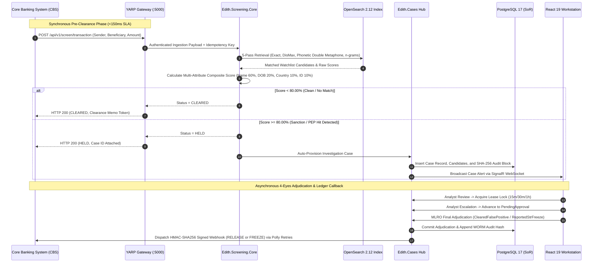

# EDITH AML Intelligence Platform
## Enterprise Architecture & Client Pitch (Version 10.0)

**Document ID:** EDITH-PITCH-v10.0  
**Target Audience:** Chief Risk Officers (CRO), Money Laundering Reporting Officers (MLRO), Chief Information Officers (CIO), Compliance Directors, Central Bank Regulators  
**Publication Date:** October 25, 2026  
**Classification:** Client Confidential / Executive Briefing  
**Core Technologies:** .NET 10 LTS, OpenSearch 2.12, PostgreSQL 17, React 19  
**Regulatory Alignment:** UAE AML/CFT Decree-Law No. (20) of 2018, Cabinet Decision No. (74) of 2020, FATF Recommendations 6, 7, 10 & 16, UNODC goAML v5.0  
**Compiled Pitch Document:** [EDITH_Client_Architecture_Pitch_v10.0.pdf](file:///F:/EDITH/MD_DOC/01_Executive_and_Pitch/EDITH_Client_Architecture_Pitch_v10.0.pdf)  
**Interactive Template:** [EDITH_Client_Architecture_Pitch_v10.0.html](file:///F:/EDITH/MD_DOC/01_Executive_and_Pitch/EDITH_Client_Architecture_Pitch_v10.0.html)

---

## Executive Summary

The **EDITH AML Intelligence Platform** is an enterprise-grade Anti-Money Laundering (AML), Counter-Terrorist Financing (CFT), and Sanctions Screening intelligence engine. Built to eliminate the critical operational bottlenecks of legacy compliance suites—crippling latency, unmanageable false-positive alert volumes, and opaque third-party cloud data exposure—EDITH delivers **sub-150ms screening throughput**, **deterministic entity resolution**, **zero-Redis dual-database persistence**, and **sovereign on-premise deployment capabilities**.

Engineered across 17 comprehensive architectural phases, Version 10.0 provides an exhaustive catalog of **10 specialized platform modules**, **17 dedicated compliance workstations and views**, and **18 active operational workflows**. From live Core Banking System (CBS) pre-clearance to 4-Eyes Maker-Checker investigations, Customer KYC 360 UBO cascade screening, automated 50,000-transaction portfolio backtesting with sensitivity elbow curves, and 14 statutory regulatory PDF reports, EDITH sets the gold standard for high-performance financial crime compliance.

---

## Section 1: Architectural Diagrams & Infrastructure Topology

EDITH implements a **Zero-Redis Dual-Database Persistence Architecture** that strictly segregates the transactional System of Record (SoR) from the read-intensive Search and Entity Resolution Engine.

### Diagram 1: Dual-Database Sovereign Architecture

The dual-database architecture eliminates write locks and resource contention during high-velocity transaction bursts:

```mermaid
flowchart TD
    subgraph ClientAndGW [Client Ingestion & API Gateway]
        CBS["Core Banking System (CBS) / Payment Rails"]
        UI["React 19 Executive Workstation (:5173)"]
        GW["YARP Reverse Proxy & Gateway (:5000)"]
        CBS -->|REST / JSON| GW
        UI -->|REST / SignalR| GW
    end

    subgraph AppTier [EDITH Core Application Tier (.NET 10 LTS)]
        AppCore["EDITH Modular Monolith Engine"]
        TxUnit["ACID Transaction Unit"]
        SearchDisp["5-Pass Match & Resolution Dispatcher"]
        LockMgr["CaseLockManager (15m/30m/1h Leases)"]
        CalibEngine["Portfolio Calibration Engine"]
        AppCore --> TxUnit
        AppCore --> SearchDisp
        AppCore --> LockMgr
        AppCore --> CalibEngine
    end

    subgraph RelationalStore [PostgreSQL 17 - System of Record]
        PG["PostgreSQL 17 (edith_aml)"]
        Schemas["5 Isolated Schemas: core, screening, cases, rules, notifications"]
        AuditLedger["WORM SHA-256 Audit Block Chaining"]
        CaseStore["Case Ledger, Notes, Evidence Dossiers"]
        PG --- Schemas
        PG --- AuditLedger
        PG --- CaseStore
    end

    subgraph SearchStore [OpenSearch 2.12 - Screening Engine]
        OS["OpenSearch 2.12 (Inverted Indices)"]
        Indices["Indices: edith_watchlist_v1, edith_customers_v1"]
        Analyzers["Analyzers: edith_ngram (3-10), Double Metaphone"]
        Fallback["Transparent In-Memory Fallback Engine"]
        OS --- Indices
        OS --- Analyzers
        OS --- Fallback
    end

    GW -->|"Authenticated & Rate-Limited Calls"| AppCore
    TxUnit -->|"Write Master Data & Audit (ACID)"| PG
    SearchDisp -->|"Sub-150ms Fuzzy/Phonetic Queries"| OS
    PG -.->|"CDC / Change-Stream Sync"| OS

    classDef primary fill:#1e1b4b,stroke:#4338ca,stroke-width:2px,color:#fff;
    classDef pg fill:#1e3a8a,stroke:#2563eb,stroke-width:2px,color:#fff;
    classDef os fill:#065f46,stroke:#059669,stroke-width:2px,color:#fff;
    classDef client fill:#334155,stroke:#64748b,stroke-width:2px,color:#fff;
    class CBS,UI,GW client;
    class AppCore,TxUnit,SearchDisp,LockMgr,CalibEngine primary;
    class PG,Schemas,AuditLedger,CaseStore pg;
    class OS,Indices,Analyzers,Fallback os;
```

---

### Diagram 2: Data Synchronization Flow & Microservice Interaction

From synchronous Core Banking System (CBS) transaction ingestion to 4-Eyes Maker-Checker case resolution and HMAC-SHA256 signed callbacks:



---

### Diagram 3: Multi-Layer 5-Pass Entity Resolution Funnel

```mermaid
flowchart TD
    RawInput["Raw Screening Input (Name, DOB, Nationality, Identifiers)"] --> Pass1
    
    subgraph Funnel [5-Pass Resolution Pipeline]
        Pass1["Pass 1: Exact Match (Normalized UTF-8 NFKC)"]
        Pass2["Pass 2: Sanitized Alias Token Inversion"]
        Pass3["Pass 3: Phonetic Encoding (Double Metaphone)"]
        Pass4["Pass 4: Fuzzy Substring & Edge n-grams (3-10)"]
        Pass5["Pass 5: Secondary Attribute Corroboration & Suppression"]
        Pass1 -->|Miss| Pass2
        Pass2 -->|Miss| Pass3
        Pass3 -->|Candidate Set| Pass4
        Pass4 --> Pass5
    end

    Pass1 -->|Exact Hit (100%)| ScoreGate
    Pass5 --> ScoreGate{"Composite Weighted Scoring Gate"}

    ScoreGate -->|Score < 80%| Cleared["CLEARED: Instant Clearance Memo"]
    ScoreGate -->|Score >= 80% & Whitelisted| Suppressed["SUPPRESSED: Verified Exemption Logged"]
    ScoreGate -->|Score >= 80% & Active Hit| Held["HELD: Auto-Provision 4-Eyes Case & Lock"]

    classDef input fill:#334155,stroke:#64748b,stroke-width:2px,color:#fff;
    classDef pipeline fill:#1e1b4b,stroke:#4338ca,stroke-width:2px,color:#fff;
    classDef gate fill:#d97706,stroke:#b45309,stroke-width:2px,color:#fff;
    classDef out fill:#0f766e,stroke:#14b8a6,stroke-width:2px,color:#fff;
    class RawInput input;
    class Pass1,Pass2,Pass3,Pass4,Pass5 pipeline;
    class ScoreGate gate;
    class Cleared,Suppressed,Held out;
```

---

## Section 2: Comprehensive Catalog of All Platform Modules

EDITH is architected as a clean **Modular Monolith** running on modern **.NET 10 LTS**, coupled with a 17-view **React 19 Workstation**. Below is the complete catalog of all 10 core modules, sub-engines, and specialized add-ons currently active in the platform:

| Module Code | Module Name & Project | Type / Tier | Core Technical Responsibilities & Key Capabilities |
| :--- | :--- | :---: | :--- |
| **`MOD-CORE-GATE`** | [`Edith.Gateway`](file:///F:/EDITH/src/Gateway/Edith.Gateway) *(YARP Gateway)* | **Core** | High-performance reverse proxy routing (`:5000`), JWT authentication, PBKDF2 IAM validation, tenant boundary isolation, rate limiting, and correlation ID tracing. |
| **`MOD-SCRN-CORE`** | [`Edith.Screening.Core`](file:///F:/EDITH/src/Screening/Edith.Screening.Core) *(Screening Engine)* | **Core** | 5-pass deterministic and phonetic fuzzy matching (Double Metaphone, Jaro-Winkler, Damerau-Levenshtein), multi-attribute composite scoring, target-type persona modes (Individual/Corporate/Vessel), PEP Tiers 1–3 diffing, and in-memory fallback. |
| **`MOD-SCRN-API`** | [`Edith.Screening.Api`](file:///F:/EDITH/src/Screening/Edith.Screening.Api) *(Screening REST API)* | **Core** | Exposes CBS pre-clearance endpoints (`POST /api/v1/screen/transaction`), single entity name search, whitelist suppression bypass, and idempotent request handling. |
| **`MOD-SCRN-BULK`** | [`Edith.Screening.Bulk`](file:///F:/EDITH/src/Screening/Edith.Screening.Bulk) *(Streaming Ingestion)* | **Core** | Asynchronous memory-bounded streaming parser (`IAsyncEnumerable`) for CSV, XML, and JSON with 9-field AML mapping, duplicate skipping, and on-demand skipped record export. |
| **`MOD-CASE-WORK`** | [`Edith.Cases`](file:///F:/EDITH/src/Cases/Edith.Cases) *(Investigation Engine)* | **Core** | 4-tab case investigation console, atomic pessimistic lease locking (`CaseLockManager`) with 15m/30m/1h options, 4-Eyes Maker-Checker state machine, investigation notes, and SignalR live updates. |
| **`MOD-RULE-PROC`** | [`Edith.Rules`](file:///F:/EDITH/src/Rules/Edith.Rules) *(Transaction Rules)* | **Core** | Real-time transaction behavior rules (High-Risk Corridors, Smurfing/Structuring, Velocity Anomaly), execution modes (Realtime, Shadow, Pending Approval), and tenant controls. |
| **`MOD-CALIB-SIM`** | [`Edith.Rules`](file:///F:/EDITH/src/Rules/Edith.Rules) *(Calibration & Replay Engine)* | **Core** | 50,000-transaction portfolio backtesting sandbox, Baseline vs Candidate Delta, Ground-Truth STR recall, 5-point Sensitivity Elbow Curve, and pin-locked slider calibration. |
| **`MOD-EVENTS-CBS`** | [`Edith.Events`](file:///F:/EDITH/src/Events/Edith.Events) *(Webhook Dispatcher)* | **Core** | Cryptographic HMAC-SHA256 signed CBS webhook callbacks (`RELEASE` / `FREEZE`), Polly exponential retry policies, and unreachable dead-letter ledger recording. |
| **`MOD-DB-STORE`** | [`Edith.Database.Migrator`](file:///F:/EDITH/src/Database/Edith.Database.Migrator) *(Persistence & WORM)* | **Infra** | Automated schema migrations for PostgreSQL 17 across 5 isolated schemas (`core`, `screening`, `cases`, `rules`, `notifications`) and SHA-256 block-chained WORM audit ledgers. |
| **`MOD-ADDONS-EXT`** | [`Edith.Addons`](file:///F:/EDITH/src/Addons/Edith.Addons) *(Regulatory & AI Suite)* | **Add-on** | UNODC goAML v5.0 XML payload generator (`MOD-GOAML-GCC`), GenAI STR Narrative Copilot (`MOD-AI-NARR`), and Multi-hop Entity Relationship Graph Visualizer (`MOD-AI-GRAPH`). |
| **`MOD-UI-PORTAL`** | [`edith-portal`](file:///F:/EDITH/src/Web/edith-portal) *(React 19 Workstation)* | **UI** | Complete 17-view compliance console with live WebSocket telemetry, What-If sensitivity slider, multi-line batch paste, Customer KYC 360 dossiers, and 14 regulatory reports. |

---

## Section 3: Comprehensive Catalog of All 17 Master Views and Pages

EDITH provides an operator interface built on React 19, TypeScript, and Tailwind CSS, featuring 17 purpose-built views:

1. **Dashboard Overview (`/`)**: Executive real-time telemetry, 24-hour screening metrics, active case distribution, system health indicators, and quick-action navigation cards.
2. **Single Entity Name Search (`/name-search`)**: Target persona selection (Individual, Corporate, Vessel), multi-attribute query fields, instant 5-pass matching, in-line adjudication slips, and downloadable clearance memos.
3. **Interactive What-If Sensitivity Simulation (`/what-if`)**: Dynamic sensitivity slider (50%–95%), real-time candidate re-ranking, and false-positive impact forecasting.
4. **Batch Clipboard Screening (`/batch-screening`)**: Multi-line delimiter-aware paste console, asynchronous parallel batch dispatch, and aggregate tabular scoring summaries.
5. **Streaming Bulk Ingestion (`/bulk-screening`)**: Drag-and-drop CSV, XML, JSON watchlist/customer portfolio ingestion, real-time rows/second throughput graphs, and skipped record exports.
6. **Periodic Watchlist Rescreening (`/rescreening`)**: Automated customer portfolio delta re-screening against newly published UN, OFAC, and local terrorist lists.
7. **Case Workspace & Investigation Queue (`/case-workspace`)**: Vertical triage queue, live lease countdown with multi-duration renewals (15m, 30m, 1h), 4-tab investigation canvas, and editable AI narrative copilot.
8. **Customer KYC 360 & UBO Cascade Hub (`/kyc360`)**: Comprehensive customer profiling, interactive UBO tree with 1-click Cascade Screening, OCR document inspector with bounding boxes, SoW/SoF checklists, and signed dossier exports.
9. **AML Rule Builder & Category Studio (`/rules/builder`)**: Authoring of transaction rules across High-Risk Corridors, Structuring/Smurfing, and Velocity Anomalies, with Realtime/Shadow execution mode toggles.
10. **Rule Calibration & Portfolio Replay Sandbox (`/rules/calibration`)**: 50,000-transaction historical replay sandbox, sensitivity elbow curve visualization, STR recall preservation, and pin-locked slider balancing.
11. **Regulatory Reports Hub (`/regulatory-reports`)**: Centralized generation, filtering (16 fields), and export of all 14 statutory PDF reports, 3d/7d SLA watchdog, and cryptographic WORM verification tool.
12. **Regulatory STR / goAML Generator (`/goaml`)**: Mapping of suspicious transaction dossiers to UNODC goAML v5.0 XML specifications with automated schema validation.
13. **Whitelist & Exemption Management (`/whitelists`)**: Controlled false-positive suppression, maker-checker authorization, legal justification ledgers, and expiration schedules.
14. **Audit Trail & WORM Ledger Viewer (`/audit-trail`)**: Immutable tamper-evident audit logs, SHA-256 block-chaining verification, and on-demand legal hold compliance certificates.
15. **System Health & Diagnostic Telemetry (`/health`)**: Dual-database ping telemetry, OpenSearch cluster state, in-memory fallback status, and API gateway throughput monitoring.
16. **IAM User & Role-Based Access Control (`/iam/users`)**: PBKDF2 credential management, TOTP MFA configuration, and 6-persona RBAC access boundaries.
17. **Tenant & Compliance Settings (`/settings`)**: Tenant isolation configurations, CBS webhook destination management, HMAC secret rotation, and SLA policy settings.

---

## Section 4: Comprehensive Catalog of All 18 Active Compliance Workflows

EDITH operationalizes compliance through **18 distinct, interconnected workflows** spanning real-time payment clearing, manual investigations, automated data synchronization, regulatory reporting, and audit verification:

### 1. Real-Time Synchronous Pre-Clearance Screening Workflow (<150ms SLA)
* **Purpose:** Enables instant payment pre-clearance for real-time payment rails (UAE IPP, SEPA Instant, FedNow) with evaluate-and-hold guarantees.
* **Execution Flow:**
  1. Core Banking System (CBS) sends `POST /api/v1/screen/transaction` with an `Idempotency-Key` header.
  2. YARP Gateway authenticates the request and forwards payload to `Edith.Screening.Core`.
  3. The 5-pass engine screens Sender, Beneficiary, and Intermediary parties against OpenSearch 2.12 inverted indices.
  4. **Clean Result ($<80\%$):** Returns `HTTP 200 CLEARED` with a digital clearance token in under 150ms.
  5. **Hit Result ($\ge 80\%$):** Returns `HTTP 200 HELD`, auto-provisions an investigation case in `cases.aml_cases`, and locks the payment ledger.

### 2. Universal Single Entity Name Search & In-Line Adjudication Workflow
* **Purpose:** Interactive compliance lookup for ad-hoc customer onboarding and counterparty checks.
* **Execution Flow:**
  1. Compliance officer selects target persona mode (**Individual**, **Corporate**, or **Vessel**) in `NameSearchView`.
  2. System queries OpenSearch indices using Double Metaphone and 3–10 edge n-grams.
  3. Candidate hits display ranked match percentages, token highlight breakdowns, and sanction program tags.
  4. **In-Line Adjudication Slip:** Analyst can dismiss false positives or escalate into a formal case with 1 click.
  5. **Onboarding Clearance Memo:** For clean searches, generates a verifiable digital clearance memo with operator timestamp.

### 3. Interactive "What-If" Sensitivity Simulation Workflow
* **Purpose:** Empowers compliance supervisors to simulate match sensitivity adjustments in real time without executing server queries.
* **Execution Flow:**
  1. Analyst loads screening candidate matches in the compliance console.
  2. Officer drags the interactive **What-If Slider (50% to 95%)** across the candidate dataset.
  3. Client-side engine instantly re-filters, re-ranks, and updates match badges in real time.
  4. Supervisors evaluate false-positive impact before submitting formal threshold adjustment requests to IT.

### 4. Batch Multi-Line Clipboard Paste Screening Workflow
* **Purpose:** Rapid ad-hoc screening of unstructured text or multi-column data directly copied from spreadsheets or emails.
* **Execution Flow:**
  1. Operator pastes multiple lines of raw text (names, IDs, nationalities) into the batch text area.
  2. Client-side parser tokenizes and validates each line into discrete entities.
  3. Entities are dispatched asynchronously in parallel batches to the screening engine.
  4. Results appear in a consolidated table displaying line-by-line match scores, hit badges, and summary statistics.

### 5. Streaming Bulk File Ingestion, Deduplication & Skipped Export Workflow
* **Purpose:** High-capacity ingestion of massive sanction watchlists and customer portfolios without memory exhaustion.
* **Execution Flow:**
  1. User uploads large CSV, XML, or JSON watchlist or customer files via `BulkScreeningView`.
  2. `AmlStreamingParser` streams records via .NET 10 `IAsyncEnumerable` within bounded memory buffers.
  3. Engine standardizes attributes into the 9-field AML schema and verifies uniqueness against PostgreSQL.
  4. Existing records are skipped; skipped records are retained when `keepSkipped=true`.
  5. SignalR streams real-time ingestion progress (rows/sec, hits); user downloads skipped duplicates in CSV, JSON, or XML.

### 6. Periodic Watchlist Delta Rescreening Workflow
* **Purpose:** Automated customer portfolio re-screening following the publication of new international or local sanctions lists.
* **Execution Flow:**
  1. New sanction feeds (UN, OFAC, UAE Local Terrorist List) are ingested into `edith_watchlist_v1`.
  2. System triggers an asynchronous delta comparison between updated watchlists and active customer profiles.
  3. Differential change-detection flags only newly affected accounts, suppressing unchanged historical matches.
  4. Generated alerts are routed directly to the designated compliance review queue.

### 7. 4-Eyes Maker-Checker Case Investigation, Vertical Queue & Multi-Lease Locking
* **Purpose:** Strict segregation of duties for suspicious transaction investigation and formal resolution with atomic concurrency protection.
* **Execution Flow:**
  1. Screening hits auto-provision an `Open` case in `cases.aml_cases`.
  2. **Analyst Lock:** Analyst selects case from vertical triage queue and chooses lease duration (15m, 30m, 1h); other analysts receive `409 Conflict`.
  3. **Triage Console:** Analyst examines 4-tab dossier (Case Details, Watchlist Hit Diff, AI Narrative Copilot, Audit Ledger & Notes).
  4. **Maker Escalation:** Analyst records categorized notes and escalates to `PendingApproval`.
  5. **Checker Adjudication:** MLRO reviews dossier and adjudicates: `ClearedFalsePositive` (optional 1-click whitelist) or `ReportedStrFreeze`.
  6. Case resolves, lease releases, and audit ledgers record state transition with SHA-256 block hash.

### 8. Customer KYC 360, Interactive UBO Tree & Cascade Screening Workflow
* **Purpose:** Holistic customer profiling and multi-tier Ultimate Beneficial Owner (UBO) ownership unwrapping.
* **Execution Flow:**
  1. Analyst queries customer dossier via `/kyc360?customer=<id>`.
  2. System visualizes corporate hierarchy down to natural-person UBOs with ownership percentages.
  3. **Cascade Screening:** Single-click execution triggers parallel 5-pass screening across all child subsidiaries and beneficial owners.
  4. Analyst inspects uploaded KYC credentials in OCR document inspector with bounding boxes, verifies SoW/SoF checklists, and exports signed WORM dossiers.

### 9. Transaction Rule Authoring, Category Logic & Shadow Execution Workflow
* **Purpose:** Dynamic transaction monitoring rule authoring across complex financial crime typologies without code deployments.
* **Execution Flow:**
  1. Compliance admin authors rules in `RuleBuilderView` selecting category (`HIGH_RISK_CORRIDOR`, `STRUCTURING_SMURFING`, `VELOCITY_ANOMALY`).
  2. Configures window durations, threshold limits, and conditional triggers.
  3. Selects execution mode: `SHADOW` (silent evaluation against production traffic) or `REALTIME` (active alert generation).
  4. Runs pre-save draft backtest to confirm syntax and logic validity before publishing.

### 10. AML Rule Calibration, 50k Portfolio Replay & Sensitivity Elbow Curve Workflow
* **Purpose:** Quantitative sensitivity calibration eliminating arbitrary threshold guessing via historical portfolio replay.
* **Execution Flow:**
  1. Compliance supervisor loads 50,000-transaction historical dataset in `RuleCalibrationView`.
  2. System runs parallel evaluation comparing Baseline vs Candidate rule configurations.
  3. Generates 5-point **Sensitivity Elbow Curve** plotting alert volume against match confidence.
  4. Confirms 100% ground-truth STR recall preservation while isolating optimal false-positive reduction sweet spots.
  5. Adjusts auto-balancing parameter sliders with pin-locks and exports calibration evidence memos.

### 11. Regulatory Reports Hub Generation (All 14 Statutory Reports) Workflow
* **Purpose:** Automated compilation, multi-criteria filtering, and export of all 14 statutory compliance and audit reports.
* **Execution Flow:**
  1. Compliance officer accesses `/regulatory-reports`.
  2. Applies 16-field transaction filter bar (date range, tenant, risk tier, amount corridors, status).
  3. Selects statutory report category:
     * **Section 4e Reports (6 Reports):** Case Velocity, False Positive Ratio, Rule Effectiveness, Watchlist Coverage, Audit Ledger Integrity, STR Filing Log.
     * **Section 4f Log Reports (5 Reports):** Ingestion Audit, Webhook Delivery, User Access & Auth, System Performance, Whitelist Review.
     * **Cross-Module Analytics (3 Reports):** End-to-End Latency Profile, Geographic Risk Matrix, High-Risk Entity Watch.
  4. 3d/7d SLA watchdog flags overdue investigation cases.
  5. Officer exports printable, publication-grade PDF reports with embedded cryptographic signatures.

### 12. Regulatory STR / SAR goAML v5.0 Filing Workflow
* **Purpose:** End-to-end generation and filing of Suspicious Transaction Reports adhering to UNODC goAML v5.0 standards.
* **Execution Flow:**
  1. Case adjudicated as `ReportedStrFreeze` initiates regulatory reporting workflow.
  2. GenAI Narrative Copilot (`MOD-AI-NARR`) synthesizes case telemetry into a structured 5-section STR narrative.
  3. Engine maps transaction details, counterparties, and entity profiles into official UNODC goAML v5.0 XML schema.
  4. Compliance officer reviews generated STR package and downloads XML payload for direct upload to the national FIU portal.

### 13. Core Banking Signed Webhook Callback Workflow
* **Purpose:** Cryptographically signed automated ledger callbacks notifying core banking systems of final compliance dispositions.
* **Execution Flow:**
  1. MLRO adjudicates case in EDITH Workstation.
  2. `ICbsWebhookDispatcher` constructs signed JSON callback (`RELEASE` or `FREEZE`).
  3. Calculates HMAC-SHA256 signature using CBS shared secret and attaches `X-Edith-Signature` header.
  4. Dispatches callback via Polly retry policy (exponential backoff across 3 attempts).
  5. Permanently unreachable endpoints record undelivered payload to `notifications.delivery_ledgers` for manual reconciliation.

### 14. Whitelist Exemption, Scope Governance & In-Case Dismissal Suppression Workflow
* **Purpose:** Controlled false-positive suppression with strict approval hierarchies, scope boundaries, and mandatory expiry dates.
* **Execution Flow:**
  1. Authorized officer identifies verified false-positive match during screening or directly inside the Case Workspace dismissal dialog.
  2. Officer defines suppression scope: Global, Entity-Specific, or Rule-Specific, with mandatory legal justification and expiry date.
  3. Record is written to `screening.whitelists` and audited via SHA-256 block ledger.
  4. Subsequent screening evaluations matching whitelist criteria are suppressed automatically (returning `CLEARED`).

### 15. Cryptographic WORM Audit Trail & On-Screen Chain Verification Workflow
* **Purpose:** Immutable, tamper-evident audit logging fulfilling central bank examination and forensic standards.
* **Execution Flow:**
  1. Every state change (screening, case transition, lease acquisition, login) writes to `core.audit_ledgers`.
  2. System retrieves SHA-256 hash of previous audit record (`previousBlockHash`) and hashes current event payload.
  3. Chained block hash is committed atomically within the same database transaction unit.
  4. Compliance officer uses the on-screen **Verify WORM Chain** tool to validate the cryptographic integrity of all audit blocks with zero breaks detected.

### 16. IAM PBKDF2 Authentication, TOTP MFA & Role-Gated Access Control Workflow
* **Purpose:** Zero-trust operator identity management with granular separation of compliance duties.
* **Execution Flow:**
  1. User authenticates via YARP Gateway with email, PBKDF2-hashed password (100,000 iterations), and TOTP MFA token.
  2. Gateway issues cryptographically signed JWT containing tenant ID and persona claims.
  3. Role-gated workstation renders only authorized navigation routes across 6 personas (Analyst, Senior Investigator, MLRO, Compliance Admin, Auditor, System Admin).

### 17. System Health, Metric Telemetry & Fallback Monitoring Workflow
* **Purpose:** Continuous operational resilience tracking and automated failover protection.
* **Execution Flow:**
  1. Health check service polls PostgreSQL 17, OpenSearch 2.12 cluster, and YARP gateway.
  2. In the event of primary search node degradation, the engine transparently switches to the in-memory fallback index.
  3. Real-time latency, memory utilization, and throughput are streamed to the Executive Dashboard.

### 18. Historical Audit Certificate Export & Legal Hold Dossier Generation Workflow
* **Purpose:** Rapid generation of certified legal hold packages for regulatory examinations and court discovery.
* **Execution Flow:**
  1. Compliance officer or legal auditor selects target case, customer, or transaction ID.
  2. System compiles complete chronological dossier: original payload, screening candidates, lease lock events, analyst notes, and WORM hashes.
  3. Exports digitally certified, tamper-evident PDF dossier with embedded cryptographic checksums.

---

## Section 5: Strategic Client Value Proposition (The Commercial Pitch)

### Key Value Drivers for Executive Leadership

| Strategic Pillar | The Industry Bottleneck | The EDITH Solution & Business Value |
| :--- | :--- | :--- |
| **1. Extreme Scalability & Latency** | Legacy systems take 1–3 seconds per check, causing instant payment timeouts and transaction drop-offs on high-speed rails. | **<150ms P99 screening SLA**; supports 50,000+ transactions/minute with horizontal container scaling and zero write-lock contention. |
| **2. Sovereign Security & Deployment** | Cross-border data privacy laws (UAE Banking Secrecy, GDPR) restrict sending customer PII to cloud SaaS providers. | **100% on-premise / sovereign deployment**; air-gapped capable, PBKDF2-SHA256 IAM, zero cloud data exfiltration. |
| **3. Precision Entity Resolution** | Global compliance averages 95% false-positive rates, overwhelming analyst teams with severe operational alert fatigue. | **Up to 70% reduction in false positives** via 5-pass composite scoring, phonetic algorithms, and scope-governed whitelist suppression. |
| **4. Frictionless Core Integration** | Multi-month integration lifecycles with costly proprietary middleware adapters and brittle batch sync jobs. | **API-first REST design**, batch clipboard screening, streaming bulk parsers, and HMAC-SHA256 signed `RELEASE`/`FREEZE` webhooks. |
| **5. Quantitative Calibration** | Compliance officers guess rule thresholds blindly, risking either catastrophic compliance misses or operational paralysis. | **50k-transaction historical replay sandbox** with sensitivity elbow curves, ensuring 100% ground-truth STR recall preservation. |
| **6. Audit & Regulatory Immunity** | Inability to prove to central bank inspectors that audit records were not modified retroactively. | **WORM SHA-256 block-chained audit ledgers** with on-screen cryptographic verification tools and automated goAML v5.0 filing. |

### Regulatory Alignment Guarantee

* **UAE Federal Decree-Law No. (20) of 2018:** Mandates comprehensive CDD and ongoing monitoring. EDITH provides real-time multi-role screening (Sender, Beneficiary, Intermediary) linked directly into KYC 360 customer profile dossiers and UBO cascade trees.
* **UAE Cabinet Decision No. (74) of 2020:** Enforces immediate application of Targeted Financial Sanctions (TFS). EDITH ingests and updates local and UN lists within under two minutes, triggering automated delta re-screening across customer portfolios.
* **FATF Recommendations 6, 7, 10 & 16:** Rigorous recordkeeping, wire transfer transparency (Travel Rule), and asset-freezing compliance via automated UNODC `goAML` XML exports and signed core banking callbacks.
* **4-Eyes Governance:** Pessimistic lease locking (15m/30m/1h), strict Maker-Checker segregation of duties, and Onboarding AML Clearance Memos.

### Proven Engineering Quality

The EDITH engine is verified by a test harness spanning **10 distinct automated test projects** and **100/100 passing test cases (100% green)**, ensuring uncompromising operational resilience under high-concurrency enterprise workloads.

---

*Compiled and published for client evaluation by the EDITH Engineering Team.*
