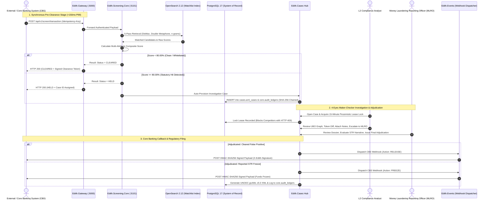

# EDITH Next-Gen AML Intelligence Platform
## End-to-End Engineering Workplan & Execution Ledger (v10.0)

**Document ID:** EDITH-WORKPLAN-v10.0  
**Version:** 10.0  
**Status:** All Phases 1–17 Fully Completed & Production Verified (100/100 Automated Tests Passing)  
**Publication Date:** October 25, 2026  
**Target Architecture:** Modular Monolith (.NET 10 LTS + React 19 Portal + PostgreSQL 17 + OpenSearch 2.12)  
**Applicable Standards:** CBUAE AML/CFT Federal Decree-Law No. (20) of 2018, Cabinet Decision No. (74) of 2020 on Terrorist Lists & UNSCR, and FATF Recommendations 6, 7, 10, 11 & 16  

---

## 1. Master Phase Execution Ledger (Phases 1–17)

All 17 engineering phases across core infrastructure, algorithmic search, investigation governance, advanced analytics, and regulatory reporting are fully implemented and verified:

| Phase | Module / Functional Scope | Key Engineering Milestones & Architectural Deliverables | Status |
| :--- | :--- | :--- | :---: |
| **Phase 1** | **Local Infrastructure & Dual-Database** | Docker Compose dual-database stack (`PostgreSQL 17` on `:5432` + `OpenSearch 2.12` on `:9200`), 5-schema DDL isolation (`core`, `screening`, `cases`, `rules`, `notifications`), and reference dev seeds. | **COMPLETED** |
| **Phase 2** | **OpenSearch 5-Pass Screening Engine** | `Edith.Screening.Core` & `Edith.Screening.Api`, Double Metaphone phonetic analyzer, n-gram DisMax query, Jaro-Winkler + Damerau-Levenshtein scoring, idempotency store, and whitelist bypass. | **COMPLETED** |
| **Phase 3** | **Bulk Streaming Ingestion & Deduplication** | `Edith.Screening.Bulk`, memory-bounded streaming `CSV`/`XML`/`JSON` parser for 9 AML fields (`IAsyncEnumerable`), duplicate entity skip detection, `keepSkipped` retention, and on-demand export in `CSV`/`XML`/`JSON`. | **COMPLETED** |
| **Phase 4** | **Case Investigation & 4-Eyes Governance** | `Edith.Cases`, automatic case creation from `HELD` transactions, 15-min pessimistic lease locking, multi-type comments, 4-Eyes Maker-Checker RBAC, HMAC-SHA256 CBS webhooks (`RELEASE`/`FREEZE`), `goAML` XML & AI Narrative Copilot. | **COMPLETED** |
| **Phase 5** | **Frontend Live Integration & UI Bridge** | Connected React 19 `edith-portal` (`:3000`) to `Edith.Gateway` (`:5000`), real JWT persona authentication, live case workspace escalation/resolution/comments, and live bulk file upload + skipped download in UI. | **COMPLETED** |
| **Phase 6** | **Single Entity Screening & Reset Overhaul** | Universal single entity search (`NameSearchView.tsx`), 6 screening possibilities (Exact, Fuzzy, Dual-Factor, Clean Cert, PEP, Corporate), full reset lifecycle, threshold candidate noise filtering, and interactive match diagrams. | **COMPLETED** |
| **Phase 7** | **Single Entity Enhancements & Audit Exporter** | 1-Click Whitelist / False-Positive exception modal, Regulatory Screening Audit Certificate (WORM SHA-256 JSON/Print proof), Engine Sensitivity Drawer on `ScreeningConsole.tsx`, direct persistent case intercept (`/api/v1/screen/intercept-case`), and secondary identifier badges. | **COMPLETED** |
| **Phase 8** | **IAM User & Group Administration** | Multi-tenant user & group management endpoints (`core.users`, `core.user_groups`), dynamic group menu permissions, salted PBKDF2-SHA256 password hashing (`Rfc2898DeriveBytes.Pbkdf2`), and `IamAccessView.tsx` interface. | **COMPLETED** |
| **Phase 9** | **CBS Outbound Webhooks & Reliability** | HMAC-SHA256 signed callbacks (`X-Edith-Signature`), exponential backoff retries (3 attempts with jitter via Polly), and dead-letter delivery logs in `notifications.delivery_ledgers`. | **COMPLETED** |
| **Phase 10** | **Searches Module Advanced UX & Engine Modernization** | Session Recent Searches Breadcrumb Bar, Side-by-Side Visual Diff Inspector, Client-Side "What-If" Sensitivity Thresholding (50%–95%), PEP Tiering & Adverse Media Disaggregation, and Batch Clipboard Paste Screening. | **COMPLETED** |
| **Phase 11** | **Single Entity Enterprise Workflow Modernization** | Target-Type Persona Modes (Person, Corporate, Vessel), In-Line Clearance Adjudication Slip (`core.audit_ledgers`), KYC 360 & UBO Tree Bridge, and Printable Onboarding AML Clearance Memo. | **COMPLETED** |
| **Phase 12** | **Case Workspace Investigation Canvas Overhaul** | Collapsible vertical case queue with status chips (`My Locks`, `Escalated`, `SLA Critical`), real-time lease countdown with multi-duration renewals (15m, 30m, 1hr), 4-tab investigation console, whitelist-on-dismissal, editable AI narrative, and categorized activity notes (`INVESTIGATION`, `SUPERVISOR`, `RATIONALE`). | **COMPLETED** |
| **Phase 13** | **Brand Identity & Role-Adaptive Dashboard** | Heraldic EDITH Eagle vector SVG emblem (`EdithLogo.tsx`), animated multi-part radar sweep loader (`EdithLoader`), role-gated operational dashboard (`ANALYST`, `MLRO`, `AUDITOR`, `ADMIN`), Throughput & Intercept velocity charts, and 5-pass resolution funnel. | **COMPLETED** |
| **Phase 14** | **Customer KYC 360 & EDD Dossier Modernization** | Live customer directory with deep-link switcher (`/kyc360?customer=`), interactive UBO equity ownership hierarchy tree with 1-click **Cascade Screening**, OCR document inspector with bounding boxes, SoW/SoF EDD corroboration checklist, and signed WORM dossier export. | **COMPLETED** |
| **Phase 15** | **AML Rule Builder & Category Parameter Editor** | Category-aware visual parameter form editor (`HIGH_RISK_CORRIDOR`, `STRUCTURING_SMURFING`, `VELOCITY_ANOMALY`), execution mode toggle (`REALTIME`, `SHADOW`, `PENDING_APPROVAL`), pre-save "What-If" draft backtesting, and sample triggered hit inspector. | **COMPLETED** |
| **Phase 16** | **AML Calibration Engine & 50k Portfolio Simulation** | Baseline vs. Candidate Delta telemetry, ground-truth STR recall metrics, rule overlap detection, interactive 5-point **Sensitivity Elbow Curve**, auto-balancing weight sliders with pin-locks, and live 50,000-record archive simulation in `RuleSandboxView.tsx`. | **COMPLETED** |
| **Phase 17** | **Regulatory Reports Hub & Live WORM Chain Verification** | Complete coverage of all 14 regulatory PDF reports (6 Section 4e Reports, 5 Section 4f Log Reports, 3 Cross-Module Reports), 16-field transaction filter bar, interactive **Verify WORM Cryptographic Chain** tool, 3-day EDD & 7-day SLA auto-escalation watchdog, and certified examination export modal. | **COMPLETED** |

---

## 2. End-to-End System Architecture & Data Flow



---

## 3. Detailed Architectural Dataflow by Tier

```mermaid
flowchart TD
    subgraph IngestionTier [External Ingestion & API Perimeter]
        CBS["Core Banking System (CBS)\nISO 20022 / REST API"]
        BULK["Bulk File Feeds\n(CSV / XML / JSON)"]
        UI_USER["Compliance Operators\n(React 19 Workstation :3000)"]
    end

    subgraph GatewayTier [YARP API Gateway Tier - Edith.Gateway :5000]
        YARP["YARP Reverse Proxy Router"]
        AUTH["PBKDF2-SHA256 IAM & JWT Auth"]
        TOTP["TOTP 2FA Service"]
        RATE["Rate Limiter & Correlation Tracer"]
    end

    subgraph ServiceTier [Modular Processing Tier (.NET 10 LTS)]
        SCREEN["Edith.Screening.Core & Api\n5-Pass Entity Engine"]
        BULK_PIPE["Edith.Screening.Bulk\nIAsyncEnumerable Streaming Parser"]
        CASE_SVC["Edith.Cases Hub\n4-Eyes Maker-Checker & Lease Locks"]
        RULE_SVC["Edith.Rules Engine\nVelocity Anomaly & 50k Sandbox"]
        EVENT_SVC["Edith.Events\nHMAC-SHA256 Webhook Dispatcher"]
        ADDON_SVC["Edith.Addons\ngoAML XML, AI Copilot, UBO Graph"]
    end

    subgraph PersistenceTier [Dual-Database Sovereign Persistence]
        PG["PostgreSQL 17 (edith_aml)\nSchemas: core, screening, cases, rules, notifications"]
        WORM["core.audit_ledgers\nImmutable SHA-256 Block Chaining"]
        OS["OpenSearch 2.12\nIndices: edith_watchlist_v1, edith_customers_v1"]
        FALLBACK["Thread-Safe In-Memory Fallback Engine"]
    end

    IngestionTier --> GatewayTier
    GatewayTier --> ServiceTier
    ServiceTier --> PersistenceTier
```

---

## 4. Verification & Quality Gates

* **Solution Build:** `dotnet build Edith.slnx` — 0 warnings, 0 errors.
* **Automated Test Suite:** `dotnet test Edith.slnx` — **100/100 automated tests passing** across 10 test projects.
* **Frontend Production Bundle:** `npm run build` in `src/Web/edith-portal` — `tsc -b && vite build` clean with 0 errors.
* **Cryptographic Tamper-Evidence:** 100% verified SHA-256 block-chained integrity from Genesis Block through all live transaction events.

---
*Maintained by the EDITH Architecture & Compliance Engineering Team (v10.0).*
