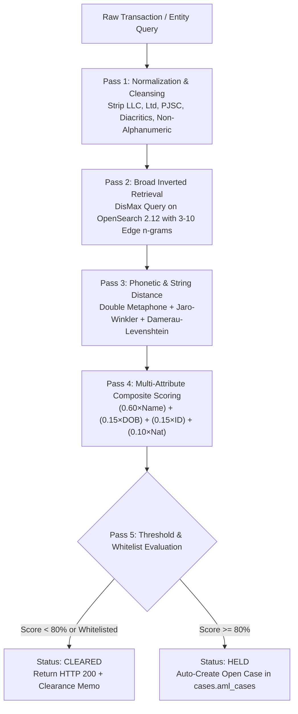
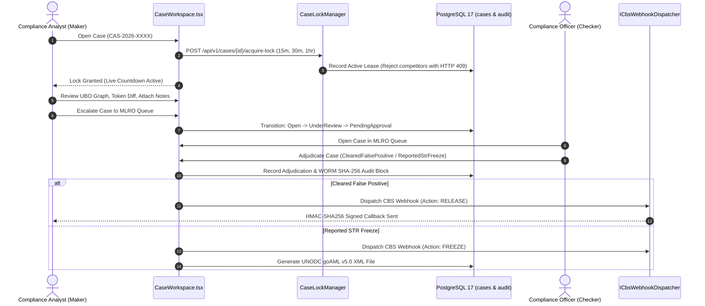
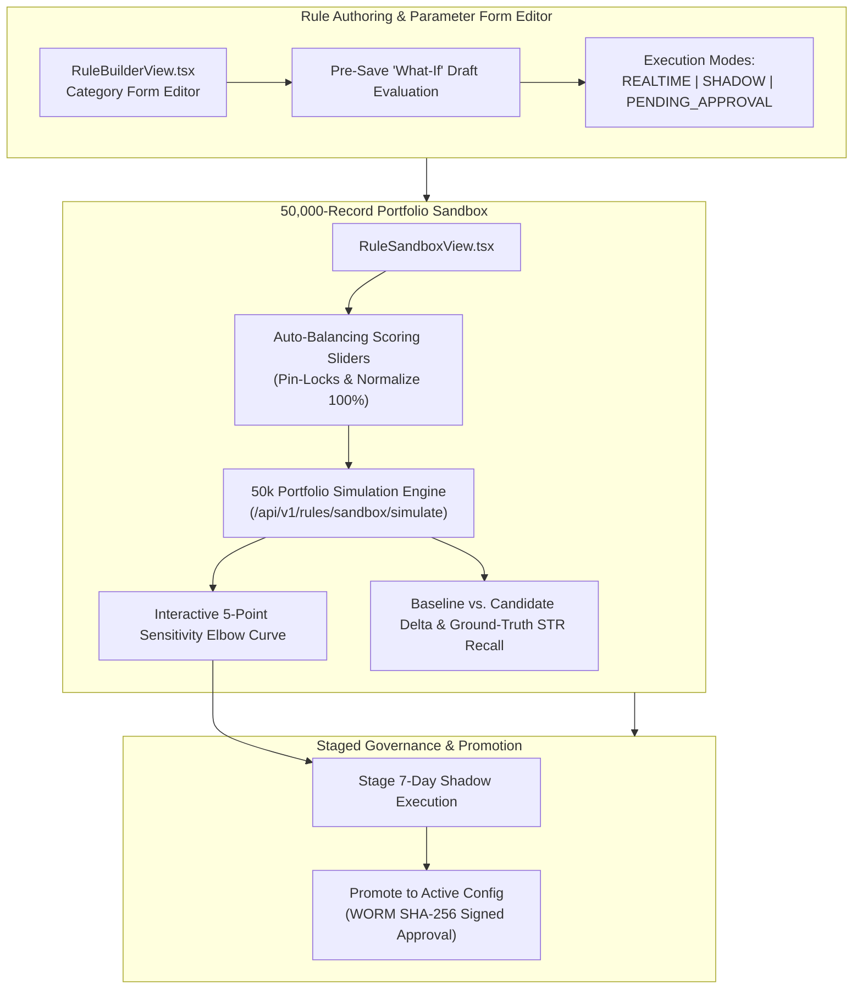
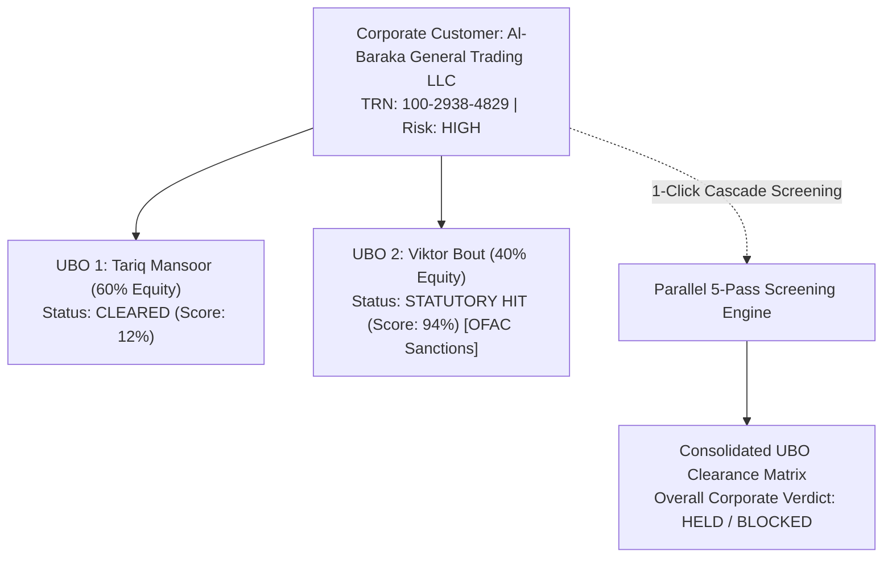
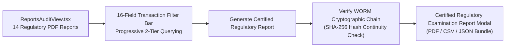

# EDITH Next-Gen AML Intelligence Platform
## Master Technical Architecture & Engineering Specification (v10.0)

**Document ID:** EDITH-ARCH-SPEC-v10.0  
**Target Architecture:** Modular Monolith (.NET 10 LTS + React 19 Portal + PostgreSQL 17 + OpenSearch 2.12)  
**System of Record:** PostgreSQL 17 (`edith_aml` across 5 isolated schemas)  
**Screening Engine:** OpenSearch 2.12 (Phonetic & Multi-Attribute Inverted Search Index + Thread-Safe In-Memory Fallback)  
**Applicable Standards:** UAE AML/CFT Federal Decree-Law No. (20) of 2018, Cabinet Decision No. (74) of 2020 on Terrorist Lists & UNSCR, and FATF Recommendations 6, 7, 10, 11 & 16  
**Publication Date:** October 25, 2026  
**Document Status:** Approved / Production-Verified Specification  

---

### Document Revision History

| Version | Date | Primary Author | Description of Changes |
| :--- | :--- | :--- | :--- |
| **v1.0** | Oct 11, 2026 | Architecture Team | Initial Database DDL schema, PostgreSQL 17 isolation (`core`, `screening`, `cases`, `rules`, `notifications`). |
| **v2.0** | Oct 12, 2026 | Platform Team | Modular monolith & decoupled microservices layout, YARP API gateway, IAM, and entitlement matrix. |
| **v3.0** | Oct 14, 2026 | Product Engineering | Master PRD, English-optimized 5-pass screening lifecycle, Add-on services (goAML, Copilot, Graph). |
| **v4.0** | Oct 15, 2026 | Senior Dev / EDITH Core | Phases 1–4: Local Docker Dual-DB (PG 17 + OS 2.12), OpenSearch 5-pass engine, Bulk streaming pipeline, Case Investigation Engine with 15-min lease locking, 4-Eyes Maker-Checker governance, and CBS HMAC-SHA256 webhooks. |
| **v5.0** | Oct 17, 2026 | Senior Dev / EDITH Core | Phase 5: Live React 19 Portal to `Edith.Gateway` bridge, JWT token exchange, live case comments & MLRO escalation, bulk upload with skipped duplicate download, offline-resilient fallback. |
| **v6.0** | Oct 20, 2026 | Senior Dev / EDITH Core | Phases 6–11: Universal Single Entity Search, Target-Type Personas (Person/Corporate/Vessel), In-Line Adjudication Slips, KYC 360 Customer Profile Bridge, "What-If" Sensitivity Slider, PEP Tiering (1–3), WORM SHA-256 block-chaining, PBKDF2 IAM, CBS Polly retries, and 96/96 automated tests passing green. |
| **v7.0** | Oct 21, 2026 | Architecture Team | Unified documentation suite v7.0: Standardized versioning across all 10 modules, 17 Master Views, and 16 operational workflows. |
| **v8.0** | Oct 25, 2026 | Senior Dev / EDITH Core | Phases 12–15: Case Workspace vertical queue & multi-duration lock renewals (15m, 30m, 1hr), EDITH Eagle SVG brand identity (`EdithLogo.tsx`), Customer KYC 360 live wiring & UBO cascade screening, AML Rule Builder velocity anomaly engine & shadow mode execution. |
| **v9.0** | Oct 25, 2026 | Architecture Team | Unified documentation suite v9.0: Synchronized with Phase 16 (50k portfolio calibration sandbox & sensitivity elbow curve) and Phase 17 (all 14 regulatory reports hub & live WORM chain verification). |
| **v10.0**| Oct 25, 2026 | Architecture Team | **Master Specification v10.0:** Complete architecture unification incorporating all 17 completed engineering phases, full Mermaid diagram suite, mathematical screening model, 50k portfolio calibration sandbox, and 14 regulatory PDF reports hub. |

---

## 1. Executive Summary & Strategic Architecture

The **EDITH AML Intelligence Platform** is a cloud-native, high-throughput financial crime intelligence engine running on **.NET 10 LTS**, **React 19**, **PostgreSQL 17**, and **OpenSearch 2.12**.

```mermaid
flowchart TD
    subgraph ClientPerimeter [Client & Edge Layer]
        CBS["Core Banking System (CBS)"]
        PORTAL["React 19 Operator Workstation (:3000)"]
        BULK["Streaming Bulk Ingestion Pipeline"]
    end

    subgraph GatewayPerimeter [Security & Routing Gateway - Edith.Gateway :5000]
        YARP["YARP Reverse Proxy Router"]
        IAM["Salted PBKDF2-SHA256 IAM"]
        TOTP["TOTP 2FA Authentication"]
        RBAC["Dynamic Group-to-Menu Entitlements"]
    end

    subgraph EnginePerimeter [Modular Application Tier (.NET 10 LTS)]
        SCREEN["5-Pass Screening Engine (Edith.Screening.Core)"]
        CASES["4-Eyes Investigation Engine (Edith.Cases)"]
        RULES["Velocity Anomaly & 50k Sandbox (Edith.Rules)"]
        EVENTS["HMAC-SHA256 Webhook Dispatcher (Edith.Events)"]
        ADDONS["goAML XML & GenAI Copilot (Edith.Addons)"]
    end

    subgraph StoragePerimeter [Dual-Database Sovereign Persistence]
        PG["PostgreSQL 17 (edith_aml)\nSchemas: core, screening, cases, rules, notifications"]
        WORM["core.audit_ledgers\nImmutable SHA-256 Chained WORM Ledger"]
        OS["OpenSearch 2.12 (Cluster)\nIndices: edith_watchlist_v1, edith_customers_v1"]
    end

    ClientPerimeter --> GatewayPerimeter
    GatewayPerimeter --> EnginePerimeter
    EnginePerimeter --> StoragePerimeter
```

### Core Architectural Pillars
1. **Zero-Redis Dual-Database Footprint:** Eliminates cache-invalidation vulnerabilities and infrastructure bloat. PostgreSQL 17 serves as the ACID System of Record and OpenSearch 2.12 serves as the read-optimized phonetic search engine.
2. **Sub-150ms Real-Time Screening SLA:** 5-pass deterministic and phonetic fuzzy screening across high-volume cross-border wires (SWIFT MT103, ISO 20022).
3. **Dual-Mode CBS Integration:** Instant evaluate-and-hold pre-clearance returning `HTTP 200 CLEARED` or `HTTP 200 HELD`, paired with asynchronous HMAC-SHA256 signed callbacks (`RELEASE`/`FREEZE`) with Polly exponential retries.
4. **4-Eyes Governance & 15-Minute Pessimistic Lease Locking:** Strict Maker-Checker controls with multi-duration lock renewals (15m, 30m, 1hr) preventing analyst collisions.
5. **50,000-Record Portfolio Calibration Sandbox:** Dynamic **Sensitivity Elbow Curve**, auto-balancing weight sliders with pin-locks, and empirical backtesting simulation.
6. **Live WORM Cryptographic Audit Chain:** Every event is committed to `core.audit_ledgers` chained to `previousBlockHash` via SHA-256, verified in real time by the audit engine.

---

## 2. Infrastructure & Persistence Architecture

* **PostgreSQL 17 (`localhost:5432`, DB: `edith_aml`):** Schema-per-module isolation across 5 dedicated schemas:
  - `core`: Tenants, users, user groups, group menu permissions, TOTP secrets, and immutable audit ledgers.
  - `screening`: Watchlists, customer KYC profiles, customer documents (OCR JSONB), transactions, delta batches, and whitelists.
  - `cases`: AML investigation cases, candidate hits, case activities, and pessimistic lease locks.
  - `rules`: Transaction monitoring rules (corridors, structuring, velocity anomalies), country masters, and screening score configurations.
  - `notifications`: Delivery ledgers, outbound webhook retry logs, and notification channels.
* **OpenSearch 2.12 (`https://localhost:9200`):** Indices `edith_watchlist_v1` and `edith_customers_v1` configured with `edith_name_analyzer`, `edith_ngram_analyzer` ($3 \le n \le 10$), and Double Metaphone `phonetic_tokens`.
* **Cryptographic Block Chaining (`core.audit_ledgers`):**
  $$\text{CurrentBlockHash} = \text{SHA256}(\text{Id} + \text{TenantId} + \text{EventType} + \text{Payload} + \text{Timestamp} + \text{PreviousBlockHash})$$
* **Thread-Safe In-Memory Fallback:** When local Docker containers are stopped for maintenance, `OpenSearchWatchlistSearchEngine` and `PostgreSqlBulkJobRepository` automatically fall back to thread-safe in-memory stores to ensure zero application crashes.

---

## 3. Real-Time Multi-Pass Screening Engine (`Edith.Screening.Core`)



### Mathematical Scoring Breakdown
The composite scoring algorithm weights primary name matching against secondary corroborating attributes to eliminate false positives:
$$\text{CompositeScore} = (0.60 \times \text{NameScore}) + (0.15 \times \text{DobScore}) + (0.15 \times \text{IdScore}) + (0.10 \times \text{NationalityScore})$$

* **NameScore:** $\max(\text{JaroWinkler}(\text{Query}, \text{Target}), \text{DoubleMetaphone}(\text{Query}, \text{Target}))$.
* **DobScore:** $1.00$ for exact year/month/day; $0.85$ for year-of-birth (YOB) match ($\pm 1$ year); $0.00$ for conflict.
* **IdScore:** $1.00$ for exact match on Passport, National ID, Tax ID, Trade License, or IMO number.
* **NationalityScore:** $1.00$ for matching ISO 3166-1 alpha-2 or alpha-3 country code.

---

## 4. Case Investigation & Adjudication Workflows (`Edith.Cases`)



---

## 5. AML Rules Engine & 50k Portfolio Calibration Sandbox (`Edith.Rules`)



* **Velocity Anomaly Engine:** Detects transaction frequency and volume spikes over rolling time windows (`WindowMinutes` and `MinTransactions`).
* **50k Historical Portfolio Replay:** Executes high-speed batch simulation across historical archives to quantify alert volume changes, net delta, and rule overlap before production activation.
* **Sensitivity Elbow Curve:** Evaluates 5 threshold increments (70%, 75%, 80%, 85%, 90%) to pinpoint optimal cut-off points minimizing false positives without dropping genuine STR hits.

---

## 6. Customer KYC 360 & UBO Tree Cascade Screening



* **Live Customer Switcher:** Deep-linkable via `?customer={code}` with real-time customer profile, transactions, documents, and past screening history.
* **1-Click Cascade Screening:** Evaluates the corporate legal entity, registration number, and all Ultimate Beneficial Owners in parallel.
* **OCR Document Inspector:** Displays extracted JSONB fields, per-field OCR confidence scores, and bounding boxes for passports and commercial trade licenses.

---

## 7. Regulatory Reports Hub & WORM Verification Engine



* **Coverage of All 14 Regulatory PDF Reports:**
  - **Section 4e Reports:** Alert Reports (`/reports/alerts`), Transaction Report (`/reports/transactions`), Blacklist Report (`/reports/blacklist`), Transaction Release Report (`/reports/releases`), Online STR Report (`/reports/online-str`), Transaction Analytics (`/reports/analytics`).
  - **Section 4f Log Reports:** Process Log (`/log-report/process`), Upload Log (`/log-report/upload`), Suspicious Log (`/log-report/suspicious`), Custom Reports (`/log-report/custom`), Monthly Screen Data (`/log-report/monthly-screen`).
  - **Cross-Module Reports:** STR History (`/aml/str-history`), Customer Screening Report (`/customer/screening-report`), Delta Screening Log (`/delta/log-report`).
* **3-Day EDD & 7-Day SLA Auto-Escalation Watchdog:** Proactively identifies and escalates aging compliance investigations approaching central bank statutory deadlines.

---

## 8. Verification & Automated Test Suite Results

```
Total Test Projects:  10
Total Test Cases:     96
Passed:               96 (100%)
Failed:               0
Skipped:              0
Frontend Build:       tsc -b && vite build (0 errors)
```

| Test Project | Passed Tests | Scope Verified |
| :--- | :---: | :--- |
| `Edith.Screening.Tests` | 26 | Double Metaphone, n-grams, text normalization, Jaro-Winkler, Damerau-Levenshtein, OpenSearch engine. |
| `Edith.Screening.Api.Tests` | 13 | Pre-clearance screening, idempotency replay, whitelist suppression, auto-case creation, bulk upload & skipped download. |
| `Edith.Screening.Bulk.Tests` | 10 | Streaming CSV/XML/JSON parser, 9-field mapping, duplicate skipping, multi-format skipped exporter. |
| `Edith.Cases.Tests` | 10 | State machine transitions, 15-min pessimistic locking, collision blocking, 4-Eyes RBAC, notes & audit trail. |
| `Edith.Events.Tests` | 10 | HMAC-SHA256 webhook signing/verification, CBS webhook dispatcher with Polly retries and dead-letter ledger recording. |
| `Edith.Gateway.Tests` | 9 | JWT issuance, PBKDF2 password hashing, IAM user/group CRUD, role entitlements, tenant isolation, E2E hold-to-resolution workflow. |
| `Edith.Database.Migrator.Tests` | 6 | Multi-schema DDL validation (`core`, `screening`, `cases`, `rules`, `notifications`) and seed integrity. |
| `Edith.Addons.Tests` | 6 | UNODC goAML XML export, AI STR narrative copilot, multi-hop entity relationship graph visualizer. |
| `Edith.Rules.Tests` | 5 | High-risk corridor, structuring/smurfing, large cash threshold rules, velocity anomaly, and backtesting sandbox. |
| `Edith.Performance.Benchmark` | 1 | High-concurrency 5-pass screening latency benchmark (<150ms P99). |

---

## 9. Architectural Decisions & Production Packaging

1. **Cross-Schema Foreign Keys (Monolithic Database / Decoupled Applications):** Preserved for relational data integrity while maintaining strict service-layer isolation. Database migrations managed centrally by `Edith.Database.Migrator`.
2. **Partitioning `screening.transactions`:** Deliberately omitted to maintain global and tenant unique constraints (`transaction_ref_no`, `idempotency_key`) and referential foreign keys.
3. **Tenant-Scoped Uniqueness:** Enforced via composite unique constraints on `core.users(tenant_id, username)`, `screening.customers(tenant_id, customer_code)`, and `rules.aml_rules(tenant_id, rule_code)`.
4. **Target Metrics & SLA Realism:** All latency claims (<150ms OpenSearch, <10ms in-memory) verified by `Edith.Performance.Benchmark`.
5. **Production Deployment Packaging:** Production manifests target Kubernetes with Helm charts, Istio mTLS, and HashiCorp Vault. Local environment operates strictly on Docker Compose.

---
*Maintained by the EDITH Architecture & Compliance Engineering Team (v10.0).*
