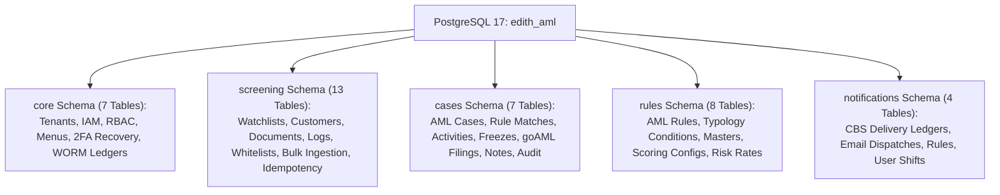
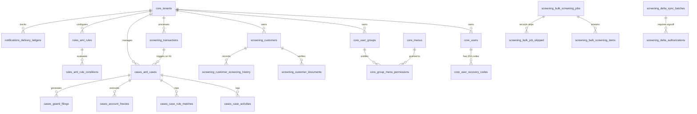
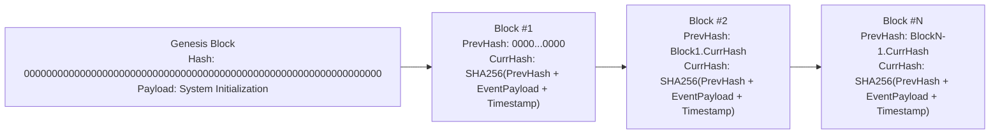

# EDITH AML Intelligence Platform: Database Architecture & OpenSearch Specification (v10.0)

**Project:** EDITH Next-Gen AML Intelligence Platform  
**Target Architecture:** PostgreSQL 17 (`edith_aml`), OpenSearch 2.12 (`edith_watchlist_v1`, `edith_customers_v1`), .NET 10 LTS  
**Version:** 10.0  
**Publication Date:** October 25, 2026  
**Status:** Approved / Production-Verified DDL & Mapping Specification  

---

## 1. Schema-per-Module Isolation Architecture

The relational database layer runs strictly on **PostgreSQL 17** partitioned into 5 logically and transactionally isolated schemas, containing a total of **39 production tables**:



---

## 2. Comprehensive Entity-Relationship Topology



---

## 3. Complete Database DDL (PostgreSQL 17 — 39 Tables)

```sql
CREATE SCHEMA IF NOT EXISTS core;
CREATE SCHEMA IF NOT EXISTS screening;
CREATE SCHEMA IF NOT EXISTS cases;
CREATE SCHEMA IF NOT EXISTS rules;
CREATE SCHEMA IF NOT EXISTS notifications;

-- ==========================================
-- SCHEMA: core (7 Tables)
-- ==========================================

-- 1. Tenants
CREATE TABLE core.tenants (
    id UUID PRIMARY KEY DEFAULT gen_random_uuid(),
    tenant_code VARCHAR(50) UNIQUE NOT NULL,
    name VARCHAR(255) NOT NULL,
    is_active BOOLEAN NOT NULL DEFAULT true,
    created_at TIMESTAMPTZ DEFAULT CURRENT_TIMESTAMP
);

-- 2. User Groups / RBAC Roles
CREATE TABLE core.user_groups (
    id UUID PRIMARY KEY DEFAULT gen_random_uuid(),
    tenant_id UUID NOT NULL REFERENCES core.tenants(id) ON DELETE RESTRICT,
    group_name VARCHAR(100) NOT NULL,
    description TEXT NULL,
    is_active BOOLEAN NOT NULL DEFAULT true,
    created_at TIMESTAMPTZ DEFAULT CURRENT_TIMESTAMP
);

-- 3. Users (IAM with PBKDF2-SHA256 & TOTP MFA)
CREATE TABLE core.users (
    id UUID PRIMARY KEY DEFAULT gen_random_uuid(),
    tenant_id UUID NOT NULL REFERENCES core.tenants(id) ON DELETE RESTRICT,
    group_id UUID NULL REFERENCES core.user_groups(id) ON DELETE SET NULL,
    username VARCHAR(100) NOT NULL,
    full_name VARCHAR(255),
    email VARCHAR(255) NOT NULL,
    department VARCHAR(255) DEFAULT 'Financial Crime Compliance',
    shift_status VARCHAR(50) DEFAULT 'ON_DUTY',
    role VARCHAR(50) NOT NULL, -- ANALYST, SENIOR_INVESTIGATOR, MLRO, COMPLIANCE_ADMIN, AUDITOR, SUPER_ADMIN
    password_hash VARCHAR(256) NULL, -- PBKDF2-SHA256 100k iterations
    must_change_password BOOLEAN NOT NULL DEFAULT true,
    mfa_enabled BOOLEAN NOT NULL DEFAULT false,
    mfa_secret VARCHAR(128) NULL,
    mfa_enrolled_at TIMESTAMPTZ NULL,
    last_login_at TIMESTAMPTZ NULL,
    invitation_token VARCHAR(128) NULL,
    invitation_token_expires_at TIMESTAMPTZ NULL,
    is_active BOOLEAN NOT NULL DEFAULT true,
    created_at TIMESTAMPTZ DEFAULT CURRENT_TIMESTAMP,
    CONSTRAINT users_tenant_username_key UNIQUE (tenant_id, username)
);

-- 4. 2FA Emergency Backup Recovery Codes
CREATE TABLE core.user_recovery_codes (
    id UUID PRIMARY KEY DEFAULT gen_random_uuid(),
    user_id UUID NOT NULL REFERENCES core.users(id) ON DELETE CASCADE,
    code_hash VARCHAR(128) NOT NULL,
    used_at TIMESTAMPTZ NULL,
    created_at TIMESTAMPTZ NOT NULL DEFAULT CURRENT_TIMESTAMP
);

-- 5. System Menus & Route Entitlements
CREATE TABLE core.menus (
    id UUID PRIMARY KEY DEFAULT gen_random_uuid(),
    parent_menu_id UUID NULL REFERENCES core.menus(id) ON DELETE CASCADE,
    menu_code VARCHAR(100) UNIQUE NOT NULL,
    menu_name VARCHAR(100) NOT NULL,
    path VARCHAR(255) NOT NULL,
    icon VARCHAR(50) NULL,
    position INT NOT NULL,
    is_active BOOLEAN NOT NULL DEFAULT true
);

-- 6. Dynamic Group Menu Permissions
CREATE TABLE core.group_menu_permissions (
    id UUID PRIMARY KEY DEFAULT gen_random_uuid(),
    group_id UUID NOT NULL REFERENCES core.user_groups(id) ON DELETE CASCADE,
    menu_id UUID NOT NULL REFERENCES core.menus(id) ON DELETE CASCADE,
    can_view BOOLEAN NOT NULL DEFAULT false,
    can_edit BOOLEAN NOT NULL DEFAULT false,
    can_export BOOLEAN NOT NULL DEFAULT false,
    CONSTRAINT group_menu_perm_key UNIQUE (group_id, menu_id)
);

-- 7. WORM SHA-256 Block-Chained Immutable Audit Ledger
CREATE TABLE core.audit_ledgers (
    id UUID PRIMARY KEY DEFAULT gen_random_uuid(),
    tenant_id UUID NOT NULL REFERENCES core.tenants(id) ON DELETE RESTRICT,
    event_type VARCHAR(100) NOT NULL,
    entity_id VARCHAR(128) NOT NULL,
    actor_id UUID NULL REFERENCES core.users(id),
    previous_block_hash VARCHAR(64) NOT NULL,
    current_block_hash VARCHAR(64) NOT NULL,
    event_payload JSONB NOT NULL,
    timestamp_utc TIMESTAMPTZ NOT NULL DEFAULT CURRENT_TIMESTAMP,
    CONSTRAINT audit_current_hash_key UNIQUE (current_block_hash)
);

-- ==========================================
-- SCHEMA: rules (8 Tables)
-- ==========================================

-- 8. Country Masters (FATF Black, Grey & Monitored)
CREATE TABLE rules.country_masters (
    id UUID PRIMARY KEY DEFAULT gen_random_uuid(),
    tenant_id UUID NOT NULL REFERENCES core.tenants(id) ON DELETE RESTRICT,
    country_code VARCHAR(3) NOT NULL,
    country_name VARCHAR(150) NOT NULL,
    risk_level VARCHAR(50) NOT NULL, -- LOW, MEDIUM, HIGH, FATF_GREY, FATF_BLACK
    is_sanctioned BOOLEAN NOT NULL DEFAULT false,
    created_at TIMESTAMPTZ DEFAULT CURRENT_TIMESTAMP,
    CONSTRAINT country_tenant_code_key UNIQUE (tenant_id, country_code)
);

-- 9. Nationality Masters
CREATE TABLE rules.nationality_masters (
    id UUID PRIMARY KEY DEFAULT gen_random_uuid(),
    tenant_id UUID NOT NULL REFERENCES core.tenants(id) ON DELETE RESTRICT,
    nationality_code VARCHAR(3) NOT NULL,
    demonym VARCHAR(150) NOT NULL,
    risk_weight NUMERIC(5,2) NOT NULL DEFAULT 1.0,
    created_at TIMESTAMPTZ DEFAULT CURRENT_TIMESTAMP
);

-- 10. AML Behavioral & Typology Rules
CREATE TABLE rules.aml_rules (
    id UUID PRIMARY KEY DEFAULT gen_random_uuid(),
    tenant_id UUID NOT NULL REFERENCES core.tenants(id) ON DELETE RESTRICT,
    rule_code VARCHAR(100) NOT NULL,
    rule_name VARCHAR(255) NOT NULL,
    category VARCHAR(50) NOT NULL, -- TRANSACTION_THRESHOLD, HIGH_RISK_CORRIDOR, STRUCTURING_SMURFING, VELOCITY_ANOMALY
    execution_mode VARCHAR(50) NOT NULL DEFAULT 'REALTIME', -- REALTIME, SHADOW, PENDING_APPROVAL
    threshold_amount NUMERIC(18,2) NULL,
    window_duration_hours INT NULL,
    burst_count INT NULL,
    severity VARCHAR(30) NOT NULL DEFAULT 'MEDIUM',
    is_active BOOLEAN NOT NULL DEFAULT true,
    created_at TIMESTAMPTZ DEFAULT CURRENT_TIMESTAMP,
    CONSTRAINT aml_rules_tenant_code_key UNIQUE (tenant_id, rule_code)
);

-- 11. AML Rule Typology Conditions
CREATE TABLE rules.aml_rule_conditions (
    id UUID PRIMARY KEY DEFAULT gen_random_uuid(),
    rule_id UUID NOT NULL REFERENCES rules.aml_rules(id) ON DELETE CASCADE,
    field_name VARCHAR(100) NOT NULL,
    operator VARCHAR(30) NOT NULL, -- GT, LT, EQ, IN, CONTAINS, MATCHES_REGEX
    comparison_value TEXT NOT NULL,
    created_at TIMESTAMPTZ DEFAULT CURRENT_TIMESTAMP
);

-- 12. Risk Rate Settings
CREATE TABLE rules.risk_rate_settings (
    id UUID PRIMARY KEY DEFAULT gen_random_uuid(),
    tenant_id UUID NOT NULL REFERENCES core.tenants(id) ON DELETE RESTRICT,
    risk_category VARCHAR(100) NOT NULL,
    multiplier NUMERIC(5,2) NOT NULL DEFAULT 1.0,
    created_at TIMESTAMPTZ DEFAULT CURRENT_TIMESTAMP
);

-- 13. Screening Scoring Configs (Multi-Attribute Weights)
CREATE TABLE rules.screening_score_configs (
    id UUID PRIMARY KEY DEFAULT gen_random_uuid(),
    tenant_id UUID NOT NULL REFERENCES core.tenants(id) ON DELETE RESTRICT,
    name_weight NUMERIC(5,2) NOT NULL DEFAULT 0.60,
    dob_weight NUMERIC(5,2) NOT NULL DEFAULT 0.15,
    passport_weight NUMERIC(5,2) NOT NULL DEFAULT 0.15,
    nationality_weight NUMERIC(5,2) NOT NULL DEFAULT 0.10,
    threshold_strict NUMERIC(5,2) NOT NULL DEFAULT 0.70,
    threshold_standard NUMERIC(5,2) NOT NULL DEFAULT 0.75,
    threshold_domestic NUMERIC(5,2) NOT NULL DEFAULT 0.85,
    updated_at TIMESTAMPTZ DEFAULT CURRENT_TIMESTAMP
);

-- 14. Setup Controls
CREATE TABLE rules.setup_controls (
    id UUID PRIMARY KEY DEFAULT gen_random_uuid(),
    tenant_id UUID NOT NULL REFERENCES core.tenants(id) ON DELETE RESTRICT,
    control_key VARCHAR(100) NOT NULL,
    control_value VARCHAR(255) NOT NULL,
    description TEXT NULL,
    updated_at TIMESTAMPTZ DEFAULT CURRENT_TIMESTAMP
);

-- 15. Risk Assessment Masters
CREATE TABLE rules.risk_assessment_masters (
    id UUID PRIMARY KEY DEFAULT gen_random_uuid(),
    tenant_id UUID NOT NULL REFERENCES core.tenants(id) ON DELETE RESTRICT,
    dimension VARCHAR(100) NOT NULL, -- GEOGRAPHIC, CUSTOMER_TYPE, PRODUCT, DELIVERY_CHANNEL
    score INT NOT NULL,
    updated_at TIMESTAMPTZ DEFAULT CURRENT_TIMESTAMP
);

-- ==========================================
-- SCHEMA: screening (13 Tables)
-- ==========================================

-- 16. Customer Master Profiles
CREATE TABLE screening.customers (
    id UUID PRIMARY KEY DEFAULT gen_random_uuid(),
    tenant_id UUID NOT NULL REFERENCES core.tenants(id) ON DELETE RESTRICT,
    customer_no VARCHAR(100) NOT NULL,
    full_name VARCHAR(255) NOT NULL,
    entity_type VARCHAR(50) NOT NULL, -- INDIVIDUAL, CORPORATE, VESSEL
    risk_tier VARCHAR(20) NOT NULL DEFAULT 'LOW', -- LOW, MEDIUM, HIGH, PEP
    date_of_birth DATE NULL,
    nationality VARCHAR(3) NULL,
    trade_license_no VARCHAR(100) NULL,
    sow_verified BOOLEAN NOT NULL DEFAULT false,
    sof_verified BOOLEAN NOT NULL DEFAULT false,
    created_at TIMESTAMPTZ DEFAULT CURRENT_TIMESTAMP,
    CONSTRAINT customers_tenant_no_key UNIQUE (tenant_id, customer_no)
);

-- 17. Customer Identity Documents & OCR Records
CREATE TABLE screening.customer_documents (
    id UUID PRIMARY KEY DEFAULT gen_random_uuid(),
    customer_id UUID NOT NULL REFERENCES screening.customers(id) ON DELETE CASCADE,
    document_type VARCHAR(50) NOT NULL, -- PASSPORT, EMIRATES_ID, TRADE_LICENSE, ARTICLES_OF_INC
    document_number VARCHAR(100) NOT NULL,
    expiry_date DATE NULL,
    ocr_confidence NUMERIC(5,2) NULL,
    ocr_extracted_fields JSONB NULL,
    file_uri VARCHAR(500) NULL,
    created_at TIMESTAMPTZ DEFAULT CURRENT_TIMESTAMP
);

-- 18. Customer Screening History
CREATE TABLE screening.customer_screening_history (
    id UUID PRIMARY KEY DEFAULT gen_random_uuid(),
    customer_id UUID NOT NULL REFERENCES screening.customers(id) ON DELETE CASCADE,
    screening_date TIMESTAMPTZ NOT NULL DEFAULT CURRENT_TIMESTAMP,
    score NUMERIC(5,2) NOT NULL,
    verdict VARCHAR(50) NOT NULL, -- CLEARED, HELD, EDD_REQUIRED
    matched_entity_id VARCHAR(128) NULL
);

-- 19. Watchlist Entities (OFAC, UN, EU, Local TFS)
CREATE TABLE screening.watchlist_entities (
    id UUID PRIMARY KEY DEFAULT gen_random_uuid(),
    source_program VARCHAR(100) NOT NULL, -- OFAC_SDN, UN_CONSOLIDATED, EU_FSF, UAE_LOCAL_TFS
    entity_uid VARCHAR(128) NOT NULL,
    entity_type VARCHAR(50) NOT NULL,
    primary_name VARCHAR(255) NOT NULL,
    aliases TEXT[] NULL,
    date_of_birth VARCHAR(50) NULL,
    nationalities VARCHAR(3)[] NULL,
    identifiers JSONB NULL,
    pep_tier INT NULL, -- 1 (Head of State), 2 (Senior Gov), 3 (SOE Exec)
    is_active BOOLEAN NOT NULL DEFAULT true,
    last_updated TIMESTAMPTZ DEFAULT CURRENT_TIMESTAMP
);

-- 20. Screening Transactions (Real-Time Pre-Clearance)
CREATE TABLE screening.transactions (
    id UUID PRIMARY KEY DEFAULT gen_random_uuid(),
    tenant_id UUID NOT NULL REFERENCES core.tenants(id) ON DELETE RESTRICT,
    transaction_ref_no VARCHAR(100) NOT NULL,
    idempotency_key VARCHAR(128) NULL,
    sender_name VARCHAR(255) NOT NULL,
    beneficiary_name VARCHAR(255) NOT NULL,
    intermediary_bank VARCHAR(255) NULL,
    origin_country VARCHAR(3) NOT NULL,
    destination_country VARCHAR(3) NOT NULL,
    amount NUMERIC(18,2) NOT NULL,
    currency VARCHAR(3) NOT NULL,
    status VARCHAR(50) NOT NULL, -- CLEARED, HELD, BLOCKED, RELEASED
    screening_score NUMERIC(5,2) NULL,
    created_at TIMESTAMPTZ DEFAULT CURRENT_TIMESTAMP,
    CONSTRAINT transactions_tenant_ref_key UNIQUE (tenant_id, transaction_ref_no)
);

-- 21. Screening Logs
CREATE TABLE screening.screening_logs (
    id UUID PRIMARY KEY DEFAULT gen_random_uuid(),
    transaction_id UUID NULL REFERENCES screening.transactions(id) ON DELETE CASCADE,
    query_entity_name VARCHAR(255) NOT NULL,
    match_score NUMERIC(5,2) NOT NULL,
    pass_number INT NOT NULL,
    latency_ms NUMERIC(8,2) NOT NULL,
    created_at TIMESTAMPTZ DEFAULT CURRENT_TIMESTAMP
);

-- 22. Whitelists & Suppression Rules
CREATE TABLE screening.whitelists (
    id UUID PRIMARY KEY DEFAULT gen_random_uuid(),
    tenant_id UUID NOT NULL REFERENCES core.tenants(id) ON DELETE RESTRICT,
    entity_name VARCHAR(255) NOT NULL,
    match_criteria JSONB NOT NULL,
    scope VARCHAR(50) NOT NULL DEFAULT 'GLOBAL', -- GLOBAL, ENTITY_SPECIFIC, RULE_SPECIFIC
    legal_justification TEXT NOT NULL,
    approved_by UUID NOT NULL REFERENCES core.users(id),
    expires_at TIMESTAMPTZ NOT NULL,
    created_at TIMESTAMPTZ DEFAULT CURRENT_TIMESTAMP
);

-- 23. Bulk Screening Jobs
CREATE TABLE screening.bulk_screening_jobs (
    id UUID PRIMARY KEY DEFAULT gen_random_uuid(),
    tenant_id UUID NOT NULL REFERENCES core.tenants(id) ON DELETE RESTRICT,
    file_name VARCHAR(255) NOT NULL,
    total_records INT NOT NULL DEFAULT 0,
    processed_records INT NOT NULL DEFAULT 0,
    hit_count INT NOT NULL DEFAULT 0,
    skipped_count INT NOT NULL DEFAULT 0,
    status VARCHAR(50) NOT NULL DEFAULT 'QUEUED', -- QUEUED, PROCESSING, COMPLETED, FAILED
    created_at TIMESTAMPTZ DEFAULT CURRENT_TIMESTAMP
);

-- 24. Bulk Screening Items
CREATE TABLE screening.bulk_screening_items (
    id UUID PRIMARY KEY DEFAULT gen_random_uuid(),
    job_id UUID NOT NULL REFERENCES screening.bulk_screening_jobs(id) ON DELETE CASCADE,
    row_number INT NOT NULL,
    raw_payload JSONB NOT NULL,
    match_score NUMERIC(5,2) NULL,
    status VARCHAR(50) NOT NULL -- PENDING, CLEARED, HELD, SKIPPED
);

-- 25. Delta Synchronization Batches
CREATE TABLE screening.delta_sync_batches (
    id UUID PRIMARY KEY DEFAULT gen_random_uuid(),
    tenant_id UUID NOT NULL REFERENCES core.tenants(id) ON DELETE RESTRICT,
    source_program VARCHAR(100) NOT NULL,
    batch_timestamp TIMESTAMPTZ NOT NULL DEFAULT CURRENT_TIMESTAMP,
    entities_added INT NOT NULL DEFAULT 0,
    entities_updated INT NOT NULL DEFAULT 0,
    entities_removed INT NOT NULL DEFAULT 0,
    affected_customers_count INT NOT NULL DEFAULT 0,
    status VARCHAR(50) NOT NULL DEFAULT 'PENDING_APPROVAL'
);

-- 26. Delta Authorizations (Maker-Checker)
CREATE TABLE screening.delta_authorizations (
    id UUID PRIMARY KEY DEFAULT gen_random_uuid(),
    batch_id UUID NOT NULL REFERENCES screening.delta_sync_batches(id) ON DELETE CASCADE,
    authorized_by UUID NOT NULL REFERENCES core.users(id),
    action VARCHAR(50) NOT NULL, -- APPROVED, REJECTED
    notes TEXT NULL,
    created_at TIMESTAMPTZ DEFAULT CURRENT_TIMESTAMP
);

-- 27. Bulk Job Skipped Records
CREATE TABLE screening.bulk_job_skipped (
    id UUID PRIMARY KEY DEFAULT gen_random_uuid(),
    job_id UUID NOT NULL REFERENCES screening.bulk_screening_jobs(id) ON DELETE CASCADE,
    row_number INT NOT NULL,
    skip_reason VARCHAR(255) NOT NULL,
    raw_payload JSONB NOT NULL,
    created_at TIMESTAMPTZ DEFAULT CURRENT_TIMESTAMP
);

-- 28. Idempotency Cache
CREATE TABLE screening.idempotency_cache (
    idempotency_key VARCHAR(128) PRIMARY KEY,
    response_payload JSONB NOT NULL,
    created_at TIMESTAMPTZ DEFAULT CURRENT_TIMESTAMP,
    expires_at TIMESTAMPTZ NOT NULL
);

-- ==========================================
-- SCHEMA: cases (7 Tables)
-- ==========================================

-- 29. AML Cases (4-Eyes Maker-Checker & Lease Locks)
CREATE TABLE cases.aml_cases (
    id UUID PRIMARY KEY DEFAULT gen_random_uuid(),
    tenant_id UUID NOT NULL REFERENCES core.tenants(id) ON DELETE RESTRICT,
    case_number VARCHAR(100) NOT NULL,
    transaction_id UUID NULL REFERENCES screening.transactions(id) ON DELETE RESTRICT,
    customer_id UUID NULL REFERENCES screening.customers(id) ON DELETE RESTRICT,
    status VARCHAR(50) NOT NULL DEFAULT 'Open', -- Open, UnderReview, PendingApproval, ClearedFalsePositive, ReportedStrFreeze
    assigned_analyst_id UUID NULL REFERENCES core.users(id),
    locked_by UUID NULL REFERENCES core.users(id),
    locked_until TIMESTAMPTZ NULL,
    lock_duration_minutes INT NULL DEFAULT 15,
    sla_due_at TIMESTAMPTZ NOT NULL,
    created_at TIMESTAMPTZ DEFAULT CURRENT_TIMESTAMP,
    CONSTRAINT aml_cases_tenant_case_number_key UNIQUE (tenant_id, case_number)
);

-- 30. Case Rule Matches
CREATE TABLE cases.case_rule_matches (
    id UUID PRIMARY KEY DEFAULT gen_random_uuid(),
    case_id UUID NOT NULL REFERENCES cases.aml_cases(id) ON DELETE CASCADE,
    rule_id UUID NOT NULL REFERENCES rules.aml_rules(id) ON DELETE RESTRICT,
    match_score NUMERIC(5,2) NOT NULL,
    tripped_condition_summary TEXT NOT NULL,
    created_at TIMESTAMPTZ DEFAULT CURRENT_TIMESTAMP
);

-- 31. Case Activities & Notes
CREATE TABLE cases.case_activities (
    id UUID PRIMARY KEY DEFAULT gen_random_uuid(),
    case_id UUID NOT NULL REFERENCES cases.aml_cases(id) ON DELETE CASCADE,
    actor_id UUID NULL REFERENCES core.users(id),
    activity_type VARCHAR(100) NOT NULL, -- NOTE_ADDED, STATUS_CHANGED, LEASE_RENEWED, LOCK_ACQUIRED
    note_type VARCHAR(30) NULL, -- INVESTIGATION, SUPERVISOR, RATIONALE
    comment_text TEXT NOT NULL,
    created_at TIMESTAMPTZ DEFAULT CURRENT_TIMESTAMP
);

-- 32. Account Freezes
CREATE TABLE cases.account_freezes (
    id UUID PRIMARY KEY DEFAULT gen_random_uuid(),
    case_id UUID NOT NULL REFERENCES cases.aml_cases(id) ON DELETE CASCADE,
    account_number VARCHAR(100) NOT NULL,
    freeze_order_ref VARCHAR(100) NOT NULL,
    frozen_by UUID NOT NULL REFERENCES core.users(id),
    frozen_at TIMESTAMPTZ DEFAULT CURRENT_TIMESTAMP
);

-- 33. goAML Regulatory Filings
CREATE TABLE cases.goaml_filings (
    id UUID PRIMARY KEY DEFAULT gen_random_uuid(),
    case_id UUID NOT NULL REFERENCES cases.aml_cases(id) ON DELETE CASCADE,
    report_type VARCHAR(20) NOT NULL DEFAULT 'STR', -- STR, SAR, AIF
    fiu_reference_no VARCHAR(100) NULL,
    xml_payload TEXT NOT NULL,
    filed_by UUID NOT NULL REFERENCES core.users(id),
    filed_at TIMESTAMPTZ DEFAULT CURRENT_TIMESTAMP
);

-- 34. Case Notes (Structured Collaboration)
CREATE TABLE cases.case_notes (
    id UUID PRIMARY KEY DEFAULT gen_random_uuid(),
    case_id UUID NOT NULL REFERENCES cases.aml_cases(id) ON DELETE CASCADE,
    author_id UUID NOT NULL REFERENCES core.users(id),
    note_category VARCHAR(50) NOT NULL,
    content TEXT NOT NULL,
    created_at TIMESTAMPTZ DEFAULT CURRENT_TIMESTAMP
);

-- 35. Case Audit Entries
CREATE TABLE cases.case_audit_entries (
    id UUID PRIMARY KEY DEFAULT gen_random_uuid(),
    case_id UUID NOT NULL REFERENCES cases.aml_cases(id) ON DELETE CASCADE,
    action VARCHAR(100) NOT NULL,
    maker_id UUID NOT NULL REFERENCES core.users(id),
    checker_id UUID NULL REFERENCES core.users(id),
    state_before VARCHAR(50) NOT NULL,
    state_after VARCHAR(50) NOT NULL,
    rationale TEXT NOT NULL,
    timestamp_utc TIMESTAMPTZ DEFAULT CURRENT_TIMESTAMP
);

-- ==========================================
-- SCHEMA: notifications (4 Tables)
-- ==========================================

-- 36. CBS Webhook Delivery Ledgers (HMAC Signed)
CREATE TABLE notifications.delivery_ledgers (
    id UUID PRIMARY KEY DEFAULT gen_random_uuid(),
    tenant_id UUID NOT NULL REFERENCES core.tenants(id) ON DELETE RESTRICT,
    target_endpoint VARCHAR(255) NOT NULL,
    event_type VARCHAR(100) NOT NULL, -- CBS_TRANSACTION_RELEASE, CBS_TRANSACTION_FREEZE
    payload JSONB NOT NULL,
    signature_header VARCHAR(256) NOT NULL, -- HMAC-SHA256
    retry_count INT NOT NULL DEFAULT 0,
    delivery_status VARCHAR(50) NOT NULL, -- DELIVERED, FAILED_DEADLETTER
    last_attempt_at TIMESTAMPTZ DEFAULT CURRENT_TIMESTAMP,
    created_at TIMESTAMPTZ DEFAULT CURRENT_TIMESTAMP
);

-- 37. Outbound Email Dispatches Log
CREATE TABLE notifications.email_dispatches (
    id UUID PRIMARY KEY DEFAULT gen_random_uuid(),
    tenant_id UUID NULL REFERENCES core.tenants(id) ON DELETE SET NULL,
    recipient_email VARCHAR(255) NOT NULL,
    subject VARCHAR(255) NOT NULL,
    body_html TEXT NOT NULL,
    status VARCHAR(50) NOT NULL, -- SENT, FAILED
    error_message TEXT NULL,
    sent_at TIMESTAMPTZ NULL,
    created_at TIMESTAMPTZ NOT NULL DEFAULT CURRENT_TIMESTAMP
);

-- 38. Notification Routing Rules
CREATE TABLE notifications.notification_rules (
    id UUID PRIMARY KEY DEFAULT gen_random_uuid(),
    tenant_id UUID NOT NULL REFERENCES core.tenants(id) ON DELETE RESTRICT,
    event_trigger VARCHAR(100) NOT NULL, -- HIGH_PRIORITY_CASE, SLA_BREACH_WARNING, STR_FREEZE
    recipient_group VARCHAR(100) NOT NULL,
    channel VARCHAR(30) NOT NULL, -- WEBHOOK, EMAIL, SIGNALR
    is_active BOOLEAN NOT NULL DEFAULT true
);

-- 39. User Shift Schedules
CREATE TABLE notifications.user_shifts (
    id UUID PRIMARY KEY DEFAULT gen_random_uuid(),
    user_id UUID NOT NULL REFERENCES core.users(id) ON DELETE CASCADE,
    shift_name VARCHAR(100) NOT NULL,
    shift_start TIME NOT NULL,
    shift_end TIME NOT NULL,
    is_active BOOLEAN NOT NULL DEFAULT true
);
```

---

## 4. OpenSearch 2.12 Inverted & Phonetic Mapping

### Watchlist Search Index: `edith_watchlist_v1`

```json
{
  "settings": {
    "index": {
      "number_of_shards": 2,
      "number_of_replicas": 1,
      "analysis": {
        "filter": {
          "edith_ngram_filter": {
            "type": "edge_ngram",
            "min_gram": 3,
            "max_gram": 10
          },
          "edith_double_metaphone": {
            "type": "phonetic",
            "encoder": "double_metaphone",
            "replace": false
          }
        },
        "analyzer": {
          "edith_name_analyzer": {
            "type": "custom",
            "tokenizer": "standard",
            "filter": ["lowercase", "asciifolding", "edith_ngram_filter"]
          },
          "edith_phonetic_analyzer": {
            "type": "custom",
            "tokenizer": "standard",
            "filter": ["lowercase", "asciifolding", "edith_double_metaphone"]
          }
        }
      }
    }
  },
  "mappings": {
    "properties": {
      "entityUid": { "type": "keyword" },
      "primaryName": {
        "type": "text",
        "analyzer": "edith_name_analyzer",
        "fields": {
          "phonetic": {
            "type": "text",
            "analyzer": "edith_phonetic_analyzer"
          },
          "raw": {
            "type": "keyword"
          }
        }
      },
      "aliases": {
        "type": "text",
        "analyzer": "edith_name_analyzer",
        "fields": {
          "phonetic": {
            "type": "text",
            "analyzer": "edith_phonetic_analyzer"
          }
        }
      },
      "entityType": { "type": "keyword" },
      "sourceProgram": { "type": "keyword" },
      "nationalities": { "type": "keyword" },
      "dateOfBirth": { "type": "keyword" },
      "pepTier": { "type": "integer" },
      "isActive": { "type": "boolean" },
      "updatedAt": { "type": "date" }
    }
  }
}
```

---

## 5. Cryptographic WORM Block-Chaining Specification

Every mutation across transactions, screening decisions, case transitions, lease locking, scoring weights, and user logins writes an immutable audit record to `core.audit_ledgers`.



### Hashing Formula:
$$\text{CurrentBlockHash} = \text{SHA256}(\text{PreviousBlockHash} \mathbin{\Vert} \text{TenantId} \mathbin{\Vert} \text{EventType} \mathbin{\Vert} \text{EntityId} \mathbin{\Vert} \text{JSON}(\text{Payload}) \mathbin{\Vert} \text{TimestampUtc})$$

The on-screen **Verify WORM Cryptographic Chain** tool in `ReportsAuditView.tsx` traverses the entire table sequentially, verifying that:
1. `record[i].previous_block_hash == record[i-1].current_block_hash`
2. `record[i].current_block_hash == SHA256(...)`
Any alteration or row deletion instantly breaks the cryptographic hash pointer, alerting compliance auditors to unauthorized tampering.

---
*Verified and approved for production by the EDITH Architecture & Compliance Engineering Team (v10.0).*
