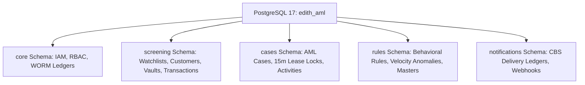
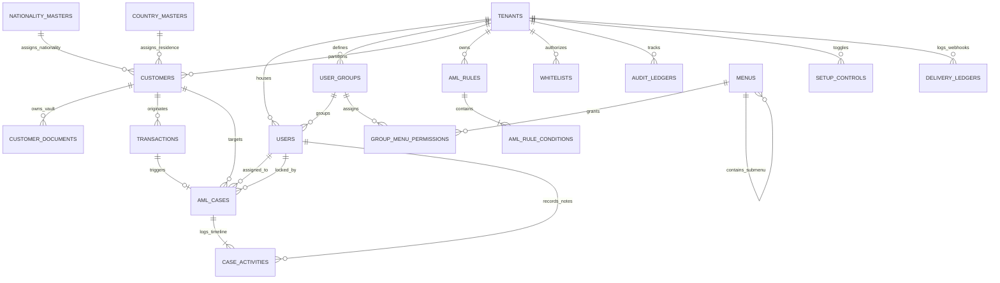

# EDITH AML Intelligence Platform: Database Architecture & OpenSearch Specification (v10.0)

**Project:** EDITH Next-Gen AML Intelligence Platform  
**Target Architecture:** PostgreSQL 17 (`edith_aml`), OpenSearch 2.12 (`edith_watchlist_v1`, `edith_customers_v1`), .NET 10 LTS  
**Version:** 10.0  
**Publication Date:** October 25, 2026  
**Status:** Approved / Production-Verified DDL & Mapping Specification  

---

## 1. Schema-per-Module Isolation Architecture

The relational database layer runs strictly on **PostgreSQL 17** partitioned into 5 logically and transactionally isolated schemas:



---

## 2. Complete Database DDL (PostgreSQL 17)

```sql
CREATE SCHEMA IF NOT EXISTS core;
CREATE SCHEMA IF NOT EXISTS screening;
CREATE SCHEMA IF NOT EXISTS cases;
CREATE SCHEMA IF NOT EXISTS rules;
CREATE SCHEMA IF NOT EXISTS notifications;

-- ==========================================
-- SCHEMA: core
-- ==========================================
CREATE TABLE core.tenants (
    id UUID PRIMARY KEY DEFAULT gen_random_uuid(),
    name VARCHAR(255) NOT NULL,
    created_at TIMESTAMPTZ DEFAULT CURRENT_TIMESTAMP
);

CREATE TABLE core.user_groups (
    id UUID PRIMARY KEY DEFAULT gen_random_uuid(),
    tenant_id UUID NOT NULL REFERENCES core.tenants(id) ON DELETE RESTRICT,
    group_name VARCHAR(100) NOT NULL,
    is_active BOOLEAN NOT NULL DEFAULT true
);

CREATE TABLE core.users (
    id UUID PRIMARY KEY DEFAULT gen_random_uuid(),
    tenant_id UUID NOT NULL REFERENCES core.tenants(id) ON DELETE RESTRICT,
    group_id UUID NULL REFERENCES core.user_groups(id) ON DELETE SET NULL,
    username VARCHAR(100) NOT NULL,
    role VARCHAR(50) NOT NULL,
    password_hash VARCHAR(256) NULL,
    two_factor_secret VARCHAR(128) NULL,
    two_factor_enabled BOOLEAN NOT NULL DEFAULT false,
    must_change_password BOOLEAN NOT NULL DEFAULT false,
    last_password_change TIMESTAMPTZ NULL,
    is_active BOOLEAN NOT NULL DEFAULT true,
    created_at TIMESTAMPTZ DEFAULT CURRENT_TIMESTAMP,
    CONSTRAINT users_tenant_username_key UNIQUE (tenant_id, username)
);

CREATE TABLE core.menus (
    id UUID PRIMARY KEY DEFAULT gen_random_uuid(),
    parent_menu_id UUID NULL REFERENCES core.menus(id) ON DELETE CASCADE,
    menu_name VARCHAR(100) NOT NULL,
    path VARCHAR(255) NOT NULL,
    position INT NOT NULL
);

CREATE TABLE core.group_menu_permissions (
    id UUID PRIMARY KEY DEFAULT gen_random_uuid(),
    group_id UUID NOT NULL REFERENCES core.user_groups(id) ON DELETE CASCADE,
    menu_id UUID NOT NULL REFERENCES core.menus(id) ON DELETE CASCADE,
    can_view BOOLEAN NOT NULL DEFAULT false,
    can_edit BOOLEAN NOT NULL DEFAULT false,
    can_authorize BOOLEAN NOT NULL DEFAULT false
);

CREATE TABLE core.audit_ledgers (
    id BIGSERIAL PRIMARY KEY,
    tenant_id UUID NOT NULL REFERENCES core.tenants(id) ON DELETE RESTRICT,
    actor_id UUID NULL REFERENCES core.users(id) ON DELETE SET NULL,
    action_type VARCHAR(100) NOT NULL,
    payload JSONB NOT NULL,
    previous_hash VARCHAR(64) NOT NULL DEFAULT 'GENESIS',
    current_hash VARCHAR(64) NOT NULL,
    created_at TIMESTAMPTZ NOT NULL DEFAULT CURRENT_TIMESTAMP
);

-- ==========================================
-- SCHEMA: rules
-- ==========================================
CREATE TABLE rules.country_masters (
    code VARCHAR(3) PRIMARY KEY,
    country_name VARCHAR(100) NOT NULL,
    is_high_risk BOOLEAN NOT NULL DEFAULT false,
    risk_score NUMERIC(5,2) NOT NULL DEFAULT 0.00
);

CREATE TABLE rules.nationality_masters (
    code VARCHAR(3) PRIMARY KEY,
    nationality_name VARCHAR(100) NOT NULL,
    is_high_risk BOOLEAN NOT NULL DEFAULT false,
    risk_score NUMERIC(5,2) NOT NULL DEFAULT 0.00
);

CREATE TABLE rules.aml_rules (
    id UUID PRIMARY KEY DEFAULT gen_random_uuid(),
    tenant_id UUID NOT NULL REFERENCES core.tenants(id) ON DELETE RESTRICT,
    rule_code VARCHAR(50) NOT NULL,
    rule_name VARCHAR(150) NOT NULL,
    execution_mode VARCHAR(20) NOT NULL DEFAULT 'REALTIME', -- REALTIME, SHADOW, PENDING_APPROVAL
    rule_type VARCHAR(30) NOT NULL,                         -- TRANSACTION_THRESHOLD, HIGH_RISK_CORRIDOR, STRUCTURING_SMURFING, VELOCITY_ANOMALY
    risk_weightage NUMERIC(5,2) NOT NULL DEFAULT 0.00,
    velocity_window_minutes INT NULL,
    velocity_min_transactions INT NULL,
    velocity_min_aggregate_amount NUMERIC(18,2) NULL,
    is_active BOOLEAN NOT NULL DEFAULT true,
    CONSTRAINT aml_rules_tenant_rule_code_key UNIQUE (tenant_id, rule_code)
);

CREATE TABLE rules.aml_rule_conditions (
    id UUID PRIMARY KEY DEFAULT gen_random_uuid(),
    rule_id UUID NOT NULL REFERENCES rules.aml_rules(id) ON DELETE CASCADE,
    field_name VARCHAR(100) NOT NULL,
    operator VARCHAR(20) NOT NULL,
    condition_value TEXT NOT NULL,
    logical_chain VARCHAR(5) NOT NULL DEFAULT 'AND'
);

CREATE TABLE rules.screening_score_configs (
    id UUID PRIMARY KEY DEFAULT gen_random_uuid(),
    tenant_id UUID NOT NULL REFERENCES core.tenants(id) ON DELETE RESTRICT,
    name_weight NUMERIC(3,2) NOT NULL DEFAULT 0.60,
    dob_weight NUMERIC(3,2) NOT NULL DEFAULT 0.15,
    id_weight NUMERIC(3,2) NOT NULL DEFAULT 0.15,
    nationality_weight NUMERIC(3,2) NOT NULL DEFAULT 0.10,
    hold_threshold NUMERIC(5,2) NOT NULL DEFAULT 80.00,
    created_at TIMESTAMPTZ NOT NULL DEFAULT CURRENT_TIMESTAMP
);

CREATE TABLE rules.setup_controls (
    id UUID PRIMARY KEY DEFAULT gen_random_uuid(),
    tenant_id UUID NOT NULL REFERENCES core.tenants(id) ON DELETE RESTRICT,
    control_code VARCHAR(100) NOT NULL,
    control_value VARCHAR(255) NOT NULL,
    is_enabled BOOLEAN NOT NULL DEFAULT true,
    CONSTRAINT setup_controls_tenant_code_key UNIQUE (tenant_id, control_code)
);

-- ==========================================
-- SCHEMA: screening
-- ==========================================
CREATE TABLE screening.customers (
    id UUID PRIMARY KEY DEFAULT gen_random_uuid(),
    tenant_id UUID NOT NULL REFERENCES core.tenants(id) ON DELETE RESTRICT,
    customer_code VARCHAR(50) NOT NULL,
    full_name VARCHAR(255) NOT NULL,
    target_type VARCHAR(30) NOT NULL DEFAULT 'INDIVIDUAL', -- INDIVIDUAL, CORPORATE, VESSEL
    date_of_birth DATE NULL,
    nationality VARCHAR(3) NULL REFERENCES rules.nationality_masters(code),
    country_of_residence VARCHAR(3) NULL REFERENCES rules.country_masters(code),
    risk_rating VARCHAR(20) NOT NULL DEFAULT 'LOW',
    is_blocked BOOLEAN NOT NULL DEFAULT false,
    ubo_hierarchy JSONB NULL,
    created_at TIMESTAMPTZ DEFAULT CURRENT_TIMESTAMP,
    CONSTRAINT customers_tenant_customer_code_key UNIQUE (tenant_id, customer_code)
);

CREATE TABLE screening.customer_documents (
    id UUID PRIMARY KEY DEFAULT gen_random_uuid(),
    customer_id UUID NOT NULL REFERENCES screening.customers(id) ON DELETE CASCADE,
    document_type VARCHAR(50) NOT NULL,
    document_number VARCHAR(100) NOT NULL,
    ocr_extracted_data JSONB NULL,
    ocr_confidence NUMERIC(5,2) NULL,
    is_verified BOOLEAN NOT NULL DEFAULT false,
    verified_by UUID NULL REFERENCES core.users(id),
    expires_at DATE NULL
);

CREATE TABLE screening.watchlist_entities (
    id UUID PRIMARY KEY DEFAULT gen_random_uuid(),
    source_list VARCHAR(100) NOT NULL,
    primary_name VARCHAR(255) NOT NULL,
    aliases TEXT[] NULL,
    entity_type VARCHAR(50) NOT NULL,
    date_of_birth DATE NULL,
    national_ids TEXT[] NULL,
    nationalities VARCHAR(3)[] NULL,
    created_at TIMESTAMPTZ DEFAULT CURRENT_TIMESTAMP
);

CREATE TABLE screening.whitelists (
    id UUID PRIMARY KEY DEFAULT gen_random_uuid(),
    tenant_id UUID NOT NULL REFERENCES core.tenants(id) ON DELETE RESTRICT,
    entity_name VARCHAR(255) NOT NULL,
    match_criteria JSONB NOT NULL,
    approved_by UUID NOT NULL REFERENCES core.users(id),
    expires_at TIMESTAMPTZ NOT NULL,
    created_at TIMESTAMPTZ DEFAULT CURRENT_TIMESTAMP
);

CREATE TABLE screening.transactions (
    id UUID PRIMARY KEY DEFAULT gen_random_uuid(),
    tenant_id UUID NOT NULL REFERENCES core.tenants(id) ON DELETE RESTRICT,
    transaction_ref_no VARCHAR(100) NOT NULL,
    idempotency_key VARCHAR(128) NULL,
    sender_name VARCHAR(255) NOT NULL,
    beneficiary_name VARCHAR(255) NOT NULL,
    intermediary_bank VARCHAR(255) NULL,
    amount NUMERIC(18,2) NOT NULL,
    currency VARCHAR(3) NOT NULL,
    status VARCHAR(50) NOT NULL, -- CLEARED, HELD, BLOCKED, RELEASED
    created_at TIMESTAMPTZ DEFAULT CURRENT_TIMESTAMP,
    CONSTRAINT transactions_tenant_ref_key UNIQUE (tenant_id, transaction_ref_no)
);

-- ==========================================
-- SCHEMA: cases
-- ==========================================
CREATE TABLE cases.aml_cases (
    id UUID PRIMARY KEY DEFAULT gen_random_uuid(),
    tenant_id UUID NOT NULL REFERENCES core.tenants(id) ON DELETE RESTRICT,
    case_number VARCHAR(100) NOT NULL,
    transaction_id UUID NULL REFERENCES screening.transactions(id) ON DELETE RESTRICT,
    customer_id UUID NULL REFERENCES screening.customers(id) ON DELETE RESTRICT,
    status VARCHAR(50) NOT NULL DEFAULT 'Open', -- Open, UnderReview, PendingApproval, ClearedFalsePositive, ReportedStrFreeze
    assigned_analyst_id UUID NULL REFERENCES core.users(id),
    locked_by UUID NULL REFERENCES core.users(id),
    locked_until TIMESTAMPTZ NULL,
    lock_duration_minutes INT NULL DEFAULT 15,
    created_at TIMESTAMPTZ DEFAULT CURRENT_TIMESTAMP,
    CONSTRAINT aml_cases_tenant_case_number_key UNIQUE (tenant_id, case_number)
);

CREATE TABLE cases.case_activities (
    id UUID PRIMARY KEY DEFAULT gen_random_uuid(),
    case_id UUID NOT NULL REFERENCES cases.aml_cases(id) ON DELETE CASCADE,
    actor_id UUID NULL REFERENCES core.users(id),
    activity_type VARCHAR(100) NOT NULL,
    note_type VARCHAR(30) NULL, -- INVESTIGATION, SUPERVISOR, RATIONALE
    comment_text TEXT NOT NULL,
    created_at TIMESTAMPTZ DEFAULT CURRENT_TIMESTAMP
);

-- ==========================================
-- SCHEMA: notifications
-- ==========================================
CREATE TABLE notifications.delivery_ledgers (
    id UUID PRIMARY KEY DEFAULT gen_random_uuid(),
    tenant_id UUID NOT NULL REFERENCES core.tenants(id) ON DELETE RESTRICT,
    target_endpoint VARCHAR(255) NOT NULL,
    event_type VARCHAR(100) NOT NULL,
    payload JSONB NOT NULL,
    signature_header VARCHAR(256) NOT NULL,
    retry_count INT NOT NULL DEFAULT 0,
    delivery_status VARCHAR(50) NOT NULL, -- DELIVERED, FAILED_DEADLETTER
    created_at TIMESTAMPTZ DEFAULT CURRENT_TIMESTAMP
);
```

---

## 3. OpenSearch 2.12 Inverted & Phonetic Mapping

Index: `edith_watchlist_v1`

```json
{
  "settings": {
    "index": {
      "number_of_shards": 2,
      "number_of_replicas": 1,
      "analysis": {
        "filter": {
          "edith_ngram_filter": {
            "type": "edge_ngram",
            "min_gram": 3,
            "max_gram": 10
          },
          "edith_double_metaphone": {
            "type": "phonetic",
            "encoder": "double_metaphone",
            "replace": false
          }
        },
        "analyzer": {
          "edith_name_analyzer": {
            "type": "custom",
            "tokenizer": "standard",
            "filter": ["lowercase", "asciifolding", "edith_ngram_filter"]
          },
          "edith_phonetic_analyzer": {
            "type": "custom",
            "tokenizer": "standard",
            "filter": ["lowercase", "asciifolding", "edith_double_metaphone"]
          }
        }
      }
    }
  },
  "mappings": {
    "properties": {
      "id": { "type": "keyword" },
      "primary_name": {
        "type": "text",
        "analyzer": "edith_name_analyzer",
        "fields": {
          "phonetic": {
            "type": "text",
            "analyzer": "edith_phonetic_analyzer"
          },
          "raw": { "type": "keyword" }
        }
      },
      "aliases": {
        "type": "text",
        "analyzer": "edith_name_analyzer",
        "fields": {
          "phonetic": { "type": "text", "analyzer": "edith_phonetic_analyzer" }
        }
      },
      "entity_type": { "type": "keyword" },
      "date_of_birth": { "type": "date" },
      "national_ids": { "type": "keyword" },
      "nationalities": { "type": "keyword" },
      "program": { "type": "keyword" }
    }
  }
}
```

---

## 4. Entity-Relationship Topology



---
*Maintained by the EDITH Architecture & Compliance Engineering Team (v10.0).*
