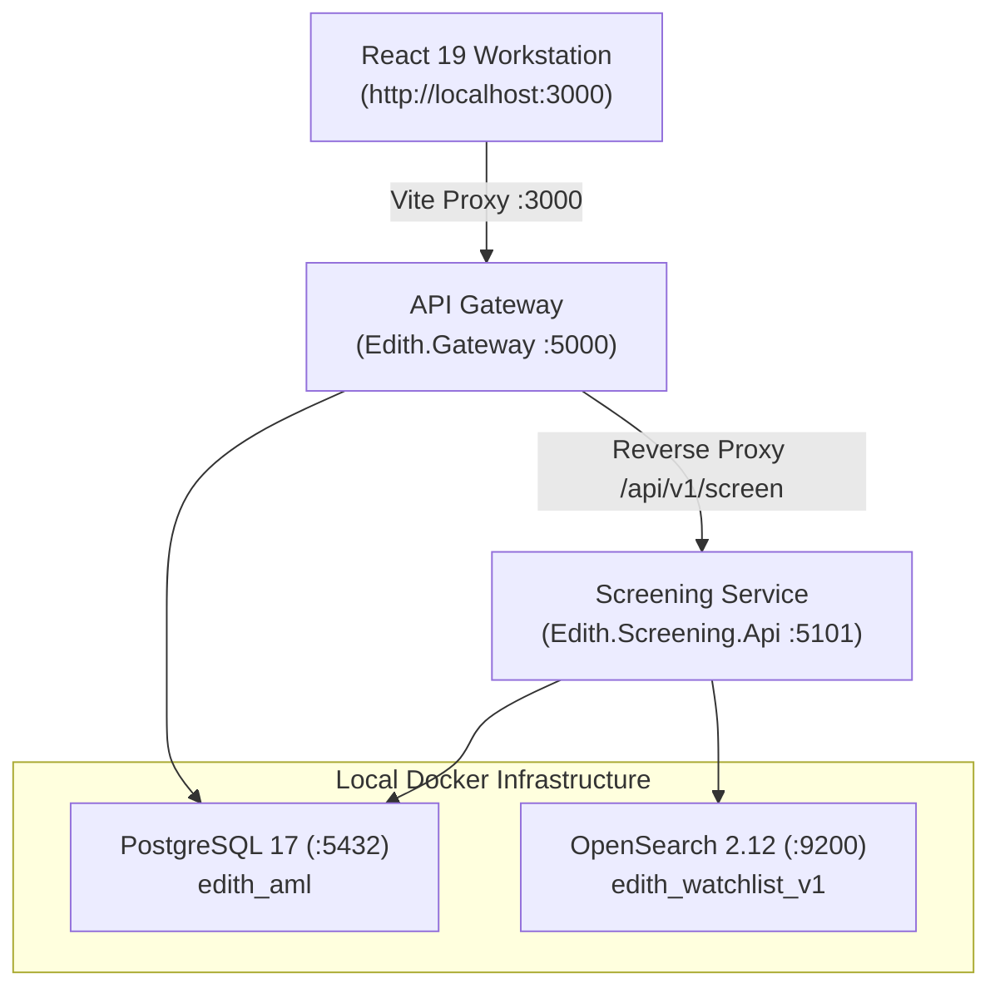

# EDITH Platform — Visual Studio & Web Portal Run Guide (v10.0)

**Document ID:** EDITH-RUN-GUIDE-v10.0  
**Environment:** Local Development (Visual Studio 2022 / 2026 + React 19 / Vite + Docker)  
**Target Solution:** [`Edith.slnx`](file:///F:/EDITH/Edith.slnx)  
**Portal Directory:** [`src/Web/edith-portal`](file:///F:/EDITH/src/Web/edith-portal)  
**Publication Date:** October 25, 2026  
**Status:** Approved / Production-Verified Run Guide  

---

## 1. Quick Start Overview

EDITH operates as an enterprise Anti-Money Laundering (AML) and Counter-Terrorist Financing (CTF) intelligence platform with the following core components:

* **Dual Database Layer (Docker):**
  - **PostgreSQL 17 (`:5432`):** Relational System of Record & WORM Audit Ledger (`edith_aml`).
  - **OpenSearch 2.12 (`:9200`):** Distributed n-gram and Double Metaphone phonetic screening index (`edith_watchlist_v1`).
* **Backend Services (.NET 10 LTS):**
  - **API Gateway & IAM (`Edith.Gateway`):** Main entry point on **`http://localhost:5000`** handling tenant isolation, JWT authentication, and SignalR live alerts.
  - **Screening Engine API (`Edith.Screening.Api`):** High-speed screening service on **`http://localhost:5101`** (proxied through the Gateway).
  - **Database Migrator (`Edith.Database.Migrator`):** Multi-schema migration and dev seed utility.
* **Frontend Workstation (`edith-portal`):**
  - React 19 + TypeScript + Vite portal running on **`http://localhost:3000`** with real-time SignalR WebSocket feeds.



---

## 2. Step-by-Step Instructions

### Step 1: Start Docker Dual-Database Infrastructure
Ensure Docker Desktop is running, then start the PostgreSQL 17 and OpenSearch 2.12 containers:
```powershell
cd F:\EDITH\docker
docker compose up -d
```
Verify containers are healthy:
```powershell
docker ps --filter "name=edith"
```

### Step 2: Apply Migrations & Seed Baseline Data
Run the database migrator to initialize the 5 schemas (`core`, `screening`, `cases`, `rules`, `notifications` — 39 total tables) and seed baseline test data:
```powershell
dotnet run --project F:\EDITH\src\Database\Edith.Database.Migrator
```

### Step 3: Launch Backend in Visual Studio
1. Open [`Edith.slnx`](file:///F:/EDITH/Edith.slnx) in **Visual Studio 2022** (v17.12+ for .NET 10).
2. Right-click **`Edith.Gateway`** in Solution Explorer $\to$ **Set as Startup Project**.
3. Press **`F5`** (Debug) or **`Ctrl + F5`** (Run without debugging).
4. Gateway runs on **`http://localhost:5000`**.
5. *(Optional Standalone Screening)*: Run `Edith.Screening.Api` on **`http://localhost:5101`**.

Verify Gateway Health:
Navigate to: 👉 **[http://localhost:5000/health](http://localhost:5000/health)**
Expected response:
```json
{
  "status": "Healthy",
  "service": "Edith.Gateway",
  "version": "10.0.0",
  "modules": ["IAM", "Screening", "Cases", "Rules", "Bulk", "Addons", "KYC", "Reports", "Settings"],
  "timestamp": "2026-10-25T20:30:00Z"
}
```

### Step 4: Launch Frontend React 19 Portal
In a terminal, start the Vite development server:
```powershell
cd F:\EDITH\src\Web\edith-portal
npm install
npm run dev
```
Open your browser at: 👉 **[http://localhost:3000](http://localhost:3000)**

---

## 3. Pre-Configured Test Accounts & Personas

| Role Code | Username | Password | Default Landing Page |
| :--- | :--- | :--- | :--- |
| `SUPER_ADMIN` | `admin@edith.aml.cloud` | `EdithCompliance2026!` | `/dashboard` (Full admin privileges) |
| `MLRO` | `analyst.fatima@adcb.ae` | `EdithCompliance2026!` | `/cases` (4-Eyes approval & goAML) |
| `ANALYST` | `tariq.mansoor@adcb.ae` | `EdithCompliance2026!` | `/name-search` (L1/L2 investigation) |
| `EDD_ANALYST` | `edd.sarah@adcb.ae` | `EdithCompliance2026!` | `/kyc360` (Customer KYC & UBO trees) |
| `AML_OFFICER` | `aml.omar@adcb.ae` | `EdithCompliance2026!` | `/rules` & `/sandbox` (Rule builder) |
| `AUDITOR` | `zayed.husseini@adcb.ae` | `EdithCompliance2026!` | `/reports` (WORM audit ledger) |

---

## 4. Key Verification Checks

1. **Screening Engine Check:**
   Navigate to `/name-search`, select **Individual**, search `Viktor Bout`. Expected result: `HELD (94.0%)` with OFAC Sanctions badge.
2. **CBS Webhook Check:**
   Open `/notifications` to review outbound HMAC-SHA256 webhooks and delivery retry logs in `notifications.delivery_ledgers`.
3. **WORM Audit Verification:**
   Navigate to `/reports`, select the **WORM Cryptographic Audit Chain** sub-view, and click **Verify WORM Cryptographic Chain** to confirm SHA-256 block-hash continuity.

---
*Maintained by the EDITH Architecture & Compliance Engineering Team (v10.0).*
