# EDITH Platform — Master Documentation Catalog & Category Index

**Project:** EDITH Next-Gen AML Intelligence Platform  
**Target Environment:** .NET 10 LTS, React 19 Portal, PostgreSQL 17, OpenSearch 2.12 (Zero Redis)  
**Applicable Regulations:** CBUAE AML/CFT Decree-Law No. (20) of 2018, Cabinet Decision No. (74) of 2020, FATF Recommendations 6, 7, 10 & 16, UNODC goAML v5.0  
**Unified Documentation Version:** 10.0  
**Last Updated:** October 25, 2026  
**Google Drive Sync Target:** [`https://drive.google.com/drive/folders/1teuXH8b2hZKMboLJTVud_Rl0v4qlx8YW?usp=drive_link`](https://drive.google.com/drive/folders/1teuXH8b2hZKMboLJTVud_Rl0v4qlx8YW?usp=drive_link)

---

## 1. Directory Structure by Functional Use

All platform specifications, database DDLs, product requirements, client pitches, and operational guides are organized into categorized functional directories based on their specific operational use under a unified **Version 10.0** release:

```
F:\EDITH\MD_DOC\
│
├── README.md                                 # Master Catalog, Version Matrix & Sync Guide (v10.0)
├── EDITH_Documentation_Library_v10.0.zip     # Pre-packaged archive ready for 1-click Google Drive sync
├── sync_to_gdrive.ps1                        # PowerShell automation script for Google Drive sync
│
├── 01_Executive_and_Pitch/                   # Client-Facing Architecture Pitches & Commercial Decks
│   ├── EDITH_Client_Architecture_Pitch_v10.0.pdf   # Executive Pitch Presentation Deck (PDF, Publication Grade)
│   ├── EDITH_Client_Architecture_Pitch_v10.0.md    # Master Architecture Pitch Document (Markdown + Mermaid)
│   └── EDITH_Client_Architecture_Pitch_v10.0.html  # Responsive, Print-Optimized HTML Master Source
│
├── 02_Product_and_Requirements/              # Product Requirements, Roadmaps & Milestone Workplans
│   ├── EDITH_Master_PRD_v10.0.md              # Master Product Requirements Document (PRD v10.0)
│   ├── EDITH_Modules_Workflows_and_Pages_v10.0.md # Complete Catalog of 10 Modules, 17 Pages/Views & 18 Workflows (v10.0)
│   └── EDITH_END_TO_END_WORKPLAN_v10.0.md     # End-to-End Engineering Workplan & Phases 1–17 Ledger (v10.0)
│
├── 03_Technical_Architecture_and_Database/   # System Architecture, 5-Pass Engine Specs & DDL
│   ├── EDITH_Master_Specification_v10.0.md    # Master Technical Architecture & Engine Spec (v10.0)
│   └── database_v10.0.md                      # PostgreSQL 17 DDL (5 Schemas) & OpenSearch Mappings (v10.0)
│
└── 04_Operations_and_Deployment/             # Runbooks, Port Credentials & Engineering Tasks
    ├── HOW_TO_RUN_v10.0.md                    # Visual Studio & Web Portal Run Guide (v10.0)
    ├── CREDENTIALS_v10.0.md                   # Infrastructure Ports, Secrets, JWT Keys & Seed Data (v10.0)
    └── TODO_v10.0.md                          # Task-by-Task Implementation Status (v10.0, Phases 1–17 Complete)
```

---

## 2. Master Documentation Index & Version Matrix

All files in the EDITH documentation suite share the identical unified **v10.0** release number:

| Category | Document | Version | Primary Purpose | Key Contents |
| :--- | :--- | :---: | :--- | :--- |
| **Executive & Pitch** | [`EDITH_Client_Architecture_Pitch_v10.0.pdf`](file:///f:/EDITH/MD_DOC/01_Executive_and_Pitch/EDITH_Client_Architecture_Pitch_v10.0.pdf) | **v10.0** | **Client Pitch Deck (PDF)** | Executive-facing presentation PDF with dual-database architecture diagrams, 10 core modules, 18 compliance workflows, and commercial value proposition. |
| **Executive & Pitch** | [`EDITH_Client_Architecture_Pitch_v10.0.md`](file:///f:/EDITH/MD_DOC/01_Executive_and_Pitch/EDITH_Client_Architecture_Pitch_v10.0.md) | **v10.0** | **Pitch Specification (MD)** | Markdown source featuring interactive Mermaid diagrams, 10 modules table, 17 pages catalog, 18 operational workflows, and commercial pitch narrative. |
| **Executive & Pitch** | [`EDITH_Client_Architecture_Pitch_v10.0.html`](file:///f:/EDITH/MD_DOC/01_Executive_and_Pitch/EDITH_Client_Architecture_Pitch_v10.0.html) | **v10.0** | **HTML Master Template** | Print-styled HTML master source utilized for generating the client-ready PDF with embedded SVG diagrams. |
| **Product & Requirements** | [`EDITH_Master_PRD_v10.0.md`](file:///f:/EDITH/MD_DOC/02_Product_and_Requirements/EDITH_Master_PRD_v10.0.md) | **v10.0** | **Master Product Requirements** | Functional business requirements, CBS integration contracts, 17 operator portal views, Target-Type Personas (Person/Corporate/Vessel), and feature packaging matrix. |
| **Product & Requirements** | [`EDITH_Modules_Workflows_and_Pages_v10.0.md`](file:///f:/EDITH/MD_DOC/02_Product_and_Requirements/EDITH_Modules_Workflows_and_Pages_v10.0.md) | **v10.0** | **Modules, Pages & Workflows Catalog** | Complete reference catalog of all 10 platform modules, 17 frontend pages/views with route maps, global shell components, and 18 end-to-end operational workflows. |
| **Product & Requirements** | [`EDITH_END_TO_END_WORKPLAN_v10.0.md`](file:///f:/EDITH/MD_DOC/02_Product_and_Requirements/EDITH_END_TO_END_WORKPLAN_v10.0.md) | **v10.0** | **Executive Workplan Ledger** | 17-Phase executive delivery milestones, end-to-end dataflow sequence, and cross-service pipeline contracts. |
| **Technical Architecture** | [`EDITH_Master_Specification_v10.0.md`](file:///f:/EDITH/MD_DOC/03_Technical_Architecture_and_Database/EDITH_Master_Specification_v10.0.md) | **v10.0** | **Technical Architecture Spec** | 5-pass scoring equations, streaming bulk ingestion algorithms, 15m/30m/1h pessimistic lease locking, 4-Eyes state machine, and 100/100 automated test suite results. |
| **Technical Architecture** | [`database_v10.0.md`](file:///f:/EDITH/MD_DOC/03_Technical_Architecture_and_Database/database_v10.0.md) | **v10.0** | **Database DDL & Search Specs** | PostgreSQL 17 DDL across 5 isolated schemas (39 production tables) (`core`, `screening`, `cases`, `rules`, `notifications`), SHA-256 block-chained WORM audit ledger, and OpenSearch analyzers. |
| **Operations & Deployment** | [`HOW_TO_RUN_v10.0.md`](file:///f:/EDITH/MD_DOC/04_Operations_and_Deployment/HOW_TO_RUN_v10.0.md) | **v10.0** | **Developer Run Guide** | Step-by-step Visual Studio 2022 and Vite React 19 launch instructions, API health check endpoints, and debugging workflows. |
| **Operations & Deployment** | [`CREDENTIALS_v10.0.md`](file:///f:/EDITH/MD_DOC/04_Operations_and_Deployment/CREDENTIALS_v10.0.md) | **v10.0** | **Infrastructure Secrets** | PostgreSQL & OpenSearch ports and credentials, JWT signing secrets, multi-tenant GUIDs, RBAC persona test users, and seeded counts. |
| **Operations & Deployment** | [`TODO_v10.0.md`](file:///f:/EDITH/MD_DOC/04_Operations_and_Deployment/TODO_v10.0.md) | **v10.0** | **Engineering Implementation Status** | Phase-by-phase implementation ledger: Phases 1–17 fully implemented and marked `COMPLETED`. |

---

## 3. Recommended Reading Order by Persona

```mermaid
flowchart TD
    subgraph ClientAndExec [Executive & Business Stakeholders]
        P1["1. EDITH_Client_Architecture_Pitch_v10.0.pdf"] --> P2["2. EDITH_Master_PRD_v10.0.md"]
        P2 --> P3["3. EDITH_Modules_Workflows_and_Pages_v10.0.md"]
    end

    subgraph TechArch [Architects & Senior Engineers]
        A1["1. EDITH_Master_Specification_v10.0.md"] --> A2["2. database_v10.0.md"]
        A2 --> A3["3. EDITH_END_TO_END_WORKPLAN_v10.0.md"]
    end

    subgraph DevOpsAndEng [Developers & DevOps]
        D1["1. CREDENTIALS_v10.0.md"] --> D2["2. HOW_TO_RUN_v10.0.md"]
        D2 --> D3["3. TODO_v10.0.md"]
    end
```



---

## 4. Google Drive Synchronization

The target remote Google Drive folder for this project is:  
👉 **[EDITH Project Google Drive Folder](https://drive.google.com/drive/folders/1teuXH8b2hZKMboLJTVud_Rl0v4qlx8YW?usp=drive_link)**

### Sync Methods Available:

1. **One-Click Package Upload (Recommended):**
   - The pre-packaged archive [`EDITH_Documentation_Library_v10.0.zip`](file:///f:/EDITH/MD_DOC/EDITH_Documentation_Library_v10.0.zip) contains all organized folders, PDF decks, and specifications.
   - Simply open the Google Drive folder in your browser and drag `EDITH_Documentation_Library_v10.0.zip` or the 4 folders directly into Google Drive.
2. **Automated Sync Script:**
   - Execute [`sync_to_gdrive.ps1`](file:///f:/EDITH/MD_DOC/sync_to_gdrive.ps1) from PowerShell. If Google Drive for Desktop or `rclone` is installed, it will automatically synchronize changes; otherwise, it opens the Drive upload view in Google Chrome.

---

*Verified and published by the EDITH Engineering Team on October 25, 2026.*
