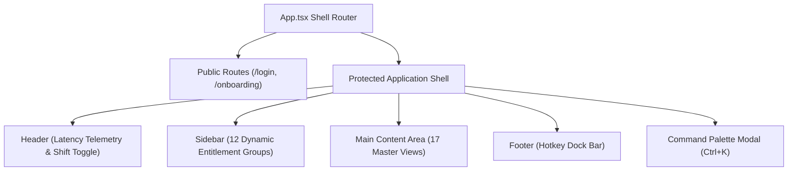
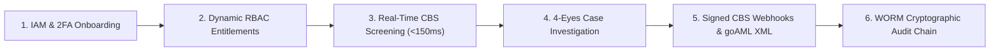

# EDITH AML Intelligence Platform
## Master Catalog of Modules, Pages, Routes & Operational Workflows (v10.1)

**Document ID:** EDITH-CATALOG-MWP-v10.1  
**Version:** 10.1  
**Target Architecture:** .NET 10 LTS + React 19 Portal + PostgreSQL 17 + OpenSearch 2.12 (Zero Redis)  
**Publication Date:** October 26, 2026  
**Status:** Approved / Production-Ready Specification  

---

## 1. Complete Catalog of All 10 Platform Modules

EDITH is architected as a modular monolith running on `.NET 10 LTS` with strict schema-per-module database isolation:

| # | Module Code | Project / Path | Tier | Core Architecture & Responsibilities |
| :-: | :--- | :--- | :-: | :--- |
| **1** | `MOD-CORE-GATE` | [`Edith.Gateway`](file:///F:/EDITH/src/Gateway/Edith.Gateway) | **Core** | High-performance YARP reverse proxy (`:5000`), JWT Bearer token issuance, multi-tenant resolution, salted PBKDF2-SHA256 password hashing, TOTP 2FA engine ([`ITotpService.cs`](file:///F:/EDITH/src/Gateway/Edith.Gateway/Services/ITotpService.cs)), dynamic RBAC menu entitlements ([`IEntitlementsService.cs`](file:///F:/EDITH/src/Gateway/Edith.Gateway/Services/IEntitlementsService.cs)), and real-time SignalR hubs. |
| **2** | `MOD-SCRN-CORE` | [`Edith.Screening.Core`](file:///F:/EDITH/src/Screening/Edith.Screening.Core) | **Core** | Algorithmic 5-pass deterministic and phonetic fuzzy screening engine (Double Metaphone, Jaro-Winkler, Damerau-Levenshtein, and multi-attribute composite scoring) powered by OpenSearch 2.12 with automatic thread-safe in-memory fallback. |
| **3** | `MOD-SCRN-API` | [`Edith.Screening.Api`](file:///F:/EDITH/src/Screening/Edith.Screening.Api) | **Core** | Low-latency Core Banking System (CBS) pre-clearance REST API (`POST /api/v1/screen/transaction`), single entity name search endpoints, idempotency replay store, and whitelist suppression bypass. |
| **4** | `MOD-SCRN-BULK` | [`Edith.Screening.Bulk`](file:///F:/EDITH/src/Screening/Edith.Screening.Bulk) | **Core** | Memory-bounded streaming parser (`IAsyncEnumerable`) for multi-gigabyte CSV, XML, and JSON files mapped to the unified 9-field AML schema, duplicate detection, and on-demand export of skipped records. |
| **5** | `MOD-CASE-WORK` | [`Edith.Cases`](file:///F:/EDITH/src/Cases/Edith.Cases) | **Core** | 3-pane investigation canvas, atomic 15-minute pessimistic lease locking (`CaseLockManager`) with multi-duration renewals (15m, 30m, 1hr), 4-Eyes Maker-Checker state machine, categorized investigation notes (`INVESTIGATION`, `SUPERVISOR`, `RATIONALE`), and SignalR `CaseHub`. |
| **6** | `MOD-RULE-PROC` | [`Edith.Rules`](file:///F:/EDITH/src/Rules/Edith.Rules) | **Core** | Transaction behavior rules (High-Risk Corridors, Structuring/Smurfing, Cash Thresholds, Velocity Anomaly detection), multi-mode execution (`REALTIME`, `SHADOW`, `PENDING_APPROVAL`), and a 50,000-record portfolio backtesting sandbox. |
| **7** | `MOD-EVENTS-CBS` | [`Edith.Events`](file:///F:/EDITH/src/Events/Edith.Events) | **Core** | Cryptographic HMAC-SHA256 signed CBS webhook dispatcher (`RELEASE` / `FREEZE`), Polly exponential backoff retries with jitter, and unreachable dead-letter recording in `notifications.delivery_ledgers`. |
| **8** | `MOD-DB-STORE` | [`Edith.Database.Migrator`](file:///F:/EDITH/src/Database/Edith.Database.Migrator) | **Infra** | Multi-schema PostgreSQL 17 DDL migrations across 5 isolated schemas (`core`, `screening`, `cases`, `rules`, `notifications`), reference dev seeds, and immutable SHA-256 block-chained WORM audit ledgers. |
| **9** | `MOD-ADDONS-EXT` | [`Edith.Addons`](file:///F:/EDITH/src/Addons/Edith.Addons) | **Add-on** | Official UNODC `goAML` v5.0 XML payload generator, GenAI 5-section STR Narrative Copilot, Multi-hop Entity Relationship Graph Visualizer, and alert notification dispatchers. |
| **10** | `MOD-UI-PORTAL` | [`edith-portal`](file:///F:/EDITH/src/Web/edith-portal) | **UI** | Enterprise React 19 + TypeScript + Vite workstation (`:3000`) featuring 17 Master Views, 12 sidebar menu groups, global command palette (`Ctrl+K`), and brand identity components. |

---

## 2. All Frontend Pages, Master Views & Route Map

Configured in [`App.tsx`](file:///F:/EDITH/src/Web/edith-portal/src/App.tsx) across **12 Sidebar Navigation Groups** plus public onboarding and authentication routes:

### Master View Catalog & Route Index

| # | Master View | Component File | Routed Paths | Functional Capabilities & Sub-Views |
| :-: | :--- | :--- | :--- | :--- |
| **1** | **Login View** | [`LoginView.tsx`](file:///F:/EDITH/src/Web/edith-portal/src/components/LoginView.tsx) | `/login` | Salted PBKDF2-SHA256 authentication, 2FA TOTP challenge modal, and role session provisioning. |
| **2** | **Onboarding View** | [`OnboardingView.tsx`](file:///F:/EDITH/src/Web/edith-portal/src/components/OnboardingView.tsx) | `/onboarding` | Mandatory first-time password rotation, interactive TOTP QR code scan, and 2FA activation. |
| **3** | **Executive Dashboard** | [`DashboardView.tsx`](file:///F:/EDITH/src/Web/edith-portal/src/components/DashboardView.tsx) | `/`, `/dashboard` | Role-gated analytics, Throughput & Intercept velocity charts, 5-pass resolution funnel, SLA countdown gauges, and 1-click printable executive PDF brief. |
| **4** | **Universal Name Search** | [`NameSearchView.tsx`](file:///F:/EDITH/src/Web/edith-portal/src/components/NameSearchView.tsx) | `/name-search` | Target-Type Personas (`Individual`, `Corporate`, `Vessel`), 6 screening possibilities, "What-If" Sensitivity Slider (50%–95%), PEP Tiers 1–3 side-by-side diff, batch clipboard paste, in-line adjudication slip, and printable Onboarding AML Clearance Memo. |
| **5** | **Screening Console** | [`ScreeningConsole.tsx`](file:///F:/EDITH/src/Web/edith-portal/src/components/ScreeningConsole.tsx) | `/screening`, `/blacklist/screening`, `/customer/screening-report` | Real-time multi-party transaction screening (Sender, Beneficiary, Intermediary), 5-pass scoring breakdown, Engine Sensitivity Drawer, 1-click Whitelist exception, and WORM SHA-256 certificate generator. |
| **6** | **Bulk Screening** | [`BulkScreeningView.tsx`](file:///F:/EDITH/src/Web/edith-portal/src/components/BulkScreeningView.tsx) | `/bulk`, `/blacklist/bulk` | Multipart file upload (`CSV`, `XML`, `JSON`), 9-field AML mapping preview, SignalR real-time progress tracking, and on-demand export of skipped duplicates. |
| **7** | **Whitelist Governance** | [`WhitelistGovernanceView.tsx`](file:///F:/EDITH/src/Web/edith-portal/src/components/WhitelistGovernanceView.tsx) | `/whitelist`, `/blacklist/watchlist` | False-positive exemption rules, legal rationale tracking, expiry dates, and automated watchlist suppression rules. |
| **8** | **Case Workspace** | [`CaseWorkspace.tsx`](file:///F:/EDITH/src/Web/edith-portal/src/components/CaseWorkspace.tsx) | `/cases`, `/aml/str-history`, `/aml/mlro-monitoring`, `/str-process/alerts`, `/str-process/istr-mlro`, `/str-process/edd-monitoring`, `/authorization/sanction-alerts` | 3-pane canvas, 15-minute pessimistic lease lock timer with multi-duration renewal (15m/30m/1hr), 4-tab investigation console (Token Diff, UBO Graph, Corridor Map, KYC Bridge), editable AI STR narrative copilot, categorized notes (`INVESTIGATION`, `SUPERVISOR`, `RATIONALE`), and 4-Eyes Maker-Checker controls. |
| **9** | **Customer KYC 360** | [`CustomerKyc360View.tsx`](file:///F:/EDITH/src/Web/edith-portal/src/components/CustomerKyc360View.tsx) | `/kyc360`, `/customer/kyc`, `/str-process/edd-analyst` | Customer directory switcher (`?customer=`), interactive UBO ownership tree with **1-Click Cascade Screening**, OCR document inspector with bounding boxes, SoW/SoF checklist, activity drift monitor, and signed WORM dossier export. |
| **10** | **AML Rule Builder** | [`RuleBuilderView.tsx`](file:///F:/EDITH/src/Web/edith-portal/src/components/RuleBuilderView.tsx) | `/rules`, `/aml/rules` | Category-aware form editor (`HIGH_RISK_CORRIDOR`, `STRUCTURING_SMURFING`, `VELOCITY_ANOMALY`), execution mode toggle (`REALTIME`, `SHADOW`, `PENDING_APPROVAL`), pre-save draft backtesting, and sample triggered transactions table. |
| **11** | **Rule Sandbox** | [`RuleSandboxView.tsx`](file:///F:/EDITH/src/Web/edith-portal/src/components/RuleSandboxView.tsx) | `/sandbox`, `/aml/process` | 50,000-record portfolio backtesting simulation, Baseline vs. Candidate Delta telemetry, ground-truth STR recall, 5-point **Sensitivity Elbow Curve**, and auto-balancing sliders with pin-locks. |
| **12** | **goAML Reporting** | [`GoAmlReportingView.tsx`](file:///F:/EDITH/src/Web/edith-portal/src/components/GoAmlReportingView.tsx) | `/goaml`, `/authorization`, `/authorization/risk-calculate`, `/authorization/customer` | Official UNODC `goAML` v5.0 XML schema validation, STR narrative synthesis, and 1-click XML download for central bank FIU submission. |
| **13** | **Reports & Audit Hub** | [`ReportsAuditView.tsx`](file:///F:/EDITH/src/Web/edith-portal/src/components/ReportsAuditView.tsx) | `/reports`, `/reports/*` | Comprehensive hub housing all **14 Regulatory PDF Reports** (6 Section 4e Reports, 5 Section 4f Log Reports, 3 Cross-Module Reports), 16-field transaction filter bar, interactive **Verify WORM Cryptographic Chain** tool, and certified examination export modal. |
| **14** | **Notification Admin** | [`NotificationAdminView.tsx`](file:///F:/EDITH/src/Web/edith-portal/src/components/NotificationAdminView.tsx) | `/notifications`, `/log-report`, `/log-report/*` | CBS HMAC-SHA256 webhook delivery ledgers, Polly exponential retry telemetry, and dead-letter queue management. |
| **15** | **IAM Access** | [`IamAccessView.tsx`](file:///F:/EDITH/src/Web/edith-portal/src/components/IamAccessView.tsx) | `/iam`, `/settings/users`, `/settings/user-groups`, `/settings/menu-master`, `/settings/menu-mappings` | Multi-tenant user lifecycle, cryptographic password generator, 2FA reset, user groups, and dynamic RBAC menu permission assignments. |
| **16** | **System Masters** | [`SystemMastersView.tsx`](file:///F:/EDITH/src/Web/edith-portal/src/components/SystemMastersView.tsx) | `/settings`, `/settings/risk-rates`, `/settings/screening-score`, `/settings/setup-control`, `/settings/risk-assessment`, `/settings/change-password`, `/master`, `/master/country`, `/master/nationality`, `/master/unblock-customer` | 8 operational tabs persisted directly to PostgreSQL (`COUNTRIES`, `NATIONALITIES`, `RISK_RATES`, `SCREENING_SCORE`, `SETUP_CONTROL`, `RISK_ASSESSMENT`, `UNBLOCK_CUSTOMER`, `CHANGE_PASSWORD`). |
| **17** | **Delta Rescreening** | [`DeltaRescreeningView.tsx`](file:///F:/EDITH/src/Web/edith-portal/src/components/DeltaRescreeningView.tsx) | `/delta`, `/delta/authorization`, `/delta/log-report` | Watchlist watermark change detection and differential customer rescreening. |

---

## 3. All 22 Active Operational & Compliance Workflows

### 1. User Onboarding, Crypto Password Provisioning & TOTP 2FA Workflow
* **Trigger:** Administrator provisions a new compliance user in [`IamAccessView.tsx`](file:///F:/EDITH/src/Web/edith-portal/src/components/IamAccessView.tsx).
* **Execution Flow:** [`CryptoPasswordGenerator.cs`](file:///F:/EDITH/src/Gateway/Edith.Gateway/Services/CryptoPasswordGenerator.cs) creates a high-entropy temporary password $\rightarrow$ [`IEmailNotificationService.cs`](file:///F:/EDITH/src/Gateway/Edith.Gateway/Services/IEmailNotificationService.cs) emails credentials $\rightarrow$ User visits `/onboarding`, rotates password, scans TOTP QR code, and verifies 6-digit token via [`ITotpService.cs`](file:///F:/EDITH/src/Gateway/Edith.Gateway/Services/ITotpService.cs).

### 2. Dynamic RBAC Menu Entitlement Workflow
* **Trigger:** User logs in or switches persona role (`ANALYST`, `MLRO`, `SUPER_ADMIN`, `AUDITOR`).
* **Execution Flow:** Administrator maps user groups to menus in `/settings/menu-mappings` $\rightarrow$ [`IEntitlementsService.cs`](file:///F:/EDITH/src/Gateway/Edith.Gateway/Services/IEntitlementsService.cs) queries PostgreSQL `core.group_menu_permissions` $\rightarrow$ [`Sidebar.tsx`](file:///F:/EDITH/src/Web/edith-portal/src/components/Sidebar.tsx) renders strictly authorized menu items.

### 3. Real-Time Synchronous CBS Pre-Clearance Workflow (`<150ms` SLA)
* **Trigger:** Core Banking System initiates wire via `POST /api/v1/screen/transaction` with `Idempotency-Key`.
* **Execution Flow:** Gateway validates JWT and idempotency $\rightarrow$ 5-pass engine screens Sender, Beneficiary, and Intermediary against OpenSearch 2.12 $\rightarrow$ Returns `CLEARED` (`<80%`) with clearance token or `HELD` (`>=80%`) and auto-creates an `Open` case in `cases.aml_cases`.

### 4. Universal Single Entity Search & Persona Screening Workflow
* **Trigger:** Compliance officer performs ad-hoc search in `/name-search`.
* **Execution Flow:** Officer toggles `Individual`, `Corporate`, or `Vessel` mode $\rightarrow$ 5-pass engine computes phonetic and string distance $\rightarrow$ Matches display side-by-side token diffs and PEP Tier (1–3) badges.

### 5. In-Line Triage & Onboarding AML Clearance Memo Workflow
* **Trigger:** Analyst evaluates search results in `/name-search`.
* **Execution Flow:** False positives are dismissed inline with rationale committed to `core.audit_ledgers`; high-risk hits trigger 1-click persistent case creation (`/api/v1/screen/intercept-case`); clean searches generate a printable, WORM-sealed Onboarding AML Clearance Memo.

### 6. Interactive "What-If" Sensitivity Simulation Workflow
* **Trigger:** Compliance supervisor adjusts the sensitivity slider (50%–95%) in `/name-search` or `/screening`.
* **Execution Flow:** Client-side scoring engine instantly re-filters, re-ranks, and updates match verdict pills in real time without executing network calls.

### 7. Batch Multi-Line Clipboard Paste Screening Workflow
* **Trigger:** Operator pastes multiple rows from an Excel sheet or email into `/name-search`.
* **Execution Flow:** Parser tokenizes lines into structured entities $\rightarrow$ Parallel 5-pass screening executes $\rightarrow$ Compact triage table renders pass/hit summary counts and per-row inspection buttons.

### 8. Streaming Bulk File Ingestion & Skipped Duplicate Export Workflow
* **Trigger:** Operator uploads large CSV, XML, or JSON files in `/bulk`.
* **Execution Flow:** `AmlStreamingParser` streams rows via `.NET 10 IAsyncEnumerable` in bounded memory buffers $\rightarrow$ Normalizes to 9-field AML schema $\rightarrow$ Automatically skips duplicates $\rightarrow$ SignalR broadcasts live progress $\rightarrow$ Skipped rows exported via `GET /api/v1/bulk/jobs/{id}/skipped?format=csv|json|xml`.

### 9. Periodic Watchlist Delta Rescreening Workflow
* **Trigger:** New sanctions lists (UN, OFAC, UAE Local Terrorist List) are published.
* **Execution Flow:** In `/delta`, system compares updated watchlist records against active customer profiles (`screening.customers`), generating alerts strictly for newly impacted relationships.

### 10. 4-Eyes Maker-Checker Case Investigation & Pessimistic Lease Workflow
* **Trigger:** Analyst opens an investigation case in `/cases` ([`CaseWorkspace.tsx`](file:///F:/EDITH/src/Web/edith-portal/src/components/CaseWorkspace.tsx)).
* **Execution Flow:** `CaseLockManager` grants an atomic 15-minute lease lock (returning `409 Conflict` to competitors) with multi-duration renewal support (15m, 30m, 1hr) $\rightarrow$ Analyst reviews token breakdowns, UBO graph, and AI narrative, attaches categorized notes (`INVESTIGATION`, `SUPERVISOR`, `RATIONALE`), and escalates to `PendingApproval` $\rightarrow$ MLRO performs independent review and adjudicates (`ClearedFalsePositive` or `ReportedStrFreeze`).

### 11. Automated CBS Signed Webhook Callback Workflow
* **Trigger:** MLRO adjudicates a held case.
* **Execution Flow:** `ICbsWebhookDispatcher` constructs `AmlDecisionWebhookPayload` (`RELEASE` or `FREEZE`), signs it with `HMAC-SHA256` (`X-Edith-Signature`), and dispatches callback to CBS via Polly exponential backoff retries (logging drops to `notifications.delivery_ledgers`).

### 12. Regulatory UNODC `goAML` STR XML & GenAI Narrative Workflow
* **Trigger:** Case is resolved as `ReportedStrFreeze` or opened in `/goaml`.
* **Execution Flow:** GenAI Copilot drafts a 5-section regulatory STR narrative $\rightarrow$ Officer edits/approves narrative $\rightarrow$ Engine compiles and validates official UNODC `goAML` v5.0 XML for direct submission to the Financial Intelligence Unit (FIU).

### 13. Customer KYC 360 & UBO Ownership Tree Cascade Screening Workflow
* **Trigger:** Analyst inspects customer profile in `/kyc360` ([`CustomerKyc360View.tsx`](file:///F:/EDITH/src/Web/edith-portal/src/components/CustomerKyc360View.tsx)).
* **Execution Flow:** Visualizes UBO equity ownership hierarchy tree $\rightarrow$ Analyst clicks **1-Click "Cascade Screen Corporate & UBO Tree"** $\rightarrow$ Parallel 5-pass screening executes across the entity, trade license, and all UBOs, returning a consolidated pass/hit clearance matrix.

### 14. Interactive OCR Document Inspection & EDD Sign-off Workflow
* **Trigger:** Analyst opens identity document in `/kyc360`.
* **Execution Flow:** OCR modal renders extracted JSONB fields, per-field confidence bars, and bounding boxes $\rightarrow$ Analyst checks statutory SoW/SoF corroboration items $\rightarrow$ Signs off EDD review, committing an immutable WORM entry to `core.audit_ledgers`.

### 15. Whitelist Exemption & False-Positive Suppression Workflow
* **Trigger:** Officer creates a whitelist rule from `/whitelist`, `/screening`, or during case dismissal.
* **Execution Flow:** Persisted to `screening.whitelists` with match scope, rationale, and expiry date $\rightarrow$ Future transactions matching criteria automatically bypass holding while recording the suppression event.

### 16. AML Rule Authoring, Category Form Editor & Shadow Execution Workflow
* **Trigger:** Compliance administrator authors a rule in `/rules` ([`RuleBuilderView.tsx`](file:///F:/EDITH/src/Web/edith-portal/src/components/RuleBuilderView.tsx)).
* **Execution Flow:** Administrator configures parameters via category-aware form editor (`HIGH_RISK_CORRIDOR`, `STRUCTURING_SMURFING`, `VELOCITY_ANOMALY`) $\rightarrow$ Pre-save draft backtest evaluates sample triggered transactions $\rightarrow$ Administrator toggles execution mode (`REALTIME` or `SHADOW`) and submits for 4-Eyes approval.

### 17. 50,000-Record Portfolio Backtesting Sandbox & Calibration Workflow
* **Trigger:** Compliance officer opens `/sandbox` ([`RuleSandboxView.tsx`](file:///F:/EDITH/src/Web/edith-portal/src/components/RuleSandboxView.tsx)).
* **Execution Flow:** Adjusts composite scoring sliders with pin-locks and auto-balance $\rightarrow$ Evaluates against a 50,000-record historical archive $\rightarrow$ System renders Baseline Delta, Ground-Truth STR Recall, and interactive 5-point **Sensitivity Elbow Curve** $\rightarrow$ Officer stages in 7-Day Shadow or promotes to active configuration with WORM audit logging.

### 18. All 14 Regulatory PDF Reports & Live WORM Chain Verification Workflow
* **Trigger:** Auditor or compliance officer opens `/reports` ([`ReportsAuditView.tsx`](file:///F:/EDITH/src/Web/edith-portal/src/components/ReportsAuditView.tsx)).
* **Execution Flow:** Officer queries across all 14 regulatory reports using the 16-field filter bar $\rightarrow$ Clicks **Verify WORM Cryptographic Chain** to validate SHA-256 block-hash continuity from Genesis Block through all events $\rightarrow$ Exports self-auditing CSV/JSON bundles or generates a printable Certified Regulatory Examination Report.

### 19. CBS Webhook Dead-Letter Queue (DLQ) Reconciliation & Manual Replay Workflow
* **Trigger:** Compliance officer opens Ledgers & DLQ tab in /notifications ([NotificationAdminView.tsx](file:///F:/EDITH/src/Web/edith-portal/src/components/NotificationAdminView.tsx)).
* **Execution Flow:** Officer filters undelivered webhooks (FAILED_DEADLETTER) $\rightarrow$ Inspects diagnostic request payload and remote HTTP error details $\rightarrow$ Clicks **Replay Failed Callback** or **Bulk Replay All Dead-Letters** $\rightarrow$ CbsWebhookDispatcher re-transmits HMAC-SHA256 signed payload with Polly exponential backoff $\rightarrow$ Successful dispatch updates status to DELIVERED with audit record committed to core.audit_ledgers.

### 20. Compliance Officer Offboarding, Case Handover & Session Revocation Workflow
* **Trigger:** Administrator de-provisions or suspends an officer in /iam ([IamAccessView.tsx](file:///F:/EDITH/src/Web/edith-portal/src/components/IamAccessView.tsx)).
* **Execution Flow:** Offboarding dialog detects active sanctions cases assigned to the officer $\rightarrow$ Administrator selects an on-duty substitute investigator for automatic case reassignment $\rightarrow$ System soft-deactivates user (is_active = false), invalidates JWT tokens, and terminates live sessions in AUDIT_SESSIONS tab $\rightarrow$ Security event logged to WORM ledger.

### 21. System Masters EWRA Weight Calibration & 4-Eyes Parameter Staging Workflow
* **Trigger:** Compliance officer tunes risk assessment or multi-factor screening weights in /settings ([SystemMastersView.tsx](file:///F:/EDITH/src/Web/edith-portal/src/components/SystemMastersView.tsx)).
* **Execution Flow:** Pin-locks essential weights while auto-balancing remaining sliders to maintain strict 100% mathematical constraint $\rightarrow$ Live impact mini-calculator projects alert volume surge $\rightarrow$ Officer stages configuration update as PENDING_APPROVAL draft $\rightarrow$ MLRO counter-signs modification, committing new parameters to 
ules.screening_score_configs with immutable SHA-256 audit entry.

### 22. Closed-Loop Delta Rescreening Case Escalation & Provenance Tracking Workflow
* **Trigger:** Compliance analyst triages differential hits in /delta ([DeltaRescreeningView.tsx](file:///F:/EDITH/src/Web/edith-portal/src/components/DeltaRescreeningView.tsx)).
* **Execution Flow:** Analyst inspects side-by-side visual token diff comparing previous vs updated watchlist records $\rightarrow$ Generates AI auto-draft rationale $\rightarrow$ Clicks **Create Alert Case** calling POST /api/v1/delta/escalate-case $\rightarrow$ System auto-provisions an active EDD case in cases.aml_cases preserving delta provenance and deep-linking directly into [CaseWorkspace.tsx](file:///F:/EDITH/src/Web/edith-portal/src/components/CaseWorkspace.tsx).

---
*Compiled and maintained by the EDITH Architecture & Compliance Engineering Team (v10.1).*
