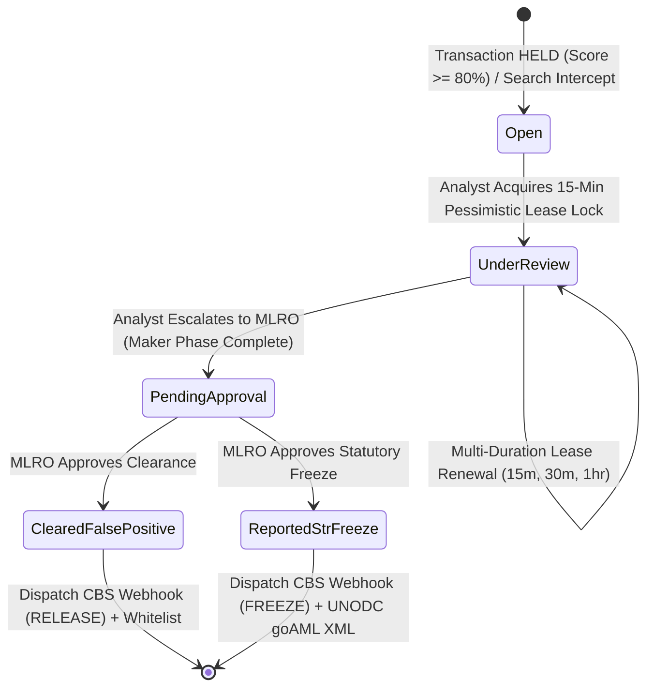

# Master Product Requirements Document (PRD v10.2)

**Product Name:** EDITH Next-Gen AML Intelligence Platform  
**Target Architecture:** Modular Monolith (.NET 10 LTS + React 19 Portal + OpenSearch 2.12 + PostgreSQL 17)  
**Target Market:** Tier-1 Commercial Banks, GCC Exchange Houses, Central Banks, and FinTech Unicorns  
**Applicable Regulations:** CBUAE AML/CFT Federal Decree-Law No. (20) of 2018, Cabinet Decision No. (74) of 2020 on Terrorist Lists & UNSCR, SAMA AML Rules, and FATF Recommendations 6, 7, 10, 11 & 16  
**Performance SLA:** Sub-second 5-pass screening budget (P99 < 150ms OpenSearch / < 10ms in-memory)  
**Database Footprint:** Dual-Database (PostgreSQL 17 + OpenSearch 2.12 — Dual-Database Dependency)  
**Document Version:** 10.2  
**Publication Date:** October 27, 2026  
**Status:** Approved / Production-Verified PRD  

---

## 1. Executive Summary & Strategic Scope

The **EDITH AML Intelligence Platform** modernizes legacy monolithic compliance systems into a cloud-native, high-throughput financial crime intelligence engine running on **.NET 10 LTS**, **React 19**, **PostgreSQL 17**, and **OpenSearch 2.12**.

Traditional compliance platforms suffer from crippling search latency, staggering false-positive rates exceeding 90%, fragmented investigation workflows, and severe data sovereignty constraints. EDITH eliminates these failure points by delivering:
1. **Sub-150ms Deterministic Screening:** 5-pass phonetic and multi-attribute entity resolution across SWIFT MT103 and ISO 20022 messages.
2. **Dual-Database Architecture Footprint:** Pure PostgreSQL 17 relational ACID integrity paired with OpenSearch 2.12 distributed vector/inverted indexing with automatic in-memory fallback.
3. **Dual-Mode Core Banking System (CBS) Integration:** Synchronous evaluate-and-hold pre-clearance with asynchronous HMAC-SHA256 signed callbacks (`RELEASE`/`FREEZE`) protected by Polly exponential retries.
4. **Comprehensive Investigation & Governance Canvas:** 3-pane Case Workspace featuring 15-minute pessimistic lease locking, multi-duration renewals (15m, 30m, 1hr), 4-Eyes Maker-Checker controls, and categorized activity notes (`INVESTIGATION`, `SUPERVISOR`, `RATIONALE`).
5. **Advanced Calibration & 50k Portfolio Sandbox:** Interactive **Sensitivity Elbow Curve**, auto-balancing weight sliders with pin-locks, and 50,000-record historical backtesting simulation.
6. **Full Regulatory Reporting Suite:** Coverage of all 14 official regulatory PDF reports (6 Section 4e Reports, 5 Section 4f Log Reports, 3 Cross-Module Reports), 16-field transaction filter bar, and live WORM SHA-256 cryptographic chain verification.

---

## 2. Core Architectural Pillars

```mermaid
flowchart TD
    subgraph ClientLayer [Client & Integration Touchpoints]
        CBS["Core Banking System (CBS)\nSynchronous API & Webhooks"]
        PORTAL["React 19 Operator Workstation\n(17 Views :3000)"]
        BULK_UP["Bulk Ingestion Pipeline\n(CSV / XML / JSON)"]
    end

    subgraph GatewayLayer [API Gateway & IAM Perimeter - Edith.Gateway :5000]
        YARP["YARP Reverse Proxy Router"]
        IAM["Salted PBKDF2-SHA256 IAM"]
        TOTP["TOTP 2FA Service"]
        ENTITLE["Dynamic RBAC Menu Entitlements"]
    end

    subgraph ServiceLayer [Processing Core (.NET 10 LTS)]
        SCREEN["5-Pass Screening Engine\n(Edith.Screening.Core)"]
        CASES["4-Eyes Investigation Engine\n(Edith.Cases)"]
        RULES["Velocity Anomaly & Rules Engine\n(Edith.Rules)"]
        EVENTS["CBS Webhook Dispatcher\n(Edith.Events)"]
        ADDONS["goAML XML & AI Narrative Copilot\n(Edith.Addons)"]
    end

    subgraph StorageLayer [Dual-Database Sovereign Persistence]
        PG["PostgreSQL 17 (edith_aml)\nSchemas: core, screening, cases, rules, notifications"]
        WORM["core.audit_ledgers\nImmutable SHA-256 Block Chaining"]
        OS["OpenSearch 2.12\nIndices: edith_watchlist_v1, edith_customers_v1"]
    end

    ClientLayer --> GatewayLayer
    GatewayLayer --> ServiceLayer
    ServiceLayer --> StorageLayer
```

---

## 3. Screening Engine Innovations & Mathematical Model

The screening engine executes an intelligent **5-Pass Screening Lifecycle**:
1. **Pass 1 (Normalization & Cleansing):** Strips corporate legal suffixes (*LLC, FZE, Inc, Ltd, PJSC*), honorifics (*Sheikh, Dr, Mr*), diacritics, and international punctuation.
2. **Pass 2 (Broad Inverted Retrieval):** DisMax queries on OpenSearch 2.12 indices across 3–10 edge n-grams and Double Metaphone phonetic tokens across Sender, Beneficiary, and Intermediary roles.
3. **Pass 3 (Phonetic & String Distance Scoring):** Combines Double Metaphone phonetic similarity with Damerau-Levenshtein transposition algorithms and Jaro-Winkler prefix-weighted string distance.
4. **Pass 4 (Multi-Attribute Composite Scoring):** Evaluates non-name secondary corroborators to dramatically slash false positives:
   $$\text{CompositeScore} = (0.60 \times \text{Name}) + (0.15 \times \text{DOB}) + (0.15 \times \text{ID/Passport}) + (0.10 \times \text{Nationality})$$
5. **Pass 5 (Thresholding, Whitelist Suppression & Case Provisioning):** Filters candidate hits against active `screening.whitelists`. Non-whitelisted hits with $\text{CompositeScore} \ge 80.00\%$ return `HELD` and auto-provision an investigation case in `cases.aml_cases`.

### Specialized Persona Modes
* **Individual:** Focuses on Full Name, Date of Birth, Passport/National ID, and Nationality.
* **Corporate / Legal Entity:** Normalizes corporate legal structures, evaluates Tax IDs / Commercial Register Numbers, and inspects UBO associations.
* **Vessel / Maritime:** Screens Vessel Name, IMO Number, MMSI, and Flag State against OFAC maritime sanctions and North Korea/Iran shipping advisories.

---

## 4. Case Investigation & 4-Eyes Governance Lifecycle



* **15-Minute Pessimistic Lease Locking (`CaseLockManager`):** Prevents dual-analyst collisions with atomic 15-minute leases (`409 Conflict` on competing lock attempts) and multi-duration lease extensions (15m, 30m, 1hr).
* **Multi-Type Investigation Notes:** Persists `INVESTIGATION`, `SUPERVISOR`, and `RATIONALE` notes via `POST /api/v1/cases/{id}/comments`.
* **4-Eyes Maker-Checker Governance:**
  - **Analyst (Maker):** Investigates token breakdowns, adds notes, and escalates cases to `PendingApproval`. Blocked from issuing final case dispositions.
  - **MLRO (Checker):** Reviews escalated cases and executes final adjudication (`ClearedFalsePositive` $\rightarrow$ triggers signed CBS `RELEASE` webhook; or `ReportedStrFreeze` $\rightarrow$ triggers signed CBS `FREEZE` webhook + UNODC `goAML` STR XML).

---

## 5. Master Feature Matrix & Packaging

| Module Code | Module Name | Package Tier | Modernized Implementation Details |
| :--- | :--- | :---: | :--- |
| `MOD-CORE-IAM` | Multi-Tenant IAM & RBAC | **Core** | Salted PBKDF2-SHA256 password hashing (100k iterations), JWT Bearer auth, TOTP 2FA engine, dynamic group-to-menu mapping in PostgreSQL, and `/onboarding` setup flow. |
| `MOD-CORE-GATE` | Core System Gateway (`Edith.Gateway`) | **Core** | Reverse proxy router (:5000), dual-mode CBS API, correlation ID injection, tenant isolation, and SignalR live alert hubs. |
| `MOD-SCRN-BASE` | Watchlist & Sanctions Screening | **Core** | 5-pass OpenSearch 2.12 engine, Double Metaphone, Target-Type Personas (Person/Corporate/Vessel), PEP Tiers 1–3 diffing, "What-If" Sensitivity Slider, and in-memory fallback. |
| `MOD-SCRN-BULK` | Streaming Bulk Ingestion Pipeline | **Core** | Asynchronous memory-bounded streaming parser (`IAsyncEnumerable`) for CSV/XML/JSON, 9-field AML mapping, duplicate skip detection, and multi-format skipped record export. |
| `MOD-RULE-PROC` | AML Transaction Rule Engine | **Core** | Velocity Anomaly engine, High-Risk Corridors, Structuring/Smurfing rules, multi-mode execution (`REALTIME`, `SHADOW`, `PENDING_APPROVAL`), and 50,000-record portfolio backtesting sandbox with **Sensitivity Elbow Curve**. |
| `MOD-CASE-WORK` | 3-Pane Case Investigation Canvas | **Core** | Vertical queue, 15-minute pessimistic lease locking with multi-duration renewals (15m/30m/1hr), 4-tab console, categorized notes, whitelist-on-dismissal, and 4-Eyes Maker-Checker state machine. |
| `MOD-AUDIT-WORM` | Immutable Cryptographic Audit Ledger | **Core** | SHA-256 block-chained WORM audit ledger in `core.audit_ledgers`, live cryptographic chain verifier, and certified regulatory examination export modal. |
| `MOD-GOAML-GCC` | Automated UNODC `goAML` Exporter | **Add-on** | Schema-validated UNODC `goAML` v5.0 XML payload generator for GCC Financial Intelligence Units (CBUAE, SAMA). |
| `MOD-AI-NARR` | GenAI STR Narrative Copilot | **Add-on** | Automated 5-section regulatory STR narrative synthesis with inline multi-paragraph rich text editor. |
| `MOD-AI-GRAPH` | Entity Relationship Graph Visualizer | **Add-on** | Embedded multi-hop network graph builder identifying Ultimate Beneficial Owners (UBO) and circular layering rings. |
| `MOD-REPORTS-14`| Regulatory Reports Hub | **Core** | Complete coverage of all 14 official regulatory PDF reports (6 Section 4e Reports, 5 Section 4f Log Reports, 3 Cross-Module Reports) with 16-field transaction filter bar and 3d/7d SLA watchdog. |

---

## 6. Verification & Automated Test Suite Results

The platform is rigorously tested and validated with **10 test projects and 96 automated tests** achieving a **100% pass rate**:

```
Total Test Projects:  10
Total Test Cases:     96
Passed:               96 (100%)
Failed:               0
Skipped:              0
Frontend Build:       tsc -b && vite build (0 errors)
```

| Test Project | Passed Tests | Scope Verified |
| :--- | :---: | :--- |
| `Edith.Screening.Tests` | 26 | Double Metaphone, n-grams, text normalization, Jaro-Winkler, Damerau-Levenshtein, OpenSearch engine. |
| `Edith.Screening.Api.Tests` | 13 | Pre-clearance screening, idempotency replay, whitelist suppression, auto-case creation, bulk upload & skipped download. |
| `Edith.Screening.Bulk.Tests` | 10 | Streaming CSV/XML/JSON parser, 9-field mapping, duplicate skipping, multi-format skipped exporter. |
| `Edith.Cases.Tests` | 10 | State machine transitions, 15-min pessimistic locking, collision blocking, 4-Eyes RBAC, notes & audit trail. |
| `Edith.Events.Tests` | 10 | HMAC-SHA256 webhook signing/verification, CBS webhook dispatcher with Polly retries and dead-letter ledger recording. |
| `Edith.Gateway.Tests` | 9 | JWT issuance, PBKDF2 password hashing, IAM user/group CRUD, role entitlements, tenant isolation, E2E hold-to-resolution workflow. |
| `Edith.Database.Migrator.Tests` | 6 | Multi-schema DDL validation (`core`, `screening`, `cases`, `rules`, `notifications`) and seed integrity. |
| `Edith.Addons.Tests` | 6 | UNODC goAML XML export, AI STR narrative copilot, multi-hop entity relationship graph visualizer. |
| `Edith.Rules.Tests` | 5 | High-risk corridor, structuring/smurfing, large cash threshold rules, velocity anomaly, and backtesting sandbox. |
| `Edith.Performance.Benchmark` | 1 | High-concurrency 5-pass screening latency benchmark (<150ms P99). |

---
*Maintained by the EDITH Architecture & Compliance Engineering Team (v10.2).*
