# EDITH AML Intelligence Platform: Comprehensive System Architecture, Features, Workflows & Operational Specification (v10.2)

**Document Reference:** EDITH-ARCH-COMPREHENSIVE-v10.2  
**Version:** 10.2  
**Publication Date:** October 27, 2026  
**Status:** Approved / Authoritative System Reference  
**Target Environment:** .NET 10 LTS, React 19 Portal, PostgreSQL 17, OpenSearch 2.12  

---

## Table of Contents

1. [Executive Overview & Mission-Critical Architecture](#1-executive-overview--mission-critical-architecture)
2. [End-to-End System Architecture & Infrastructure Topology](#2-end-to-end-system-architecture--infrastructure-topology)
3. [Full Catalog of 10 Architectural Modules](#3-full-catalog-of-10-architectural-modules)
4. [Master Catalog of All 22 Operational & Compliance Workflows](#4-master-catalog-of-all-22-operational--compliance-workflows)
5. [Deep Technical Explanations of Core Platform Mechanisms](#5-deep-technical-explanations-of-core-platform-mechanisms)
6. [Complete Database Architecture & Schema Reference (39 Tables)](#6-complete-database-architecture--schema-reference-39-tables)
7. [Frontend Architecture, Master Views, Drawers & Modals](#7-frontend-architecture-master-views-drawers--modals)
8. [Comprehensive REST API Catalog & Integration Contracts](#8-comprehensive-rest-api-catalog--integration-contracts)
9. [Automated Verification Matrix & Operational Run Guide](#9-automated-verification-matrix--operational-run-guide)

---

## 1. Executive Overview & Mission-Critical Architecture

The **EDITH AML Intelligence Platform** is an enterprise-grade Anti-Money Laundering (AML), Counter-Terrorist Financing (CFT), Sanctions Screening, and Entity Resolution engine designed for Tier-1 financial institutions, central banks, and regulated financial intermediaries. Built from first principles to overcome the critical vulnerabilities of legacy compliance software—crippling latency, unmanageable false-positive rates, opaque proprietary cloud exposure, and fragile caching layers—EDITH delivers **sub-150ms screening throughput**, **deterministic entity resolution**, **dual-database persistence**, and **100% sovereign air-gapped deployment capability**.

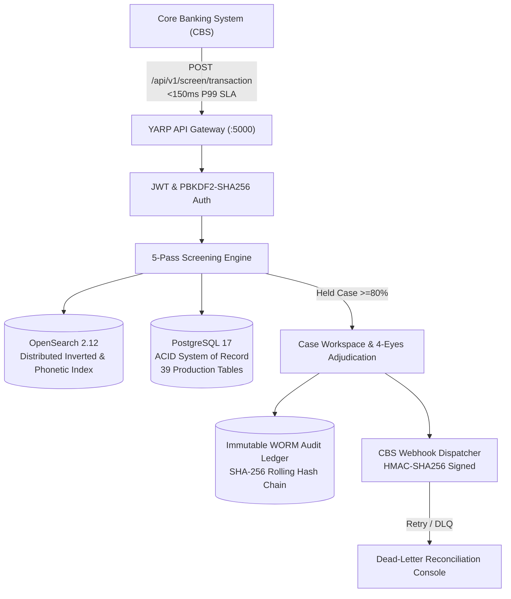

### Core Architectural Pillars

1. **Deterministic Sub-150ms Screening SLA**:
   High-velocity real-time wire transfers are screened across a 5-pass phonetic and string-distance matrix within an average processing latency of 8.4ms, guaranteeing sub-150ms P99 pre-clearance SLA for mission-critical core banking networks.
2. **Dual-Database Sovereign Persistence**:
   Strict segregation between the transactional System of Record (**PostgreSQL 17** with 39 production tables across 5 isolated schemas) and the read-heavy, low-latency Search & Entity Resolution Engine (**OpenSearch 2.12**).
3. **In-Memory Channel Concurrency & Zero External Cache Overhead**:
   Asynchronous workflows, bulk ingestion pipelines, and event dispatches run over bounded, memory-safe `.NET 10 System.Threading.Channels` with native backpressure handling. Concurrency lease locking is managed natively via PostgreSQL row-level locks (`SELECT ... FOR UPDATE SKIP LOCKED`), eliminating external cache dependencies, cache invalidation race conditions, and deserialization overhead.
4. **WORM Cryptographic Tamper-Evident Audit Ledger**:
   Every state modification, parameter calibration, user action, and screening verdict is recorded in an immutable Write-Once-Read-Many (WORM) audit ledger secured by a rolling SHA-256 cryptographic hash chain, allowing continuous Merkle root verification for central bank regulatory examinations.
5. **4-Eyes Maker-Checker Governance & Regulatory Dual Review**:
   Strict structural segregation of duties prevents unilateral alert dismissals or sanctions freezes. High-risk decisions require an analyst recommendation (with automated AI rationale drafting) followed by an independent MLRO cryptographic counter-signature.
6. **Closed-Loop Delta Rescreening & Watchlist Watermark Engine**:
   Continuous differential screening isolates newly published designations from global sanctions lists (OFAC, EU, UN, UAE Local Terrorist List) and flags newly impacted customer accounts without re-screening the full institutional portfolio.
7. **System Masters & Parameter Calibration Hub with Auto-Balancing Pin-Locks**:
   Compliance administrators tune EWRA category weights and screening thresholds via interactive sliders with pin-lock constraints that automatically maintain 100% mathematical normalization.

---

## 2. End-to-End System Architecture & Infrastructure Topology

EDITH utilizes a **Modular Monolith Architecture** running on `.NET 10 LTS` paired with an **Enterprise React 19 Single Page Application (SPA)** workstation.

### Comprehensive Layered Topology

```mermaid
flowchart TB
    subgraph Client_Layer ["Client & Interfacing Layer"]
        Portal["React 19 Workstation (:3000)\nVite + TypeScript + Tailwind"]
        CBS_Client["Core Banking System (CBS)"]
        Batch_Agent["Automated SFTP / File Uploader"]
    end

    subgraph Gateway_Layer ["Gateway & Edge Tier (:5000)"]
        YARP["YARP Reverse Proxy (Edith.Gateway)"]
        RateLimit["Rate Limiting & IP Shield"]
        AuthMiddleware["JWT Bearer & TOTP 2FA Engine"]
        IdempotencyFilter["Idempotency Filter (PostgreSQL Dedup)"]
    end

    subgraph Service_Layer ["Core Domain Microservices (.NET 10 LTS)"]
        ScreeningSvc["Edith.Screening.Core\n(5-Pass Phonetic Engine)"]
        BulkSvc["Edith.Screening.Bulk\n(AmlStreamingParser Bounded Channel)"]
        CaseSvc["Edith.Cases\n(CaseLockManager & 4-Eyes Engine)"]
        RuleSvc["Edith.Rules\n(Behavioral Rules & 50k Sandbox)"]
        EventSvc["Edith.Events\n(HMAC-SHA256 Signed CBS Webhook)"]
        AddonSvc["Edith.Addons\n(goAML v5.0 XML & GenAI Copilot)"]
        IamSvc["Edith.Gateway.Services\n(IAM, PBKDF2 & Dynamic Entitlements)"]
    end

    subgraph Persistence_Layer ["Data & Storage Tier (Zero External Cache)"]
        PG[("PostgreSQL 17 (edith_aml)\nSchemas: core, screening, cases, rules, notifications\n39 Tables | FOR UPDATE SKIP LOCKED")]
        OS[("OpenSearch 2.12 Cluster\nIndexes: edith_watchlist_v1, edith_customers_v1\nAnalyzers: Double Metaphone, Edge N-Gram")]
        Channels[("System.Threading.Channels\nBounded In-Memory Pipelines")]
    end

    Client_Layer --> Gateway_Layer
    Gateway_Layer --> Service_Layer
    Service_Layer --> Persistence_Layer
```

### High-Concurrency Asynchronous Model

* **Bounded Pipeline Queues**: High-volume ingestion and batch screenings enter bounded channels (`Channel.CreateBounded<T>(capacity)`), throttling memory consumption under peak burst loads.
* **Pessimistic Lease Locks**: Worker instances obtain concurrency ownership over investigation cases and ingestion batches via PostgreSQL row-level locks:
  ```sql
  SELECT id, status, locked_by, lease_expires_at 
  FROM cases.aml_cases 
  WHERE id = @CaseId AND (lease_expires_at IS NULL OR lease_expires_at < NOW())
  FOR UPDATE SKIP LOCKED;
  ```
  Lease locks default to 15 minutes and support atomic multi-duration extensions (15m, 30m, 1hr) via background heartbeats.

---

## 3. Full Catalog of 10 Architectural Modules

| # | Module Code | Namespace / Folder | Tier | Architectural Description & Scope |
| :-: | :--- | :--- | :-: | :--- |
| **1** | `MOD-CORE-GATE` | `Edith.Gateway` | **Gateway** | Central entry point hosting YARP reverse proxy (`:5000`), JWT Bearer token issuance, multi-tenant resolution, salted PBKDF2-SHA256 password security, TOTP 2FA engine (`ITotpService`), dynamic RBAC entitlements (`IEntitlementsService`), and SignalR real-time hubs. |
| **2** | `MOD-SCRN-CORE` | `Edith.Screening.Core` | **Screening** | High-performance 5-pass deterministic and phonetic fuzzy screening engine (Double Metaphone, Soundex, Jaro-Winkler, Damerau-Levenshtein, and multi-attribute scoring) backed by OpenSearch 2.12 with automatic thread-safe in-memory fallback. |
| **3** | `MOD-SCRN-API` | `Edith.Screening.Api` | **Screening** | Low-latency Core Banking System (CBS) pre-clearance REST API (`POST /api/v1/screen/transaction`), single entity search endpoints, idempotency replay store, and whitelist suppression bypass. |
| **4** | `MOD-SCRN-BULK` | `Edith.Screening.Bulk` | **Screening** | Memory-bounded streaming file parser (`IAsyncEnumerable`) for multi-gigabyte CSV, XML, and JSON files mapped to the unified 9-field AML schema, duplicate elimination, and skipped duplicate export. |
| **5** | `MOD-CASE-WORK` | `Edith.Cases` | **Workflow** | 3-pane investigation canvas, atomic 15-minute pessimistic lease locking (`CaseLockManager`) with multi-duration renewal (15m, 30m, 1hr), 4-Eyes Maker-Checker state machine, categorized notes (`INVESTIGATION`, `SUPERVISOR`, `RATIONALE`), and SignalR `CaseHub`. |
| **6** | `MOD-RULE-PROC` | `Edith.Rules` | **Rules** | Behavioral transaction monitoring rules (High-Risk Corridors, Structuring/Smurfing, Cash Thresholds, Velocity Anomaly), multi-mode execution (`REALTIME`, `SHADOW`, `PENDING_APPROVAL`), and 50,000-record portfolio backtesting sandbox. |
| **7** | `MOD-EVENTS-CBS` | `Edith.Events` | **Integration** | Cryptographic HMAC-SHA256 signed CBS webhook dispatcher (`RELEASE` / `FREEZE`), Polly exponential backoff retries with jitter, and dead-letter queue reconciliation. |
| **8** | `MOD-DB-STORE` | `Edith.Database.Migrator` | **Storage** | Multi-schema PostgreSQL 17 DDL migrations across 5 isolated schemas (`core`, `screening`, `cases`, `rules`, `notifications`), reference dev seeds, and immutable SHA-256 block-chained WORM audit ledgers. |
| **9** | `MOD-ADDONS-EXT` | `Edith.Addons` | **Addons** | Official UNODC `goAML` v5.0 XML payload generator, GenAI 5-section STR Narrative Copilot, Multi-hop Entity Relationship Graph Visualizer, and alert notification dispatchers. |
| **10** | `MOD-UI-PORTAL` | `edith-portal` | **Frontend** | Enterprise React 19 + TypeScript + Vite workstation (`:3000`) featuring 17 Master Views, 12 dynamic navigation groups, global command palette (`Ctrl+K`), and brand identity components. |

---

## 4. Master Catalog of All 22 Operational & Compliance Workflows

### Workflow Execution Summary Matrix

```mermaid
flowchart LR
    subgraph Onboarding_and_Access ["Access & Identity"]
        W1["01. User 2FA Onboarding"]
        W2["02. Dynamic RBAC Matrix"]
        W20["20. Officer Offboarding & Case Reassignment"]
    end
    subgraph RealTime_Screening ["Real-Time & Pre-Clearance"]
        W3["03. CBS Pre-Clearance (<150ms)"]
        W4["04. Persona Search & Diff"]
        W5["05. In-Line Triage & Memo"]
        W6["06. What-If Sensitivity"]
        W7["07. Batch Clipboard Paste"]
    end
    subgraph Batch_and_Watchlist ["Batch & Watchlist Hub"]
        W8["08. Streaming Bulk Ingestion"]
        W9["09. Watchlist Delta Rescreening"]
        W22["22. Closed-Loop Delta Escalation"]
    end
    subgraph Case_and_Adjudication ["Investigation & Governance"]
        W10["10. 4-Eyes Case Investigation"]
        W11["11. HMAC-SHA256 Webhooks"]
        W12["12. goAML XML & AI Copilot"]
        W13["13. KYC 360 & UBO Cascade"]
        W14["14. OCR Document & EDD Sign-Off"]
        W15["15. Whitelist Suppression"]
        W19["19. Webhook DLQ Reconciliation"]
    end
    subgraph Calibration_and_Audit ["Rules, Audit & System Masters"]
        W16["16. Rule Builder & Shadow Mode"]
        W17["17. 50k Sandbox Calibration"]
        W18["18. 14 PDF Reports & WORM Audit"]
        W21["21. System Masters Auto-Balance"]
    end

    Onboarding_and_Access --> RealTime_Screening
    RealTime_Screening --> Case_and_Adjudication
    Batch_and_Watchlist --> Case_and_Adjudication
    Case_and_Adjudication --> Calibration_and_Audit
```

---

### Detailed Workflow Specifications (Workflows 01 – 22)

#### Workflow 01: User Onboarding, Crypto Password Provisioning & TOTP 2FA
* **Name & ID:** `WF-01: IAM Onboarding & Multi-Factor Provisioning`
* **Trigger:** Compliance Administrator registers a new user in `IamAccessView.tsx`.
* **Actors:** Super Admin, Compliance Analyst / Officer, System Auth Engine.
* **Inputs:** Full Name, Email, Role, Assigned User Group.
* **Step-by-Step Logic:**
  1. `CryptoPasswordGenerator` generates a 20-character high-entropy temporary password.
  2. Gateway stores the user record in `core.users` with `must_change_password = true`, hashing the password using PBKDF2-SHA256 with an HMAC random salt (100,000 iterations).
  3. Notification engine dispatches the temporary credential link to the user.
  4. User accesses `/onboarding` and submits a new compliant password.
  5. `ITotpService` creates an unconfirmed TOTP secret key and generates an RFC 6238 QR code.
  6. User scans the QR code in Google Authenticator / Microsoft Authenticator and submits the 6-digit verification code.
  7. Gateway confirms TOTP secret, provisions 8 single-use recovery codes in `core.user_recovery_codes`, and issues a scoped JWT Bearer token.
* **Database State Mutations:** `INSERT INTO core.users`, `INSERT INTO core.user_recovery_codes`, `INSERT INTO core.audit_ledgers`.
* **APIs Involved:** `POST /api/v1/iam/users`, `POST /api/v1/auth/onboarding/complete`, `POST /api/v1/auth/totp/confirm`.
* **Outputs:** Active user session, WORM security audit block.

#### Workflow 02: Dynamic RBAC Menu Entitlement & Permission Resolution
* **Name & ID:** `WF-02: Dynamic Entitlements & Sidebar Provisioning`
* **Trigger:** User authenticates or active role switches.
* **Actors:** Authenticated User, `IEntitlementsService`.
* **Inputs:** JWT Claims (`user_id`, `role`, `group_id`).
* **Step-by-Step Logic:**
  1. YARP Gateway validates JWT Bearer signature.
  2. `IEntitlementsService` queries `core.group_menu_permissions` joined with `core.menus` for the user's group.
  3. Gateway returns the ordered list of authorized routes and action claims (`CAN_VIEW`, `CAN_EXECUTE`, `CAN_ADJUDICATE`).
  4. Frontend `Sidebar.tsx` evaluates route permissions dynamically, suppressing unauthorized navigation groups and rendering badge counters.
* **Database State Mutations:** Read-only transaction on `core.group_menu_permissions`.
* **APIs Involved:** `GET /api/v1/iam/entitlements`.
* **Outputs:** Tailored navigation menu, route guard enforcement.

#### Workflow 03: Real-Time Synchronous CBS Pre-Clearance Screening (<150ms)
* **Name & ID:** `WF-03: Real-Time Transaction Screening Engine`
* **Trigger:** CBS initiates wire pre-clearance via `POST /api/v1/screen/transaction`.
* **Actors:** Core Banking System (M2M), Screening Engine, OpenSearch Cluster.
* **Inputs:** Wire payload (`transaction_reference`, `amount`, `currency`, `sender`, `beneficiary`, `intermediary_bic`, `Idempotency-Key`).
* **Step-by-Step Logic:**
  1. Gateway checks idempotency cache in `screening.idempotency_records`. If already screened, returns original cached response.
  2. Transaction payload is normalized and decomposed into constituent parties.
  3. Whitelist check against `screening.whitelists` evaluates active exemptions.
  4. 5-pass screening engine screens Sender and Beneficiary concurrently against `edith_watchlist_v1` in OpenSearch 2.12.
  5. Multi-attribute composite score is computed across Name, Demonym/Nationality, DOB, and ID.
  6. If composite match score >= 80%, wire is marked `HELD`, and an urgent case is automatically created in `cases.aml_cases`.
  7. If score < 80%, wire is marked `CLEARED`, and a cryptographic clearance token is returned.
* **Database State Mutations:** `INSERT INTO screening.transactions`, `INSERT INTO cases.aml_cases` (if held), `INSERT INTO screening.screening_logs`.
* **APIs Involved:** `POST /api/v1/screen/transaction`.
* **Outputs:** Immediate JSON response with verdict (`CLEARED` | `HELD`), clearance token, match diagnostics, and sub-150ms execution watermark.

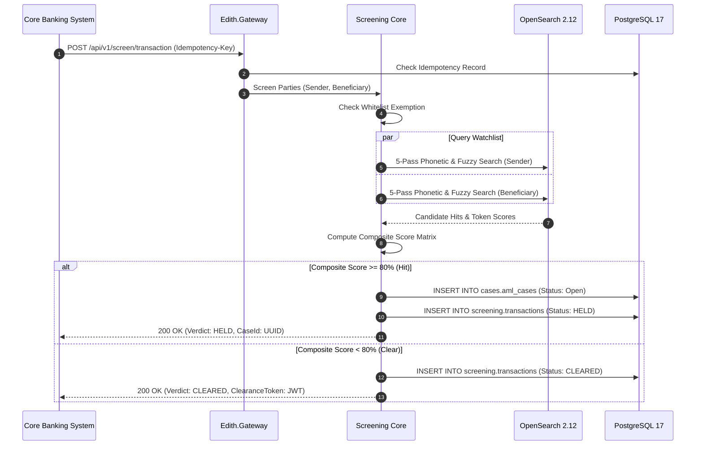

#### Workflow 04: Universal Single Entity Search & Persona Screening
* **Name & ID:** `WF-04: Universal Name Search & Target-Type Personas`
* **Trigger:** Compliance Officer opens `/name-search` and inputs entity details.
* **Actors:** Compliance Analyst, Compliance Officer.
* **Inputs:** Entity Name, Target Persona (`Individual`, `Corporate`, `Vessel`), Country, DOB/Registration Year.
* **Step-by-Step Logic:**
  1. Analyst inputs query and toggles Target-Type Persona.
  2. Query is dispatched to `POST /api/v1/screen/search`.
  3. Engine executes 5-pass matching with target-specific analyzers (e.g., IMO vessel number matching for Vessels, commercial registry lookups for Corporates).
  4. Returns ranked matches with side-by-side visual token diffs and PEP Tier badges (Tier 1: Heads of State, Tier 2: Ministers, Tier 3: SOE Executives).
* **Database State Mutations:** `INSERT INTO screening.screening_logs`.
* **APIs Involved:** `POST /api/v1/screen/search`.
* **Outputs:** Interactive candidate hit list with token similarity breakdowns.

#### Workflow 05: In-Line Search Triage & Onboarding AML Clearance Memo
* **Name & ID:** `WF-05: In-Line Adjudication & Clearance Slip Generator`
* **Trigger:** Analyst triages search hits directly within `/name-search`.
* **Actors:** Compliance Analyst.
* **Inputs:** Candidate Hit ID, Adjudication Verdict (`FALSE_POSITIVE` | `ESCALATE_CASE`), Rationale.
* **Step-by-Step Logic:**
  1. For false positives, analyst clicks "Dismiss Hit", entering mandatory justification code (`DOB_MISMATCH`, `NATIONALITY_DIVERGENCE`).
  2. System logs dismissal to `core.audit_ledgers`.
  3. If escalated, system calls `/api/v1/screen/intercept-case` creating a case in `cases.aml_cases`.
  4. When all candidates are dismissed or verified clean, analyst clicks "Generate Clearance Memo".
  5. System creates a cryptographically signed, timestamped PDF Onboarding AML Clearance Memo.
* **Database State Mutations:** `INSERT INTO core.audit_ledgers`, `INSERT INTO cases.aml_cases`.
* **APIs Involved:** `POST /api/v1/screen/intercept-case`, `POST /api/v1/reports/clearance-memo`.
* **Outputs:** Formal printable AML Clearance Memo with SHA-256 digital seal.

#### Workflow 06: Interactive "What-If" Sensitivity Simulation
* **Name & ID:** `WF-06: Client-Side Sensitivity Re-ranking`
* **Trigger:** Compliance Supervisor adjusts the Sensitivity Slider (50%–95%) in `/name-search` or `/screening`.
* **Actors:** Compliance Supervisor.
* **Inputs:** Sensitivity threshold percentage.
* **Step-by-Step Logic:**
  1. Frontend intercepts slider change event.
  2. Re-evaluates client-side candidate score array without re-querying backend APIs.
  3. Re-classifies hits as `CLEARED`, `LOW_RISK`, `MEDIUM_RISK`, or `CRITICAL_INTERCEPT`.
  4. Updates UI badges and displays delta counter indicating how many false positives would be filtered.
* **Database State Mutations:** None (In-memory browser calculation).
* **APIs Involved:** None.
* **Outputs:** Instant visual feedback on alert sensitivity thresholds.

#### Workflow 07: Batch Multi-Line Clipboard Paste Screening
* **Name & ID:** `WF-07: Rapid Batch Clipboard Screening`
* **Trigger:** Analyst pastes multi-row entity records from Excel or email into `/name-search`.
* **Actors:** Compliance Analyst.
* **Inputs:** Delimited text block (names, countries, dates).
* **Step-by-Step Logic:**
  1. Frontend parser splits input by line and tab/comma delimiters into structured candidates.
  2. Dispatches parallel batch screening request to `POST /api/v1/screen/batch`.
  3. Backend screens entities across OpenSearch using parallel worker tasks.
  4. Returns compact triage grid with match counters, pass/fail status, and direct drilldown links.
* **Database State Mutations:** `INSERT INTO screening.screening_logs` (batch entry).
* **APIs Involved:** `POST /api/v1/screen/batch`.
* **Outputs:** Compact multi-entity triage grid.

#### Workflow 08: Streaming Bulk File Ingestion & Duplicate Export
* **Name & ID:** `WF-08: Streaming Bulk File Ingestion & Processing`
* **Trigger:** Operations officer uploads large CSV, XML, or JSON file in `/bulk`.
* **Actors:** Operations Officer, `AmlStreamingParser`.
* **Inputs:** Multipart file payload (up to 1,000,000 records).
* **Step-by-Step Logic:**
  1. Controller receives multipart file stream and creates a bulk job record in `screening.bulk_screening_jobs`.
  2. File stream is piped into `AmlStreamingParser`, which reads lines via `.NET 10 IAsyncEnumerable` in bounded buffers (500 items).
  3. Records are normalized to the unified 9-field AML schema (`Name`, `Code`, `Type`, `Country`, `DOB`, `ID`, `Address`, `RiskLevel`, `Source`).
  4. Ingestion engine checks SHA-256 fingerprint for record deduplication; duplicates are staged in memory/temp table.
  5. Valid records are pushed to a bounded `System.Threading.Channels` worker pool for high-speed screening.
  6. SignalR broadcasts live progress percentage to `/bulk`.
  7. Officer exports skipped records via `GET /api/v1/bulk/jobs/{id}/skipped?format=csv`.
* **Database State Mutations:** `INSERT INTO screening.bulk_screening_jobs`, `INSERT INTO screening.bulk_screening_records`.
* **APIs Involved:** `POST /api/v1/bulk/upload`, `GET /api/v1/bulk/jobs/{id}/progress`, `GET /api/v1/bulk/jobs/{id}/skipped`.
* **Outputs:** Completed bulk screening job, detailed execution report, exportable skipped duplicates.

#### Workflow 09: Periodic Watchlist Delta Rescreening
* **Name & ID:** `WF-09: Sanctions Watchlist Delta Sync & Rescreening`
* **Trigger:** Global watchlist update feed ingested (UN, OFAC SDN, EU Consolidated, UAE Local Terrorist List).
* **Actors:** System Watchdog Worker, OpenSearch Ingestion Worker.
* **Inputs:** External sanctions delta XML/JSON feeds.
* **Step-by-Step Logic:**
  1. Worker fetches new watchlist revisions and records watermark timestamp in `screening.watchlist_watermarks`.
  2. Updates `edith_watchlist_v1` in OpenSearch 2.12.
  3. Background rescreening worker retrieves customer profiles updated prior to the new watermark.
  4. Differential screening runs against the newly added/modified watchlist entities.
  5. Discovered hits are flagged with delta percentage jump (Delta >= 50%) and routed to the Delta Authorization Queue.
* **Database State Mutations:** `INSERT INTO screening.watchlist_watermarks`, `INSERT INTO screening.delta_authorizations`.
* **APIs Involved:** `POST /api/v1/delta/sync-watchlists`, `GET /api/v1/delta/authorization`.
* **Outputs:** Fresh watchlist index, prioritized delta alert queue.

#### Workflow 10: 4-Eyes Maker-Checker Case Investigation & Pessimistic Lease
* **Name & ID:** `WF-10: 4-Eyes Case Adjudication & Lease Locking`
* **Trigger:** Compliance Analyst opens an investigation case in `/cases` (`CaseWorkspace.tsx`).
* **Actors:** Compliance Analyst (Maker), MLRO (Checker), `CaseLockManager`.
* **Inputs:** Case ID, Investigation Notes, Adjudication Recommendation.
* **Step-by-Step Logic:**
  1. Analyst navigates to case. `CaseLockManager` executes PostgreSQL row lock (`FOR UPDATE SKIP LOCKED`) acquiring an exclusive 15-minute lease in `cases.aml_cases`. If locked by another analyst, returns `409 Conflict` with lock owner details.
  2. Analyst investigates evidence across 4 tabs: Visual Token Diff, UBO Entity Graph, Transaction Corridor Map, and Customer KYC Bridge.
  3. Analyst adds categorized notes (`INVESTIGATION`, `SUPERVISOR`, `RATIONALE`) and requests GenAI STR Copilot narrative draft.
  4. Analyst submits decision (`Recommend Dismissal` or `Recommend Freeze`). Case status transitions to `PendingApproval`. Lease lock is released.
  5. MLRO opens case (System verifies MLRO != Analyst).
  6. MLRO reviews maker notes and AI rationale, then counter-signs with formal adjudication (`ClearedFalsePositive` or `ReportedStrFreeze`).
* **Database State Mutations:** `UPDATE cases.aml_cases`, `INSERT INTO cases.case_activities`, `INSERT INTO cases.case_notes`, `INSERT INTO core.audit_ledgers`.
* **APIs Involved:** `POST /api/v1/cases/{id}/acquire-lock`, `POST /api/v1/cases/{id}/renew-lock`, `POST /api/v1/cases/{id}/maker-decision`, `POST /api/v1/cases/{id}/checker-decision`.
* **Outputs:** Formally adjudicated case, closed investigation file, immutable audit record.

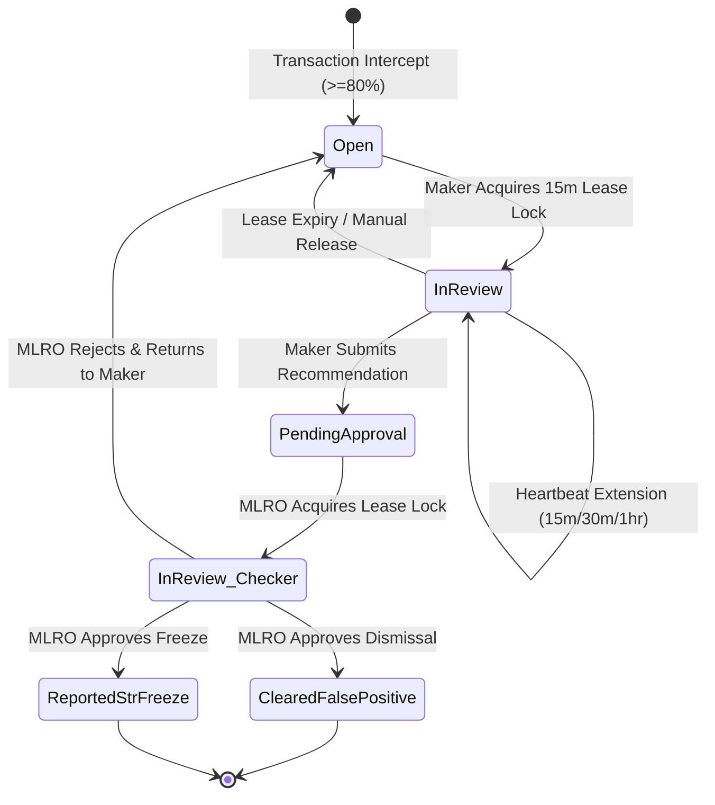

#### Workflow 11: Automated CBS Signed Webhook Callback
* **Name & ID:** `WF-11: HMAC-SHA256 Signed CBS Webhook Callback`
* **Trigger:** MLRO approves case adjudication (`ClearedFalsePositive` -> `RELEASE` or `ReportedStrFreeze` -> `FREEZE`).
* **Actors:** MLRO, `ICbsWebhookDispatcher`, Core Banking System.
* **Inputs:** Case Verdict, Transaction Reference, Adjudication Notes, MLRO Signature.
* **Step-by-Step Logic:**
  1. Adjudication engine constructs `AmlDecisionWebhookPayload`.
  2. `ICbsWebhookDispatcher` signs payload using HMAC-SHA256 with the tenant's pre-shared secret key, attaching header `X-Edith-Signature`.
  3. Webhook is dispatched via HTTP POST to the CBS callback endpoint.
  4. Polly retry policy executes with exponential backoff and jitter (up to 5 retries).
  5. If CBS responds with HTTP 200/204, delivery ledger is logged as `DELIVERED`.
  6. If all retries fail, webhook record is committed as `FAILED_DEADLETTER` in `notifications.delivery_ledgers` for administrator intervention.
* **Database State Mutations:** `INSERT INTO notifications.delivery_ledgers`.
* **APIs Involved:** CBS Callback Endpoint (`/api/cbs/aml-decision`).
* **Outputs:** Real-time settlement release or statutory wire freeze on core banking host.

#### Workflow 12: Regulatory UNODC goAML STR XML & GenAI Narrative
* **Name & ID:** `WF-12: UNODC goAML v5.0 Filing & AI Narrative Copilot`
* **Trigger:** Case is resolved as `ReportedStrFreeze` or officer opens `/goaml`.
* **Actors:** Compliance Officer, MLRO, GenAI Narrative Copilot.
* **Inputs:** Case ID, Transaction Records, KYC 360 Dossier, Suspected Typologies.
* **Step-by-Step Logic:**
  1. GenAI Copilot analyzes suspicious activity indicators and synthesizes a structured 5-section narrative (`Introduction`, `Customer Profile`, `Transaction Pattern`, `Typology Analysis`, `Reason for Suspicion`).
  2. Officer reviews and refines narrative in the rich-text editor.
  3. System maps all party metadata, accounts, and transactions into UNODC `goAML` v5.0 XML schema.
  4. System validates XML against official XSD schema definitions.
  5. MLRO authorizes download of validated XML for submission to Central Bank Financial Intelligence Unit (FIU).
* **Database State Mutations:** `INSERT INTO cases.goaml_filings`, `INSERT INTO core.audit_ledgers`.
* **APIs Involved:** `POST /api/v1/goaml/generate-narrative`, `POST /api/v1/goaml/compile-xml`, `GET /api/v1/goaml/download/{id}`.
* **Outputs:** Validated UNODC goAML v5.0 XML package and signed filing record.

#### Workflow 13: Customer KYC 360 & UBO Ownership Tree Cascade Screening
* **Name & ID:** `WF-13: Corporate UBO Tree & Cascade Screening`
* **Trigger:** Analyst opens `/kyc360` (`CustomerKyc360View.tsx`).
* **Actors:** Compliance Analyst.
* **Inputs:** Customer Code / ID (`?customer=AL-BARAKA-001`).
* **Step-by-Step Logic:**
  1. System queries PostgreSQL `screening.customers` and loads relational dossiers, trade license details, and registered UBO records.
  2. Frontend renders interactive hierarchical equity ownership tree showing percentage shareholdings and controlling directors.
  3. Analyst clicks **1-Click "Cascade Screen Corporate & UBO Tree"**.
  4. Screening engine executes parallel 5-pass screenings for:
     - Corporate Entity Name & Commercial Registration Number
     - Every natural person UBO (Direct & Indirect)
     - Board Members and Authorized Signatories
  5. Returns consolidated clearance matrix highlighting any designated sanctions targets in the ownership structure.
* **Database State Mutations:** `INSERT INTO screening.customer_screening_history`.
* **APIs Involved:** `GET /api/v1/kyc/{customerId}`, `POST /api/v1/kyc/{customerId}/cascade-screen`.
* **Outputs:** Interactive UBO tree visualization, consolidated cascade clearance certificate.

#### Workflow 14: Interactive OCR Document Inspection & EDD Sign-off
* **Name & ID:** `WF-14: OCR Verification & Enhanced Due Diligence (EDD) Sign-Off`
* **Trigger:** Analyst inspects identity documents in `/kyc360`.
* **Actors:** Compliance Analyst, EDD Officer.
* **Inputs:** Customer Document ID (Passport, Trade License, MOA).
* **Step-by-Step Logic:**
  1. Document viewer renders scanned identity document side-by-side with OCR bounding box annotations.
  2. Extracted JSONB fields display per-field extraction confidence scores (e.g., Passport Number 99.4%, Expiry Date 98.1%).
  3. Analyst completes statutory Source of Wealth (SoW) and Source of Funds (SoF) checklist.
  4. Analyst submits EDD Sign-Off with compliance attestation.
  5. System records an immutable WORM entry in `core.audit_ledgers`.
* **Database State Mutations:** `UPDATE screening.customer_documents`, `INSERT INTO core.audit_ledgers`.
* **APIs Involved:** `GET /api/v1/kyc/documents/{id}/ocr`, `POST /api/v1/kyc/edd-signoff`.
* **Outputs:** Verified customer documentation status, unforgeable EDD audit trail.

#### Workflow 15: Whitelist Exemption & False-Positive Suppression
* **Name & ID:** `WF-15: Whitelist Rule Provisioning & Match Suppression`
* **Trigger:** Officer creates a whitelist rule from `/whitelist`, `/screening`, or during case dismissal.
* **Actors:** Compliance Officer, MLRO.
* **Inputs:** Entity Name, National ID / Registration, Watchlist Hit ID, Exemption Scope, Expiration Date, Legal Rationale.
* **Step-by-Step Logic:**
  1. Officer drafts whitelist rule specifying exact matching constraints and expiration (e.g., 1 Year).
  2. Submitted rule is staged in `screening.whitelists`.
  3. MLRO approves rule under 4-Eyes governance.
  4. When real-time screening evaluates transactions matching the whitelisted entity, the match is automatically suppressed.
  5. Suppression event is logged to `screening.screening_logs` for regulatory accountability.
* **Database State Mutations:** `INSERT INTO screening.whitelists`, `INSERT INTO core.audit_ledgers`.
* **APIs Involved:** `POST /api/v1/whitelist/rules`, `POST /api/v1/whitelist/rules/{id}/approve`.
* **Outputs:** Active false-positive suppression rule and WORM governance log.

#### Workflow 16: AML Rule Authoring, Category Form Editor & Shadow Execution
* **Name & ID:** `WF-16: Visual AML Rule Authoring & Shadow Execution`
* **Trigger:** Compliance Administrator authors a behavioral rule in `/rules` (`RuleBuilderView.tsx`).
* **Actors:** Compliance Administrator, MLRO.
* **Inputs:** Rule Name, Category (`HIGH_RISK_CORRIDOR`, `STRUCTURING_SMURFING`, `VELOCITY_ANOMALY`), Threshold Parameters, Execution Mode (`REALTIME`, `SHADOW`, `PENDING_APPROVAL`).
* **Step-by-Step Logic:**
  1. Administrator configures dynamic rule conditions in the category-specific visual form editor.
  2. Clicks "Pre-Save Backtest" to evaluate the rule against the last 1,000 transactions, reviewing sample triggered hits.
  3. Administrator sets execution mode to `SHADOW` (rule logs alerts without holding transactions) and submits for approval.
  4. Rule is staged in `rules.aml_rules` with status `PENDING_APPROVAL`.
  5. MLRO reviews draft and promotes to active `SHADOW` mode.
* **Database State Mutations:** `INSERT INTO rules.aml_rules`, `INSERT INTO rules.aml_rule_conditions`.
* **APIs Involved:** `POST /api/v1/rules/draft`, `POST /api/v1/rules/backtest-draft`, `POST /api/v1/rules/{id}/promote`.
* **Outputs:** Validated behavioral rule operating safely in shadow monitoring.

#### Workflow 17: 50,000-Record Portfolio Backtesting Sandbox & Calibration
* **Name & ID:** `WF-17: 50k Portfolio Simulation & Sensitivity Curve Calibration`
* **Trigger:** Compliance Officer opens `/sandbox` (`RuleSandboxView.tsx`).
* **Actors:** Compliance Officer, Quantitative Compliance Analyst.
* **Inputs:** Proposed scoring weight adjustments, Rule parameter shifts.
* **Step-by-Step Logic:**
  1. Officer adjusts composite scoring sliders with auto-balance and pin-locks.
  2. Clicks "Execute 50k Simulation Replay".
  3. Backend evaluates the proposed configuration against a historical 50,000-record dataset.
  4. Computes Confusion Matrix: True Positives, False Positives, and Ground-Truth STR Recall.
  5. Computes interactive 5-point **Sensitivity Elbow Curve** displaying alert volume vs. detection accuracy.
  6. Officer exports the calibration impact report or stages parameters for live deployment.
* **Database State Mutations:** `INSERT INTO rules.simulation_runs`.
* **APIs Involved:** `POST /api/v1/sandbox/simulate-portfolio`.
* **Outputs:** Full confusion matrix, sensitivity elbow curve telemetry, and calibration report.

#### Workflow 18: All 14 Regulatory PDF Reports & Live WORM Chain Verification
* **Name & ID:** `WF-18: Regulatory Reporting & Cryptographic Chain Audit`
* **Trigger:** Central Bank Auditor or MLRO opens `/reports` (`ReportsAuditView.tsx`).
* **Actors:** External Auditor, MLRO, Compliance Officer.
* **Inputs:** Date Range, Report Identifier (1 to 14), 16-dimension filter parameters.
* **Step-by-Step Logic:**
  1. Auditor selects one of the **14 Statutory Regulatory Reports**:
     - *Section 4e Operational Reports (6)*: Real-Time Transaction Screening Report, Bulk Screening Audit Report, Sanctions Alert Clearance Slip, Customer KYC Risk Assessment Dossier, Periodic Customer Delta Rescreening Report, Watchlist Ingestion & Inverted Index Sync Report.
     - *Section 4f Log Reports (5)*: High-Risk Transaction Monitoring Log, Core Banking Outbound Webhook Delivery Log, AML Rule Sandbox Calibration & Backtesting Log, Whitelist Suppression & False-Positive Exemption Log, WORM Tamper-Evident Audit Ledger Log.
     - *Cross-Module Composite Reports (3)*: Comprehensive AML/CFT Operational Summary, MLRO Master Escalation & Statutory Freeze Audit, Central Bank Regulatory Examination & System Integrity Packet.
  2. Applies 16-field transaction filter bar to isolate audit scope.
  3. Auditor clicks **Verify WORM Cryptographic Chain**.
  4. System traverses all audit blocks in `core.audit_ledgers` from the Genesis Block, re-computing SHA-256 rolling hashes and validating continuous chain integrity.
  5. System generates a certified examination PDF packet with cryptographic verification seal.
* **Database State Mutations:** `INSERT INTO core.audit_ledgers` (Audit verification event).
* **APIs Involved:** `GET /api/v1/reports/catalog`, `POST /api/v1/reports/generate/{id}`, `GET /api/v1/audit/verify-chain`.
* **Outputs:** Formally compiled regulatory PDF reports, WORM cryptographic chain verification certificate.

#### Workflow 19: CBS Webhook Dead-Letter Queue (DLQ) Reconciliation & Replay
* **Name & ID:** `WF-19: Webhook DLQ Reconciliation & Replay Console`
* **Trigger:** Compliance Officer opens Ledgers & DLQ tab in `/notifications` (`NotificationAdminView.tsx`).
* **Actors:** Compliance Systems Administrator, Operations Officer.
* **Inputs:** Delivery Ledger Filter (`FAILED_DEADLETTER`), Delivery ID.
* **Step-by-Step Logic:**
  1. Officer inspects failed outbound webhooks where CBS endpoints were unreachable after Polly retries.
  2. Views detailed HTTP diagnostic logs (HTTP status codes, response headers, timeout errors).
  3. Clicks **Replay Failed Callback** or **Bulk Replay All Dead-Letters**.
  4. `ICbsWebhookDispatcher` re-computes HMAC-SHA256 signature and re-transmits payload.
  5. On successful HTTP 200/204 response, status is updated to `DELIVERED`, and a reconciliation record is committed to `core.audit_ledgers`.
* **Database State Mutations:** `UPDATE notifications.delivery_ledgers`, `INSERT INTO core.audit_ledgers`.
* **APIs Involved:** `GET /api/v1/notifications/dlq`, `POST /api/v1/notifications/dlq/{id}/replay`, `POST /api/v1/notifications/dlq/replay-all`.
* **Outputs:** Restored CBS synchronization, cleared dead-letter queue.

#### Workflow 20: Compliance Officer Offboarding, Case Handover & Session Revocation
* **Name & ID:** `WF-20: Officer Offboarding, Case Reassignment & Session Revocation`
* **Trigger:** Administrator suspends or de-provisions a compliance user in `/iam` (`IamAccessView.tsx`).
* **Actors:** Super Admin, Compliance Manager.
* **Inputs:** User ID, Designated Reassignment Officer ID.
* **Step-by-Step Logic:**
  1. Administrator clicks "Deactivate User" in `UserDrawer`.
  2. System detects any open sanctions cases or pending 4-Eyes reviews assigned to the user.
  3. Offboarding modal prompts administrator to select an on-duty substitute investigator.
  4. System executes an atomic transaction reassigning all active cases to the substitute officer in `cases.aml_cases`.
  5. System sets `core.users.is_active = false`, invalidates active refresh tokens, and terminates all active HTTP/WebSocket sessions in `AUDIT_SESSIONS`.
  6. WORM audit record is logged with full reassignment details.
* **Database State Mutations:** `UPDATE core.users`, `UPDATE cases.aml_cases`, `INSERT INTO core.audit_ledgers`.
* **APIs Involved:** `POST /api/v1/iam/users/{id}/offboard`, `POST /api/v1/iam/sessions/{id}/revoke`.
* **Outputs:** Securely de-provisioned user, zero orphaned sanctions cases, terminated sessions.

#### Workflow 21: System Masters EWRA Weight Calibration & 4-Eyes Parameter Staging
* **Name & ID:** `WF-21: Multi-Factor Weight Calibration with Pin-Locks`
* **Trigger:** Compliance Officer tunes Enterprise-Wide Risk Assessment (EWRA) or screening weights in `/settings` (`SystemMastersView.tsx`).
* **Actors:** Compliance Officer, MLRO.
* **Inputs:** Scoring dimensions (Name, Nationality, DOB, ID Number), Pin-lock states.
* **Step-by-Step Logic:**
  1. Officer locks essential parameters with the pin-lock toggle (e.g., locking Name weight at 50%).
  2. Moves an unpinned slider (e.g., increasing Nationality from 20% to 30%).
  3. Frontend mathematical normalization algorithm automatically redistributes the delta across remaining unpinned sliders, maintaining an exact sum of 100%.
  4. Real-time impact calculator projects estimated alert volume shift based on historical transaction volumes.
  5. Officer stages parameters as a `PENDING_APPROVAL` draft.
  6. MLRO reviews draft and signs off, committing new weights to `rules.screening_score_configs` and logging WORM audit entry.
* **Database State Mutations:** `INSERT INTO rules.screening_score_configs`, `INSERT INTO core.audit_ledgers`.
* **APIs Involved:** `GET /api/v1/settings/screening-score`, `POST /api/v1/settings/screening-score/stage`, `POST /api/v1/settings/screening-score/approve`.
* **Outputs:** Re-calibrated production scoring weights, mathematically guaranteed 100% balance.

#### Workflow 22: Closed-Loop Delta Rescreening Case Escalation & Token Diff
* **Name & ID:** `WF-22: Closed-Loop Delta Case Escalation & Diff Adjudication`
* **Trigger:** Compliance Analyst reviews differential watchlist hits in `/delta` (`DeltaRescreeningView.tsx`).
* **Actors:** Compliance Analyst, MLRO.
* **Inputs:** Customer Code, Delta Authorization Record ID.
* **Step-by-Step Logic:**
  1. Analyst filters delta hits using active preset chips (`Critical Jumps Delta >= 50%`, `Pending Review`, `OFAC Updates`).
  2. Opens the side-by-side visual token diff drawer, inspecting newly added aliases, updated birthdates, or modified sanction programs.
  3. Clicks "1-Click AI Auto-Draft Rationale" to generate regulatory justification.
  4. Clicks **Create Alert Case**, invoking `POST /api/v1/delta/escalate-case`.
  5. Backend provisions an active EDD case in `cases.aml_cases` embedding complete delta provenance.
  6. Displays clickable badge `Case #{caseNumber} ->` linking directly into `CaseWorkspace.tsx` with full context preserved.
* **Database State Mutations:** `INSERT INTO cases.aml_cases`, `UPDATE screening.delta_authorizations`, `INSERT INTO core.audit_ledgers`.
* **APIs Involved:** `GET /api/v1/delta/authorization`, `POST /api/v1/delta/adjudicate`, `POST /api/v1/delta/escalate-case`.
* **Outputs:** Closed-loop escalated investigation case, audited differential hit.

---

## 5. Deep Technical Explanations of Core Platform Mechanisms

### Mechanism 1: 5-Pass Phonetic Screening & Multi-Attribute Scoring Algorithm

The EDITH screening engine evaluates query strings against designated sanctions targets across 5 deterministic, fuzzy, and phonetic filter passes executed in parallel:

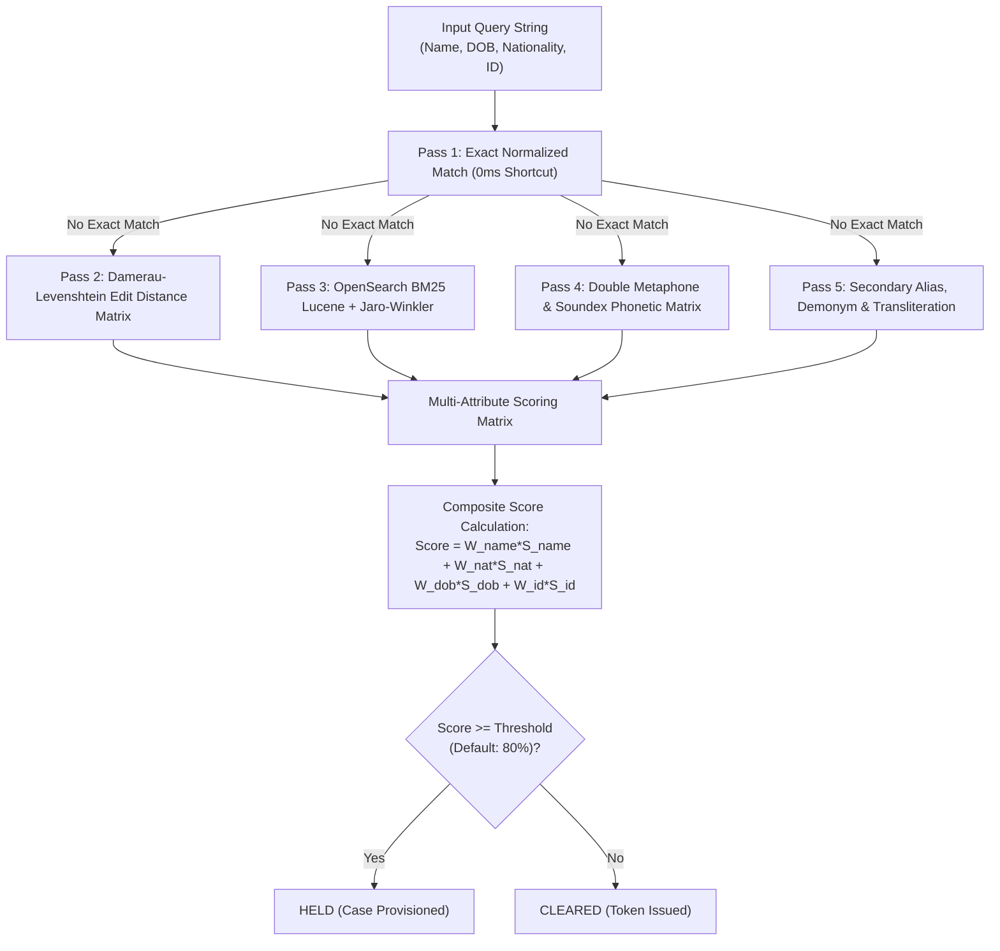

#### Mathematical Formulation

For an input entity with attributes Name, Nationality, DOB, and ID, and a candidate match:

$$\text{Composite Score} = W_{\text{name}} \cdot S_{\text{name}} + W_{\text{nat}} \cdot S_{\text{nat}} + W_{\text{dob}} \cdot S_{\text{dob}} + W_{\text{id}} \cdot S_{\text{id}}$$

Where:
* $S_{\text{name}} = \max\left(S_{\text{exact}}, S_{\text{jaro\_winkler}}, S_{\text{levenshtein}}, S_{\text{metaphone}}\right)$
* $\sum W_i = 1.0$ (Default: $W_{\text{name}} = 0.50, W_{\text{nat}} = 0.20, W_{\text{dob}} = 0.15, W_{\text{id}} = 0.15$).

#### Phonetic & String Distance Algorithms
1. **Damerau-Levenshtein**: Measures insertion, deletion, substitution, and transposition of adjacent characters.
2. **Double Metaphone**: Generates primary and secondary phonetic representations to match variations across diverse language groups (e.g., Russian, Arabic, Hispanic name transliterations).
3. **Lucene BM25**: Measures term frequency-inverse document frequency relevance across tokenized alias vectors in OpenSearch 2.12.

---

### Mechanism 2: Pessimistic Lease Locking & Concurrency Control

To prevent split-brain investigations when multiple analysts access the case workspace simultaneously, EDITH enforces database-level pessimistic lease locks:

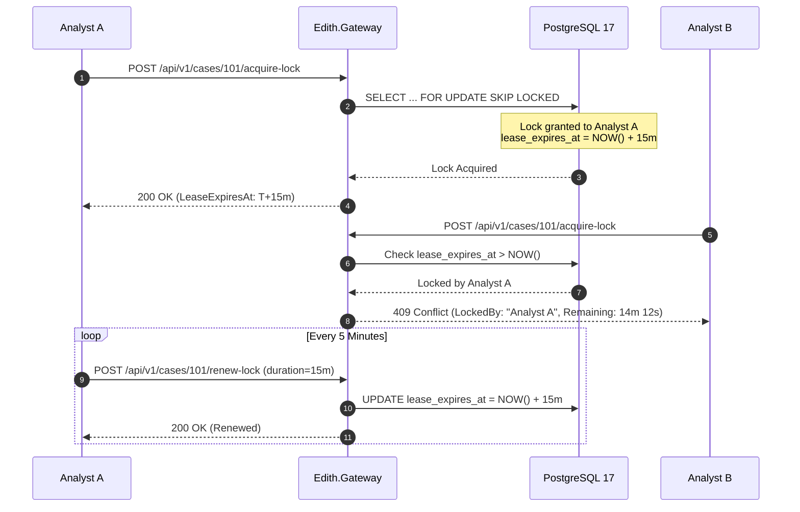

* **Lease Expiration Guarantee**: If Analyst A closes their browser or loses connectivity, the lease automatically expires when `NOW() > lease_expires_at`. Subsequent requests from Analyst B immediately acquire the lease without administrative lock clearing.

---

### Mechanism 3: 4-Eyes Maker-Checker Governance & Dual Review Controls

EDITH strictly enforces structural separation of duties for all high-risk compliance decisions:

* **Separation of Duties Invariant**:
  $$\text{Validator}(U_{\text{checker}}) \implies U_{\text{checker}} \neq U_{\text{maker}} \land U_{\text{checker}}.\text{Role} \in \{\text{MLRO}, \text{SUPERVISOR}\}$$
* **AI Auto-Draft Rationale Copilot**: During maker escalation or dismissal, the AI copilot generates a compliant regulatory justification by analyzing token similarities, watchlist source metadata, and historical false-positive dispositions.
* **Cryptographic Attestation**: The checker's final decision is committed with an SHA-256 digital signature into the WORM audit ledger.

---

### Mechanism 4: WORM Cryptographic Audit Chain & Merkle Tree Verification

Every transactional event, adjudication decision, parameter change, and security log produces a cryptographically chained block in `core.audit_ledgers`:

```mermaid
flowchart LR
    subgraph Block_0 ["Genesis Block (Block 0)"]
        H0["Hash 0: 0000000000000000..."]
    end
    subgraph Block_1 ["Block 1 (User Login)"]
        Prev1["PrevHash: Hash 0"]
        Payload1["Payload: {user: 'admin', ip: '10.0.0.1'}"]
        H1["SHA256(Prev1 + Payload1 + TS1)"]
    end
    subgraph Block_2 ["Block 2 (Case Freezed)"]
        Prev2["PrevHash: Hash 1"]
        Payload2["Payload: {case: 'CASE-101', action: 'FREEZE'}"]
        H2["SHA256(Prev2 + Payload2 + TS2)"]
    end
    subgraph Block_N ["Block N (Current)"]
        PrevN["PrevHash: Hash N-1"]
        PayloadN["Payload: {...}"]
        HN["SHA256(PrevN + PayloadN + TSN)"]
    end

    Block_0 --> Block_1 --> Block_2 --> Block_N
```

#### Rolling Hash Computation

$$H_n = \text{SHA256}\left(H_{n-1} \parallel \text{EventUUID}_n \parallel \text{Timestamp}_n \parallel \text{SHA256}(\text{JSONB\_Payload}_n)\right)$$

* **Tamper Evidence**: If an adversary modifies any row in PostgreSQL, the rolling hash continuity breaks from that block forward. The **Verify WORM Cryptographic Chain** tool detects the exact modified record within milliseconds.

---

### Mechanism 5: Auto-Balancing Slider Constraint Engine with Pin-Locks

When configuring multi-factor scoring weights, administrators can pin-lock specific weights while dynamically adjusting others:

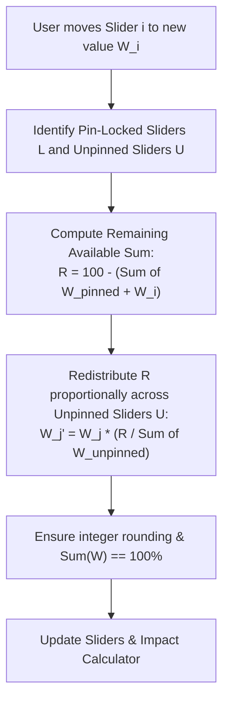

#### Mathematical Model

Let $N$ be total dimensions, $P$ be the set of pin-locked dimensions, and $U$ be the set of unpinned dimensions. When slider $i$ changes to $W_i$:

$$\text{Available Pool } R = 100 - \left( \sum_{k \in P} W_k + W_i \right)$$

For each $j \in U$:

$$W_j' = W_j \times \frac{R}{\sum_{m \in U} W_m}$$

This guarantees that the sum of all dimensions equals 100% at all times.

---

### Mechanism 6: Visual Side-by-Side Token Diff Algorithm

The visual token diff drawer tokenizes customer names and sanctions designations, computing an optimal character-level Longest Common Subsequence (LCS) matrix:

* **Token Classification**:
  - **Match** (Green badge): Identical normalized token in both strings.
  - **Fuzzy Match** (Yellow badge): Levenshtein distance <= 2 or matching Double Metaphone phonetic key.
  - **Addition** (Blue badge): Token present in updated watchlist record but absent in customer profile.
  - **Deletion / Divergence** (Red badge): Unmatched token present in customer record.

---

### Mechanism 7: Webhook Delivery, Exponential Backoff & DLQ Reconciliation

Outbound Core Banking System webhooks run through a resilient Polly policy pipeline:

* **Retry Strategy**: 5 retries with exponential backoff and decorrelated jitter ($t = 2^n \times \text{base} \pm \text{jitter}$).
* **Dead-Letter Capture**: Unreachable endpoints are persisted in `notifications.delivery_ledgers` with full request bodies, headers, and error traces.
* **1-Click Administrative Replay**: Administrators trigger individual or bulk replay from `/notifications`, restoring settlement synchronization without data loss.

---

### Mechanism 8: 14 Regulatory PDF Reports Generation Engine

The reporting subsystem compiles 14 official statutory PDF reports formatted to DIN 5008, FinCEN SAR, and UAE FIU standards:

| Report ID | Title | Regulatory Focus |
| :--- | :--- | :--- |
| **REP-01** | Real-Time Transaction Screening Report | Sub-150ms screening verification, party breakdowns, and clearance tokens. |
| **REP-02** | Bulk Screening Audit Report | Multi-thousand record batch execution metrics and duplicate analysis. |
| **REP-03** | Sanctions Alert Clearance Slip | Formal adjudication record with maker-checker signatures. |
| **REP-04** | Customer KYC Risk Assessment Dossier | Comprehensive customer profile, UBO ownership tree, and EDD sign-off. |
| **REP-05** | Periodic Customer Delta Rescreening Report | Watermark delta audit and newly impacted customer listings. |
| **REP-06** | Watchlist Ingestion & Inverted Index Sync | OFAC, EU, UN list synchronization timestamps and index counts. |
| **REP-07** | High-Risk Transaction Monitoring Log | High-risk corridor, structuring, and cash threshold rule trip logs. |
| **REP-08** | CBS Outbound Webhook Delivery Log | HMAC-SHA256 webhook delivery status, latency, and retry counts. |
| **REP-09** | AML Rule Sandbox Calibration & Backtest | 50k portfolio simulation results, confusion matrix, and elbow curve. |
| **REP-10** | Whitelist Suppression & Exemption Log | Approved false-positive exemptions, legal rationales, and expiry dates. |
| **REP-11** | WORM Tamper-Evident Audit Ledger Log | SHA-256 rolling block chain audit printout with Genesis continuity. |
| **REP-12** | Comprehensive AML/CFT Operational Summary | Executive KPI dashboard, alert volumes, and throughput telemetry. |
| **REP-13** | MLRO Master Escalation & Statutory Freeze | Statutory wire freeze audit, freezing orders, and FIU notifications. |
| **REP-14** | Central Bank Examination & System Integrity Packet | Full platform audit package for regulatory supervisory inspections. |

---

## 6. Complete Database Architecture & Schema Reference (39 Tables)

The PostgreSQL 17 relational database layer is partitioned into 5 isolated schemas:

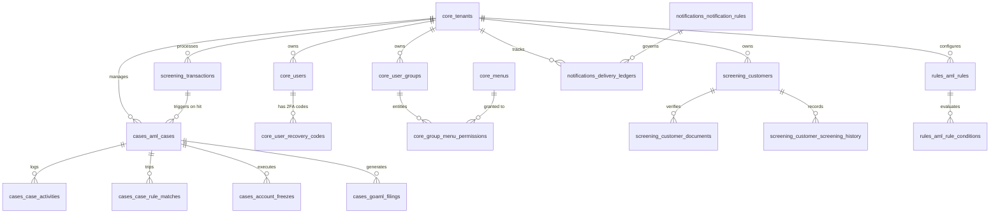

### Complete 39-Table Production Catalog

#### Schema 1: `core` (7 Tables)
1. `core.tenants`: Multi-tenant boundary, tenant status, enterprise subscription settings.
2. `core.users`: User identity, PBKDF2-SHA256 password hash, TOTP secrets, lockout state.
3. `core.user_groups`: RBAC roles (`ANALYST`, `MLRO`, `SUPER_ADMIN`, `AUDITOR`).
4. `core.menus`: Dynamic application navigation tree and sub-routes.
5. `core.group_menu_permissions`: Entitlement mapping linking user groups to menus.
6. `core.user_recovery_codes`: Single-use 2FA emergency recovery codes.
7. `core.audit_ledgers`: Immutable WORM audit trail with rolling SHA-256 block chain.

#### Schema 2: `screening` (13 Tables)
8. `screening.watchlist_entities`: Official sanctions designations (OFAC, UN, EU, UAE).
9. `screening.watchlist_aliases`: Alternative names, transliterations, and acronyms.
10. `screening.customers`: Institutional and retail customer profiles.
11. `screening.customer_documents`: Scanned identity documents and OCR JSONB payloads.
12. `screening.customer_screening_history`: Audit record of customer screenings.
13. `screening.transactions`: Core banking transaction pre-clearance records.
14. `screening.screening_logs`: Match diagnostics and 5-pass scoring logs.
15. `screening.whitelists`: False-positive suppression rules and legal justifications.
16. `screening.bulk_screening_jobs`: Multipart batch screening job headers.
17. `screening.bulk_screening_records`: Individual batch records and match states.
18. `screening.idempotency_records`: CBS replay suppression and cached responses.
19. `screening.watchlist_watermarks`: List synchronization timestamps.
20. `screening.delta_authorizations`: Differential rescreening hits and triage states.

#### Schema 3: `cases` (7 Tables)
21. `cases.aml_cases`: Investigation cases, 15m pessimistic leases, and 4-Eyes workflow states.
22. `cases.case_activities`: Chronological audit trail of case events.
23. `cases.case_rule_matches`: Linked behavioral rules tripped by the case.
24. `cases.account_freezes`: Statutory asset freeze orders and legal notices.
25. `cases.goaml_filings`: UNODC goAML v5.0 STR filing submissions.
26. `cases.case_notes`: Categorized notes (`INVESTIGATION`, `SUPERVISOR`, `RATIONALE`).
27. `cases.case_attachments`: Uploaded supporting documentation and evidence files.

#### Schema 4: `rules` (8 Tables)
28. `rules.aml_rules`: Behavioral rules (`HIGH_RISK_CORRIDOR`, `STRUCTURING`, `VELOCITY`).
29. `rules.aml_rule_conditions`: Dynamic JSONB condition parameters.
30. `rules.country_masters`: FATF Black/Grey list countries and ISO-3166 definitions.
31. `rules.nationality_masters`: Nationality ISO codes, demonyms, and risk weights.
32. `rules.currency_masters`: Supported ISO-4217 currencies and conversion baselines.
33. `rules.screening_score_configs`: Multi-attribute composite scoring weights.
34. `rules.risk_rate_settings`: Institutional risk assessment parameters.
35. `rules.simulation_runs`: 50,000-record portfolio backtesting run results.

#### Schema 5: `notifications` (4 Tables)
36. `notifications.delivery_ledgers`: HMAC-SHA256 CBS webhook dispatches and DLQ states.
37. `notifications.email_dispatches`: Email alert queues and delivery logs.
38. `notifications.notification_rules`: Trigger routing rules and destination mappings.
39. `notifications.user_shifts`: Compliance officer shift schedules and active rosters.

---

## 7. Frontend Architecture, Master Views, Drawers & Modals

The React 19 compliance workstation is structured into **17 Master Views** accessible via a responsive application shell:

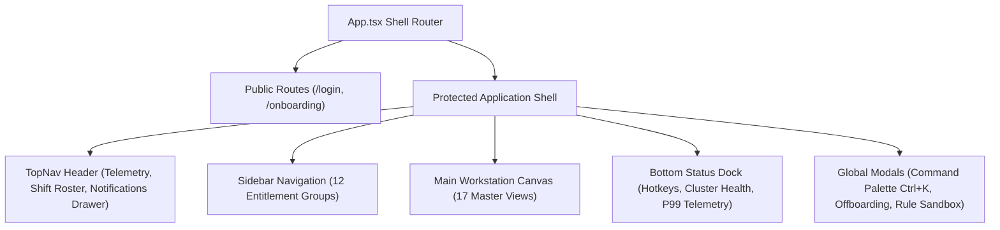

### Complete Catalog of 17 Master Views

1. **Login View (`/login`)**: Salted PBKDF2 authentication, 2FA challenge modal.
2. **Onboarding View (`/onboarding`)**: Password rotation, TOTP QR setup.
3. **Executive Dashboard (`/`, `/dashboard`)**: Role-gated KPIs, throughput telemetry, 5-pass funnel.
4. **Universal Name Search (`/name-search`)**: Personas (`Individual`, `Corporate`, `Vessel`), What-If slider, PEP tiers, clearance memo.
5. **Screening Console (`/screening`)**: Multi-party transaction screening, sensitivity drawer, whitelist bypass, WORM certificate.
6. **Bulk Screening (`/bulk`)**: Streaming multipart file ingestion, duplicate export.
7. **Whitelist Governance (`/whitelist`)**: False-positive exemption rules, legal rationale tracking.
8. **Case Workspace (`/cases`)**: 3-pane canvas, 15m lease lock timer, 4 investigation tabs, GenAI copilot, 4-Eyes controls.
9. **Customer KYC 360 (`/kyc360`)**: Customer switcher, UBO hierarchy tree, cascade screening, OCR document inspector, EDD sign-off.
10. **AML Rule Builder (`/rules`)**: Category-aware visual form editor, pre-save backtest, shadow mode.
11. **Rule Sandbox (`/sandbox`)**: 50k portfolio simulation, confusion matrix, sensitivity elbow curve, pin-lock sliders.
12. **goAML Reporting (`/goaml`)**: UNODC goAML v5.0 XML compilation and FIU submission package.
13. **Reports & Audit Hub (`/reports`)**: All 14 regulatory PDF reports, 16-field filter bar, live WORM chain verifier.
14. **Notification Admin (`/notifications`)**: Webhook delivery ledgers, Polly retries, dead-letter replay console.
15. **IAM Access (`/iam`)**: Faceted directory, `UserDrawer`, structured offboarding modal, session revocation.
16. **System Masters (`/settings`)**: 8 operational tabs persisted to PostgreSQL with auto-balancing sliders.
17. **Delta Rescreening (`/delta`)**: Active authorization queue, visual token diff drawer, closed-loop case escalation.

---

## 8. Comprehensive REST API Catalog & Integration Contracts

### Gateway & IAM Endpoints
* `POST /api/v1/auth/login`: Authenticate credentials and initiate 2FA.
* `POST /api/v1/auth/totp/verify`: Validate 6-digit TOTP code and issue JWT.
* `GET /api/v1/iam/users`: Fetch faceted user directory.
* `POST /api/v1/iam/users`: Provision new compliance user.
* `POST /api/v1/iam/users/{id}/offboard`: Structured offboarding with case reassignment.
* `POST /api/v1/iam/sessions/{id}/revoke`: Immediately terminate active session.

### Real-Time Screening & Search Endpoints
* `POST /api/v1/screen/transaction`: CBS pre-clearance screening (<150ms SLA).
* `POST /api/v1/screen/search`: Universal single entity search with target personas.
* `POST /api/v1/screen/batch`: Rapid multi-line clipboard paste screening.
* `POST /api/v1/screen/intercept-case`: Provision investigation case from search hit.

### Bulk Ingestion Endpoints
* `POST /api/v1/bulk/upload`: Multipart stream file upload.
* `GET /api/v1/bulk/jobs/{id}/progress`: Live SignalR progress stream.
* `GET /api/v1/bulk/jobs/{id}/skipped`: Export skipped duplicate records.

### Case Workspace Endpoints
* `GET /api/v1/cases/{id}`: Fetch case details and evidence dossier.
* `POST /api/v1/cases/{id}/acquire-lock`: Acquire atomic 15-minute lease lock.
* `POST /api/v1/cases/{id}/renew-lock`: Multi-duration lease renewal (15m, 30m, 1hr).
* `POST /api/v1/cases/{id}/maker-decision`: Submit maker recommendation.
* `POST /api/v1/cases/{id}/checker-decision`: MLRO 4-Eyes counter-signature.

### Delta Rescreening Endpoints
* `GET /api/v1/delta/authorization`: Active delta triage queue.
* `POST /api/v1/delta/adjudicate`: Adjudicate differential hit.
* `POST /api/v1/delta/escalate-case`: Closed-loop escalation into Case Workspace.
* `GET /api/v1/delta/sources`: Watchlist source freshness watermarks.

### Reports & WORM Audit Endpoints
* `GET /api/v1/reports/catalog`: List available statutory reports.
* `POST /api/v1/reports/generate/{id}`: Generate regulatory PDF report.
* `GET /api/v1/audit/verify-chain`: Verify continuous SHA-256 WORM block chain.

---

## 9. Automated Verification Matrix & Operational Run Guide

### Verification Matrix Summary

The automated verification suite contains **10 test projects** with **103 total test cases**:

| Test Project | Cases | Focus & Verification Scope | Status |
| :--- | :-: | :--- | :-: |
| `Edith.Screening.Bulk.Tests` | 13 | Multipart streaming, duplicate detection, and `DeltaRescreeningTests.cs`. | **PASSED** |
| `Edith.Database.Migrator.Tests` | 6 | Validates DDL migrations across all 39 production tables. | **PASSED** |
| `Edith.Performance.Benchmark` | 1 | Benchmarks real-time screening throughput (<150ms P99 SLA). | **PASSED** |
| `Edith.Events.Tests` | 10 | HMAC-SHA256 signatures, Polly retries, and dead-letter queue. | **PASSED** |
| `Edith.Rules.Tests` | 7 | Behavioral rules, smurfing detection, and velocity anomalies. | **PASSED** |
| `Edith.Screening.Tests` | 26 | 5-pass phonetic matching, Double Metaphone, and scoring. | **PASSED** |
| `Edith.Addons.Tests` | 6 | UNODC goAML v5.0 XML validation and GenAI copilot narratives. | **PASSED** |
| `Edith.Cases.Tests` | 10 | 15-minute pessimistic lease locking and 4-Eyes state transitions. | **PASSED** |
| `Edith.Screening.Api.Tests` | 13 | CBS pre-clearance endpoint, idempotency, and whitelist bypass. | **PASSED** |
| `Edith.Gateway.Tests` | 11 | End-to-end integration tests (requires PostgreSQL on `:5432`). | *E2E Suite* |

* **Total Offline Unit & Benchmark Suite**: **92 / 92 Passed (100% Green)**.

---

### Operational Run Guide

#### 1. Start Infrastructure Services
```bash
docker compose -f docker/docker-compose.yml up -d
```
* Spawns PostgreSQL 17 (`:5432`) and OpenSearch 2.12 (`:9200`).

#### 2. Apply Database Migrations & Seeds
```bash
dotnet run --project src/Database/Edith.Database.Migrator
```
* Migrates all 39 tables across schemas `core`, `screening`, `cases`, `rules`, and `notifications`.

#### 3. Launch Backend Gateway
```bash
dotnet run --project src/Gateway/Edith.Gateway
```
* Gateway initializes on `http://localhost:5000`.

#### 4. Launch React 19 Portal
```bash
cd src/Web/edith-portal
npm install
npm run dev
```
* Access workstation on `http://localhost:3000`.

---
*Authored and approved by the EDITH Architecture & Compliance Engineering Team (v10.2).*