# EDITH Platform — Master Documentation Catalog & Category Index

**Project:** EDITH Next-Gen AML Intelligence Platform  
**Target Environment:** .NET 10 LTS, React 19 Portal, PostgreSQL 17, OpenSearch 2.12  
**Applicable Regulations:** CBUAE AML/CFT Decree-Law No. (20) of 2018, Cabinet Decision No. (74) of 2020, FATF Recommendations 6, 7, 10 & 16, UNODC goAML v5.0  
**Unified Documentation Version:** 10.2  
**Last Updated:** October 27, 2026  
**Active Release Directory:** [`F:\EDITH\MD_DOC\EDITH_Documentation_v10.2\`](file:///F:/EDITH/MD_DOC/EDITH_Documentation_v10.2/)  
**Google Drive Sync Target:** [`https://drive.google.com/drive/folders/1teuXH8b2hZKMboLJTVud_Rl0v4qlx8YW?usp=drive_link`](https://drive.google.com/drive/folders/1teuXH8b2hZKMboLJTVud_Rl0v4qlx8YW?usp=drive_link)

---

## 1. Directory Structure by Functional Use

All platform specifications, database DDLs, product requirements, client pitches, master comprehensive architecture, and operational guides are organized into categorized functional directories based on their specific operational use under a unified **Version 10.2** release:

```
F:\EDITH\MD_DOC\EDITH_Documentation_v10.2\
│
├── README.md                                 # Master Catalog, Version Matrix & Sync Guide (v10.2)
├── README_v10.2.md                           # Master Catalog, Version Matrix & Sync Guide (v10.2)
├── EDITH_Documentation_Library_v10.2.zip     # Pre-packaged archive ready for 1-click Google Drive sync
├── sync_to_gdrive.ps1                        # PowerShell automation script for Google Drive sync
├── sync_to_gdrive_v10.2.ps1                  # PowerShell automation script for Google Drive sync
├── sync_checkpoint_v10.2.json                # Cryptographic audit checkpoint & SHA-256 release manifest
│
├── 01_Executive_and_Pitch/                   # Client-Facing Architecture Pitches & Commercial Decks
│   ├── EDITH_Client_Architecture_Pitch_v10.2.pdf   # Executive Pitch Presentation Deck (PDF, Publication Grade)
│   ├── EDITH_Client_Architecture_Pitch_v10.2.md    # Master Architecture Pitch Document (Markdown + Mermaid)
│   └── EDITH_Client_Architecture_Pitch_v10.2.html  # Responsive, Print-Optimized HTML Master Source
│
├── 02_Product_and_Requirements/              # Product Requirements, Roadmaps & Milestone Workplans
│   ├── EDITH_Master_PRD_v10.2.md              # Master Product Requirements Document (PRD v10.2)
│   ├── EDITH_Modules_Workflows_and_Pages_v10.2.md # Complete Catalog of 10 Modules, 17 Pages/Views & 22 Workflows (v10.2)
│   └── EDITH_END_TO_END_WORKPLAN_v10.2.md     # End-to-End Engineering Workplan & Phases 1–21 Ledger (v10.2)
│
├── 03_Technical_Architecture_and_Database/   # System Architecture, 5-Pass Engine Specs & DDL
│   ├── EDITH_Comprehensive_Platform_Architecture_and_Workflows_v10.2.md # Comprehensive All-in-One Master Reference (v10.2)
│   ├── EDITH_Master_Specification_v10.2.md    # Master Technical Architecture & Engine Spec (v10.2)
│   └── database_v10.2.md                      # PostgreSQL 17 DDL (5 Schemas, 39 Tables) & OpenSearch Mappings (v10.2)
│
└── 04_Operations_and_Deployment/             # Runbooks, Port Credentials & Engineering Tasks
    ├── HOW_TO_RUN_v10.2.md                    # Visual Studio & Web Portal Run Guide (v10.2)
    ├── CREDENTIALS_v10.2.md                   # Infrastructure Ports, Secrets, JWT Keys & Seed Data (v10.2)
    └── TODO_v10.2.md                          # Task-by-Task Implementation Status (v10.2, Phases 1–21 Complete)
```

---

## 2. Master Documentation Index & Version Matrix

All files in the EDITH documentation suite share the identical unified **v10.2** release number:

| Category | Document | Version | Primary Purpose | Key Contents |
| :--- | :--- | :---: | :--- | :--- |
| **All-in-One Master Reference** | [`EDITH_Comprehensive_Platform_Architecture_and_Workflows_v10.2.md`](file:///F:/EDITH/MD_DOC/EDITH_Documentation_v10.2/03_Technical_Architecture_and_Database/EDITH_Comprehensive_Platform_Architecture_and_Workflows_v10.2.md) | **v10.2** | **Definitive Master Reference** | All-in-one authoritative guide covering all 10 modules, all 22 workflows, deep mathematical explanations of 8 core mechanisms, 39 tables ER topology, 17 master views, and full REST API catalog. |
| **Executive & Pitch** | [`EDITH_Client_Architecture_Pitch_v10.2.pdf`](file:///F:/EDITH/MD_DOC/EDITH_Documentation_v10.2/01_Executive_and_Pitch/EDITH_Client_Architecture_Pitch_v10.2.pdf) | **v10.2** | **Client Pitch Deck (PDF)** | Executive-facing presentation PDF with dual-database architecture diagrams, 10 core modules, 22 compliance workflows, and commercial value proposition. |
| **Executive & Pitch** | [`EDITH_Client_Architecture_Pitch_v10.2.md`](file:///F:/EDITH/MD_DOC/EDITH_Documentation_v10.2/01_Executive_and_Pitch/EDITH_Client_Architecture_Pitch_v10.2.md) | **v10.2** | **Pitch Specification (MD)** | Markdown source featuring interactive Mermaid diagrams, 10 modules table, 17 pages catalog, 22 operational workflows, and commercial pitch narrative. |
| **Executive & Pitch** | [`EDITH_Client_Architecture_Pitch_v10.2.html`](file:///F:/EDITH/MD_DOC/EDITH_Documentation_v10.2/01_Executive_and_Pitch/EDITH_Client_Architecture_Pitch_v10.2.html) | **v10.2** | **HTML Master Template** | Print-styled HTML master source utilized for generating the client-ready PDF with embedded SVG diagrams. |
| **Product & Requirements** | [`EDITH_Master_PRD_v10.2.md`](file:///F:/EDITH/MD_DOC/EDITH_Documentation_v10.2/02_Product_and_Requirements/EDITH_Master_PRD_v10.2.md) | **v10.2** | **Master Product Requirements** | Functional business requirements, CBS integration contracts, 17 operator portal views, Target-Type Personas (Person/Corporate/Vessel), and feature packaging matrix. |
| **Product & Requirements** | [`EDITH_Modules_Workflows_and_Pages_v10.2.md`](file:///F:/EDITH/MD_DOC/EDITH_Documentation_v10.2/02_Product_and_Requirements/EDITH_Modules_Workflows_and_Pages_v10.2.md) | **v10.2** | **Modules, Pages & Workflows Catalog** | Complete reference catalog of all 10 platform modules, 17 frontend pages/views with route maps, global shell components, and 22 end-to-end operational workflows. |
| **Product & Requirements** | [`EDITH_END_TO_END_WORKPLAN_v10.2.md`](file:///F:/EDITH/MD_DOC/EDITH_Documentation_v10.2/02_Product_and_Requirements/EDITH_END_TO_END_WORKPLAN_v10.2.md) | **v10.2** | **Executive Workplan Ledger** | 21-Phase delivery milestones, end-to-end dataflow sequence, and cross-service pipeline contracts. |
| **Technical Architecture** | [`EDITH_Master_Specification_v10.2.md`](file:///F:/EDITH/MD_DOC/EDITH_Documentation_v10.2/03_Technical_Architecture_and_Database/EDITH_Master_Specification_v10.2.md) | **v10.2** | **Technical Architecture Spec** | 5-pass scoring equations, streaming bulk ingestion algorithms, 15m/30m/1h pessimistic lease locking, 4-Eyes state machine, and 103 automated test suite results. |
| **Technical Architecture** | [`database_v10.2.md`](file:///F:/EDITH/MD_DOC/EDITH_Documentation_v10.2/03_Technical_Architecture_and_Database/database_v10.2.md) | **v10.2** | **Database DDL & Search Specs** | PostgreSQL 17 DDL across 5 isolated schemas (39 production tables) (`core`, `screening`, `cases`, `rules`, `notifications`), SHA-256 block-chained WORM audit ledger, and OpenSearch analyzers. |
| **Operations & Deployment** | [`HOW_TO_RUN_v10.2.md`](file:///F:/EDITH/MD_DOC/EDITH_Documentation_v10.2/04_Operations_and_Deployment/HOW_TO_RUN_v10.2.md) | **v10.2** | **Developer Run Guide** | Step-by-step Visual Studio 2022 and Vite React 19 launch instructions, API health check endpoints, and debugging workflows. |
| **Operations & Deployment** | [`CREDENTIALS_v10.2.md`](file:///F:/EDITH/MD_DOC/EDITH_Documentation_v10.2/04_Operations_and_Deployment/CREDENTIALS_v10.2.md) | **v10.2** | **Infrastructure Secrets** | PostgreSQL & OpenSearch ports and credentials, JWT signing secrets, multi-tenant GUIDs, RBAC persona test users, and seeded counts. |
| **Operations & Deployment** | [`TODO_v10.2.md`](file:///F:/EDITH/MD_DOC/EDITH_Documentation_v10.2/04_Operations_and_Deployment/TODO_v10.2.md) | **v10.2** | **Engineering Implementation Status** | Phase-by-phase implementation ledger: Phases 1–21 fully implemented and marked `COMPLETED`. |

---

## 3. Recommended Reading Order by Persona

```mermaid
flowchart TD
    subgraph ClientAndExec [Executive & Business Stakeholders]
        P1["1. EDITH_Client_Architecture_Pitch_v10.2.pdf"] --> P2["2. EDITH_Master_PRD_v10.2.md"]
        P2 --> P3["3. EDITH_Modules_Workflows_and_Pages_v10.2.md"]
    end

    subgraph MasterGuide [Technical Leaders & Lead Architects]
        M1["1. EDITH_Comprehensive_Platform_Architecture_and_Workflows_v10.2.md\n(Complete Master Guide)"]
    end

    subgraph TechArch [Architects & Senior Engineers]
        A1["1. EDITH_Master_Specification_v10.2.md"] --> A2["2. database_v10.2.md"]
        A2 --> A3["3. EDITH_END_TO_END_WORKPLAN_v10.2.md"]
    end

    subgraph DevOpsAndEng [Developers & DevOps]
        D1["1. CREDENTIALS_v10.2.md"] --> D2["2. HOW_TO_RUN_v10.2.md"]
        D2 --> D3["3. TODO_v10.2.md"]
    end
```



---

## 4. Google Drive Synchronization

The target remote Google Drive folder for this project is:  
👉 **[EDITH Project Google Drive Folder](https://drive.google.com/drive/folders/1teuXH8b2hZKMboLJTVud_Rl0v4qlx8YW?usp=drive_link)**

### Sync Methods Available:

1. **One-Click Package Upload (Recommended):**
   - The pre-packaged archive [`EDITH_Documentation_Library_v10.2.zip`](file:///F:/EDITH/MD_DOC/EDITH_Documentation_v10.2/EDITH_Documentation_Library_v10.2.zip) contains all organized folders, PDF decks, and specifications.
   - Simply open the Google Drive folder in your browser and drag `EDITH_Documentation_Library_v10.2.zip` or the 4 folders directly into Google Drive.
2. **Automated Sync Script:**
   - Execute [`sync_to_gdrive_v10.2.ps1`](file:///F:/EDITH/MD_DOC/EDITH_Documentation_v10.2/sync_to_gdrive_v10.2.ps1) from PowerShell. If Google Drive for Desktop or `rclone` is installed, it will automatically synchronize changes; otherwise, it opens the Drive upload view in Google Chrome.

---

*Verified and published by the EDITH Engineering Team on October 27, 2026.*