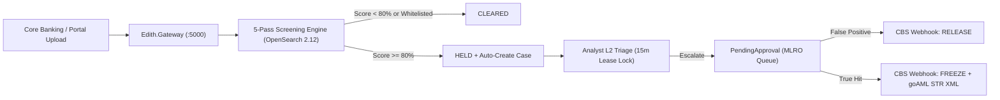

# EDITH Next-Gen AML Intelligence Platform
## End-to-End Engineering Workplan & Execution Ledger (v2.1)

**Document ID:** EDITH-WORKPLAN-V2.1  
**Version:** 2.1  
**Status:** Phases 1–6 Completed & Verified (93/93 Automated Tests Passing)  
**Last Updated:** October 19, 2026  

---

## 1. Phase Execution Summary

| Phase | Module / Deliverable | Key Engineering Milestones | Status |
| :--- | :--- | :--- | :---: |
| **Phase 1** | **Local Infrastructure & Dual-Database** | Docker Compose stack (`PostgreSQL 17` on `:5432` + `OpenSearch 2.12` on `:9200`), 5-schema DDL migrations (`core`, `screening`, `cases`, `rules`, `notifications`), reference seeds. | **COMPLETED** |
| **Phase 2** | **OpenSearch 5-Pass Screening Engine** | `Edith.Screening.Core` & `Edith.Screening.Api`, Double Metaphone phonetic analyzer, n-gram DisMax query, Jaro-Winkler + Damerau-Levenshtein scoring, idempotency store, whitelist bypass. | **COMPLETED** |
| **Phase 3** | **Bulk Streaming Ingestion & Deduplication** | `Edith.Screening.Bulk`, streaming `CSV`/`XML`/`JSON` parser for 9 AML fields, duplicate entity skip detection, `keepSkipped` retention, and on-demand export in `CSV`/`XML`/`JSON`. | **COMPLETED** |
| **Phase 4** | **Case Investigation & 4-Eyes Governance** | `Edith.Cases`, automatic case creation from `HELD` transactions, 15-min pessimistic lease locking, multi-type comments, 4-Eyes Maker-Checker RBAC, HMAC-SHA256 CBS webhooks (`RELEASE`/`FREEZE`), `goAML` XML & AI Narrative Copilot. | **COMPLETED** |
| **Phase 5** | **Frontend Live Integration & UI Bridge** | Connected React 19 `edith-portal` (`:3000`) to `Edith.Gateway` (`:5000`), real JWT persona authentication, live case workspace escalation/resolution/comments, and live bulk file upload + skipped download in UI. | **COMPLETED** |
| **Phase 6** | **Single Entity Screening & Reset Overhaul** | Universal single entity search (`NameSearchView.tsx`), 6 screening possibilities (Exact, Fuzzy, Dual-Factor, Clean Cert, PEP, Corporate), full reset lifecycle, threshold candidate noise filtering, and interactive match diagrams. | **COMPLETED** |
| **Phase 7** | **Single Entity Enhancements & Audit Exporter** | 1-Click Whitelist / False-Positive exception modal, Regulatory Screening Audit Certificate (PDF/JSON), Engine Sensitivity Drawer, direct persistent case intercept, and secondary identifier badges. | **PENDING (v1.3.0 Target)** |
| **Phase 8** | **IAM User & Group Administration** | Multi-tenant user & group management endpoints (`core.users`, `core.user_groups`), group menu permission matrix, and hashed credentials. | **PENDING** |
| **Phase 9** | **CBS Webhook Reliability & Delivery Outbox** | HMAC-SHA256 signed callbacks (`X-Edith-Signature`), exponential backoff retries, and dead-letter delivery logs in `notifications.delivery_ledgers`. | **PENDING** |

---

## 2. End-to-End Operational Data Flow

---

## 3. Verification & Quality Gates

* **Solution Build:** `dotnet build Edith.slnx` — 0 warnings, 0 errors.
* **Automated Test Suite:** `dotnet test Edith.slnx` — **93/93 tests passing** across 10 test projects.
* **Frontend Production Bundle:** `npm run build` in `src/Web/edith-portal` — `tsc -b && vite build` clean with 0 errors.
