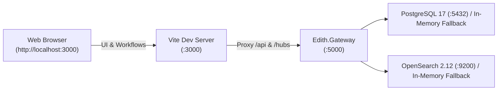

# EDITH Platform — Visual Studio & Web Portal Run Guide

**Document ID:** EDITH-RUN-GUIDE-V1.0  
**Environment:** Local Development (Visual Studio 2022 + React 19 / Vite + Docker)  
**Target Solution:** [`Edith.slnx`](file:///f:/EDITH/Edith.slnx)  
**Portal Directory:** [`src/Web/edith-portal`](file:///f:/EDITH/src/Web/edith-portal)  
**Last Updated:** October 21, 2026  

---

## 1. Quick Start Overview

EDITH operates as a decoupled microservices architecture:
* **Backend API Gateway (`Edith.Gateway`):** .NET 10 LTS Minimal API service running on **`http://localhost:5000`**.
* **Frontend Workstation (`edith-portal`):** React 19 + Vite compliance portal running on **`http://localhost:3000`** with real-time API and WebSocket proxying.



---

## 2. Step-by-Step Instructions

### Step 1: Launch the Backend in Visual Studio
1. Open [`Edith.slnx`](file:///f:/EDITH/Edith.slnx) in **Visual Studio 2022** (v17.12+ recommended for .NET 10).
2. In the **Solution Explorer**, expand the `src` $\to$ `Gateway` folder.
3. Right-click **`Edith.Gateway`** and choose **Set as Startup Project**.
4. Press **`F5`** (Debug) or **`Ctrl + F5`** (Start Without Debugging).
5. The API Gateway will compile and start on:
   - **`http://localhost:5000`**
   - *(Optional HTTPS: `https://localhost:5001`)*

### Step 2: Verify Backend Health
Open your web browser or terminal and navigate to:
👉 **[http://localhost:5000/health](http://localhost:5000/health)**

Expected JSON response:
```json
{
  "status": "Healthy",
  "service": "Edith.Gateway",
  "version": "1.3.0",
  "modules": ["IAM", "Screening", "Cases", "Rules", "Bulk", "Addons", "KYC", "Settings"],
  "timestamp": "2026-10-21T08:20:00Z"
}
```

---

### Step 3: Launch the React 19 Compliance Portal
The operator portal is built with React 19, TypeScript, and Vite.

1. Open a terminal (inside Visual Studio via **View $\to$ Terminal** or **Ctrl + `**, or open external PowerShell).
2. Navigate to the portal directory and launch the dev server:
   ```powershell
   cd F:\EDITH\src\Web\edith-portal
   npm run dev
   ```
3. Vite will start the frontend on:
   - **`http://localhost:3000`**

*(Note: `npm install` is only required on initial setup; dependencies are already installed in `node_modules`).*

---

### Step 4: Access the Compliance Workstation
Open your web browser and navigate to:
👉 **[http://localhost:3000](http://localhost:3000)**

The Vite development server is pre-configured in [`vite.config.ts`](file:///f:/EDITH/src/Web/edith-portal/vite.config.ts) to automatically proxy all backend traffic:
* `/api/*` $\longrightarrow$ `http://localhost:5000/api/*`
* `/hubs/*` $\longrightarrow$ `ws://localhost:5000/hubs/*` (SignalR WebSocket live streaming)

---

## 3. Role Personas & Authentication

No manual registration or password entry is required for development. The portal defaults to the **`ANALYST`** role persona.

You can instantly switch personas using the **Role Switcher Dropdown** in the top-right header:

| Persona / Role | Seeded Username | Responsibilities & Authorized Capabilities |
| :--- | :--- | :--- |
| **`ANALYST`** | `analyst.fatima@adcb.ae` | L1/L2 Alert triage, case locking (15m lease), EDD notes, and escalation to MLRO queue. |
| **`MLRO`** | `analyst.fatima@adcb.ae` | Money Laundering Reporting Officer. 4-Eyes statutory adjudication (`Confirm Hit (STR)` / `Dismiss (False +)`), outbound CBS webhook callbacks. |
| **`SUPER_ADMIN`** | `admin@edith.aml.cloud` | Full system administration, IAM user/group RBAC governance, scoring weights, and rule builder. |
| **`AUDITOR`** | `zayed.husseini@adcb.ae` | Read-only inspection of cases, goAML regulatory filings, and WORM SHA-256 immutable audit trails. |

---

## 4. Optional: Docker Infrastructure (PostgreSQL 17 & OpenSearch 2.12)

EDITH features **transparent in-memory fallback**. If Docker containers are stopped, the backend operates entirely in-memory with seeded test data (47,600+ watchlist entities, active cases, customers, and rules).

To spin up persistent database containers:
```powershell
cd F:\EDITH\docker
docker compose up -d
```

| Service | Port | Default Credentials | Purpose |
| :--- | :--- | :--- | :--- |
| **PostgreSQL 17** | `localhost:5432` | `edith_admin` / `EdithSecurePassword2026!` | Relational System of Record (`edith_aml`) |
| **OpenSearch 2.12** | `https://localhost:9200` | `admin` / `Tr@ns@ct10n$2026!#` | Phonetic DisMax Screening Index (`edith_watchlist_v1`) |

---

## 5. Troubleshooting & FAQs

* **Port 5000 is already in use:**
  - Close any existing `dotnet` instances or run `Get-Process -Id (Get-NetTCPConnection -LocalPort 5000).OwningProcess | Stop-Process`.
* **Port 3000 is already in use:**
  - Vite will prompt to run on `3001` or you can stop the conflicting process.
* **Frontend shows "Network Error" or 502 Bad Gateway:**
  - Ensure the backend in Visual Studio is running on `http://localhost:5000`. Test `http://localhost:5000/health`.
* **SignalR WebSocket connection failed:**
  - Verify `Edith.Gateway` is active and that your firewall allows WebSocket connections on `ws://localhost:5000`.
