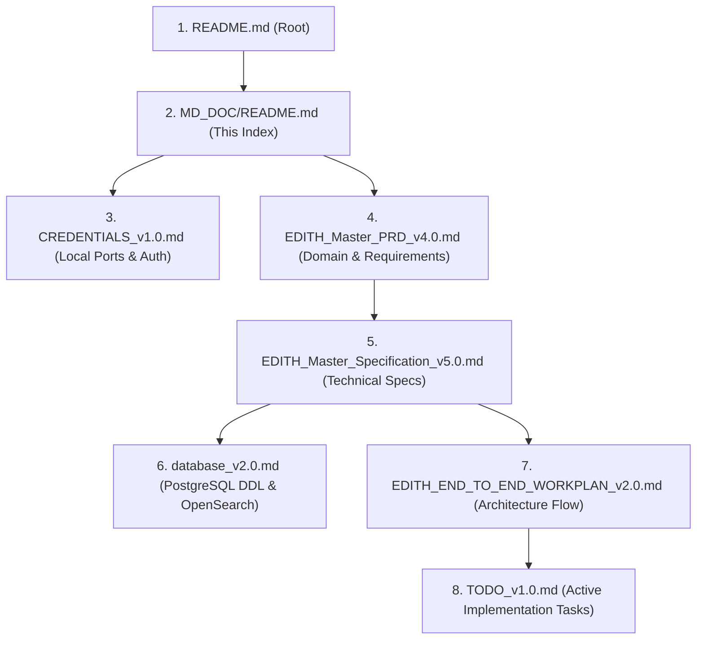

# EDITH Platform — Master Documentation Catalog & Architecture Index

**Project:** EDITH Next-Gen AML Intelligence Platform  
**Target Environment:** .NET 10 LTS, React 19 Portal, PostgreSQL 17, OpenSearch 2.12 (Zero Redis)  
**Applicable Regulations:** CBUAE AML/CFT Decree-Law No. (20) of 2018, SAMA AML Rules, FATF Recommendations 6, 7, 10 & 16  
**Last Updated:** October 19, 2026  

---

## 1. Documentation Index & Version Matrix

All platform specifications, database DDLs, product requirements, and execution roadmaps are maintained exclusively within this directory:

| Document | Current Version | Primary Purpose | Key Contents |
| :--- | :---: | :--- | :--- |
| [`TODO_v1.0.md`](file:///f:/EDITH/MD_DOC/TODO_v1.0.md) | **v1.2.0** | **Live Engineering Roadmap** | Task-by-task execution ledger: Phases 1–6 (Completed) and Phases 7–9 (Pending: Whitelist modal, PDF audit cert, sensitivity drawer, IAM CRUD, CBS retries). |
| [`CREDENTIALS_v1.0.md`](file:///f:/EDITH/MD_DOC/CREDENTIALS_v1.0.md) | **v1.1** | **Developer & Infrastructure Secrets** | PostgreSQL & OpenSearch ports/credentials, JWT signing keys, multi-tenant GUIDs, RBAC personas, CBS webhook secrets, seeded data counts. |
| [`database_v2.0.md`](file:///f:/EDITH/MD_DOC/database_v2.0.md) | **v2.1** | **Database DDL & Search Index Schema** | PostgreSQL 17 DDL across 5 isolated schemas (`core`, `screening`, `cases`, `rules`, `notifications`), foreign keys, OpenSearch analyzer & mapping configs. |
| [`EDITH_Master_Specification_v5.0.md`](file:///f:/EDITH/MD_DOC/EDITH_Master_Specification_v5.0.md) | **v5.1** | **Master Technical Architecture Spec** | 5-pass scoring equations, streaming bulk ingestion, 15-min pessimistic locking, 4-Eyes state machine, live test suite breakdown (93/93 passing), resolved design decisions. |
| [`EDITH_Master_PRD_v4.0.md`](file:///f:/EDITH/MD_DOC/EDITH_Master_PRD_v4.0.md) | **v4.1** | **Master Product Requirements (PRD)** | Business objectives, CBS integration workflows, 9-field AML mapping, 3-pane case canvas, module packaging matrix (`MOD-CORE-IAM` through `MOD-AI-GRAPH`). |
| [`EDITH_END_TO_END_WORKPLAN_v2.0.md`](file:///f:/EDITH/MD_DOC/EDITH_END_TO_END_WORKPLAN_v2.0.md) | **v2.1** | **Executive Workplan & Data Flow** | 9-Phase executive milestones, end-to-end dataflow flowchart (Core Banking $\to$ 5-Pass Screening $\to$ 4-Eyes Adjudication $\to$ CBS Webhooks). |

---

## 2. Recommended Reading Order for Engineers

1. **Start with [`CREDENTIALS_v1.0.md`](file:///f:/EDITH/MD_DOC/CREDENTIALS_v1.0.md)** to spin up Docker containers and connect to PostgreSQL (`localhost:5432`) and OpenSearch (`https://localhost:9200`).
2. **Review [`EDITH_Master_PRD_v4.0.md`](file:///f:/EDITH/MD_DOC/EDITH_Master_PRD_v4.0.md)** for regulatory background, CBS integration contracts, and module boundaries.
3. **Study [`EDITH_Master_Specification_v5.0.md`](file:///f:/EDITH/MD_DOC/EDITH_Master_Specification_v5.0.md)** for 5-pass scoring algorithms, 4-Eyes Maker-Checker workflows, and architectural decisions.
4. **Inspect [`database_v2.0.md`](file:///f:/EDITH/MD_DOC/database_v2.0.md)** for exact table structures and migrator scripts.
5. **Track active engineering on [`TODO_v1.0.md`](file:///f:/EDITH/MD_DOC/TODO_v1.0.md)** for phase status and roadmap targets.

---

## 3. Core Architectural Principles

* **Zero-Redis Dual-Database Footprint:** Relies strictly on **PostgreSQL 17** for relational ACID integrity and audit ledgers, and **OpenSearch 2.12** for phonetic and n-gram entity search, with automatic in-memory fallback when containers are offline.
* **Sub-Second 5-Pass Real-Time Screening:**
  $$\text{CompositeScore} = (0.60 \times \text{Name}) + (0.15 \times \text{DOB}) + (0.15 \times \text{ID}) + (0.10 \times \text{Nationality})$$
  Hits with score $\ge 80.00\%$ trigger `HELD` and auto-provision an investigation case.
* **Dual-Mode CBS Integration:** Instantaneous pre-clearance API paired with HMAC-SHA256 signed webhook callbacks (`RELEASE` / `FREEZE`).
* **Streaming Bulk Ingestion:** Bounded memory stream parser supporting CSV, XML, and JSON with deduplication skipping and multi-format export of skipped records.
* **4-Eyes Governance:** 15-minute pessimistic locking prevents collision; Analyst escalates to MLRO; MLRO adjudicates final decision.
