# EDITH AML Intelligence Platform: Database Architecture & OpenSearch Specification (v2.0)

**Project:** EDITH Next-Gen AML Intelligence Platform  
**Target Architecture:** PostgreSQL 17 (`edith_aml`), OpenSearch 2.12 (`edith_watchlist_v1`, `edith_customers_v1`), .NET 10 Microservices  
**Version:** 2.0  
**Last Updated:** October 2026  

---

## 1. Complete Database DDL (PostgreSQL 17)

```sql
CREATE SCHEMA IF NOT EXISTS core;
CREATE SCHEMA IF NOT EXISTS screening;
CREATE SCHEMA IF NOT EXISTS cases;
CREATE SCHEMA IF NOT EXISTS rules;
CREATE SCHEMA IF NOT EXISTS notifications;

-- ==========================================
-- SCHEMA: core
-- ==========================================
CREATE TABLE core.tenants (
    id UUID PRIMARY KEY DEFAULT gen_random_uuid(),
    name VARCHAR(255) NOT NULL,
    created_at TIMESTAMPTZ DEFAULT CURRENT_TIMESTAMP
);

CREATE TABLE core.user_groups (
    id UUID PRIMARY KEY DEFAULT gen_random_uuid(),
    tenant_id UUID NOT NULL REFERENCES core.tenants(id) ON DELETE RESTRICT,
    group_name VARCHAR(100) NOT NULL,
    is_active BOOLEAN NOT NULL DEFAULT true
);

CREATE TABLE core.users (
    id UUID PRIMARY KEY DEFAULT gen_random_uuid(),
    tenant_id UUID NOT NULL REFERENCES core.tenants(id) ON DELETE RESTRICT,
    group_id UUID NULL REFERENCES core.user_groups(id) ON DELETE SET NULL,
    username VARCHAR(100) NOT NULL,
    role VARCHAR(50) NOT NULL,
    is_active BOOLEAN NOT NULL DEFAULT true,
    created_at TIMESTAMPTZ DEFAULT CURRENT_TIMESTAMP,
    CONSTRAINT users_tenant_username_key UNIQUE (tenant_id, username)
);

CREATE TABLE core.menus (
    id UUID PRIMARY KEY DEFAULT gen_random_uuid(),
    parent_menu_id UUID NULL REFERENCES core.menus(id) ON DELETE CASCADE,
    menu_name VARCHAR(100) NOT NULL,
    path VARCHAR(255) NOT NULL,
    position INT NOT NULL
);

CREATE TABLE core.group_menu_permissions (
    id UUID PRIMARY KEY DEFAULT gen_random_uuid(),
    group_id UUID NOT NULL REFERENCES core.user_groups(id) ON DELETE CASCADE,
    menu_id UUID NOT NULL REFERENCES core.menus(id) ON DELETE CASCADE,
    can_view BOOLEAN NOT NULL DEFAULT false,
    can_edit BOOLEAN NOT NULL DEFAULT false,
    can_authorize BOOLEAN NOT NULL DEFAULT false
);

CREATE TABLE core.audit_ledgers (
    id BIGSERIAL PRIMARY KEY,
    tenant_id UUID NOT NULL REFERENCES core.tenants(id) ON DELETE RESTRICT,
    actor_id UUID NULL REFERENCES core.users(id) ON DELETE SET NULL,
    action_type VARCHAR(100) NOT NULL,
    payload JSONB NOT NULL,
    created_at TIMESTAMPTZ NOT NULL DEFAULT CURRENT_TIMESTAMP
);

-- ==========================================
-- SCHEMA: rules
-- ==========================================
CREATE TABLE rules.country_masters (
    code VARCHAR(3) PRIMARY KEY,
    country_name VARCHAR(100) NOT NULL,
    is_high_risk BOOLEAN NOT NULL DEFAULT false,
    risk_score NUMERIC(5,2) NOT NULL DEFAULT 0.00
);

CREATE TABLE rules.nationality_masters (
    code VARCHAR(3) PRIMARY KEY,
    nationality_name VARCHAR(100) NOT NULL,
    is_high_risk BOOLEAN NOT NULL DEFAULT false,
    risk_score NUMERIC(5,2) NOT NULL DEFAULT 0.00
);

CREATE TABLE rules.aml_rules (
    id UUID PRIMARY KEY DEFAULT gen_random_uuid(),
    tenant_id UUID NOT NULL REFERENCES core.tenants(id) ON DELETE RESTRICT,
    rule_code VARCHAR(50) NOT NULL,
    rule_name VARCHAR(150) NOT NULL,
    execution_mode VARCHAR(20) NOT NULL,
    rule_type VARCHAR(30) NOT NULL,
    risk_weightage NUMERIC(5,2) NOT NULL DEFAULT 0.00,
    is_active BOOLEAN NOT NULL DEFAULT true,
    CONSTRAINT aml_rules_tenant_rule_code_key UNIQUE (tenant_id, rule_code)
);

CREATE TABLE rules.aml_rule_conditions (
    id UUID PRIMARY KEY DEFAULT gen_random_uuid(),
    rule_id UUID NOT NULL REFERENCES rules.aml_rules(id) ON DELETE CASCADE,
    field_name VARCHAR(100) NOT NULL,
    operator VARCHAR(20) NOT NULL,
    condition_value TEXT NOT NULL,
    logical_chain VARCHAR(5) NOT NULL DEFAULT 'AND'
);

CREATE TABLE rules.risk_rate_settings (
    id UUID PRIMARY KEY DEFAULT gen_random_uuid(),
    tenant_id UUID NOT NULL REFERENCES core.tenants(id) ON DELETE RESTRICT,
    risk_target VARCHAR(50) NOT NULL,
    benchmark_min NUMERIC(5,2) NOT NULL,
    benchmark_max NUMERIC(5,2) NOT NULL,
    assigned_risk_tier VARCHAR(20) NOT NULL
);

CREATE TABLE rules.screening_score_configs (
    id UUID PRIMARY KEY DEFAULT gen_random_uuid(),
    tenant_id UUID NOT NULL REFERENCES core.tenants(id) ON DELETE RESTRICT,
    name_weightage NUMERIC(5,2) NOT NULL,
    nationality_weightage NUMERIC(5,2) NOT NULL,
    dob_weightage NUMERIC(5,2) NOT NULL,
    id_weightage NUMERIC(5,2) NOT NULL,
    min_threshold_score NUMERIC(5,2) NOT NULL
);

CREATE TABLE rules.setup_controls (
    id UUID PRIMARY KEY DEFAULT gen_random_uuid(),
    tenant_id UUID NOT NULL REFERENCES core.tenants(id) ON DELETE RESTRICT,
    control_code VARCHAR(50) NOT NULL,
    control_name VARCHAR(150) NOT NULL,
    is_enabled BOOLEAN NOT NULL DEFAULT true,
    CONSTRAINT setup_controls_tenant_code_key UNIQUE (tenant_id, control_code)
);

CREATE TABLE rules.risk_assessment_masters (
    id UUID PRIMARY KEY DEFAULT gen_random_uuid(),
    tenant_id UUID NOT NULL REFERENCES core.tenants(id) ON DELETE RESTRICT,
    factor_category VARCHAR(50) NOT NULL,
    factor_name VARCHAR(100) NOT NULL,
    weightage NUMERIC(5,2) NOT NULL
);

-- ==========================================
-- SCHEMA: screening
-- ==========================================
CREATE TABLE screening.customers (
    id UUID PRIMARY KEY DEFAULT gen_random_uuid(),
    tenant_id UUID NOT NULL REFERENCES core.tenants(id) ON DELETE RESTRICT,
    customer_code VARCHAR(50) NOT NULL,
    customer_type VARCHAR(20) NOT NULL CHECK (customer_type IN ('INDIVIDUAL', 'CORPORATE')),
    full_name VARCHAR(255) NOT NULL,
    dob DATE NOT NULL,
    nationality VARCHAR(3) NOT NULL REFERENCES rules.nationality_masters(code) ON DELETE RESTRICT,
    residence_country VARCHAR(3) NOT NULL REFERENCES rules.country_masters(code) ON DELETE RESTRICT,
    id_type VARCHAR(50) NOT NULL,
    id_number VARCHAR(100) NOT NULL,
    risk_tier VARCHAR(20) NOT NULL DEFAULT 'LOW',
    is_blocked BOOLEAN NOT NULL DEFAULT false,
    onboarding_status VARCHAR(30) NOT NULL DEFAULT 'PENDING',
    created_at TIMESTAMPTZ NOT NULL DEFAULT CURRENT_TIMESTAMP,
    updated_at TIMESTAMPTZ NOT NULL DEFAULT CURRENT_TIMESTAMP,
    CONSTRAINT customers_tenant_code_key UNIQUE (tenant_id, customer_code)
);

CREATE TABLE screening.customer_documents (
    id UUID PRIMARY KEY DEFAULT gen_random_uuid(),
    customer_id UUID NOT NULL REFERENCES screening.customers(id) ON DELETE CASCADE,
    document_type VARCHAR(50) NOT NULL,
    document_number VARCHAR(100) NOT NULL,
    file_path VARCHAR(255) NOT NULL,
    ocr_extracted_data JSONB NULL,
    verification_status VARCHAR(30) NOT NULL DEFAULT 'PENDING'
);

CREATE TABLE screening.customer_screening_history (
    id UUID PRIMARY KEY DEFAULT gen_random_uuid(),
    customer_id UUID NOT NULL REFERENCES screening.customers(id) ON DELETE CASCADE,
    screened_at TIMESTAMPTZ NOT NULL DEFAULT CURRENT_TIMESTAMP,
    match_status VARCHAR(30) NOT NULL,
    match_score NUMERIC(5,2) NOT NULL
);

CREATE TABLE screening.watchlist_entities (
    id UUID PRIMARY KEY DEFAULT gen_random_uuid(),
    entity_external_id VARCHAR(100) NOT NULL,
    entity_type VARCHAR(30) NOT NULL,
    full_name VARCHAR(255) NOT NULL,
    dob DATE NULL,
    nationality VARCHAR(3) NULL REFERENCES rules.nationality_masters(code) ON DELETE SET NULL,
    source_list VARCHAR(50) NOT NULL,
    category VARCHAR(50) NOT NULL,
    is_blocked BOOLEAN NOT NULL DEFAULT true,
    is_active BOOLEAN NOT NULL DEFAULT true,
    created_at TIMESTAMPTZ NOT NULL DEFAULT CURRENT_TIMESTAMP
);

CREATE TABLE screening.transactions (
    id UUID PRIMARY KEY DEFAULT gen_random_uuid(),
    tenant_id UUID NOT NULL REFERENCES core.tenants(id) ON DELETE RESTRICT,
    customer_id UUID NOT NULL REFERENCES screening.customers(id) ON DELETE RESTRICT,
    transaction_ref_no VARCHAR(100) NOT NULL UNIQUE,
    idempotency_key VARCHAR(100) NOT NULL UNIQUE,
    transaction_type VARCHAR(50) NOT NULL,
    amount NUMERIC(18,4) NOT NULL CHECK (amount > 0.0000),
    currency VARCHAR(3) NOT NULL,
    lcy_amount NUMERIC(18,4) NOT NULL CHECK (lcy_amount > 0.0000),
    sender_nationality VARCHAR(3) NOT NULL REFERENCES rules.nationality_masters(code) ON DELETE RESTRICT,
    sender_country VARCHAR(3) NOT NULL REFERENCES rules.country_masters(code) ON DELETE RESTRICT,
    beneficiary_name VARCHAR(255) NOT NULL,
    beneficiary_country VARCHAR(3) NOT NULL REFERENCES rules.country_masters(code) ON DELETE RESTRICT,
    status VARCHAR(30) NOT NULL DEFAULT 'PENDING',
    transaction_date TIMESTAMPTZ NOT NULL,
    created_at TIMESTAMPTZ NOT NULL DEFAULT CURRENT_TIMESTAMP
);

CREATE TABLE screening.screening_logs (
    id UUID PRIMARY KEY DEFAULT gen_random_uuid(),
    transaction_id UUID NOT NULL REFERENCES screening.transactions(id) ON DELETE CASCADE,
    pass_number INT NOT NULL,
    score NUMERIC(5,2) NOT NULL,
    match_type VARCHAR(50) NOT NULL,
    created_at TIMESTAMPTZ NOT NULL DEFAULT CURRENT_TIMESTAMP
);

CREATE TABLE screening.whitelists (
    id UUID PRIMARY KEY DEFAULT gen_random_uuid(),
    tenant_id UUID NOT NULL REFERENCES core.tenants(id) ON DELETE RESTRICT,
    customer_id UUID NULL REFERENCES screening.customers(id) ON DELETE CASCADE,
    entity_identifier VARCHAR(255) NOT NULL,
    match_scope VARCHAR(50) NOT NULL,
    reason TEXT NOT NULL,
    expires_at TIMESTAMPTZ NULL,
    is_active BOOLEAN NOT NULL DEFAULT true
);

CREATE TABLE screening.bulk_screening_jobs (
    id UUID PRIMARY KEY DEFAULT gen_random_uuid(),
    user_id UUID NOT NULL REFERENCES core.users(id) ON DELETE RESTRICT,
    file_name VARCHAR(255) NOT NULL,
    total_records INT NOT NULL DEFAULT 0,
    processed_records INT NOT NULL DEFAULT 0,
    skipped_records INT NOT NULL DEFAULT 0,
    keep_skipped BOOLEAN NOT NULL DEFAULT true,
    skipped_format VARCHAR(10) NOT NULL DEFAULT 'csv',
    status VARCHAR(30) NOT NULL DEFAULT 'PENDING'
);

CREATE TABLE screening.bulk_screening_items (
    id UUID PRIMARY KEY DEFAULT gen_random_uuid(),
    job_id UUID NOT NULL REFERENCES screening.bulk_screening_jobs(id) ON DELETE CASCADE,
    matched_entity_id UUID NULL REFERENCES screening.watchlist_entities(id) ON DELETE SET NULL,
    input_name VARCHAR(255) NOT NULL,
    match_score NUMERIC(5,2) NOT NULL DEFAULT 0.00,
    match_found BOOLEAN NOT NULL DEFAULT false
);

CREATE TABLE screening.bulk_job_skipped (
    id UUID PRIMARY KEY DEFAULT gen_random_uuid(),
    job_id UUID NOT NULL REFERENCES screening.bulk_screening_jobs(id) ON DELETE CASCADE,
    aml_type VARCHAR(30) NOT NULL,
    aml_fullname VARCHAR(255) NOT NULL,
    aml_iddetails VARCHAR(100) NULL,
    aml_category VARCHAR(50) NULL,
    aml_dateofbirth VARCHAR(30) NULL,
    aml_remarks TEXT NULL,
    aml_nationality VARCHAR(10) NULL,
    aml_program VARCHAR(100) NULL,
    aml_aliasname TEXT NULL,
    created_at TIMESTAMPTZ NOT NULL DEFAULT CURRENT_TIMESTAMP
);

CREATE TABLE screening.delta_sync_batches (
    id UUID PRIMARY KEY DEFAULT gen_random_uuid(),
    batch_date TIMESTAMPTZ NOT NULL DEFAULT CURRENT_TIMESTAMP,
    list_source VARCHAR(100) NOT NULL,
    hits_detected INT NOT NULL DEFAULT 0,
    status VARCHAR(30) NOT NULL DEFAULT 'COMPLETED'
);

CREATE TABLE screening.delta_authorizations (
    id UUID PRIMARY KEY DEFAULT gen_random_uuid(),
    batch_id UUID NOT NULL REFERENCES screening.delta_sync_batches(id) ON DELETE CASCADE,
    customer_id UUID NOT NULL REFERENCES screening.customers(id) ON DELETE CASCADE,
    watchlist_entity_id UUID NOT NULL REFERENCES screening.watchlist_entities(id) ON DELETE CASCADE,
    match_score NUMERIC(5,2) NOT NULL,
    status VARCHAR(30) NOT NULL DEFAULT 'PENDING',
    authorized_by UUID NULL REFERENCES core.users(id) ON DELETE SET NULL
);

-- ==========================================
-- SCHEMA: cases
-- ==========================================
CREATE TABLE cases.aml_cases (
    id UUID PRIMARY KEY DEFAULT gen_random_uuid(),
    tenant_id UUID NOT NULL REFERENCES core.tenants(id) ON DELETE RESTRICT,
    case_number VARCHAR(50) NOT NULL UNIQUE,
    transaction_id UUID NULL REFERENCES screening.transactions(id) ON DELETE RESTRICT,
    customer_id UUID NOT NULL REFERENCES screening.customers(id) ON DELETE RESTRICT,
    alert_type VARCHAR(50) NOT NULL,
    priority VARCHAR(10) NOT NULL,
    stage VARCHAR(30) NOT NULL DEFAULT 'TRIAGE',
    status VARCHAR(30) NOT NULL DEFAULT 'OPEN',
    resolution VARCHAR(40) NULL,
    resolution_reason TEXT NULL,
    assigned_analyst_id UUID NULL REFERENCES core.users(id) ON DELETE SET NULL,
    locked_by_user_id UUID NULL REFERENCES core.users(id) ON DELETE SET NULL,
    lock_expires_at TIMESTAMPTZ NULL,
    edd_deadline TIMESTAMPTZ NULL,
    mlro_deadline TIMESTAMPTZ NULL,
    created_at TIMESTAMPTZ NOT NULL DEFAULT CURRENT_TIMESTAMP,
    updated_at TIMESTAMPTZ NOT NULL DEFAULT CURRENT_TIMESTAMP
);

CREATE TABLE cases.case_rule_matches (
    id UUID PRIMARY KEY DEFAULT gen_random_uuid(),
    case_id UUID NOT NULL REFERENCES cases.aml_cases(id) ON DELETE CASCADE,
    rule_id UUID NOT NULL REFERENCES rules.aml_rules(id) ON DELETE CASCADE,
    rule_violation_summary TEXT NOT NULL
);

CREATE TABLE cases.case_activities (
    id UUID PRIMARY KEY DEFAULT gen_random_uuid(),
    case_id UUID NOT NULL REFERENCES cases.aml_cases(id) ON DELETE CASCADE,
    actor_id UUID NULL REFERENCES core.users(id) ON DELETE SET NULL,
    action_type VARCHAR(50) NOT NULL,
    note_type VARCHAR(30) NOT NULL DEFAULT 'INVESTIGATION',
    comments TEXT NULL,
    created_at TIMESTAMPTZ NOT NULL DEFAULT CURRENT_TIMESTAMP
);

CREATE TABLE cases.account_freezes (
    id UUID PRIMARY KEY DEFAULT gen_random_uuid(),
    case_id UUID NOT NULL REFERENCES cases.aml_cases(id) ON DELETE RESTRICT,
    customer_id UUID NOT NULL REFERENCES screening.customers(id) ON DELETE RESTRICT,
    transaction_id UUID NULL REFERENCES screening.transactions(id) ON DELETE RESTRICT,
    freeze_scope VARCHAR(30) NOT NULL,
    requested_by UUID NOT NULL REFERENCES core.users(id) ON DELETE RESTRICT,
    approved_by_mlro UUID NOT NULL REFERENCES core.users(id) ON DELETE RESTRICT,
    is_unfrozen BOOLEAN NOT NULL DEFAULT false
);

CREATE TABLE cases.goaml_filings (
    id UUID PRIMARY KEY DEFAULT gen_random_uuid(),
    case_id UUID NOT NULL REFERENCES cases.aml_cases(id) ON DELETE RESTRICT,
    report_type VARCHAR(30) NOT NULL,
    report_payload_xml TEXT NOT NULL,
    validation_status VARCHAR(30) NOT NULL,
    submission_date TIMESTAMPTZ NULL
);

-- ==========================================
-- SCHEMA: notifications
-- ==========================================
CREATE TABLE notifications.notification_rules (
    id UUID PRIMARY KEY DEFAULT gen_random_uuid(),
    tenant_id UUID NOT NULL REFERENCES core.tenants(id) ON DELETE CASCADE,
    alert_type VARCHAR(50) NOT NULL,
    severity_tier VARCHAR(10) NOT NULL,
    target_channels VARCHAR(255) NOT NULL
);

CREATE TABLE notifications.delivery_ledgers (
    id UUID PRIMARY KEY DEFAULT gen_random_uuid(),
    notification_rule_id UUID NOT NULL REFERENCES notifications.notification_rules(id) ON DELETE CASCADE,
    trace_id VARCHAR(100) NOT NULL UNIQUE,
    delivery_status VARCHAR(30) NOT NULL DEFAULT 'PENDING',
    sent_at TIMESTAMPTZ NOT NULL DEFAULT CURRENT_TIMESTAMP
);

CREATE TABLE notifications.user_shifts (
    id UUID PRIMARY KEY DEFAULT gen_random_uuid(),
    user_id UUID NOT NULL REFERENCES core.users(id) ON DELETE CASCADE,
    shift_start TIMESTAMPTZ NOT NULL,
    shift_end TIMESTAMPTZ NOT NULL,
    is_on_duty BOOLEAN NOT NULL DEFAULT false
);
```

---

## 2. OpenSearch 2.12 Index Mappings (`edith_watchlist_v1` & `edith_customers_v1`)

* **Custom Analyzers (`deploy/opensearch/`):**
  * `edith_name_analyzer`: Standard tokenizer, lowercase, ASCII folding, corporate suffix stop-word filter.
  * `edith_ngram_analyzer`: Edge n-gram tokenizer (`min_gram: 3`, `max_gram: 10`) for partial token matching.
  * `phonetic_tokens`: Pre-computed Double Metaphone primary and alternate keys indexed as `keyword` array for zero-latency phonetic DisMax queries.

---

## 3. Comprehensive Entity-Relationship Diagram (Mermaid)

```mermaid
erDiagram
    TENANTS ||--o{ USERS : houses
    TENANTS ||--o{ USER_GROUPS : defines
    TENANTS ||--o{ CUSTOMERS : partitions
    TENANTS ||--o{ AML_RULES : owns
    TENANTS ||--o{ WHITELISTS : authorizes
    TENANTS ||--o{ NOTIFICATION_RULES : configures
    TENANTS ||--o{ AUDIT_LEDGERS : tracks
    TENANTS ||--o{ SETUP_CONTROLS : toggles

    USER_GROUPS ||--o{ USERS : groups
    USER_GROUPS ||--o{ GROUP_MENU_PERMISSIONS : assigns
    MENUS ||--o{ GROUP_MENU_PERMISSIONS : grants
    MENUS ||--o{ MENUS : contains_submenu

    NATIONALITY_MASTERS ||--o{ CUSTOMERS : assigns_nationality
    COUNTRY_MASTERS ||--o{ CUSTOMERS : assigns_residence
    NATIONALITY_MASTERS ||--o{ TRANSACTIONS : sender_nationality
    COUNTRY_MASTERS ||--o{ TRANSACTIONS : sender_country
    COUNTRY_MASTERS ||--o{ TRANSACTIONS : beneficiary_country
    AML_RULES ||--|{ AML_RULE_CONDITIONS : contains
    AML_RULES ||--o{ CASE_RULE_MATCHES : violates

    CUSTOMERS ||--o{ TRANSACTIONS : originates
    CUSTOMERS ||--o{ CUSTOMER_DOCUMENTS : owns_vault
    CUSTOMERS ||--o{ CUSTOMER_SCREENING_HISTORY : logs_checks
    CUSTOMERS ||--o{ WHITELISTS : safe_lists
    CUSTOMERS ||--o{ DELTA_AUTHORIZATIONS : flags
    CUSTOMERS ||--o{ AML_CASES : targets
    CUSTOMERS ||--o{ ACCOUNT_FREEZES : locks_entity

    DELTA_SYNC_BATCHES ||--o{ DELTA_AUTHORIZATIONS : generates
    WATCHLIST_ENTITIES ||--o{ DELTA_AUTHORIZATIONS : matches_target

    BULK_SCREENING_JOBS ||--|{ BULK_SCREENING_ITEMS : processes
    BULK_SCREENING_JOBS ||--o{ BULK_JOB_SKIPPED : retains_skipped
    WATCHLIST_ENTITIES ||--o{ BULK_SCREENING_ITEMS : matches_record

    TRANSACTIONS ||--o| AML_CASES : triggers
    TRANSACTIONS ||--o{ SCREENING_LOGS : produces
    TRANSACTIONS ||--o{ ACCOUNT_FREEZES : freezes_remittance

    AML_CASES ||--|{ CASE_ACTIVITIES : logs_timeline
    AML_CASES ||--o{ CASE_RULE_MATCHES : records_trips
    AML_CASES ||--o{ ACCOUNT_FREEZES : executes_freeze
    AML_CASES ||--o{ GOAML_FILINGS : dispatches_str

    USERS ||--o{ AML_CASES : assigned_to
    USERS ||--o{ AML_CASES : locked_by
    USERS ||--o{ CASE_ACTIVITIES : performs_action
    USERS ||--o{ USER_SHIFTS : schedules

    NOTIFICATION_RULES ||--o{ DELIVERY_LEDGERS : dispatches
```


