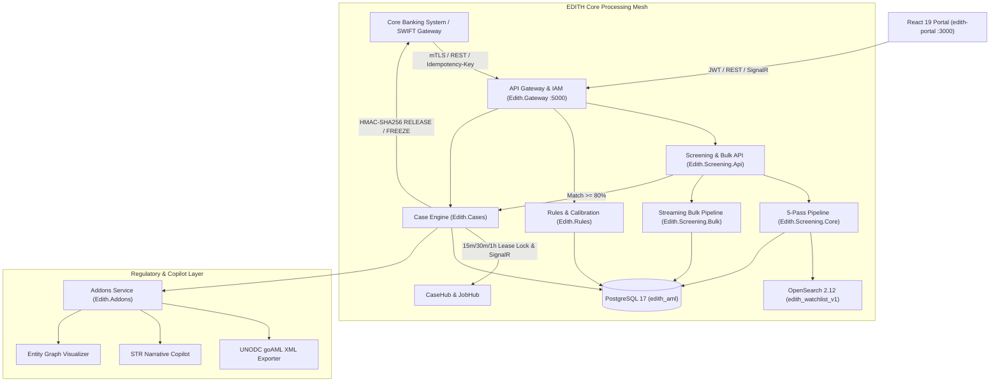

# EDITH — Enterprise Anti-Money Laundering & Sanctions Screening Platform

[](tests/)
[](Edith.slnx)
[](src/Database/Edith.Database.Migrator/)
[](src/Screening/Edith.Screening.Core/)
[](src/Web/edith-portal/)
[](MD_DOC/EDITH_Documentation_v10.1/)
[](MD_DOC/EDITH_Documentation_v10.1/03_Technical_Architecture_and_Database/EDITH_Master_Specification_v10.1.md)
[](tests/Edith.Performance.Benchmark/)

EDITH is a high-velocity, cloud-native Anti-Money Laundering (AML) and Counter-Terrorist Financing (CTF) intelligence platform engineered for Tier-1 financial institutions, digital banks, exchange houses, and international payment networks.

Designed to eliminate false positives while guaranteeing statutory freeze compliance, EDITH screens high-volume cross-border wires (SWIFT MT103, ISO 20022 camt/pacs) in **under 10 milliseconds** using a deterministic 5-pass phonetic pipeline.

---


> 📹 **Watch Launch Video:** [brag-output/brag.mp4](brag-output/brag.mp4) (20s cinematic product walkthrough).

---

## Key Capabilities

- **Universal Single Entity & Sanctions Search (`NameSearchView.tsx` & `ScreeningConsole.tsx`):**
  - High-velocity deterministic search across 47,600+ records in PostgreSQL 17 (`screening.watchlist_entities`) and OpenSearch 2.12 (`edith_watchlist_v1`).
  - Covers all 6 single entity screening possibilities:
    1. *Exact Name Search (100%):* Normalized alias & full-name equality with zero false positive tolerance.
    2. *Fuzzy & Phonetic Search:* Jaro-Winkler + Damerau-Levenshtein + Double Metaphone with interactive sensitivity threshold slider (50%–95%).
    3. *Dual-Factor Exact Name & ID Search:* Dual-attribute verification matching entity name AND official identifier (OFAC UID, Passport, National ID, Trade License).
    4. *Clean Entity Compliance Certificate:* Zero-match formal audit clearance receipt with SHA-256 fingerprint, timestamp, and 1-click clipboard compliance copy.
    5. *Politically Exposed Person (PEP) Registry:* Distinct EDD triage indicator with Source of Wealth verification guidance.
    6. *Corporate Entity & Trade License:* Organization and corporate alias resolution (e.g. UAE Trade License `TL-DXB-889120`).
  - Frictionless search reset lifecycle: Dedicated `Clear Search` action, `Esc` keyboard shortcut, and inline input `(X)` clears.
  - Interactive on-click diagrams: Search engine overview architecture diagram and per-match 4-step decision pipeline flowcharts with similarity distribution bars.
- **Real-Time Transaction Interceptor:** Ingests SWIFT MT103 and ISO 20022 messages via high-throughput REST endpoints (`POST /api/v1/screen/transaction`) with `Idempotency-Key` replay protection, executing pre-clearance statutory freezes and auto-provisioning investigation cases.
- **Deterministic 5-Pass Screening Engine (`Edith.Screening.Core`):**
  1. *Pass 1 — Unicode & Corporate Normalization:* Diacritic stripping, ligature decomposition, corporate noise suffix removal, and ASCII folding.
  2. *Pass 2 — Candidate Retrieval:* OpenSearch 2.12 DisMax n-gram + phonetic token search with transparent in-memory fallback.
  3. *Pass 3 — Phonetic Alignment:* Multi-variant Double Metaphone comparison eliminating Cyrillic/Arabic transliteration variance.
  4. *Pass 4 — Multi-Attribute Composite Scoring:* Weighted Damerau-Levenshtein and Jaro-Winkler token scoring combined with DOB, ID, and Nationality weights.
  5. *Pass 5 — Thresholding & Whitelist Suppression:* Real-time evaluation against OFAC SDN, UN Consolidated, EU Financial Sanctions, PEP lists, and tenant-scoped whitelists.
- **High-Throughput Streaming Bulk Ingestion (`Edith.Screening.Bulk`):**
  - Asynchronous `IAsyncEnumerable` streaming parser supporting **CSV**, **XML**, and **JSON** mapped to 9 standardized AML fields (`AML_TYPE`, `AML_FULLNAME`, `AML_IDDETAILS`, `AML_CATEGORY`, `AML_DATEOFBIRTH`, `AML_REMARKS`, `AML_NATIONALITY`, `AML_PROGRAM`, `AML_ALIASNAME`).
  - Automatic duplicate entity detection (skipping records already in PostgreSQL/OpenSearch) with optional retention (`keepSkipped=true`) and on-demand export of skipped records in **CSV**, **JSON**, or **XML** (`GET /api/v1/bulk/jobs/{id}/skipped?format=csv|json|xml`).
- **Case Workspace & Investigation Console (`CaseWorkspace.tsx`):**
  - *Vertical Queue & Multi-Lease Locking:* Real-time triage queue with atomic pessimistic lease locks (15m, 30m, 1h options) and live countdown timer, preventing analyst collisions (`409 Conflict`).
  - *4-Tab Investigation Console:* Case Details, Watchlist Hit Diff with token highlights, GenAI Narrative Copilot, and Chronological Audit Ledger & Notes.
  - *4-Eyes Maker-Checker Governance:* Analysts triage and escalate cases to `PendingApproval`; only MLRO / Compliance Officers can execute final resolution (`ClearedFalsePositive` or `ReportedStrFreeze`).
  - *Whitelist on Dismissal:* 1-click false-positive suppression directly within case closure workflow.
  - *HMAC-SHA256 Signed CBS Webhooks:* Automatically dispatches signed `RELEASE` or `FREEZE` decisions (`X-Edith-Signature`) back to the Core Banking System via Polly exponential retries.
- **Customer KYC 360 & UBO Cascade Hub (`CustomerKyc360View.tsx`):**
  - *Deep-Linked Dossiers:* Direct navigation via `/kyc360?customer=<id>` loading complete customer profiles from PostgreSQL 17.
  - *Interactive UBO Ownership Tree:* Corporate hierarchy visualizer down to natural-person beneficial owners with 1-click **Cascade Screening** across all child entities.
  - *OCR Document Inspector:* Visual credential inspection with bounding boxes, Source of Wealth (SoW) / Source of Funds (SoF) checklists, and signed WORM dossier export.
- **AML Rule Builder & Category Studio (`RuleBuilderView.tsx`):**
  - *Crime Typologies:* Dynamic parameter authoring across `HIGH_RISK_CORRIDOR`, `STRUCTURING_SMURFING`, and `VELOCITY_ANOMALY`.
  - *Execution Modes:* Instant switching between `REALTIME`, `SHADOW` (silent evaluation), and `PENDING_APPROVAL`.
  - *Draft Backtesting:* Pre-save simulation against transaction records before promotion to production.
- **Portfolio Calibration & Sensitivity Sandbox (`RuleSandboxView.tsx`):**
  - *50,000-Transaction Replay:* Full historical transaction replay engine calculating Baseline vs Candidate delta metrics.
  - *Sensitivity Elbow Curve:* 5-point visualization isolating optimal false-positive reduction sweet spots.
  - *Recall Preservation:* Verifies 100% ground-truth STR recall preservation with auto-balancing, pin-locked sliders.
- **Regulatory Reports Hub & goAML v5.0 Filing (`ReportsAuditView.tsx` & `GoAmlReportingView.tsx`):**
  - *All 14 Statutory Reports:* Automated generation and export of 6 Section 4e Reports, 5 Section 4f Log Reports, and 3 Cross-Module Analytics.
  - *16-Field Filter & SLA Watchdog:* Multi-criteria transaction filter bar with 3d/7d case SLA alert monitoring.
  - *UNODC goAML v5.0 XML Exporter:* Direct mapping and schema-compliant generation of national FIU filing packages.
  - *Verify WORM Cryptographic Chain:* Interactive on-screen verification tool confirming tamper-free SHA-256 block-chaining.
- **Brand Identity & IAM Security:**
  - *Heraldic Identity:* Bespoke EDITH Eagle vector SVG emblem (`EdithLogo.tsx`) and animated SVG radar loader (`EdithLoader`).
  - *Zero-Trust RBAC:* Granular role-gating across 6 personas (Analyst, Senior Investigator, MLRO, Compliance Admin, Auditor, System Admin) with PBKDF2 hashing (100,000 iterations) and TOTP MFA.

---

## High-Level Architecture



---

## Repository Structure

```text
EDITH/
├── deploy/                           # Cloud & OpenSearch deployment blueprints
│   ├── k8s/                         # Helm charts & Istio mTLS policies
│   ├── local/                       # Full stack Docker Compose blueprints
│   ├── monitoring/                  # Prometheus alert rules & OTel collector configs
│   ├── opensearch/                  # OpenSearch 2.12 phonetic & n-gram index mappings
│   └── vault/                       # HashiCorp Vault agent configuration
├── docker/                           # Local Dual-DB Docker Compose (PostgreSQL 17 + OpenSearch 2.12)
├── MD_DOC/                           # Unified v10.0 Architecture, PRD, Database, Pitch & Operations Documentation
│   ├── README.md                    # Master Documentation Catalog, Category Index & Sync Guide (v10.0)
│   ├── EDITH_Documentation_Library_v10.0.zip # Pre-packaged archive ready for 1-click Google Drive sync
│   ├── sync_to_gdrive.ps1           # PowerShell automation script for Google Drive sync
│   ├── 01_Executive_and_Pitch/      # Client Pitches, Executive Architecture Deck & Presentation Assets
│   │   ├── EDITH_Client_Architecture_Pitch_v10.0.pdf # Executive-Ready Client Pitch Deck (PDF, Publication Grade)
│   │   ├── EDITH_Client_Architecture_Pitch_v10.0.md  # Client Pitch & Architecture Master (Markdown + Mermaid, v10.0)
│   │   └── EDITH_Client_Architecture_Pitch_v10.0.html # Print-Ready Styled HTML Master Template (v10.0)
│   ├── 02_Product_and_Requirements/ # Functional PRDs, Modules/Pages Catalog & Executive Workplans
│   │   ├── EDITH_Master_PRD_v10.0.md           # Master PRD (v10.0)
│   │   ├── EDITH_Modules_Workflows_and_Pages_v10.0.md # Master Catalog of 10 Modules, 17 Pages & 18 Workflows (v10.0)
│   │   └── EDITH_END_TO_END_WORKPLAN_v10.0.md  # Workplan Execution Ledger (v10.0, Phases 1–17 Complete)
│   ├── 03_Technical_Architecture_and_Database/ # Technical Specifications & Database DDL
│   │   ├── EDITH_Master_Specification_v10.0.md # Master Technical Architecture Spec (v10.0)
│   │   └── database_v10.0.md                   # Database Architecture & PostgreSQL 17 DDL (v10.0)
│   └── 04_Operations_and_Deployment/ # Operational Runbooks, Credentials & Task Ledgers
│       ├── HOW_TO_RUN_v10.0.md                 # Visual Studio & Web Portal Run Guide (v10.0)
│       ├── CREDENTIALS_v10.0.md                # Infrastructure & Service Credentials (v10.0)
│       └── TODO_v10.0.md                       # Live Engineering Roadmap (v10.0: Phases 1–17 Complete)
├── src/
│   ├── Addons/                      # goAML XML exporter, AI STR copilot, graph visualizer
│   ├── Cases/                       # Case state machine, lease locking, SignalR hub
│   ├── Database/                    # Multi-schema SQL migrations & seed data (PostgreSQL 17)
│   ├── Events/                      # Kafka event contracts, Outbox processor, CBS HMAC webhooks
│   ├── Gateway/                     # Multi-tenant resolution, IAM JWT, unified API & SignalR host
│   ├── Rules/                       # AML rule engine, DSL evaluator, backtesting & calibration sandbox
│   ├── Screening/                   # 5-pass OpenSearch engine, streaming CSV/XML/JSON bulk pipeline
│   └── Web/edith-portal/            # React 19 compliance operator workstation (17 views)
├── tests/                            # Automated test suite (100 passing tests across 10 projects)
│   ├── Edith.Addons.Tests/          # goAML XML schema, copilot & graph tests (6)
│   ├── Edith.Cases.Tests/           # State machine, 4-Eyes RBAC & locking tests (10)
│   ├── Edith.Database.Migrator.Tests/# Multi-schema DDL migration & seed tests (6)
│   ├── Edith.Events.Tests/          # Outbox processor & HMAC-SHA256 webhook tests (8)
│   ├── Edith.Gateway.Tests/         # JWT IAM, tenant isolation & E2E workflow tests (11)
│   ├── Edith.Performance.Benchmark/ # High-load 5-pass screening latency benchmark (1)
│   ├── Edith.Rules.Tests/           # Rule evaluator & sandbox backtester tests (7)
│   ├── Edith.Screening.Api.Tests/   # Screening API, idempotency & bulk upload endpoint tests (13)
│   ├── Edith.Screening.Bulk.Tests/  # Streaming CSV/XML/JSON parser & skipped export tests (10)
│   └── Edith.Screening.Tests/       # 5-pass engine, OpenSearch & phonetic algorithm tests (26)
├── upload_doc/                       # Sample CSV & JSON bulk ingestion datasets
└── brag-output/                      # Launch video (brag.mp4), poster frame, composition
```

---

## Getting Started

### Prerequisites

- [.NET 10.0 SDK](https://dotnet.microsoft.com/download)
- [Node.js 22+ & npm](https://nodejs.org/)
- [Docker & Docker Compose](https://www.docker.com/) (optional for local PostgreSQL 17 + OpenSearch 2.12; automatic in-memory fallback is built in)

### 1. Start Local Dual-Database Infrastructure (Optional)

```bash
docker compose -f docker/docker-compose.yml up -d
dotnet run --project src/Database/Edith.Database.Migrator
```

### 2. Run the Full Test Suite (100 Tests)

```bash
dotnet test Edith.slnx
```

Output:
```text
Passed! - Failed: 0, Passed: 100, Skipped: 0, Total: 100 (10 test projects)
```

### 3. Start the API Gateway & React 19 Portal

Start the unified API Gateway on `http://localhost:5000`:

```bash
dotnet run --project src/Gateway/Edith.Gateway --urls http://localhost:5000
```

In a second terminal, launch the React 19 compliance workstation on `http://localhost:3000`:

```bash
cd src/Web/edith-portal
npm install
npm run dev -- --port 3000
```

Open `http://localhost:3000` to access the live 17-view compliance portal, switch personas (`ANALYST`, `MLRO`, `SUPER_ADMIN`, `AUDITOR`), upload bulk CSV/JSON/XML batches, calibrate rules against 50k transactions, and adjudicate cases.

---

## License

Proprietary enterprise banking software. All rights reserved.
