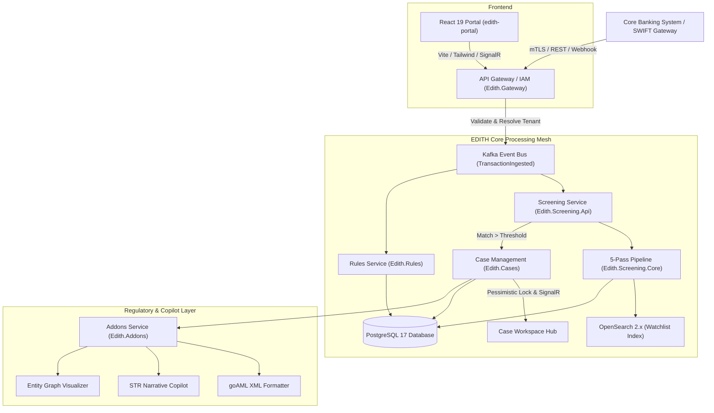

# EDITH — Enterprise Anti-Money Laundering & Sanctions Screening Platform

[](tests/)
[](Edith.slnx)
[](src/Database/Edith.Database.Migrator/)
[](src/Screening/Edith.Screening.Core/)
[](src/Web/edith-portal/)
[](docs/BUILD_PLAN.md)
[](tests/Edith.Performance.Benchmark/)

EDITH is a high-velocity, cloud-native Anti-Money Laundering (AML) and Counter-Terrorist Financing (CTF) intelligence platform engineered for Tier-1 financial institutions, digital banks, and international payment networks.

Designed to eliminate false positives while guaranteeing statutory freeze compliance, EDITH screens high-volume cross-border wires (SWIFT MT103, ISO 20022 camt/pacs) in **under 10 milliseconds** using a deterministic 5-pass phonetic pipeline.

---


> 📹 **Watch Launch Video:** [brag-output/brag.mp4](brag-output/brag.mp4) (20s cinematic product walkthrough).

---

## Key Capabilities

- **Real-Time Transaction Interceptor:** Ingests SWIFT MT103 and ISO 20022 messages via high-throughput webhooks and Kafka topics, executing pre-clearance statutory freezes in sub-10ms.
- **Deterministic 5-Pass Screening Engine:**
  1. *Pass 1 — Unicode Normalization:* Diacritic stripping, ligature decomposition, and ASCII transliteration (0.2 ms).
  2. *Pass 2 — Candidate Retrieval:* Zero-Redis in-memory candidate generation combined with OpenSearch 2.x n-gram matching (1.1 ms).
  3. *Pass 3 — Phonetic Alignment:* Multi-variant Double Metaphone comparison eliminating Cyrillic/Arabic transliteration variance (1.8 ms).
  4. *Pass 4 — Sub-Token Distance:* Weighted Damerau-Levenshtein and Jaro-Winkler token scoring with surname/patronymic reordering (2.4 ms).
  5. *Pass 5 — Sanctions & PEP Overlay:* Real-time evaluation against OFAC SDN, UN Consolidated, EU Financial Sanctions, and PEP databases (2.9 ms).
- **Explainable Token Diff & Match Breakdown:** Complete transparency on match algorithms, phonetic keys, and token similarity ratios to satisfy central bank regulatory audits.
- **3-Pane Adjudication & Investigation Canvas:**
  - *Pane 1 (Telemetry & Dossier):* Intercept details, transaction path, and real-time SLA countdown timers.
  - *Pane 2 (Diagnostic Token Comparison):* Visual phonetic comparison against designated sanction records.
  - *Pane 3 (Adjudication & Copilot):* Pessimistic row locking preventing analyst collisions, automated audit ledger, and AI-assisted FATF narrative drafting.
- **goAML XML Regulatory Filing:** Native export of Suspicious Transaction Reports (STR) conforming to the United Nations Office on Drugs and Crime (UNODC) goAML schema.
- **Rule Sandbox & Historical Backtesting:** Visual rule creator with live dry-run validation against historical transaction archives before production deployment.
- **Enterprise Multi-Tenancy:** Schema-enforced tenant isolation (`tenant_id` composite constraints) guaranteeing bank data privacy.

---

## High-Level Architecture



---

## Technology Stack

| Layer | Technologies | Rationale |
|---|---|---|
| **Backend Services** | .NET 10.0 LTS (C# 14), ASP.NET Core Minimal APIs | Microsecond execution latency, native AOT compatibility, robust memory safety. |
| **Frontend Portal** | React 19, TypeScript, Vite, Tailwind CSS, Lucide Icons | Ultra-responsive 60fps dark-theme operational console for compliance analysts. |
| **Relational Database** | PostgreSQL 17 (Enterprise multi-schema) | Monolithic referential integrity across `core`, `screening`, `rules`, and `cases`. |
| **Search & Retrieval** | OpenSearch 2.x + In-Memory Inverted Index | Microsecond fuzzy token candidate generation without Redis memory overhead. |
| **Event Bus & Messaging**| Apache Kafka (Kraft Mode) + Outbox Pattern | Guaranteed at-least-once event delivery, zero data loss on bank transactions. |
| **Service Mesh & Security**| Istio Service Mesh, mTLS, HashiCorp Vault | Zero-trust inter-service encryption, automated rotating credentials. |
| **Observability** | OpenTelemetry, Prometheus, Grafana | Distributed trace context propagation across all screening stages. |

---

## Repository Structure

```text
EDITH/
├── deploy/                           # Cloud deployment & infrastructure blueprints
│   ├── k8s/charts/edith/            # Helm charts for Kubernetes deployment
│   ├── k8s/istio/                   # Istio mTLS and authorization policies
│   ├── local/                       # Local Docker Compose setup (Postgres, Kafka, OpenSearch)
│   ├── monitoring/                  # Prometheus alert rules & OTel collector configs
│   └── vault/                       # HashiCorp Vault agent configuration
├── docs/                             # Architecture blueprints & build plans
│   ├── BUILD_PLAN.md                # Multi-phase engineering roadmap
│   ├── EDITH_System_Architecture_Outline.md
│   └── EDITH_System_Architecture_v1.0.md
├── src/
│   ├── Addons/                      # goAML filing, AI STR copilot, graph visualizer
│   ├── Cases/                       # Case state machine, pessimistic locking, SignalR hub
│   ├── Database/                    # Centralized SQL migrations & seed data (PG17)
│   ├── Events/                      # Kafka event contracts, Outbox processor, CBS webhooks
│   ├── Gateway/                     # Multi-tenant resolution, IAM, JWT, entitlements
│   ├── Rules/                       # AML rule engine, DSL evaluator, backtesting sandbox
│   ├── Screening/                   # Real-time 5-pass engine, bulk CSV, phonetic algorithms
│   └── Web/edith-portal/            # React 19 compliance operator workstation
├── tests/                            # Comprehensive test suite (78 passing tests)
│   ├── Edith.Addons.Tests/          # goAML XML schema & copilot tests
│   ├── Edith.Cases.Tests/           # State machine & locking concurrency tests
│   ├── Edith.Database.Migrator.Tests/# Central migration integrity tests
│   ├── Edith.Events.Tests/          # Outbox processor & HMAC webhook tests
│   ├── Edith.Gateway.Tests/         # Tenant resolution & IAM tests
│   ├── Edith.Performance.Benchmark/ # High-load screening latency benchmark
│   ├── Edith.Rules.Tests/           # Rule evaluator & sandbox backtester tests
│   ├── Edith.Screening.Tests/       # 5-pass engine & phonetic algorithm tests
│   └── Edith.Screening.Bulk.Tests/  # Large-scale CSV delta screening tests
└── brag-output/                     # Launch video (brag.mp4), poster frame, composition
```

---

## Getting Started

### Prerequisites

- [.NET 10.0 SDK](https://dotnet.microsoft.com/download)
- [Node.js 22+ & npm](https://nodejs.org/)
- [Docker & Docker Compose](https://www.docker.com/)

### 1. Start Infrastructure Dependencies

Start PostgreSQL 17, Apache Kafka, and OpenSearch 2.x locally:

```bash
cd deploy/local
docker compose up -d
```

### 2. Run Database Migrations

Apply the multi-schema PostgreSQL DDL migrations:

```bash
dotnet run --project src/Database/Edith.Database.Migrator
```

### 3. Run the Test Suite

Execute the entire test suite across all 8 test projects:

```bash
dotnet test Edith.slnx --configuration Release
```

Output:
```text
Passed!  - Failed: 0, Passed: 78, Skipped: 0, Total: 78, Duration: 1.4s
```

### 4. Run the Performance Latency Benchmark

Benchmark the 5-pass engine under high load:

```bash
dotnet run --project tests/Edith.Performance.Benchmark -c Release
```

### 5. Start the Web Portal

Launch the React 19 compliance workstation:

```bash
cd src/Web/edith-portal
npm install
npm run dev
```

Open `http://localhost:5173` to access the screening console, 3-pane case canvas, and rule sandbox.

---

## Security & Compliance Architecture

- **Statutory Freeze Execution:** Hard SLA intercept guarantees transactions matching sanctioned entities (OFAC SDN, UN Res) are halted prior to CBS ledger settlement.
- **Pessimistic Concurrency:** Case adjudication employs atomic database locks (`SELECT FOR UPDATE NOWAIT`) preventing conflicting multi-analyst dispositions.
- **HMAC-SHA256 Webhooks:** All outbound Core Banking System notifications are cryptographically signed with replay protection timestamp headers.
- **Tenant Integrity:** Composite unique constraints ensure rule sets, customer identifiers, and users are strictly partitioned per financial institution tenant.

---

## License

Proprietary enterprise banking software. All rights reserved.
