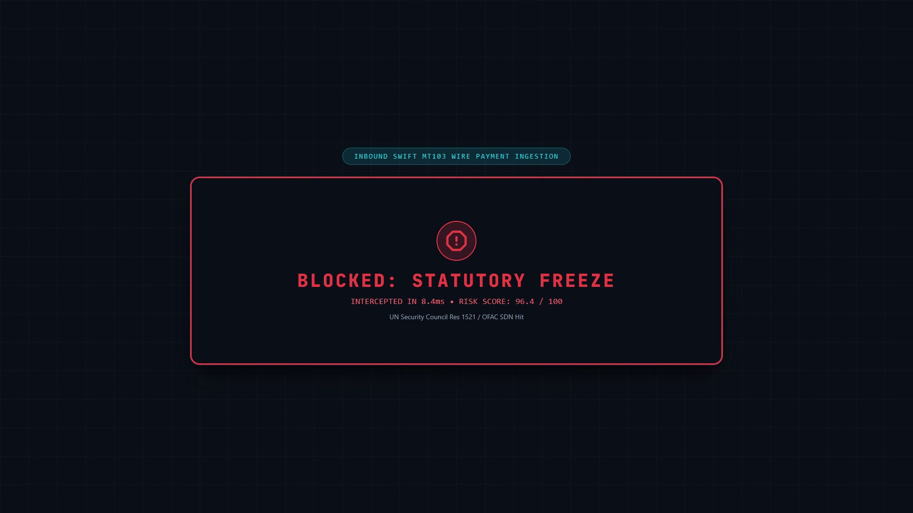
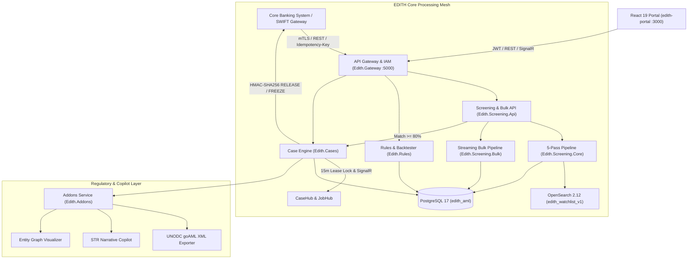

# EDITH — Enterprise Anti-Money Laundering & Sanctions Screening Platform

[](tests/)
[](Edith.slnx)
[](src/Database/Edith.Database.Migrator/)
[](src/Screening/Edith.Screening.Core/)
[](src/Web/edith-portal/)
[](MD_DOC/EDITH_Master_Specification_v5.0.md)
[](tests/Edith.Performance.Benchmark/)

EDITH is a high-velocity, cloud-native Anti-Money Laundering (AML) and Counter-Terrorist Financing (CTF) intelligence platform engineered for Tier-1 financial institutions, digital banks, exchange houses, and international payment networks.

Designed to eliminate false positives while guaranteeing statutory freeze compliance, EDITH screens high-volume cross-border wires (SWIFT MT103, ISO 20022 camt/pacs) in **under 10 milliseconds** using a deterministic 5-pass phonetic pipeline.

---



> 📹 **Watch Launch Video:** [brag-output/brag.mp4](brag-output/brag.mp4) (20s cinematic product walkthrough).

---

## Key Capabilities

- **Real-Time Transaction Interceptor:** Ingests SWIFT MT103 and ISO 20022 messages via high-throughput REST endpoints (`POST /api/v1/screen/transaction`) with `Idempotency-Key` replay protection, executing pre-clearance statutory freezes and auto-provisioning investigation cases.
- **Deterministic 5-Pass Screening Engine (`Edith.Screening.Core`):**
  1. *Pass 1 — Unicode & Corporate Normalization:* Diacritic stripping, ligature decomposition, corporate noise suffix removal, and ASCII folding.
  2. *Pass 2 — Candidate Retrieval:* OpenSearch 2.12 DisMax n-gram + phonetic token search with transparent in-memory fallback.
  3. *Pass 3 — Phonetic Alignment:* Multi-variant Double Metaphone comparison eliminating Cyrillic/Arabic transliteration variance.
  4. *Pass 4 — Multi-Attribute Composite Scoring:* Weighted Damerau-Levenshtein and Jaro-Winkler token scoring combined with DOB, ID, and Nationality weights.
  5. *Pass 5 — Thresholding & Whitelist Suppression:* Real-time evaluation against OFAC SDN, UN Consolidated, EU Financial Sanctions, PEP lists, and tenant-scoped whitelists.
- **High-Throughput Streaming Bulk Ingestion (`Edith.Screening.Bulk`):**
  - Asynchronous `IAsyncEnumerable` streaming parser supporting **CSV**, **XML**, and **JSON** mapped to 9 standardized AML fields (`AML_TYPE`, `AML_FULLNAME`, `AML_IDDETAILS`, `AML_CATEGORY`, `AML_DATEOFBIRTH`, `AML_REMARKS`, `AML_NATIONALITY`, `AML_PROGRAM`, `AML_ALIASNAME`).
  - Automatic duplicate entity detection (skipping records already in PostgreSQL/OpenSearch) with optional retention (`keepSkipped=true`) and on-demand export of skipped records in **CSV**, **JSON**, or **XML** (`GET /api/v1/bulk/jobs/{id}/skipped?format=csv|json|xml`).
- **3-Pane Case Investigation & 4-Eyes Adjudication (`Edith.Cases`):**
  - *Pessimistic 15-Minute Lease Locking:* Prevents dual-analyst collisions (`409 Conflict`) with real-time SignalR `CaseHub` broadcasts.
  - *Multi-Type Investigation Notes:* Chronological `INVESTIGATION`, `SUPERVISOR`, and `RATIONALE` commentary.
  - *4-Eyes Maker-Checker Governance:* Analysts triage and escalate cases to `PendingApproval`; only MLRO / Compliance Officers can execute final resolution (`ClearedFalsePositive` or `ReportedStrFreeze`).
  - *HMAC-SHA256 Signed CBS Webhooks:* Automatically dispatches signed `RELEASE` or `FREEZE` decisions (`X-Edith-Signature`) back to the Core Banking System.
- **Regulatory Filing & AI Copilot (`Edith.Addons`):** Native UNODC `goAML` v5.0 XML export, 5-section AI STR narrative copilot, and multi-hop entity relationship graph visualizer.
- **Rule Sandbox & Historical Backtesting (`Edith.Rules`):** Visual rule creator with live dry-run validation against historical transaction archives.

---

## High-Level Architecture



---

## Repository Structure

```text
EDITH/
├── deploy/                           # Cloud & OpenSearch deployment blueprints
│   ├── k8s/                         # Helm charts & Istio mTLS policies
│   ├── local/                       # Full stack Docker Compose blueprints
│   ├── monitoring/                  # Prometheus alert rules & OTel collector configs
│   ├── opensearch/                  # OpenSearch 2.12 phonetic & n-gram index mappings
│   └── vault/                       # HashiCorp Vault agent configuration
├── docker/                           # Local Dual-DB Docker Compose (PostgreSQL 17 + OpenSearch 2.12)
├── docs/                             # Engineering build plan (BUILD_PLAN.md)
├── MD_DOC/                           # Versioned Architecture, PRD, Database & Workplan PDFs/MDs
│   ├── EDITH_Master_Specification_v5.0.md / .pdf
│   ├── EDITH_Master_PRD_v4.0.md / .pdf
│   ├── database_v2.0.md / .pdf
│   └── EDITH_END_TO_END_WORKPLAN_v2.0.md / .pdf
├── src/
│   ├── Addons/                      # goAML XML exporter, AI STR copilot, graph visualizer
│   ├── Cases/                       # Case state machine, 15m pessimistic locking, SignalR hub
│   ├── Database/                    # Multi-schema SQL migrations & seed data (PostgreSQL 17)
│   ├── Events/                      # Kafka event contracts, Outbox processor, CBS HMAC webhooks
│   ├── Gateway/                     # Multi-tenant resolution, IAM JWT, unified API & SignalR host
│   ├── Rules/                       # AML rule engine, DSL evaluator, backtesting sandbox
│   ├── Screening/                   # 5-pass OpenSearch engine, streaming CSV/XML/JSON bulk pipeline
│   └── Web/edith-portal/            # React 19 compliance operator workstation (14 views)
├── tests/                            # Automated test suite (93 passing tests across 10 projects)
│   ├── Edith.Addons.Tests/          # goAML XML schema, copilot & graph tests (6)
│   ├── Edith.Cases.Tests/           # State machine, 4-Eyes RBAC & locking tests (10)
│   ├── Edith.Database.Migrator.Tests/# Multi-schema DDL migration & seed tests (6)
│   ├── Edith.Events.Tests/          # Outbox processor & HMAC-SHA256 webhook tests (8)
│   ├── Edith.Gateway.Tests/         # JWT IAM, tenant isolation & E2E workflow tests (8)
│   ├── Edith.Performance.Benchmark/ # High-load 5-pass screening latency benchmark (1)
│   ├── Edith.Rules.Tests/           # Rule evaluator & sandbox backtester tests (5)
│   ├── Edith.Screening.Api.Tests/   # Screening API, idempotency & bulk upload endpoint tests (13)
│   ├── Edith.Screening.Bulk.Tests/  # Streaming CSV/XML/JSON parser & skipped export tests (10)
│   └── Edith.Screening.Tests/       # 5-pass engine, OpenSearch & phonetic algorithm tests (26)
├── upload_doc/                       # Sample CSV & JSON bulk ingestion datasets
└── brag-output/                      # Launch video (brag.mp4), poster frame, composition
```

---

## Getting Started

### Prerequisites

- [.NET 10.0 SDK](https://dotnet.microsoft.com/download)
- [Node.js 22+ & npm](https://nodejs.org/)
- [Docker & Docker Compose](https://www.docker.com/) (optional for local PostgreSQL 17 + OpenSearch 2.12; automatic in-memory fallback is built in)

### 1. Start Local Dual-Database Infrastructure (Optional)

```bash
docker compose -f docker/docker-compose.yml up -d
dotnet run --project src/Database/Edith.Database.Migrator
```

### 2. Run the Full Test Suite (93 Tests)

```bash
dotnet test Edith.slnx
```

Output:
```text
Passed! - Failed: 0, Passed: 93, Skipped: 0, Total: 93 (10 test projects)
```

### 3. Start the API Gateway & React 19 Portal

Start the unified API Gateway on `http://localhost:5000`:

```bash
dotnet run --project src/Gateway/Edith.Gateway --urls http://localhost:5000
```

In a second terminal, launch the React 19 compliance workstation on `http://localhost:3000`:

```bash
cd src/Web/edith-portal
npm install
npm run dev -- --port 3000
```

Open `http://localhost:3000` to access the live 14-view compliance portal, switch personas (`ANALYST`, `MLRO`, `SUPER_ADMIN`, `AUDITOR`), upload bulk CSV/JSON/XML batches, and adjudicate cases.

---

## License

Proprietary enterprise banking software. All rights reserved.
